# 과제 정의: 실제 데이터 예시 전부

학습·평가에 쓴 **모든 과제**를 실제 데이터 한 건씩으로 보여 줍니다. 질문 전문, 정답 전문, 채점 정보, 나눠 보기 정보, 학습 레코드를 줄이지 않고 그대로 실었습니다. 이 문서만 보고 같은 형식의 문제를 다시 만들 수 있게 하는 것이 목적입니다.

- 이 문서는 `bash guide/examples/make_examples.sh <작업 폴더> --docs` 로 자동 생성합니다(예시 데이터 생성부터 이 문서·발표 부록까지, 명령과 바꾼 설정값이 스크립트 안에 그대로 있음). 직접 고치지 말고 다시 생성하세요.
- 이미지는 문서 크기 때문에 긴 변 1000px 로 줄인 사본입니다(`guide/examples/img/`). 모델이 보는 크기는 학습 설정(긴 변 2300·짧은 변 1600, 문항당 이미지 합 12,000토큰)을 따릅니다.

**목차**
- [OCR 과제](#ocr-과제) — 입력 데이터, 문항 필드, 과제 8종, SFT 행
- [서류 한 건 과제](#서류-한-건-과제) — 세트 구조, 필드 사전, 과제 11종
- [3부. 비슷한 문제를 새로 정의하려면](#3부-비슷한-문제를-새로-정의하려면)

## OCR 과제

실제 학습은 내부망 서류 이미지를 사내 OCR에 돌린 결과로 했습니다. 이 문서의 예시는 실제 이미지를 문서에 넣을 수 없어서, 합성 서류 이미지에 **사내 OCR과 같은 형식의 결과 JSON**을 붙이고 **실제 학습 코드(`docgen.bench.ocr_data.scan` → `docgen.bench.ocr_prepare`)로 만든** 것입니다. 파일 구조·필드·질문·정답 형식은 실제 학습 데이터와 같습니다. 예시용 OCR 결과는 생성기 정답(값 칸·항목명 위치)에서 만들어서 단어가 아니라 줄 단위입니다.

### 1-0. 입력 데이터

**① 페이지 이미지** (원본, 1장)

<p><a href="../examples/img/loan_application_000000_p1_b632a7d4.jpg">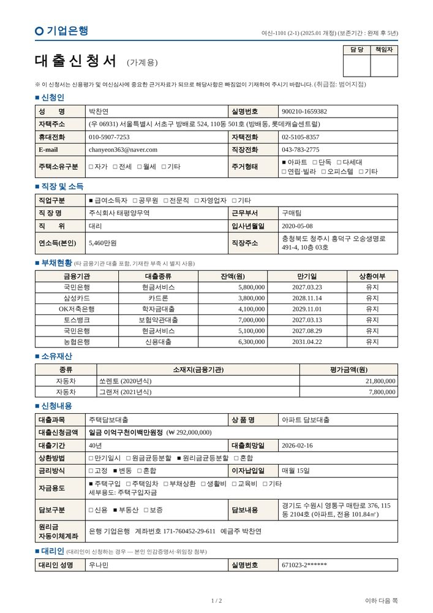</a></p>

**② 사내 OCR 결과 JSON** (`loan_application_000000_p1.json`, 이 페이지 전체. 실제 사내 OCR 응답과 같은 키)

<details><summary>펼치기</summary>

```json
{
 "filename": "loan_application_000000_p1.png",
 "success": "Y",
 "data": {
  "basicData": [
   [
    {"text": "기업은행", "confidence": 0.99, "bounding": {"shape": "rectangle", "vertices": [{"x": 172, "y": 88}, {"x": 327, "y": 88}, {"x": 327, "y": 138}, {"x": 172, "y": 138}]}, "line_num": 0},
    {"text": "범어지점", "confidence": 0.99, "bounding": {"shape": "rectangle", "vertices": [{"x": 1242, "y": 297}, {"x": 1335, "y": 297}, {"x": 1335, "y": 323}, {"x": 1242, "y": 323}]}, "line_num": 0},
    {"text": "박찬연", "confidence": 0.9999, "bounding": {"shape": "rectangle", "vertices": [{"x": 326, "y": 394}, {"x": 399, "y": 394}, {"x": 399, "y": 422}, {"x": 326, "y": 422}]}, "line_num": 0},
    {"text": "성명", "confidence": 0.995, "bounding": {"shape": "rectangle", "vertices": [{"x": 129, "y": 385}, {"x": 313, "y": 385}, {"x": 313, "y": 432}, {"x": 129, "y": 432}]}, "line_num": 0},
    {"text": "900210-1659382", "confidence": 0.97, "bounding": {"shape": "rectangle", "vertices": [{"x": 1034, "y": 394}, {"x": 1199, "y": 394}, {"x": 1199, "y": 422}, {"x": 1034, "y": 422}]}, "line_num": 0},
    {"text": "실명번호", "confidence": 0.99, "bounding": {"shape": "rectangle", "vertices": [{"x": 837, "y": 385}, {"x": 1021, "y": 385}, {"x": 1021, "y": 432}, {"x": 837, "y": 432}]}, "line_num": 0},
    {"text": "06931", "confidence": 0.99, "bounding": {"shape": "rectangle", "vertices": [{"x": 364, "y": 441}, {"x": 425, "y": 441}, {"x": 425, "y": 469}, {"x": 364, "y": 469}]}, "line_num": 0},
    {"text": "우편번호", "confidence": 0.995, "bounding": {"shape": "rectangle", "vertices": [{"x": 129, "y": 432}, {"x": 313, "y": 432}, {"x": 313, "y": 478}, {"x": 129, "y": 478}]}, "line_num": 0},
    {
     "text": "서울특별시 서초구 방배로 524, 110동 501호 (방배동, 롯데캐슬센트럴)",
     "confidence": 0.99,
     "bounding": {"shape": "rectangle", "vertices": [{"x": 439, "y": 441}, {"x": 1174, "y": 441}, {"x": 1174, "y": 469}, {"x": 439, "y": 469}]},
     "line_num": 0
    },
    {"text": "자택주소", "confidence": 0.995, "bounding": {"shape": "rectangle", "vertices": [{"x": 129, "y": 432}, {"x": 313, "y": 432}, {"x": 313, "y": 478}, {"x": 129, "y": 478}]}, "line_num": 0},
    {"text": "010-5907-7253", "confidence": 0.97, "bounding": {"shape": "rectangle", "vertices": [{"x": 326, "y": 487}, {"x": 475, "y": 487}, {"x": 475, "y": 515}, {"x": 326, "y": 515}]}, "line_num": 0},
    {"text": "휴대전화", "confidence": 0.998, "bounding": {"shape": "rectangle", "vertices": [{"x": 129, "y": 478}, {"x": 313, "y": 478}, {"x": 313, "y": 525}, {"x": 129, "y": 525}]}, "line_num": 0},
    {"text": "02-5105-8357", "confidence": 0.97, "bounding": {"shape": "rectangle", "vertices": [{"x": 1034, "y": 487}, {"x": 1171, "y": 487}, {"x": 1171, "y": 515}, {"x": 1034, "y": 515}]}, "line_num": 0},
    {"text": "자택전화", "confidence": 0.998, "bounding": {"shape": "rectangle", "vertices": [{"x": 837, "y": 478}, {"x": 1021, "y": 478}, {"x": 1021, "y": 525}, {"x": 837, "y": 525}]}, "line_num": 0},
    {"text": "chanyeon363@naver.com", "confidence": 0.995, "bounding": {"shape": "rectangle", "vertices": [{"x": 326, "y": 534}, {"x": 577, "y": 534}, {"x": 577, "y": 562}, {"x": 326, "y": 562}]}, "line_num": 0},
    {"text": "E-mail", "confidence": 0.998, "bounding": {"shape": "rectangle", "vertices": [{"x": 129, "y": 525}, {"x": 313, "y": 525}, {"x": 313, "y": 572}, {"x": 129, "y": 572}]}, "line_num": 0},
    {"text": "043-783-2775", "confidence": 0.9999, "bounding": {"shape": "rectangle", "vertices": [{"x": 1034, "y": 534}, {"x": 1171, "y": 534}, {"x": 1171, "y": 562}, {"x": 1034, "y": 562}]}, "line_num": 0},
    {"text": "직장전화", "confidence": 0.97, "bounding": {"shape": "rectangle", "vertices": [{"x": 837, "y": 525}, {"x": 1021, "y": 525}, {"x": 1021, "y": 572}, {"x": 837, "y": 572}]}, "line_num": 0},
    {"text": "주택소유구분", "confidence": 0.995, "bounding": {"shape": "rectangle", "vertices": [{"x": 129, "y": 572}, {"x": 313, "y": 572}, {"x": 313, "y": 651}, {"x": 129, "y": 651}]}, "line_num": 0},
    {"text": "주거형태", "confidence": 0.97, "bounding": {"shape": "rectangle", "vertices": [{"x": 837, "y": 572}, {"x": 1021, "y": 572}, {"x": 1021, "y": 651}, {"x": 837, "y": 651}]}, "line_num": 0},
    {"text": "직업구분", "confidence": 0.91, "bounding": {"shape": "rectangle", "vertices": [{"x": 129, "y": 711}, {"x": 313, "y": 711}, {"x": 313, "y": 758}, {"x": 129, "y": 758}]}, "line_num": 0},
    {"text": "주식회사 태평양무역", "confidence": 0.97, "bounding": {"shape": "rectangle", "vertices": [{"x": 326, "y": 766}, {"x": 550, "y": 766}, {"x": 550, "y": 794}, {"x": 326, "y": 794}]}, "line_num": 0},
    {"text": "직장명", "confidence": 0.998, "bounding": {"shape": "rectangle", "vertices": [{"x": 129, "y": 758}, {"x": 313, "y": 758}, {"x": 313, "y": 804}, {"x": 129, "y": 804}]}, "line_num": 0},
    {"text": "구매팀", "confidence": 0.995, "bounding": {"shape": "rectangle", "vertices": [{"x": 1034, "y": 766}, {"x": 1107, "y": 766}, {"x": 1107, "y": 794}, {"x": 1034, "y": 794}]}, "line_num": 0},
    {"text": "근무부서", "confidence": 0.9999, "bounding": {"shape": "rectangle", "vertices": [{"x": 837, "y": 758}, {"x": 1021, "y": 758}, {"x": 1021, "y": 804}, {"x": 837, "y": 804}]}, "line_num": 0},
    {"text": "대리", "confidence": 0.91, "bounding": {"shape": "rectangle", "vertices": [{"x": 326, "y": 813}, {"x": 374, "y": 813}, {"x": 374, "y": 841}, {"x": 326, "y": 841}]}, "line_num": 0},
    {"text": "직위", "confidence": 0.9999, "bounding": {"shape": "rectangle", "vertices": [{"x": 129, "y": 804}, {"x": 313, "y": 804}, {"x": 313, "y": 851}, {"x": 129, "y": 851}]}, "line_num": 0},
    {"text": "2020-05-08", "confidence": 0.91, "bounding": {"shape": "rectangle", "vertices": [{"x": 1034, "y": 813}, {"x": 1147, "y": 813}, {"x": 1147, "y": 841}, {"x": 1034, "y": 841}]}, "line_num": 0},
    {"text": "입사년월일", "confidence": 0.995, "bounding": {"shape": "rectangle", "vertices": [{"x": 837, "y": 804}, {"x": 1021, "y": 804}, {"x": 1021, "y": 851}, {"x": 837, "y": 851}]}, "line_num": 0},
    {"text": "5,460만원", "confidence": 0.99, "bounding": {"shape": "rectangle", "vertices": [{"x": 326, "y": 876}, {"x": 429, "y": 876}, {"x": 429, "y": 904}, {"x": 326, "y": 904}]}, "line_num": 0},
    {"text": "연소득(본인)", "confidence": 0.97, "bounding": {"shape": "rectangle", "vertices": [{"x": 129, "y": 851}, {"x": 313, "y": 851}, {"x": 313, "y": 930}, {"x": 129, "y": 930}]}, "line_num": 0},
    {"text": "충청북도 청주시 흥덕구 오송생명로 491-4, 10층 03호", "confidence": 0.9999, "bounding": {"shape": "rectangle", "vertices": [{"x": 1034, "y": 860}, {"x": 1415, "y": 860}, {"x": 1415, "y": 920}, {"x": 1034, "y": 920}]}, "line_num": 0},
    {"text": "직장주소", "confidence": 0.995, "bounding": {"shape": "rectangle", "vertices": [{"x": 837, "y": 851}, {"x": 1021, "y": 851}, {"x": 1021, "y": 930}, {"x": 837, "y": 930}]}, "line_num": 0},
    {"text": "국민은행", "confidence": 0.99, "bounding": {"shape": "rectangle", "vertices": [{"x": 234, "y": 1038}, {"x": 330, "y": 1038}, {"x": 330, "y": 1066}, {"x": 234, "y": 1066}]}, "line_num": 0},
    {"text": "금융기관", "confidence": 0.995, "bounding": {"shape": "rectangle", "vertices": [{"x": 129, "y": 990}, {"x": 435, "y": 990}, {"x": 435, "y": 1033}, {"x": 129, "y": 1033}]}, "line_num": 0},
    {"text": "현금서비스", "confidence": 0.97, "bounding": {"shape": "rectangle", "vertices": [{"x": 521, "y": 1038}, {"x": 642, "y": 1038}, {"x": 642, "y": 1066}, {"x": 521, "y": 1066}]}, "line_num": 0},
    {"text": "대출종류", "confidence": 0.91, "bounding": {"shape": "rectangle", "vertices": [{"x": 435, "y": 990}, {"x": 728, "y": 990}, {"x": 728, "y": 1033}, {"x": 435, "y": 1033}]}, "line_num": 0},
    {"text": "5,800,000", "confidence": 0.998, "bounding": {"shape": "rectangle", "vertices": [{"x": 874, "y": 1038}, {"x": 971, "y": 1038}, {"x": 971, "y": 1066}, {"x": 874, "y": 1066}]}, "line_num": 0},
    {"text": "잔액", "confidence": 0.97, "bounding": {"shape": "rectangle", "vertices": [{"x": 728, "y": 990}, {"x": 980, "y": 990}, {"x": 980, "y": 1033}, {"x": 728, "y": 1033}]}, "line_num": 0},
    {"text": "2027.03.23", "confidence": 0.99, "bounding": {"shape": "rectangle", "vertices": [{"x": 1072, "y": 1038}, {"x": 1181, "y": 1038}, {"x": 1181, "y": 1066}, {"x": 1072, "y": 1066}]}, "line_num": 0},
    {"text": "만기일", "confidence": 0.99, "bounding": {"shape": "rectangle", "vertices": [{"x": 980, "y": 990}, {"x": 1273, "y": 990}, {"x": 1273, "y": 1033}, {"x": 980, "y": 1033}]}, "line_num": 0},
    {"text": "유지", "confidence": 0.97, "bounding": {"shape": "rectangle", "vertices": [{"x": 1342, "y": 1038}, {"x": 1390, "y": 1038}, {"x": 1390, "y": 1066}, {"x": 1342, "y": 1066}]}, "line_num": 0},
    {"text": "상환여부", "confidence": 0.995, "bounding": {"shape": "rectangle", "vertices": [{"x": 1273, "y": 990}, {"x": 1459, "y": 990}, {"x": 1459, "y": 1033}, {"x": 1273, "y": 1033}]}, "line_num": 0},
    {"text": "삼성카드", "confidence": 0.9999, "bounding": {"shape": "rectangle", "vertices": [{"x": 234, "y": 1078}, {"x": 330, "y": 1078}, {"x": 330, "y": 1106}, {"x": 234, "y": 1106}]}, "line_num": 0},
    {"text": "카드론", "confidence": 0.97, "bounding": {"shape": "rectangle", "vertices": [{"x": 545, "y": 1078}, {"x": 617, "y": 1078}, {"x": 617, "y": 1106}, {"x": 545, "y": 1106}]}, "line_num": 0},
    {"text": "3,800,000", "confidence": 0.9999, "bounding": {"shape": "rectangle", "vertices": [{"x": 874, "y": 1078}, {"x": 971, "y": 1078}, {"x": 971, "y": 1106}, {"x": 874, "y": 1106}]}, "line_num": 0},
    {"text": "2028.11.14", "confidence": 0.9999, "bounding": {"shape": "rectangle", "vertices": [{"x": 1072, "y": 1078}, {"x": 1180, "y": 1078}, {"x": 1180, "y": 1106}, {"x": 1072, "y": 1106}]}, "line_num": 0},
    {"text": "유지", "confidence": 0.91, "bounding": {"shape": "rectangle", "vertices": [{"x": 1342, "y": 1078}, {"x": 1390, "y": 1078}, {"x": 1390, "y": 1106}, {"x": 1342, "y": 1106}]}, "line_num": 0},
    {"text": "OK저축은행", "confidence": 0.99, "bounding": {"shape": "rectangle", "vertices": [{"x": 216, "y": 1118}, {"x": 348, "y": 1118}, {"x": 348, "y": 1146}, {"x": 216, "y": 1146}]}, "line_num": 0},
    {"text": "학자금대출", "confidence": 0.91, "bounding": {"shape": "rectangle", "vertices": [{"x": 521, "y": 1118}, {"x": 642, "y": 1118}, {"x": 642, "y": 1146}, {"x": 521, "y": 1146}]}, "line_num": 0},
    {"text": "4,100,000", "confidence": 0.91, "bounding": {"shape": "rectangle", "vertices": [{"x": 874, "y": 1118}, {"x": 971, "y": 1118}, {"x": 971, "y": 1146}, {"x": 874, "y": 1146}]}, "line_num": 0},
    {"text": "2029.11.01", "confidence": 0.91, "bounding": {"shape": "rectangle", "vertices": [{"x": 1072, "y": 1118}, {"x": 1180, "y": 1118}, {"x": 1180, "y": 1146}, {"x": 1072, "y": 1146}]}, "line_num": 0},
    {"text": "유지", "confidence": 0.9999, "bounding": {"shape": "rectangle", "vertices": [{"x": 1342, "y": 1118}, {"x": 1390, "y": 1118}, {"x": 1390, "y": 1146}, {"x": 1342, "y": 1146}]}, "line_num": 0},
    {"text": "토스뱅크", "confidence": 0.97, "bounding": {"shape": "rectangle", "vertices": [{"x": 234, "y": 1158}, {"x": 330, "y": 1158}, {"x": 330, "y": 1186}, {"x": 234, "y": 1186}]}, "line_num": 0},
    {"text": "보험약관대출", "confidence": 0.99, "bounding": {"shape": "rectangle", "vertices": [{"x": 509, "y": 1158}, {"x": 654, "y": 1158}, {"x": 654, "y": 1186}, {"x": 509, "y": 1186}]}, "line_num": 0},
    {"text": "7,000,000", "confidence": 0.995, "bounding": {"shape": "rectangle", "vertices": [{"x": 874, "y": 1158}, {"x": 971, "y": 1158}, {"x": 971, "y": 1186}, {"x": 874, "y": 1186}]}, "line_num": 0},
    {"text": "2027.03.13", "confidence": 0.998, "bounding": {"shape": "rectangle", "vertices": [{"x": 1072, "y": 1158}, {"x": 1181, "y": 1158}, {"x": 1181, "y": 1186}, {"x": 1072, "y": 1186}]}, "line_num": 0},
    {"text": "유지", "confidence": 0.91, "bounding": {"shape": "rectangle", "vertices": [{"x": 1342, "y": 1158}, {"x": 1390, "y": 1158}, {"x": 1390, "y": 1186}, {"x": 1342, "y": 1186}]}, "line_num": 0},
    {"text": "국민은행", "confidence": 0.995, "bounding": {"shape": "rectangle", "vertices": [{"x": 234, "y": 1198}, {"x": 330, "y": 1198}, {"x": 330, "y": 1226}, {"x": 234, "y": 1226}]}, "line_num": 0},
    {"text": "현금서비스", "confidence": 0.91, "bounding": {"shape": "rectangle", "vertices": [{"x": 521, "y": 1198}, {"x": 642, "y": 1198}, {"x": 642, "y": 1226}, {"x": 521, "y": 1226}]}, "line_num": 0},
    {"text": "5,100,000", "confidence": 0.9999, "bounding": {"shape": "rectangle", "vertices": [{"x": 874, "y": 1198}, {"x": 971, "y": 1198}, {"x": 971, "y": 1226}, {"x": 874, "y": 1226}]}, "line_num": 0},
    {"text": "2027.08.29", "confidence": 0.998, "bounding": {"shape": "rectangle", "vertices": [{"x": 1072, "y": 1198}, {"x": 1181, "y": 1198}, {"x": 1181, "y": 1226}, {"x": 1072, "y": 1226}]}, "line_num": 0},
    {"text": "유지", "confidence": 0.97, "bounding": {"shape": "rectangle", "vertices": [{"x": 1342, "y": 1198}, {"x": 1390, "y": 1198}, {"x": 1390, "y": 1226}, {"x": 1342, "y": 1226}]}, "line_num": 0},
    {"text": "농협은행", "confidence": 0.998, "bounding": {"shape": "rectangle", "vertices": [{"x": 234, "y": 1238}, {"x": 330, "y": 1238}, {"x": 330, "y": 1266}, {"x": 234, "y": 1266}]}, "line_num": 0},
    {"text": "신용대출", "confidence": 0.998, "bounding": {"shape": "rectangle", "vertices": [{"x": 533, "y": 1238}, {"x": 630, "y": 1238}, {"x": 630, "y": 1266}, {"x": 533, "y": 1266}]}, "line_num": 0},
    {"text": "6,300,000", "confidence": 0.998, "bounding": {"shape": "rectangle", "vertices": [{"x": 874, "y": 1238}, {"x": 971, "y": 1238}, {"x": 971, "y": 1266}, {"x": 874, "y": 1266}]}, "line_num": 0},
    {"text": "2031.04.22", "confidence": 0.97, "bounding": {"shape": "rectangle", "vertices": [{"x": 1072, "y": 1238}, {"x": 1181, "y": 1238}, {"x": 1181, "y": 1266}, {"x": 1072, "y": 1266}]}, "line_num": 0},
    {"text": "유지", "confidence": 0.99, "bounding": {"shape": "rectangle", "vertices": [{"x": 1342, "y": 1238}, {"x": 1390, "y": 1238}, {"x": 1390, "y": 1266}, {"x": 1342, "y": 1266}]}, "line_num": 0},
    {"text": "자동차", "confidence": 0.9999, "bounding": {"shape": "rectangle", "vertices": [{"x": 206, "y": 1381}, {"x": 278, "y": 1381}, {"x": 278, "y": 1409}, {"x": 206, "y": 1409}]}, "line_num": 0},
    {"text": "종류", "confidence": 0.9999, "bounding": {"shape": "rectangle", "vertices": [{"x": 129, "y": 1333}, {"x": 355, "y": 1333}, {"x": 355, "y": 1375}, {"x": 129, "y": 1375}]}, "line_num": 0},
    {"text": "쏘렌토 (2020년식)", "confidence": 0.995, "bounding": {"shape": "rectangle", "vertices": [{"x": 364, "y": 1381}, {"x": 556, "y": 1381}, {"x": 556, "y": 1409}, {"x": 364, "y": 1409}]}, "line_num": 0},
    {"text": "소재지", "confidence": 0.97, "bounding": {"shape": "rectangle", "vertices": [{"x": 355, "y": 1333}, {"x": 1100, "y": 1333}, {"x": 1100, "y": 1375}, {"x": 355, "y": 1375}]}, "line_num": 0},
    {"text": "21,800,000", "confidence": 0.99, "bounding": {"shape": "rectangle", "vertices": [{"x": 1341, "y": 1381}, {"x": 1450, "y": 1381}, {"x": 1450, "y": 1409}, {"x": 1341, "y": 1409}]}, "line_num": 0},
    {"text": "평가금액", "confidence": 0.9999, "bounding": {"shape": "rectangle", "vertices": [{"x": 1100, "y": 1333}, {"x": 1459, "y": 1333}, {"x": 1459, "y": 1375}, {"x": 1100, "y": 1375}]}, "line_num": 0},
    {"text": "자동차", "confidence": 0.995, "bounding": {"shape": "rectangle", "vertices": [{"x": 206, "y": 1421}, {"x": 278, "y": 1421}, {"x": 278, "y": 1449}, {"x": 206, "y": 1449}]}, "line_num": 0},
    {"text": "그랜저 (2021년식)", "confidence": 0.97, "bounding": {"shape": "rectangle", "vertices": [{"x": 364, "y": 1421}, {"x": 556, "y": 1421}, {"x": 556, "y": 1449}, {"x": 364, "y": 1449}]}, "line_num": 0},
    {"text": "7,800,000", "confidence": 0.995, "bounding": {"shape": "rectangle", "vertices": [{"x": 1353, "y": 1421}, {"x": 1450, "y": 1421}, {"x": 1450, "y": 1449}, {"x": 1353, "y": 1449}]}, "line_num": 0},
    {"text": "주택담보대출", "confidence": 0.91, "bounding": {"shape": "rectangle", "vertices": [{"x": 326, "y": 1524}, {"x": 471, "y": 1524}, {"x": 471, "y": 1552}, {"x": 326, "y": 1552}]}, "line_num": 0},
    {"text": "대출과목", "confidence": 0.9999, "bounding": {"shape": "rectangle", "vertices": [{"x": 129, "y": 1515}, {"x": 313, "y": 1515}, {"x": 313, "y": 1562}, {"x": 129, "y": 1562}]}, "line_num": 0},
    {"text": "아파트 담보대출", "confidence": 0.97, "bounding": {"shape": "rectangle", "vertices": [{"x": 1034, "y": 1524}, {"x": 1209, "y": 1524}, {"x": 1209, "y": 1552}, {"x": 1034, "y": 1552}]}, "line_num": 0},
    {"text": "상품명", "confidence": 0.995, "bounding": {"shape": "rectangle", "vertices": [{"x": 837, "y": 1515}, {"x": 1021, "y": 1515}, {"x": 1021, "y": 1562}, {"x": 837, "y": 1562}]}, "line_num": 0},
    {"text": "일금 이억구천이백만원정", "confidence": 0.97, "bounding": {"shape": "rectangle", "vertices": [{"x": 326, "y": 1571}, {"x": 598, "y": 1571}, {"x": 598, "y": 1599}, {"x": 326, "y": 1599}]}, "line_num": 0},
    {"text": "대출신청금액(한글)", "confidence": 0.998, "bounding": {"shape": "rectangle", "vertices": [{"x": 129, "y": 1562}, {"x": 313, "y": 1562}, {"x": 313, "y": 1609}, {"x": 129, "y": 1609}]}, "line_num": 0},
    {"text": "292,000,000", "confidence": 0.97, "bounding": {"shape": "rectangle", "vertices": [{"x": 647, "y": 1571}, {"x": 768, "y": 1571}, {"x": 768, "y": 1599}, {"x": 647, "y": 1599}]}, "line_num": 0},
    {"text": "대출신청금액", "confidence": 0.97, "bounding": {"shape": "rectangle", "vertices": [{"x": 129, "y": 1562}, {"x": 313, "y": 1562}, {"x": 313, "y": 1609}, {"x": 129, "y": 1609}]}, "line_num": 0},
    {"text": "40년", "confidence": 0.97, "bounding": {"shape": "rectangle", "vertices": [{"x": 326, "y": 1618}, {"x": 374, "y": 1618}, {"x": 374, "y": 1646}, {"x": 326, "y": 1646}]}, "line_num": 0},
    {"text": "대출기간", "confidence": 0.995, "bounding": {"shape": "rectangle", "vertices": [{"x": 129, "y": 1609}, {"x": 313, "y": 1609}, {"x": 313, "y": 1655}, {"x": 129, "y": 1655}]}, "line_num": 0},
    {"text": "2026-02-16", "confidence": 0.99, "bounding": {"shape": "rectangle", "vertices": [{"x": 1034, "y": 1618}, {"x": 1147, "y": 1618}, {"x": 1147, "y": 1646}, {"x": 1034, "y": 1646}]}, "line_num": 0},
    {"text": "대출희망일", "confidence": 0.9999, "bounding": {"shape": "rectangle", "vertices": [{"x": 837, "y": 1609}, {"x": 1021, "y": 1609}, {"x": 1021, "y": 1655}, {"x": 837, "y": 1655}]}, "line_num": 0},
    {"text": "상환방법", "confidence": 0.97, "bounding": {"shape": "rectangle", "vertices": [{"x": 129, "y": 1655}, {"x": 313, "y": 1655}, {"x": 313, "y": 1702}, {"x": 129, "y": 1702}]}, "line_num": 0},
    {"text": "금리방식", "confidence": 0.99, "bounding": {"shape": "rectangle", "vertices": [{"x": 129, "y": 1702}, {"x": 313, "y": 1702}, {"x": 313, "y": 1748}, {"x": 129, "y": 1748}]}, "line_num": 0},
    {"text": "매월 15일", "confidence": 0.995, "bounding": {"shape": "rectangle", "vertices": [{"x": 1034, "y": 1711}, {"x": 1137, "y": 1711}, {"x": 1137, "y": 1739}, {"x": 1034, "y": 1739}]}, "line_num": 0},
    {"text": "이자납입일", "confidence": 0.97, "bounding": {"shape": "rectangle", "vertices": [{"x": 837, "y": 1702}, {"x": 1021, "y": 1702}, {"x": 1021, "y": 1748}, {"x": 837, "y": 1748}]}, "line_num": 0},
    {"text": "자금용도구분", "confidence": 0.998, "bounding": {"shape": "rectangle", "vertices": [{"x": 129, "y": 1748}, {"x": 313, "y": 1748}, {"x": 313, "y": 1828}, {"x": 129, "y": 1828}]}, "line_num": 0},
    {"text": "주택구입자금", "confidence": 0.995, "bounding": {"shape": "rectangle", "vertices": [{"x": 431, "y": 1790}, {"x": 576, "y": 1790}, {"x": 576, "y": 1818}, {"x": 431, "y": 1818}]}, "line_num": 0},
    {"text": "세부용도", "confidence": 0.998, "bounding": {"shape": "rectangle", "vertices": [{"x": 129, "y": 1748}, {"x": 313, "y": 1748}, {"x": 313, "y": 1828}, {"x": 129, "y": 1828}]}, "line_num": 0},
    {"text": "담보구분", "confidence": 0.998, "bounding": {"shape": "rectangle", "vertices": [{"x": 129, "y": 1828}, {"x": 313, "y": 1828}, {"x": 313, "y": 1908}, {"x": 129, "y": 1908}]}, "line_num": 0},
    {
     "text": "경기도 수원시 영통구 매탄로 376, 115동 2104호 (아파트, 전용 101.84㎡)",
     "confidence": 0.998,
     "bounding": {"shape": "rectangle", "vertices": [{"x": 1034, "y": 1837}, {"x": 1432, "y": 1837}, {"x": 1432, "y": 1898}, {"x": 1034, "y": 1898}]},
     "line_num": 0
    },
    {"text": "담보내용", "confidence": 0.9999, "bounding": {"shape": "rectangle", "vertices": [{"x": 837, "y": 1828}, {"x": 1021, "y": 1828}, {"x": 1021, "y": 1908}, {"x": 837, "y": 1908}]}, "line_num": 0},
    {"text": "기업은행", "confidence": 0.97, "bounding": {"shape": "rectangle", "vertices": [{"x": 380, "y": 1933}, {"x": 477, "y": 1933}, {"x": 477, "y": 1961}, {"x": 380, "y": 1961}]}, "line_num": 0},
    {"text": "이체은행", "confidence": 0.91, "bounding": {"shape": "rectangle", "vertices": [{"x": 129, "y": 1908}, {"x": 313, "y": 1908}, {"x": 313, "y": 1987}, {"x": 129, "y": 1987}]}, "line_num": 0},
    {"text": "171-760452-29-611", "confidence": 0.995, "bounding": {"shape": "rectangle", "vertices": [{"x": 598, "y": 1933}, {"x": 791, "y": 1933}, {"x": 791, "y": 1961}, {"x": 598, "y": 1961}]}, "line_num": 0},
    {"text": "이체계좌번호", "confidence": 0.99, "bounding": {"shape": "rectangle", "vertices": [{"x": 129, "y": 1908}, {"x": 313, "y": 1908}, {"x": 313, "y": 1987}, {"x": 129, "y": 1987}]}, "line_num": 0},
    {"text": "박찬연", "confidence": 0.9999, "bounding": {"shape": "rectangle", "vertices": [{"x": 888, "y": 1933}, {"x": 960, "y": 1933}, {"x": 960, "y": 1961}, {"x": 888, "y": 1961}]}, "line_num": 0},
    {"text": "예금주", "confidence": 0.9999, "bounding": {"shape": "rectangle", "vertices": [{"x": 129, "y": 1908}, {"x": 313, "y": 1908}, {"x": 313, "y": 1987}, {"x": 129, "y": 1987}]}, "line_num": 0},
    {"text": "우나민", "confidence": 0.91, "bounding": {"shape": "rectangle", "vertices": [{"x": 326, "y": 2056}, {"x": 399, "y": 2056}, {"x": 399, "y": 2084}, {"x": 326, "y": 2084}]}, "line_num": 0},
    {"text": "대리인성명", "confidence": 0.998, "bounding": {"shape": "rectangle", "vertices": [{"x": 129, "y": 2047}, {"x": 313, "y": 2047}, {"x": 313, "y": 2094}, {"x": 129, "y": 2094}]}, "line_num": 0},
    {"text": "671023-2******", "confidence": 0.998, "bounding": {"shape": "rectangle", "vertices": [{"x": 1034, "y": 2056}, {"x": 1199, "y": 2056}, {"x": 1199, "y": 2084}, {"x": 1034, "y": 2084}]}, "line_num": 0},
    {"text": "대리인실명번호", "confidence": 0.9999, "bounding": {"shape": "rectangle", "vertices": [{"x": 837, "y": 2047}, {"x": 1021, "y": 2047}, {"x": 1021, "y": 2094}, {"x": 837, "y": 2094}]}, "line_num": 0}
   ]
  ]
 }
}
```
</details>

**③ manifest.jsonl 한 줄** (`scan` 결과)

```json
{
 "document_id": "loan_application_000000",
 "image": "<images>/loan_application_000000_p1.png",
 "ocr_json": "<ocr_json>/loan_application_000000_p1.json",
 "page_id": "loan_application_000000_p1.png",
 "split": "train"
}
```

| 키 | 뜻 |
|---|---|
| `document_id` | 문서 ID. 같은 문서의 쪽은 같은 ID (파일 이름 정규식으로 뽑음) |
| `page_id` | 페이지 ID (이미지 상대 경로) |
| `image` | 이미지 경로 |
| `ocr_json` | 미리 만든 OCR JSON 경로 (없으면 prepare 가 사내 OCR 서버를 호출) |
| `split` | scan 때 준 분리. prepare 가 benchmark_fraction·val_fraction 비율로 문서 단위 재배정 |

**④ pages.jsonl 한 줄** (`prepare` 가 OCR JSON 을 읽어 정리한 것: 글자, 픽셀 박스 `bbox`, 0~1000 박스 `bbox_norm`, 신뢰도, 읽는 순서)

<details><summary>펼치기</summary>

```json
{
 "document_id": "loan_application_000000",
 "height": 2246,
 "id": "d6cecc2b9d432b628bc11304",
 "image": "<ocr_cache>/images/57c91de8cc7a6633c3ed2817863435ac72e388dc04e169bd8dfa5d5780ec8427.png",
 "ocr": [
  {"bbox": [172, 88, 327, 138], "bbox_norm": [108, 39, 206, 61], "confidence": 0.99, "line_num": 0, "order": 0, "text": "기업은행"},
  {"bbox": [1242, 297, 1335, 323], "bbox_norm": [782, 132, 841, 144], "confidence": 0.99, "line_num": 0, "order": 1, "text": "범어지점"},
  {"bbox": [326, 394, 399, 422], "bbox_norm": [205, 175, 251, 188], "confidence": 0.9999, "line_num": 0, "order": 2, "text": "박찬연"},
  {"bbox": [129, 385, 313, 432], "bbox_norm": [81, 171, 197, 192], "confidence": 0.995, "line_num": 0, "order": 3, "text": "성명"},
  {"bbox": [1034, 394, 1199, 422], "bbox_norm": [651, 175, 755, 188], "confidence": 0.97, "line_num": 0, "order": 4, "text": "900210-1659382"},
  {"bbox": [837, 385, 1021, 432], "bbox_norm": [527, 171, 643, 192], "confidence": 0.99, "line_num": 0, "order": 5, "text": "실명번호"},
  {"bbox": [364, 441, 425, 469], "bbox_norm": [229, 196, 268, 209], "confidence": 0.99, "line_num": 0, "order": 6, "text": "06931"},
  {"bbox": [129, 432, 313, 478], "bbox_norm": [81, 192, 197, 213], "confidence": 0.995, "line_num": 0, "order": 7, "text": "우편번호"},
  {"bbox": [439, 441, 1174, 469], "bbox_norm": [276, 196, 739, 209], "confidence": 0.99, "line_num": 0, "order": 8, "text": "서울특별시 서초구 방배로 524, 110동 501호 (방배동, 롯데캐슬센트럴)"},
  {"bbox": [129, 432, 313, 478], "bbox_norm": [81, 192, 197, 213], "confidence": 0.995, "line_num": 0, "order": 9, "text": "자택주소"},
  {"bbox": [326, 487, 475, 515], "bbox_norm": [205, 217, 299, 229], "confidence": 0.97, "line_num": 0, "order": 10, "text": "010-5907-7253"},
  {"bbox": [129, 478, 313, 525], "bbox_norm": [81, 213, 197, 234], "confidence": 0.998, "line_num": 0, "order": 11, "text": "휴대전화"},
  {"bbox": [1034, 487, 1171, 515], "bbox_norm": [651, 217, 737, 229], "confidence": 0.97, "line_num": 0, "order": 12, "text": "02-5105-8357"},
  {"bbox": [837, 478, 1021, 525], "bbox_norm": [527, 213, 643, 234], "confidence": 0.998, "line_num": 0, "order": 13, "text": "자택전화"},
  {"bbox": [326, 534, 577, 562], "bbox_norm": [205, 238, 363, 250], "confidence": 0.995, "line_num": 0, "order": 14, "text": "chanyeon363@naver.com"},
  {"bbox": [129, 525, 313, 572], "bbox_norm": [81, 234, 197, 255], "confidence": 0.998, "line_num": 0, "order": 15, "text": "E-mail"},
  {"bbox": [1034, 534, 1171, 562], "bbox_norm": [651, 238, 737, 250], "confidence": 0.9999, "line_num": 0, "order": 16, "text": "043-783-2775"},
  {"bbox": [837, 525, 1021, 572], "bbox_norm": [527, 234, 643, 255], "confidence": 0.97, "line_num": 0, "order": 17, "text": "직장전화"},
  {"bbox": [129, 572, 313, 651], "bbox_norm": [81, 255, 197, 290], "confidence": 0.995, "line_num": 0, "order": 18, "text": "주택소유구분"},
  {"bbox": [837, 572, 1021, 651], "bbox_norm": [527, 255, 643, 290], "confidence": 0.97, "line_num": 0, "order": 19, "text": "주거형태"},
  {"bbox": [129, 711, 313, 758], "bbox_norm": [81, 317, 197, 337], "confidence": 0.91, "line_num": 0, "order": 20, "text": "직업구분"},
  {"bbox": [326, 766, 550, 794], "bbox_norm": [205, 341, 346, 354], "confidence": 0.97, "line_num": 0, "order": 21, "text": "주식회사 태평양무역"},
  {"bbox": [129, 758, 313, 804], "bbox_norm": [81, 337, 197, 358], "confidence": 0.998, "line_num": 0, "order": 22, "text": "직장명"},
  {"bbox": [1034, 766, 1107, 794], "bbox_norm": [651, 341, 697, 354], "confidence": 0.995, "line_num": 0, "order": 23, "text": "구매팀"},
  {"bbox": [837, 758, 1021, 804], "bbox_norm": [527, 337, 643, 358], "confidence": 0.9999, "line_num": 0, "order": 24, "text": "근무부서"},
  {"bbox": [326, 813, 374, 841], "bbox_norm": [205, 362, 236, 374], "confidence": 0.91, "line_num": 0, "order": 25, "text": "대리"},
  {"bbox": [129, 804, 313, 851], "bbox_norm": [81, 358, 197, 379], "confidence": 0.9999, "line_num": 0, "order": 26, "text": "직위"},
  {"bbox": [1034, 813, 1147, 841], "bbox_norm": [651, 362, 722, 374], "confidence": 0.91, "line_num": 0, "order": 27, "text": "2020-05-08"},
  {"bbox": [837, 804, 1021, 851], "bbox_norm": [527, 358, 643, 379], "confidence": 0.995, "line_num": 0, "order": 28, "text": "입사년월일"},
  {"bbox": [326, 876, 429, 904], "bbox_norm": [205, 390, 270, 402], "confidence": 0.99, "line_num": 0, "order": 29, "text": "5,460만원"},
  {"bbox": [129, 851, 313, 930], "bbox_norm": [81, 379, 197, 414], "confidence": 0.97, "line_num": 0, "order": 30, "text": "연소득(본인)"},
  {"bbox": [1034, 860, 1415, 920], "bbox_norm": [651, 383, 891, 410], "confidence": 0.9999, "line_num": 0, "order": 31, "text": "충청북도 청주시 흥덕구 오송생명로 491-4, 10층 03호"},
  {"bbox": [837, 851, 1021, 930], "bbox_norm": [527, 379, 643, 414], "confidence": 0.995, "line_num": 0, "order": 32, "text": "직장주소"},
  {"bbox": [234, 1038, 330, 1066], "bbox_norm": [147, 462, 208, 475], "confidence": 0.99, "line_num": 0, "order": 33, "text": "국민은행"},
  {"bbox": [129, 990, 435, 1033], "bbox_norm": [81, 441, 274, 460], "confidence": 0.995, "line_num": 0, "order": 34, "text": "금융기관"},
  {"bbox": [521, 1038, 642, 1066], "bbox_norm": [328, 462, 404, 475], "confidence": 0.97, "line_num": 0, "order": 35, "text": "현금서비스"},
  {"bbox": [435, 990, 728, 1033], "bbox_norm": [274, 441, 458, 460], "confidence": 0.91, "line_num": 0, "order": 36, "text": "대출종류"},
  {"bbox": [874, 1038, 971, 1066], "bbox_norm": [550, 462, 611, 475], "confidence": 0.998, "line_num": 0, "order": 37, "text": "5,800,000"},
  {"bbox": [728, 990, 980, 1033], "bbox_norm": [458, 441, 617, 460], "confidence": 0.97, "line_num": 0, "order": 38, "text": "잔액"},
  {"bbox": [1072, 1038, 1181, 1066], "bbox_norm": [675, 462, 744, 475], "confidence": 0.99, "line_num": 0, "order": 39, "text": "2027.03.23"},
  {"bbox": [980, 990, 1273, 1033], "bbox_norm": [617, 441, 802, 460], "confidence": 0.99, "line_num": 0, "order": 40, "text": "만기일"},
  {"bbox": [1342, 1038, 1390, 1066], "bbox_norm": [845, 462, 875, 475], "confidence": 0.97, "line_num": 0, "order": 41, "text": "유지"},
  {"bbox": [1273, 990, 1459, 1033], "bbox_norm": [802, 441, 919, 460], "confidence": 0.995, "line_num": 0, "order": 42, "text": "상환여부"},
  {"bbox": [234, 1078, 330, 1106], "bbox_norm": [147, 480, 208, 492], "confidence": 0.9999, "line_num": 0, "order": 43, "text": "삼성카드"},
  {"bbox": [545, 1078, 617, 1106], "bbox_norm": [343, 480, 389, 492], "confidence": 0.97, "line_num": 0, "order": 44, "text": "카드론"},
  {"bbox": [874, 1078, 971, 1106], "bbox_norm": [550, 480, 611, 492], "confidence": 0.9999, "line_num": 0, "order": 45, "text": "3,800,000"},
  {"bbox": [1072, 1078, 1180, 1106], "bbox_norm": [675, 480, 743, 492], "confidence": 0.9999, "line_num": 0, "order": 46, "text": "2028.11.14"},
  {"bbox": [1342, 1078, 1390, 1106], "bbox_norm": [845, 480, 875, 492], "confidence": 0.91, "line_num": 0, "order": 47, "text": "유지"},
  {"bbox": [216, 1118, 348, 1146], "bbox_norm": [136, 498, 219, 510], "confidence": 0.99, "line_num": 0, "order": 48, "text": "OK저축은행"},
  {"bbox": [521, 1118, 642, 1146], "bbox_norm": [328, 498, 404, 510], "confidence": 0.91, "line_num": 0, "order": 49, "text": "학자금대출"},
  {"bbox": [874, 1118, 971, 1146], "bbox_norm": [550, 498, 611, 510], "confidence": 0.91, "line_num": 0, "order": 50, "text": "4,100,000"},
  {"bbox": [1072, 1118, 1180, 1146], "bbox_norm": [675, 498, 743, 510], "confidence": 0.91, "line_num": 0, "order": 51, "text": "2029.11.01"},
  {"bbox": [1342, 1118, 1390, 1146], "bbox_norm": [845, 498, 875, 510], "confidence": 0.9999, "line_num": 0, "order": 52, "text": "유지"},
  {"bbox": [234, 1158, 330, 1186], "bbox_norm": [147, 516, 208, 528], "confidence": 0.97, "line_num": 0, "order": 53, "text": "토스뱅크"},
  {"bbox": [509, 1158, 654, 1186], "bbox_norm": [321, 516, 412, 528], "confidence": 0.99, "line_num": 0, "order": 54, "text": "보험약관대출"},
  {"bbox": [874, 1158, 971, 1186], "bbox_norm": [550, 516, 611, 528], "confidence": 0.995, "line_num": 0, "order": 55, "text": "7,000,000"},
  {"bbox": [1072, 1158, 1181, 1186], "bbox_norm": [675, 516, 744, 528], "confidence": 0.998, "line_num": 0, "order": 56, "text": "2027.03.13"},
  {"bbox": [1342, 1158, 1390, 1186], "bbox_norm": [845, 516, 875, 528], "confidence": 0.91, "line_num": 0, "order": 57, "text": "유지"},
  {"bbox": [234, 1198, 330, 1226], "bbox_norm": [147, 533, 208, 546], "confidence": 0.995, "line_num": 0, "order": 58, "text": "국민은행"},
  {"bbox": [521, 1198, 642, 1226], "bbox_norm": [328, 533, 404, 546], "confidence": 0.91, "line_num": 0, "order": 59, "text": "현금서비스"},
  {"bbox": [874, 1198, 971, 1226], "bbox_norm": [550, 533, 611, 546], "confidence": 0.9999, "line_num": 0, "order": 60, "text": "5,100,000"},
  {"bbox": [1072, 1198, 1181, 1226], "bbox_norm": [675, 533, 744, 546], "confidence": 0.998, "line_num": 0, "order": 61, "text": "2027.08.29"},
  {"bbox": [1342, 1198, 1390, 1226], "bbox_norm": [845, 533, 875, 546], "confidence": 0.97, "line_num": 0, "order": 62, "text": "유지"},
  {"bbox": [234, 1238, 330, 1266], "bbox_norm": [147, 551, 208, 564], "confidence": 0.998, "line_num": 0, "order": 63, "text": "농협은행"},
  {"bbox": [533, 1238, 630, 1266], "bbox_norm": [336, 551, 397, 564], "confidence": 0.998, "line_num": 0, "order": 64, "text": "신용대출"},
  {"bbox": [874, 1238, 971, 1266], "bbox_norm": [550, 551, 611, 564], "confidence": 0.998, "line_num": 0, "order": 65, "text": "6,300,000"},
  {"bbox": [1072, 1238, 1181, 1266], "bbox_norm": [675, 551, 744, 564], "confidence": 0.97, "line_num": 0, "order": 66, "text": "2031.04.22"},
  {"bbox": [1342, 1238, 1390, 1266], "bbox_norm": [845, 551, 875, 564], "confidence": 0.99, "line_num": 0, "order": 67, "text": "유지"},
  {"bbox": [206, 1381, 278, 1409], "bbox_norm": [130, 615, 175, 627], "confidence": 0.9999, "line_num": 0, "order": 68, "text": "자동차"},
  {"bbox": [129, 1333, 355, 1375], "bbox_norm": [81, 593, 224, 612], "confidence": 0.9999, "line_num": 0, "order": 69, "text": "종류"},
  {"bbox": [364, 1381, 556, 1409], "bbox_norm": [229, 615, 350, 627], "confidence": 0.995, "line_num": 0, "order": 70, "text": "쏘렌토 (2020년식)"},
  {"bbox": [355, 1333, 1100, 1375], "bbox_norm": [224, 593, 693, 612], "confidence": 0.97, "line_num": 0, "order": 71, "text": "소재지"},
  {"bbox": [1341, 1381, 1450, 1409], "bbox_norm": [844, 615, 913, 627], "confidence": 0.99, "line_num": 0, "order": 72, "text": "21,800,000"},
  {"bbox": [1100, 1333, 1459, 1375], "bbox_norm": [693, 593, 919, 612], "confidence": 0.9999, "line_num": 0, "order": 73, "text": "평가금액"},
  {"bbox": [206, 1421, 278, 1449], "bbox_norm": [130, 633, 175, 645], "confidence": 0.995, "line_num": 0, "order": 74, "text": "자동차"},
  {"bbox": [364, 1421, 556, 1449], "bbox_norm": [229, 633, 350, 645], "confidence": 0.97, "line_num": 0, "order": 75, "text": "그랜저 (2021년식)"},
  {"bbox": [1353, 1421, 1450, 1449], "bbox_norm": [852, 633, 913, 645], "confidence": 0.995, "line_num": 0, "order": 76, "text": "7,800,000"},
  {"bbox": [326, 1524, 471, 1552], "bbox_norm": [205, 679, 297, 691], "confidence": 0.91, "line_num": 0, "order": 77, "text": "주택담보대출"},
  {"bbox": [129, 1515, 313, 1562], "bbox_norm": [81, 675, 197, 695], "confidence": 0.9999, "line_num": 0, "order": 78, "text": "대출과목"},
  {"bbox": [1034, 1524, 1209, 1552], "bbox_norm": [651, 679, 761, 691], "confidence": 0.97, "line_num": 0, "order": 79, "text": "아파트 담보대출"},
  {"bbox": [837, 1515, 1021, 1562], "bbox_norm": [527, 675, 643, 695], "confidence": 0.995, "line_num": 0, "order": 80, "text": "상품명"},
  {"bbox": [326, 1571, 598, 1599], "bbox_norm": [205, 699, 377, 712], "confidence": 0.97, "line_num": 0, "order": 81, "text": "일금 이억구천이백만원정"},
  {"bbox": [129, 1562, 313, 1609], "bbox_norm": [81, 695, 197, 716], "confidence": 0.998, "line_num": 0, "order": 82, "text": "대출신청금액(한글)"},
  {"bbox": [647, 1571, 768, 1599], "bbox_norm": [407, 699, 484, 712], "confidence": 0.97, "line_num": 0, "order": 83, "text": "292,000,000"},
  {"bbox": [129, 1562, 313, 1609], "bbox_norm": [81, 695, 197, 716], "confidence": 0.97, "line_num": 0, "order": 84, "text": "대출신청금액"},
  {"bbox": [326, 1618, 374, 1646], "bbox_norm": [205, 720, 236, 733], "confidence": 0.97, "line_num": 0, "order": 85, "text": "40년"},
  {"bbox": [129, 1609, 313, 1655], "bbox_norm": [81, 716, 197, 737], "confidence": 0.995, "line_num": 0, "order": 86, "text": "대출기간"},
  {"bbox": [1034, 1618, 1147, 1646], "bbox_norm": [651, 720, 722, 733], "confidence": 0.99, "line_num": 0, "order": 87, "text": "2026-02-16"},
  {"bbox": [837, 1609, 1021, 1655], "bbox_norm": [527, 716, 643, 737], "confidence": 0.9999, "line_num": 0, "order": 88, "text": "대출희망일"},
  {"bbox": [129, 1655, 313, 1702], "bbox_norm": [81, 737, 197, 758], "confidence": 0.97, "line_num": 0, "order": 89, "text": "상환방법"},
  {"bbox": [129, 1702, 313, 1748], "bbox_norm": [81, 758, 197, 778], "confidence": 0.99, "line_num": 0, "order": 90, "text": "금리방식"},
  {"bbox": [1034, 1711, 1137, 1739], "bbox_norm": [651, 762, 716, 774], "confidence": 0.995, "line_num": 0, "order": 91, "text": "매월 15일"},
  {"bbox": [837, 1702, 1021, 1748], "bbox_norm": [527, 758, 643, 778], "confidence": 0.97, "line_num": 0, "order": 92, "text": "이자납입일"},
  {"bbox": [129, 1748, 313, 1828], "bbox_norm": [81, 778, 197, 814], "confidence": 0.998, "line_num": 0, "order": 93, "text": "자금용도구분"},
  {"bbox": [431, 1790, 576, 1818], "bbox_norm": [271, 797, 363, 809], "confidence": 0.995, "line_num": 0, "order": 94, "text": "주택구입자금"},
  {"bbox": [129, 1748, 313, 1828], "bbox_norm": [81, 778, 197, 814], "confidence": 0.998, "line_num": 0, "order": 95, "text": "세부용도"},
  {"bbox": [129, 1828, 313, 1908], "bbox_norm": [81, 814, 197, 850], "confidence": 0.998, "line_num": 0, "order": 96, "text": "담보구분"},
  {"bbox": [1034, 1837, 1432, 1898], "bbox_norm": [651, 818, 902, 845], "confidence": 0.998, "line_num": 0, "order": 97, "text": "경기도 수원시 영통구 매탄로 376, 115동 2104호 (아파트, 전용 101.84㎡)"},
  {"bbox": [837, 1828, 1021, 1908], "bbox_norm": [527, 814, 643, 850], "confidence": 0.9999, "line_num": 0, "order": 98, "text": "담보내용"},
  {"bbox": [380, 1933, 477, 1961], "bbox_norm": [239, 861, 300, 873], "confidence": 0.97, "line_num": 0, "order": 99, "text": "기업은행"},
  {"bbox": [129, 1908, 313, 1987], "bbox_norm": [81, 850, 197, 885], "confidence": 0.91, "line_num": 0, "order": 100, "text": "이체은행"},
  {"bbox": [598, 1933, 791, 1961], "bbox_norm": [377, 861, 498, 873], "confidence": 0.995, "line_num": 0, "order": 101, "text": "171-760452-29-611"},
  {"bbox": [129, 1908, 313, 1987], "bbox_norm": [81, 850, 197, 885], "confidence": 0.99, "line_num": 0, "order": 102, "text": "이체계좌번호"},
  {"bbox": [888, 1933, 960, 1961], "bbox_norm": [559, 861, 605, 873], "confidence": 0.9999, "line_num": 0, "order": 103, "text": "박찬연"},
  {"bbox": [129, 1908, 313, 1987], "bbox_norm": [81, 850, 197, 885], "confidence": 0.9999, "line_num": 0, "order": 104, "text": "예금주"},
  {"bbox": [326, 2056, 399, 2084], "bbox_norm": [205, 915, 251, 928], "confidence": 0.91, "line_num": 0, "order": 105, "text": "우나민"},
  {"bbox": [129, 2047, 313, 2094], "bbox_norm": [81, 911, 197, 932], "confidence": 0.998, "line_num": 0, "order": 106, "text": "대리인성명"},
  {"bbox": [1034, 2056, 1199, 2084], "bbox_norm": [651, 915, 755, 928], "confidence": 0.998, "line_num": 0, "order": 107, "text": "671023-2******"},
  {"bbox": [837, 2047, 1021, 2094], "bbox_norm": [527, 911, 643, 932], "confidence": 0.9999, "line_num": 0, "order": 108, "text": "대리인실명번호"}
 ],
 "ocr_cache": "<ocr_json>/loan_application_000000_p1.json",
 "ocr_json": "<ocr_json>/loan_application_000000_p1.json",
 "page_id": "loan_application_000000_p1.png",
 "pixel_sha256": "57c91de8cc7a6633c3ed2817863435ac72e388dc04e169bd8dfa5d5780ec8427",
 "reference_type": "ocr_pseudo_unreviewed",
 "source_image": "<images>/loan_application_000000_p1.png",
 "split": "benchmark",
 "width": 1588
}
```
</details>

### 1-1. 문항 한 줄의 필드 (`*_tasks.jsonl`, 모든 OCR 과제 공통)

| 키 | 뜻 |
|---|---|
| `id` | 문항 ID: `<페이지 ID>_v<사본 번호>_<과제>_<순번>` |
| `task` | 과제 이름 |
| `document_id` | 원본 문서 ID (manifest). 학습·검증·벤치마크는 이 단위로 나뉜다 |
| `page_id` | 원본 페이지 ID (manifest) |
| `split` | train / val / benchmark |
| `view` | 입력 이미지 종류: `clean` 깨끗한 사본, `aug` 노이즈 사본 |
| `view_id` | 이 문항이 쓴 사본 이미지의 ID |
| `view_ops` | 노이즈 사본에 적용한 변환 목록 (예: `scale0.760` 축소, `blur` 흐림, `rotate…`, `jpeg…`). 깨끗한 사본은 [] |
| `reference_type` | 정답의 출처. `ocr_pseudo_unreviewed` = 사내 OCR 결과, 사람 검수 없음 |
| `messages` | 모델에게 보내는 질문 (user 한 턴). `<image>` 자리에 images[0]가 들어간다 |
| `images` | 모델 입력 이미지 경로 1개 (사본, 잘라낸 단어, 타일, 색 박스 그림 중 하나) |
| `context_image` | 이 문항을 만든 사본 페이지 이미지 (잘라낸 이미지·타일의 원래 페이지) |
| `target` | 정답 JSON 문자열. 글자 과제는 `{"text"}`, 박스 과제는 `{"boxes": [{"bbox_2d", "label"}]}` |
| `confidence` | 정답 단어들의 사내 OCR 신뢰도 중 최솟값 (평가에서 0.95 이상/미만으로 나눠 봄) |
| `masked_words` | (spotting만) 신뢰도가 낮아 타일에서 배경색으로 지우고 정답에서 뺀 단어 수 |
| `size` | 정답 박스 높이 구간 `small`(<12) / `medium`(<25) / `large` (0~1000 좌표 기준, 평가에서 나눠 봄) |

### 1-2. crop_ocr — 잘라낸 글자 읽기

**어떻게 만드나:** OCR 단어 하나의 박스를 위아래 여백과 함께 잘라낸 이미지(`crops/`)를 준다. 신뢰도 0.95 이상·잘리지 않은 단어만

**채점:** 글자: CER·완전 일치. 문항 점수 0.7×문자 유사도+0.3×숫자 유사도

**입력 이미지** (왼쪽) 

<p><a href="../examples/img/d6cecc2b9d432b628bc11304_v1_90_1d985a36.jpg">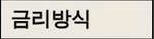</a></p>

**질문** (`messages[0].content`)

```
<image>
이미지의 글자를 보이는 그대로 읽으세요. 고치거나 추측하지 말고 글자만 답하세요.
```

**정답** (`target`)

```json
{"text": "금리방식"}
```

**학습할 때 모델이 내야 하는 답** (SFT 의 assistant 내용)

```
금리방식
```

**문항 한 줄 전체** (`benchmark_tasks.jsonl`)

```json
{
 "confidence": 0.99,
 "context_image": "<prepared>/views/d6cecc2b9d432b628bc11304_v1.png",
 "document_id": "loan_application_000000",
 "id": "d6cecc2b9d432b628bc11304_v1_crop_ocr_0",
 "images": [
  "<prepared>/crops/d6cecc2b9d432b628bc11304_v1_90.png"
 ],
 "messages": [{"content": "<image>\n이미지의 글자를 보이는 그대로 읽으세요. 고치거나 추측하지 말고 글자만 답하세요.", "role": "user"}],
 "page_id": "loan_application_000000_p1.png",
 "reference_type": "ocr_pseudo_unreviewed",
 "size": "medium",
 "split": "benchmark",
 "target": "{\"text\": \"금리방식\"}",
 "task": "crop_ocr",
 "view": "aug",
 "view_id": "d6cecc2b9d432b628bc11304_v1",
 "view_ops": ["crop1559x2114", "rotate-0.08", "scale0.830", "jpeg", "contrast"]
}
```

### 1-3. bbox_ocr — 박스 안 글자 읽기

**어떻게 만드나:** 사본 페이지 전체 + 단어 하나의 박스 좌표(0~1000)를 질문에 넣는다

**채점:** 글자: CER·완전 일치·숫자 일치

**입력 이미지** (왼쪽) · 정답 박스 초록, 질문에 준 박스 파랑 (오른쪽)

<p><a href="../examples/img/d6cecc2b9d432b628bc11304_v1_17b871c9.jpg"></a> <a href="../examples/img/d6cecc2b9d432b628bc11304_v1_bbox_ocr_2255bea6.jpg">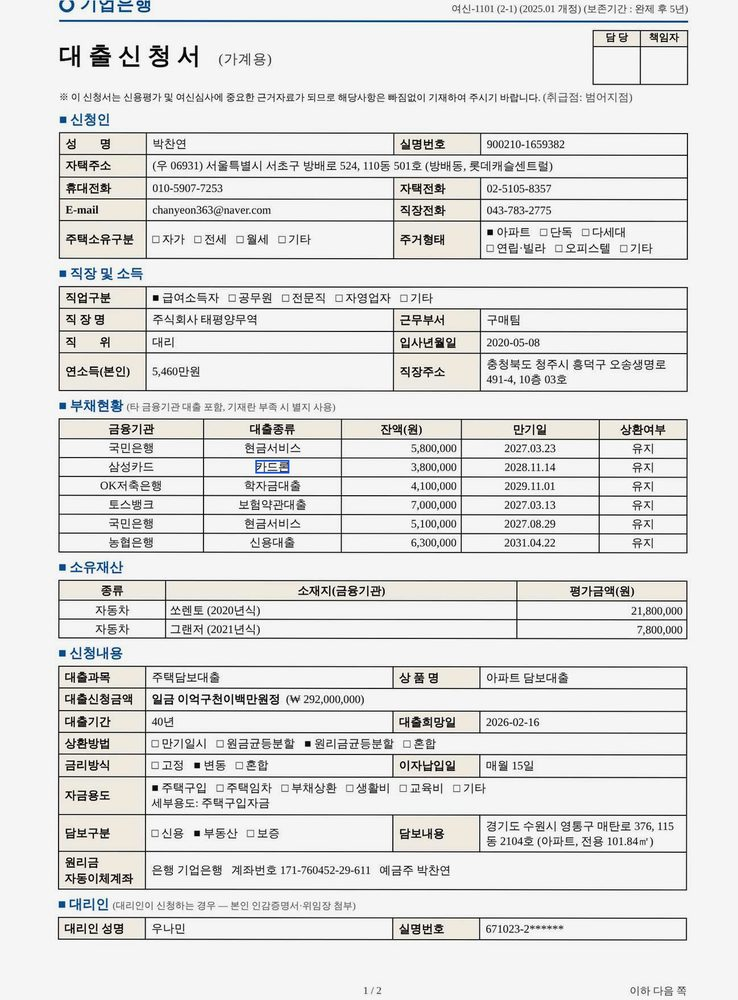</a></p>

**질문** (`messages[0].content`)

```
<image>
bbox_2d=[346, 460, 392, 473] 영역 안의 글자를 그대로 읽으세요. 좌표는 이미지 기준 0~1000입니다. 글자만 답하세요.
```

**정답** (`target`)

```json
{"text": "카드론"}
```

**학습할 때 모델이 내야 하는 답** (SFT 의 assistant 내용)

```
카드론
```

**문항 한 줄 전체** (`benchmark_tasks.jsonl`)

```json
{
 "confidence": 0.97,
 "context_image": "<prepared>/views/d6cecc2b9d432b628bc11304_v1.png",
 "document_id": "loan_application_000000",
 "id": "d6cecc2b9d432b628bc11304_v1_bbox_ocr_0",
 "images": [
  "<prepared>/views/d6cecc2b9d432b628bc11304_v1.png"
 ],
 "messages": [
  {
   "content": "<image>\nbbox_2d=[346, 460, 392, 473] 영역 안의 글자를 그대로 읽으세요. 좌표는 이미지 기준 0~1000입니다. 글자만 답하세요.",
   "role": "user"
  }
 ],
 "page_id": "loan_application_000000_p1.png",
 "reference_type": "ocr_pseudo_unreviewed",
 "size": "medium",
 "split": "benchmark",
 "target": "{\"text\": \"카드론\"}",
 "task": "bbox_ocr",
 "view": "aug",
 "view_id": "d6cecc2b9d432b628bc11304_v1",
 "view_ops": ["crop1559x2114", "rotate-0.08", "scale0.830", "jpeg", "contrast"]
}
```

### 1-4. grounding — 글자 위치 찾기

**어떻게 만드나:** 사본 페이지 + 글자. 페이지에 같은 글자가 여러 번 있으면 전부가 정답. 약 10%는 같은 분리의 다른 페이지에서 가져온, 이 페이지에 없는 글자(정답 [])

**채점:** 박스: IoU 0.5 F1 등. 정답이 [] 이면 [] 일 때만 맞음. 문항 점수 min(1, IoU/0.8) 짝별 soft F1

**입력 이미지** (왼쪽) · 정답 박스 초록, 질문에 준 박스 파랑 (오른쪽)

<p><a href="../examples/img/d6cecc2b9d432b628bc11304_v0_aae6b8a8.jpg"></a> <a href="../examples/img/d6cecc2b9d432b628bc11304_v0_grounding_0302c30c.jpg"></a></p>

**질문** (`messages[0].content`)

```
<image>
"주택소유구분" 와 정확히 같은 글자가 있는 곳을 모두 찾으세요. 좌표는 이미지 기준 0~1000입니다. [{"bbox_2d": [x1, y1, x2, y2], "label": "..."}] 형식의 JSON 리스트만 답하고, 없으면 []로 답하세요.
```

**정답** (`target`)

```json
{"boxes": [{"bbox_2d": [81, 255, 197, 290], "label": "주택소유구분"}]}
```

**학습할 때 모델이 내야 하는 답** (SFT 의 assistant 내용)

```
[{"bbox_2d": [81, 255, 197, 290], "label": "주택소유구분"}]
```

**문항 한 줄 전체** (`benchmark_tasks.jsonl`)

```json
{
 "confidence": 0.995,
 "context_image": "<prepared>/views/d6cecc2b9d432b628bc11304_v0.png",
 "document_id": "loan_application_000000",
 "id": "d6cecc2b9d432b628bc11304_v0_grounding_0",
 "images": [
  "<prepared>/views/d6cecc2b9d432b628bc11304_v0.png"
 ],
 "messages": [
  {
   "content": "<image>\n\"주택소유구분\" 와 정확히 같은 글자가 있는 곳을 모두 찾으세요. 좌표는 이미지 기준 0~1000입니다. [{\"bbox_2d\": [x1, y1, x2, y2], \"label\": \"...\"}] 형식의 JSON 리스트만 답하고, 없으면 []로 답하세요.",
   "role": "user"
  }
 ],
 "page_id": "loan_application_000000_p1.png",
 "reference_type": "ocr_pseudo_unreviewed",
 "size": "large",
 "split": "benchmark",
 "target": "{\"boxes\": [{\"bbox_2d\": [81, 255, 197, 290], \"label\": \"주택소유구분\"}]}",
 "task": "grounding",
 "view": "clean",
 "view_id": "d6cecc2b9d432b628bc11304_v0",
 "view_ops": []
}
```

### 1-5. region_ocr — 영역 안 글자 전부 읽기

**어떻게 만드나:** 여러 단어를 덮는 영역(단어를 자르지 않게 넓힘). 영역 안에 신뢰도 낮은 단어가 하나라도 있으면 버림. 줄은 세로로 겹치는 단어끼리 묶고 위→아래, 왼→오른쪽

**채점:** 글자: CER·완전 일치 + 순서 무관 단어 F1

**입력 이미지** (왼쪽) · 정답 박스 초록, 질문에 준 박스 파랑 (오른쪽)

<p><a href="../examples/img/d6cecc2b9d432b628bc11304_v0_aae6b8a8.jpg"></a> <a href="../examples/img/d6cecc2b9d432b628bc11304_v0_region_ocr_2a8116fb.jpg">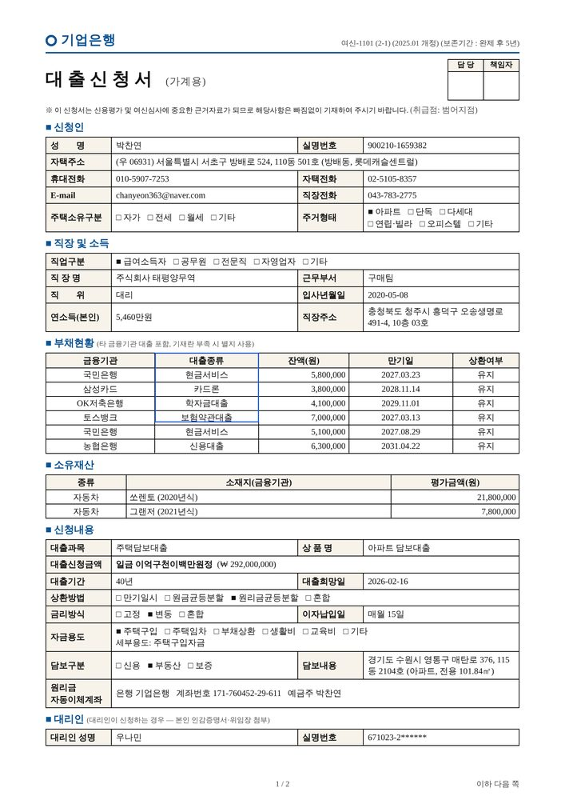</a></p>

**질문** (`messages[0].content`)

```
<image>
bbox_2d=[274, 441, 458, 528] 영역 안의 모든 글자를 읽는 순서대로 적으세요. 줄이 바뀌면 줄바꿈하세요. 좌표는 0~1000입니다. 글자만 답하세요.
```

**정답** (`target`)

```json
{"text": "대출종류\n현금서비스\n카드론\n학자금대출\n보험약관대출"}
```

**학습할 때 모델이 내야 하는 답** (SFT 의 assistant 내용)

```
대출종류
현금서비스
카드론
학자금대출
보험약관대출
```

**문항 한 줄 전체** (`benchmark_tasks.jsonl`)

```json
{
 "confidence": 0.91,
 "context_image": "<prepared>/views/d6cecc2b9d432b628bc11304_v0.png",
 "document_id": "loan_application_000000",
 "id": "d6cecc2b9d432b628bc11304_v0_region_ocr_0",
 "images": [
  "<prepared>/views/d6cecc2b9d432b628bc11304_v0.png"
 ],
 "messages": [
  {
   "content": "<image>\nbbox_2d=[274, 441, 458, 528] 영역 안의 모든 글자를 읽는 순서대로 적으세요. 줄이 바뀌면 줄바꿈하세요. 좌표는 0~1000입니다. 글자만 답하세요.",
   "role": "user"
  }
 ],
 "page_id": "loan_application_000000_p1.png",
 "reference_type": "ocr_pseudo_unreviewed",
 "size": null,
 "split": "benchmark",
 "target": "{\"text\": \"대출종류\\n현금서비스\\n카드론\\n학자금대출\\n보험약관대출\"}",
 "task": "region_ocr",
 "view": "clean",
 "view_id": "d6cecc2b9d432b628bc11304_v0",
 "view_ops": []
}
```

### 1-6. spotting — 전체 글자 + 위치

**어떻게 만드나:** 페이지를 잘라낸 타일(`tiles/`), 타일당 단어 40개 이하. 신뢰도 낮은 단어는 배경색으로 지우고 정답에서 뺌

**채점:** 박스+글자: 위치+글자 F1. 문항 점수 0.5×min(1,IoU/0.8)+0.5×글자 유사도

**입력 이미지** (왼쪽) · 정답 박스 초록, 질문에 준 박스 파랑 (오른쪽)

<p><a href="../examples/img/d6cecc2b9d432b628bc11304_v0_0_071d42c4.jpg">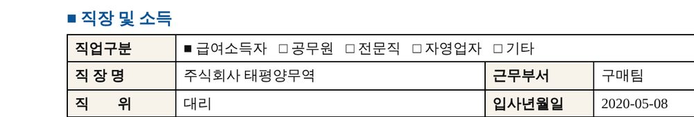</a> <a href="../examples/img/d6cecc2b9d432b628bc11304_v0_0_spotting_147013dd.jpg">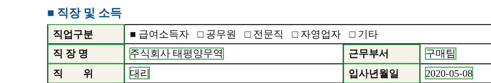</a></p>

**질문** (`messages[0].content`)

```
<image>
Detect every piece of text in the image in reading order. Coordinates are 0-1000 relative to the image. Return only a JSON list like [{"bbox_2d": [x1, y1, x2, y2], "label": "text"}].
```

**정답** (`target`)

```json
{
 "boxes": [
  {"bbox_2d": [97, 296, 253, 533], "label": "직업구분"},
  {"bbox_2d": [97, 533, 253, 764], "label": "직장명"},
  {"bbox_2d": [264, 573, 455, 714], "label": "주식회사 태평양무역"},
  {"bbox_2d": [699, 533, 855, 764], "label": "근무부서"},
  {"bbox_2d": [866, 573, 929, 714], "label": "구매팀"},
  {"bbox_2d": [97, 764, 253, 1000], "label": "직위"},
  {"bbox_2d": [264, 809, 305, 950], "label": "대리"},
  {"bbox_2d": [699, 764, 855, 1000], "label": "입사년월일"},
  {"bbox_2d": [866, 809, 963, 950], "label": "2020-05-08"}
 ]
}
```

**학습할 때 모델이 내야 하는 답** (SFT 의 assistant 내용)

```
[{"bbox_2d": [97, 296, 253, 533], "label": "직업구분"}, {"bbox_2d": [97, 533, 253, 764], "label": "직장명"}, {"bbox_2d": [264, 573, 455, 714], "label": "주식회사 태평양무역"}, {"bbox_2d": [699, 533, 855, 764], "label": "근무부서"}, {"bbox_2d": [866, 573, 929, 714], "label": "구매팀"}, {"bbox_2d": [97, 764, 253, 1000], "label": "직위"}, {"bbox_2d": [264, 809, 305, 950], "label": "대리"}, {"bbox_2d": [699, 764, 855, 1000], "label": "입사년월일"}, {"bbox_2d": [866, 809, 963, 950], "label": "2020-05-08"}]
```

**문항 한 줄 전체** (`benchmark_tasks.jsonl`)

```json
{
 "confidence": 0.91,
 "context_image": "<prepared>/views/d6cecc2b9d432b628bc11304_v0.png",
 "document_id": "loan_application_000000",
 "id": "d6cecc2b9d432b628bc11304_v0_spotting_0",
 "images": [
  "<prepared>/tiles/d6cecc2b9d432b628bc11304_v0_0.png"
 ],
 "masked_words": 0,
 "messages": [
  {
   "content": "<image>\nDetect every piece of text in the image in reading order. Coordinates are 0-1000 relative to the image. Return only a JSON list like [{\"bbox_2d\": [x1, y1, x2, y2], \"label\": \"text\"}].",
   "role": "user"
  }
 ],
 "page_id": "loan_application_000000_p1.png",
 "reference_type": "ocr_pseudo_unreviewed",
 "size": null,
 "split": "benchmark",
 "target": "{\"boxes\": [{\"bbox_2d\": [97, 296, 253, 533], \"label\": \"직업구분\"}, {\"bbox_2d\": [97, 533, 253, 764], \"label\": \"직장명\"}, {\"bbox_2d\": [264, 573, 455, 714], \"label\": \"주식회사 태평양무역\"}, {\"bbox_2d\": [699, 533, 855, 764], \"label\": \"근무부서\"}, {\"bbox_2d\": [866, 573, 929, 714], \"label\": \"구매팀\"}, {\"bbox_2d\": [97, 764, 253, 1000], \"label\": \"직위\"}, {\"bbox_2d\": [264, 809, 305, 950], \"label\": \"대리\"}, {\"bbox_2d\": [699, 764, 855, 1000], \"label\": \"입사년월일\"}, {\"bbox_2d\": [866, 809, 963, 950], \"label\": \"2020-05-08\"}]}",
 "task": "spotting",
 "view": "clean",
 "view_id": "d6cecc2b9d432b628bc11304_v0",
 "view_ops": []
}
```

### 1-7. relation — 옆 글자 찾기

**어떻게 만드나:** 기준 글자(페이지에 하나뿐이면 글자, 아니면 박스 좌표) + 방향(오른쪽·왼쪽·위·아래). 가장 가까운 이웃이 분명할 때만

**채점:** 박스+글자: 위치+글자 F1 (박스 하나)

**입력 이미지** (왼쪽) · 정답 박스 초록, 질문에 준 박스 파랑 (오른쪽)

<p><a href="../examples/img/d6cecc2b9d432b628bc11304_v0_aae6b8a8.jpg"></a> <a href="../examples/img/d6cecc2b9d432b628bc11304_v0_relation_683587c8.jpg">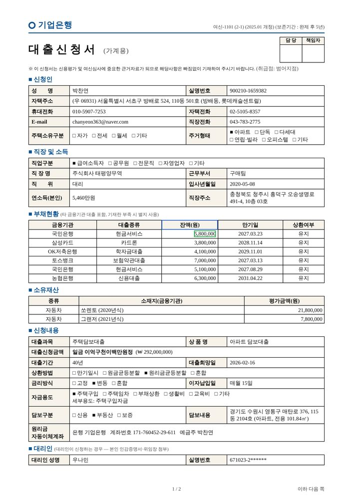</a></p>

**질문** (`messages[0].content`)

```
<image>
bbox_2d=[458, 441, 617, 460] 글자 바로 아래에 있는 글자를 찾으세요. 좌표는 0~1000입니다. [{"bbox_2d": [x1, y1, x2, y2], "label": "글자"}] 형식으로 하나만 답하세요.
```

**정답** (`target`)

```json
{"boxes": [{"bbox_2d": [550, 462, 611, 475], "label": "5,800,000"}]}
```

**학습할 때 모델이 내야 하는 답** (SFT 의 assistant 내용)

```
[{"bbox_2d": [550, 462, 611, 475], "label": "5,800,000"}]
```

**문항 한 줄 전체** (`benchmark_tasks.jsonl`)

```json
{
 "confidence": 0.97,
 "context_image": "<prepared>/views/d6cecc2b9d432b628bc11304_v0.png",
 "document_id": "loan_application_000000",
 "id": "d6cecc2b9d432b628bc11304_v0_relation_0",
 "images": [
  "<prepared>/views/d6cecc2b9d432b628bc11304_v0.png"
 ],
 "messages": [
  {
   "content": "<image>\nbbox_2d=[458, 441, 617, 460] 글자 바로 아래에 있는 글자를 찾으세요. 좌표는 0~1000입니다. [{\"bbox_2d\": [x1, y1, x2, y2], \"label\": \"글자\"}] 형식으로 하나만 답하세요.",
   "role": "user"
  }
 ],
 "page_id": "loan_application_000000_p1.png",
 "reference_type": "ocr_pseudo_unreviewed",
 "size": "medium",
 "split": "benchmark",
 "target": "{\"boxes\": [{\"bbox_2d\": [550, 462, 611, 475], \"label\": \"5,800,000\"}]}",
 "task": "relation",
 "view": "clean",
 "view_id": "d6cecc2b9d432b628bc11304_v0",
 "view_ops": []
}
```

### 1-8. marked_ocr — 그린 박스 안 글자 읽기

**어떻게 만드나:** 사본에 빨강·파랑·초록 사각형(최대 3개)을 그린 이미지(`marked/`). 30%는 좌표도 함께 알려 줌

**채점:** 글자: CER·완전 일치

**입력 이미지** (왼쪽) 

<p><a href="../examples/img/d6cecc2b9d432b628bc11304_v0_1a3a3858.jpg">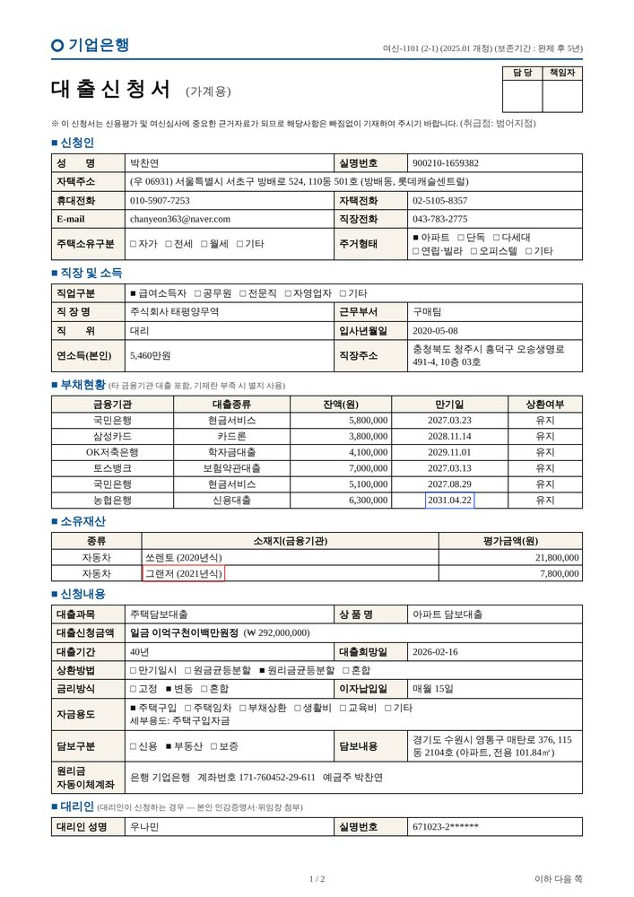</a></p>

**질문** (`messages[0].content`)

```
<image>
이미지에 그려진 빨간 박스 안의 글자를 그대로 읽으세요. 글자만 답하세요.
```

**정답** (`target`)

```json
{"text": "그랜저 (2021년식)"}
```

**학습할 때 모델이 내야 하는 답** (SFT 의 assistant 내용)

```
그랜저 (2021년식)
```

**문항 한 줄 전체** (`benchmark_tasks.jsonl`)

```json
{
 "confidence": 0.97,
 "context_image": "<prepared>/views/d6cecc2b9d432b628bc11304_v0.png",
 "document_id": "loan_application_000000",
 "id": "d6cecc2b9d432b628bc11304_v0_marked_ocr_0",
 "images": [
  "<prepared>/marked/d6cecc2b9d432b628bc11304_v0.png"
 ],
 "messages": [{"content": "<image>\n이미지에 그려진 빨간 박스 안의 글자를 그대로 읽으세요. 글자만 답하세요.", "role": "user"}],
 "page_id": "loan_application_000000_p1.png",
 "reference_type": "ocr_pseudo_unreviewed",
 "size": "medium",
 "split": "benchmark",
 "target": "{\"text\": \"그랜저 (2021년식)\"}",
 "task": "marked_ocr",
 "view": "clean",
 "view_id": "d6cecc2b9d432b628bc11304_v0",
 "view_ops": []
}
```

### 1-9. marked_box — 그린 박스의 좌표

**어떻게 만드나:** 같은 그림에서 색 하나를 묻고, 직접 그린 사각형의 바깥 테두리 좌표와 글자를 답한다

**채점:** 박스+글자: IoU 0.75 F1 (그린 사각형이라 정답 좌표가 정확함)

**입력 이미지** (왼쪽) · 정답 박스 초록, 질문에 준 박스 파랑 (오른쪽)

<p><a href="../examples/img/d6cecc2b9d432b628bc11304_v0_1a3a3858.jpg"></a> <a href="../examples/img/d6cecc2b9d432b628bc11304_v0_marked_box_db2a69d2.jpg">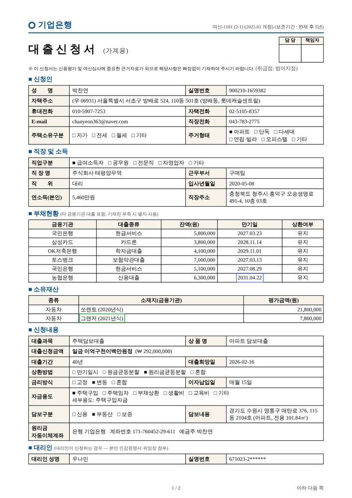</a></p>

**질문** (`messages[0].content`)

```
<image>
이미지에 그려진 빨간 박스의 위치와 그 안의 글자를 답하세요. 좌표는 이미지 기준 0~1000입니다. [{"bbox_2d": [x1, y1, x2, y2], "label": "글자"}] 형식으로 하나만 답하세요.
```

**정답** (`target`)

```json
{"boxes": [{"bbox_2d": [225, 630, 355, 648], "label": "그랜저 (2021년식)"}]}
```

**학습할 때 모델이 내야 하는 답** (SFT 의 assistant 내용)

```
[{"bbox_2d": [225, 630, 355, 648], "label": "그랜저 (2021년식)"}]
```

**문항 한 줄 전체** (`benchmark_tasks.jsonl`)

```json
{
 "confidence": 0.97,
 "context_image": "<prepared>/views/d6cecc2b9d432b628bc11304_v0.png",
 "document_id": "loan_application_000000",
 "id": "d6cecc2b9d432b628bc11304_v0_marked_box_0",
 "images": [
  "<prepared>/marked/d6cecc2b9d432b628bc11304_v0.png"
 ],
 "messages": [
  {
   "content": "<image>\n이미지에 그려진 빨간 박스의 위치와 그 안의 글자를 답하세요. 좌표는 이미지 기준 0~1000입니다. [{\"bbox_2d\": [x1, y1, x2, y2], \"label\": \"글자\"}] 형식으로 하나만 답하세요.",
   "role": "user"
  }
 ],
 "page_id": "loan_application_000000_p1.png",
 "reference_type": "ocr_pseudo_unreviewed",
 "size": "medium",
 "split": "benchmark",
 "target": "{\"boxes\": [{\"bbox_2d\": [225, 630, 355, 648], \"label\": \"그랜저 (2021년식)\"}]}",
 "task": "marked_box",
 "view": "clean",
 "view_id": "d6cecc2b9d432b628bc11304_v0",
 "view_ops": []
}
```

### 1-10. SFT 학습 샘플 한 줄 (`train_sft.jsonl`)

같은 이미지에 대한 질문을 최대 8개까지 한 대화로 묶습니다. 이미지는 첫 질문에만 붙고, 답은 모두 학습합니다.

```json
{
 "images": [
  "<prepared>/views/d4ceaa08ef4eb07ef6474f30_v0.png"
 ],
 "messages": [
  {
   "content": "<image>\n\"공정태\" 와 정확히 같은 글자가 있는 곳을 모두 찾으세요. 좌표는 이미지 기준 0~1000입니다. [{\"bbox_2d\": [x1, y1, x2, y2], \"label\": \"...\"}] 형식의 JSON 리스트만 답하고, 없으면 []로 답하세요.",
   "role": "user"
  },
  {"content": "[{\"bbox_2d\": [689, 215, 731, 226], \"label\": \"공정태\"}]", "role": "assistant"},
  {
   "content": "\"소재지(주소)\" 바로 오른쪽에 있는 글자를 찾으세요. 좌표는 0~1000입니다. [{\"bbox_2d\": [x1, y1, x2, y2], \"label\": \"글자\"}] 형식으로 하나만 답하세요.",
   "role": "user"
  },
  {
   "content": "[{\"bbox_2d\": [297, 264, 625, 275], \"label\": \"충청북도 청주시 흥덕구 오송생명로 491-4, 10층 03호\"}]",
   "role": "assistant"
  },
  {
   "content": "Read all text inside bbox_2d=[101, 641, 549, 805] in reading order, one line per text line. Coordinates are 0-1000 relative to the image. Return only the text.",
   "role": "user"
  },
  {"content": "비과세소득계 2,400,000\n주(현)근무지\n결정세액\n주(현)근무지\n차감징수세액\n실효세율(%)", "role": "assistant"},
  {
   "content": "Find every occurrence of the exact text \"법인명(상호)\". Coordinates are 0-1000 relative to the image. Return only a JSON list like [{\"bbox_2d\": [x1, y1, x2, y2], \"label\": \"...\"}]; return [] if it does not appear.",
   "role": "user"
  },
  {"content": "[{\"bbox_2d\": [105, 213, 292, 229], \"label\": \"법인명(상호)\"}]", "role": "assistant"},
  {
   "content": "bbox_2d=[661, 775, 712, 785] 영역 안의 글자를 그대로 읽으세요. 좌표는 이미지 기준 0~1000입니다. 글자만 답하세요.",
   "role": "user"
  },
  {"content": "-370,770", "role": "assistant"},
  {
   "content": "Find every occurrence of the exact text \"상여\". Coordinates are 0-1000 relative to the image. Return only a JSON list like [{\"bbox_2d\": [x1, y1, x2, y2], \"label\": \"...\"}]; return [] if it does not appear.",
   "role": "user"
  },
  {"content": "[{\"bbox_2d\": [105, 421, 338, 437], \"label\": \"상여\"}]", "role": "assistant"},
  {
   "content": "\"주민등록번호\" 바로 오른쪽에 있는 글자를 찾으세요. 좌표는 0~1000입니다. [{\"bbox_2d\": [x1, y1, x2, y2], \"label\": \"글자\"}] 형식으로 하나만 답하세요.",
   "role": "user"
  },
  {"content": "[{\"bbox_2d\": [689, 287, 786, 297], \"label\": \"900210-1659382\"}]", "role": "assistant"},
  {
   "content": "Read all text inside bbox_2d=[297, 169, 429, 226] in reading order, one line per text line. Coordinates are 0-1000 relative to the image. Return only the text.",
   "role": "user"
  },
  {"content": "2024\n주식회사 태평양무역", "role": "assistant"}
 ]
}
```

## 서류 한 건 과제

예시는 `python -m docgen.bench build` 로 만든 실제 평가 세트 형식 그대로입니다 (세트 버전 5.1, 생성기 커밋 `3f8dd92`). 학습 데이터(`--split train`)도 같은 형식이고, 가짜 고객(seed)만 다릅니다.

### 2-0. 세트 폴더와 문항 한 줄의 필드

```
<세트>/
  meta.json                 만든 설정, 생성기 커밋, 과제별 문항 수, split (test / train)
  dataset.json              (레시피로 만들 때) 레시피, 생성기 커밋, 서식 파일 해시
  images/<서류ID>_<seed>.jpg               서류 이미지 (여러 쪽이면 _p1, _p2 …)
  crops/                    값 칸을 잘라낸 이미지 (ocr_field)
  tasks/<과제>.jsonl        문항, 한 줄에 하나
  swift/all.jsonl           (학습 세트만) 같은 문항의 학습 레코드
```

| 키 | 뜻 |
|---|---|
| `id` | 문항 ID: `<과제>/<서류ID>_<seed>[/<구분>]`. 두 번째 칸이 서류 한 건이라서 학습·평가의 겹침 검사에 쓰인다 |
| `task` | 과제 이름 |
| `images` | 질문 앞에 순서대로 넣는 이미지 (세트 폴더 기준 상대 경로). 여러 쪽 서류는 `_p1`, `_p2` … |
| `prompt` | 질문 문장 (docgen/bench/prompts.py 의 틀에 값을 채운 것) |
| `answer` | 정답 |
| `eval` | 채점에 쓰는 추가 정보 |
| `meta` | 결과를 나눠 보는 기준 (채점에는 안 쓰임) |

**meta 키** (과제에 따라 일부만 있음)

| 키 | 뜻 |
|---|---|
| `doc_type` | 서식 ID (guide/reference/documents.md) |
| `doc_name` | 서류 정식 명칭 |
| `group` | 서식 그룹 |
| `condition` | 촬영 조건: clean 원본 / scan 스캔 / photo 촬영 / fax 팩스 |
| `writing` | 글씨: print 인쇄체 / hand 손글씨 |
| `n_pages` | 쪽 수 (한 쪽만 물으면 1) |
| `view` | 물은 범위: all 서류 전체 / page 여러 쪽 서류에서 한 쪽만 (레시피 page_view) |
| `page` | (view page) 물은 쪽 번호, 1부터 |
| `n_pages_doc` | (view page) 서류 전체 쪽 수 |
| `key` | 값 칸의 정답 키 |
| `label` | 값 칸의 키 설명 |
| `kind` | 값 종류 (이름·금액·날짜 …) |
| `corrected` | 손글씨 정정(두 줄 긋고 고쳐 씀)이 있는 칸인지 |
| `length` | 정답 글자 수 (공백 제외) |
| `masked` | 검은 상자로 가린 값 칸 수 (정답 null) |
| `table` | 표 묶음 이름 (키의 행 번호 앞, `rows.0.x` → `rows`) |
| `ref` | 표를 가리킨 방법: title 제목 / header 머리글 / box 위치 / only 표가 하나뿐 |
| `scope` | 범위: all 모든 행 / page 한 쪽 / first 앞 30행 |
| `n_rows` | 표의 행 수 (물은 범위) |
| `n_cols` | 열 수 (섞은 없는 열 포함) |
| `absent` | 없는 열을 섞었는지 |
| `n_tables` | 서류의 표 수 |
| `n_segments` | 표 조각 수 (여러 쪽 표는 쪽마다) |
| `segments` | 같은 표가 나뉜 쪽 수 |
| `level` | 기타 칸 글의 꼴: short 짧은 말 / sentence 문장 / relative 상대 날짜 / approx 대략적인 값 |
| `question` | 서식 전용 질문: `<서식ID>.<qa.py 함수 이름>` |
| `task_group` | 과제 묶음: ocr 글자 읽기 / doc 문서 이해 (점수를 묶어 보는 구분) |
| `label_format` | 정답 구조 (key_values, table_rows, scalar …) — 점수를 정답 꼴별로 나눠 볼 때 |
| `template_variant` | 서식 레이아웃 변형 {id, name} |

**eval 키**

| 키 | 뜻 |
|---|---|
| `answer_type` | 서식 전용 질문의 정답 꼴: `number` 숫자 / `yesno` 예·아니오 / `text` / `json` |
| `tol` | 숫자 답의 허용 오차 |
| `fields` | 키마다 `type`(값 타입), `norm`(정규화 값: 날짜 YYYY-MM-DD, 금액 정수 …), `kind`(값 종류). 타입별로 표기 차이를 맞춰 비교 |
| `types` | 키마다 `checkbox` / `checkbox_multi` / `seal` / `signature` |
| `absent` | 섞은 없는 키·열 (서류에 없음, 정답 null) |
| `group` | 표 묶음 이름 |
| `type` | 표 질의: 물은 열의 값 타입 |
| `key` | 표 질의: 물은 열 키 |
| `aliases` | 분류: 정답으로 인정하는 다른 서류명 |

### 2-1. classify — 서류 분류

**정답 형식:** 서류 정식 명칭

**채점:** 공백·문장부호를 뺀 뒤 정식 명칭과 같으면 정답

**입력 이미지** (1장, 질문 앞에 이 순서로)

<p><a href="../examples/img/loan_application_1000000_c024fabb.jpg">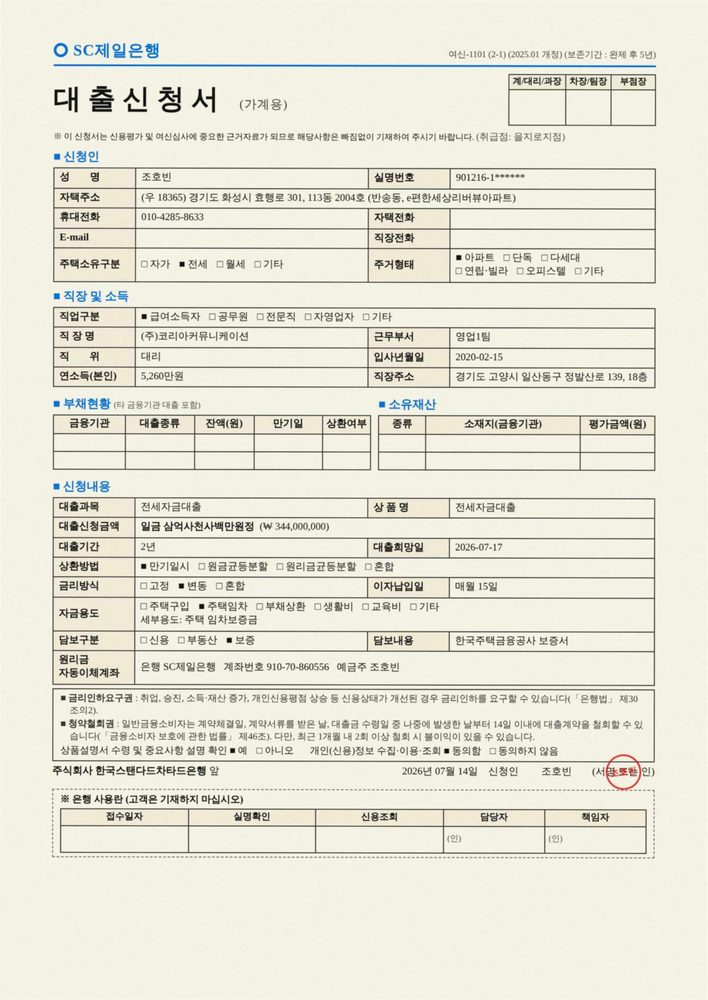</a></p>

1. `loan_application_1000000.jpg`

**질문** (`prompt`)

```
이 문서는 고객이 은행에 제출한 서류입니다. 서류의 정식 명칭(서류명)을 답하세요. 설명 없이 서류명만 한 줄로 답하세요.
```

**정답** (`answer`)

```
대출거래신청서
```

**채점 정보** (`eval`)

```json
{"aliases": ["《개인》대출신청서(가계용)"]}
```

**나눠 보기 정보** (`meta`)

```json
{
 "doc_type": "loan_application",
 "doc_name": "대출거래신청서",
 "group": "bank_form",
 "condition": "scan",
 "writing": "print",
 "n_pages": 1,
 "view": "all",
 "task_group": "doc",
 "label_format": "text"
}
```

**문항 한 줄 전체** (`tasks/classify.jsonl`)

<details><summary>펼치기</summary>

```json
{
 "id": "classify/loan_application_1000000",
 "task": "classify",
 "prompt": "이 문서는 고객이 은행에 제출한 서류입니다. 서류의 정식 명칭(서류명)을 답하세요. 설명 없이 서류명만 한 줄로 답하세요.",
 "answer": "대출거래신청서",
 "eval": {"aliases": ["《개인》대출신청서(가계용)"]},
 "images": ["images/loan_application_1000000.jpg"],
 "meta": {
  "doc_type": "loan_application",
  "doc_name": "대출거래신청서",
  "group": "bank_form",
  "condition": "scan",
  "writing": "print",
  "n_pages": 1,
  "view": "all",
  "task_group": "doc",
  "label_format": "text"
 }
}
```
</details>

**학습 레코드** (`swift/all.jsonl` 한 줄: 같은 문항을 질문 + 정답 답변 대화로 바꾼 것)

```json
{
 "id": "classify/loan_application_1000000",
 "task": "classify",
 "images": ["images/loan_application_1000000.jpg"],
 "messages": [
  {"role": "user", "content": "<image>이 문서는 고객이 은행에 제출한 서류입니다. 서류의 정식 명칭(서류명)을 답하세요. 설명 없이 서류명만 한 줄로 답하세요."},
  {"role": "assistant", "content": "대출거래신청서"}
 ]
}
```

### 2-2. kie — 정보 추출

**정답 형식:** `[{"key", "value": 문서에 적힌 값, "bbox_2d", "page"}]`. 빈 칸·가린 칸·서류에 없는 항목은 `{"key", "value": null}`

**채점:** 주 지표: 값+위치 F1 (값 F1·위치 F1 함께, 빈 칸에 값을 지어내면 감점). 날짜·금액·번호는 타입별로 표기를 맞춰 비교

**입력 이미지** (1장, 질문 앞에 이 순서로)

<p><a href="../examples/img/loan_application_1000000_c024fabb.jpg"></a></p>

1. `loan_application_1000000.jpg`

**질문** (`prompt`)

```
이 문서에서 아래 항목의 값과 위치를 찾아 JSON 목록으로 답하세요. 항목마다 {"key": 키, "value": 문서에 적힌 값 그대로, "bbox_2d": [x1, y1, x2, y2], "page": 쪽 번호} 를 쓰세요. 좌표는 그 쪽 이미지 기준 0~1000 정수, 쪽 번호는 1부터입니다. 키는 그대로 쓰고, 문서에 비어 있거나 없는 항목은 {"key": 키, "value": null} 로 답하세요.
항목 (키: 설명 (몇 번째 행))
- bank: 은행명
- branch: 취급점
- applicant.name: 성명
- applicant.rrn: 실명번호
- applicant.zipcode: 우편번호
- applicant.address: 자택주소
- applicant.mobile: 휴대전화
- applicant.home_phone: 자택전화
- applicant.email: E-mail
- applicant.work_phone: 직장전화
- workplace.name: 직장명
- workplace.department: 근무부서
- workplace.position: 직위
- workplace.hire_date: 입사년월일
- workplace.annual_income: 연소득(본인)
- workplace.address: 직장주소
- loan.subject: 대출과목
- loan.product: 상품명
- loan.amount_korean: 대출신청금액(한글)
- loan.amount: 대출신청금액
- customer.nationality: 국적
- ebank.limit_once: 1회이체한도
- loan.term: 대출기간
- loan.hope_date: 대출희망일
- bank_use.manager: 책임자
- loan.interest_day: 이자납입일
- loan.purpose: 세부용도
- collateral_detail: 담보내용
- loan.debit_bank: 이체은행
- loan.debit_account: 이체계좌번호
- loan.debit_holder: 예금주
- apply_date: 신청일
- signature: 신청인
```

**정답** (`answer`)

```json
[
 {"key": "bank", "value": "SC제일은행", "bbox_2d": [103, 39, 227, 61], "page": 1},
 {"key": "branch", "value": "을지로지점", "bbox_2d": [725, 131, 794, 142], "page": 1},
 {"key": "applicant.name", "value": "조호빈", "bbox_2d": [200, 172, 243, 183], "page": 1},
 {"key": "applicant.rrn", "value": "901216-1******", "bbox_2d": [644, 173, 742, 184], "page": 1},
 {"key": "applicant.zipcode", "value": "18365", "bbox_2d": [222, 192, 258, 203], "page": 1},
 {
  "key": "applicant.address",
  "value": "경기도 화성시 효행로 301, 113동 2004호 (반송동, e편한세상리버뷰아파트)",
  "bbox_2d": [266, 192, 728, 204],
  "page": 1
 },
 {"key": "applicant.mobile", "value": "010-4285-8633", "bbox_2d": [200, 212, 288, 223], "page": 1},
 {"key": "applicant.home_phone", "value": null},
 {"key": "applicant.email", "value": null},
 {"key": "applicant.work_phone", "value": null},
 {"key": "workplace.name", "value": "(주)코리아커뮤니케이션", "bbox_2d": [199, 331, 352, 342], "page": 1},
 {"key": "workplace.department", "value": "영업1팀", "bbox_2d": [643, 332, 694, 343], "page": 1},
 {"key": "workplace.position", "value": "대리", "bbox_2d": [199, 351, 228, 362], "page": 1},
 {"key": "workplace.hire_date", "value": "2020-02-15", "bbox_2d": [643, 352, 710, 363], "page": 1},
 {"key": "workplace.annual_income", "value": "5,260만원", "bbox_2d": [199, 371, 260, 382], "page": 1},
 {
  "key": "workplace.address",
  "value": "경기도 고양시 일산동구 정발산로 139, 18층",
  "bbox_2d": [643, 372, 915, 383],
  "page": 1
 },
 {"key": "loan.subject", "value": "전세자금대출", "bbox_2d": [199, 502, 285, 512], "page": 1},
 {"key": "loan.product", "value": "전세자금대출", "bbox_2d": [643, 502, 729, 513], "page": 1},
 {"key": "loan.amount_korean", "value": "일금 삼억사천사백만원정", "bbox_2d": [199, 522, 360, 533], "page": 1},
 {"key": "loan.amount", "value": "344,000,000", "bbox_2d": [389, 522, 460, 533], "page": 1},
 {"key": "customer.nationality", "value": null},
 {"key": "ebank.limit_once", "value": null},
 {"key": "loan.term", "value": "2년", "bbox_2d": [199, 542, 220, 552], "page": 1},
 {"key": "loan.hope_date", "value": "2026-07-17", "bbox_2d": [643, 542, 710, 553], "page": 1},
 {"key": "bank_use.manager", "value": null},
 {"key": "loan.interest_day", "value": "매월 15일", "bbox_2d": [643, 582, 704, 593], "page": 1},
 {"key": "loan.purpose", "value": "주택 임차보증금", "bbox_2d": [261, 615, 364, 626], "page": 1},
 {"key": "collateral_detail", "value": "한국주택금융공사 보증서", "bbox_2d": [643, 635, 803, 646], "page": 1},
 {"key": "loan.debit_bank", "value": "SC제일은행", "bbox_2d": [231, 662, 305, 672], "page": 1},
 {"key": "loan.debit_account", "value": "910-70-860556", "bbox_2d": [377, 662, 465, 673], "page": 1},
 {"key": "loan.debit_holder", "value": "조호빈", "bbox_2d": [522, 662, 565, 673], "page": 1},
 {"key": "apply_date", "value": "2026년 07월 14일", "bbox_2d": [568, 766, 675, 777], "page": 1},
 {"key": "signature", "value": "조호빈", "bbox_2d": [765, 766, 808, 777], "page": 1}
]
```

**채점 정보** (`eval`)

```json
{
 "fields": {
  "bank": {"type": "text", "norm": "SC제일은행", "kind": "text"},
  "branch": {"type": "text", "norm": "을지로지점", "kind": "text"},
  "applicant.name": {"type": "text", "norm": "조호빈", "kind": "name"},
  "applicant.rrn": {"type": "rrn", "norm": "901216-1******", "kind": "rrn"},
  "applicant.zipcode": {"type": "number", "norm": 18365, "kind": "number"},
  "applicant.address": {"type": "text", "norm": "경기도 화성시 효행로 301, 113동 2004호 (반송동, e편한세상리버뷰아파트)", "kind": "address"},
  "applicant.mobile": {"type": "phone", "norm": "01042858633", "kind": "phone"},
  "applicant.home_phone": {"type": "phone", "norm": null, "kind": "phone"},
  "applicant.email": {"type": "text", "norm": null, "kind": "text"},
  "applicant.work_phone": {"type": "phone", "norm": null, "kind": "phone"},
  "workplace.name": {"type": "text", "norm": "(주)코리아커뮤니케이션", "kind": "text"},
  "workplace.department": {"type": "text", "norm": "영업1팀", "kind": "text"},
  "workplace.position": {"type": "text", "norm": "대리", "kind": "text"},
  "workplace.hire_date": {"type": "date", "norm": "2020-02-15", "kind": "date"},
  "workplace.annual_income": {"type": "text", "norm": "5,260만원", "kind": "text"},
  "workplace.address": {"type": "text", "norm": "경기도 고양시 일산동구 정발산로 139, 18층", "kind": "address"},
  "loan.subject": {"type": "text", "norm": "전세자금대출", "kind": "text"},
  "loan.product": {"type": "text", "norm": "전세자금대출", "kind": "text"},
  "loan.amount_korean": {"type": "amount_korean", "norm": 344000000, "kind": "amount"},
  "loan.amount": {"type": "amount", "norm": 344000000, "kind": "amount"},
  "customer.nationality": {"type": "text", "norm": null, "kind": "absent"},
  "ebank.limit_once": {"type": "amount", "norm": null, "kind": "absent"},
  "loan.term": {"type": "text", "norm": "2년", "kind": "text"},
  "loan.hope_date": {"type": "date", "norm": "2026-07-17", "kind": "date"},
  "bank_use.manager": {"type": "text", "norm": null, "kind": "absent"},
  "loan.interest_day": {"type": "text", "norm": "매월 15일", "kind": "text"},
  "loan.purpose": {"type": "text", "norm": "주택 임차보증금", "kind": "text"},
  "collateral_detail": {"type": "text", "norm": "한국주택금융공사 보증서", "kind": "text"},
  "loan.debit_bank": {"type": "text", "norm": "SC제일은행", "kind": "text"},
  "loan.debit_account": {"type": "account_no", "norm": "910-70-860556", "kind": "account_no"},
  "loan.debit_holder": {"type": "text", "norm": "조호빈", "kind": "name"},
  "apply_date": {"type": "date", "norm": "2026-07-14", "kind": "date"},
  "signature": {"type": "text", "norm": "조호빈", "kind": "text"}
 },
 "absent": ["customer.nationality", "ebank.limit_once", "bank_use.manager"]
}
```

**나눠 보기 정보** (`meta`)

```json
{
 "doc_type": "loan_application",
 "doc_name": "대출거래신청서",
 "group": "bank_form",
 "condition": "scan",
 "writing": "print",
 "n_pages": 1,
 "view": "all",
 "task_group": "doc",
 "label_format": "key_values"
}
```

**문항 한 줄 전체** (`tasks/kie.jsonl`)

<details><summary>펼치기</summary>

```json
{
 "id": "kie/loan_application_1000000",
 "task": "kie",
 "prompt": "이 문서에서 아래 항목의 값과 위치를 찾아 JSON 목록으로 답하세요. 항목마다 {\"key\": 키, \"value\": 문서에 적힌 값 그대로, \"bbox_2d\": [x1, y1, x2, y2], \"page\": 쪽 번호} 를 쓰세요. 좌표는 그 쪽 이미지 기준 0~1000 정수, 쪽 번호는 1부터입니다. 키는 그대로 쓰고, 문서에 비어 있거나 없는 항목은 {\"key\": 키, \"value\": null} 로 답하세요.\n항목 (키: 설명 (몇 번째 행))\n- bank: 은행명\n- branch: 취급점\n- applicant.name: 성명\n- applicant.rrn: 실명번호\n- applicant.zipcode: 우편번호\n- applicant.address: 자택주소\n- applicant.mobile: 휴대전화\n- applicant.home_phone: 자택전화\n- applicant.email: E-mail\n- applicant.work_phone: 직장전화\n- workplace.name: 직장명\n- workplace.department: 근무부서\n- workplace.position: 직위\n- workplace.hire_date: 입사년월일\n- workplace.annual_income: 연소득(본인)\n- workplace.address: 직장주소\n- loan.subject: 대출과목\n- loan.product: 상품명\n- loan.amount_korean: 대출신청금액(한글)\n- loan.amount: 대출신청금액\n- customer.nationality: 국적\n- ebank.limit_once: 1회이체한도\n- loan.term: 대출기간\n- loan.hope_date: 대출희망일\n- bank_use.manager: 책임자\n- loan.interest_day: 이자납입일\n- loan.purpose: 세부용도\n- collateral_detail: 담보내용\n- loan.debit_bank: 이체은행\n- loan.debit_account: 이체계좌번호\n- loan.debit_holder: 예금주\n- apply_date: 신청일\n- signature: 신청인",
 "answer": [
  {"key": "bank", "value": "SC제일은행", "bbox_2d": [103, 39, 227, 61], "page": 1},
  {"key": "branch", "value": "을지로지점", "bbox_2d": [725, 131, 794, 142], "page": 1},
  {"key": "applicant.name", "value": "조호빈", "bbox_2d": [200, 172, 243, 183], "page": 1},
  {"key": "applicant.rrn", "value": "901216-1******", "bbox_2d": [644, 173, 742, 184], "page": 1},
  {"key": "applicant.zipcode", "value": "18365", "bbox_2d": [222, 192, 258, 203], "page": 1},
  {
   "key": "applicant.address",
   "value": "경기도 화성시 효행로 301, 113동 2004호 (반송동, e편한세상리버뷰아파트)",
   "bbox_2d": [266, 192, 728, 204],
   "page": 1
  },
  {"key": "applicant.mobile", "value": "010-4285-8633", "bbox_2d": [200, 212, 288, 223], "page": 1},
  {"key": "applicant.home_phone", "value": null},
  {"key": "applicant.email", "value": null},
  {"key": "applicant.work_phone", "value": null},
  {"key": "workplace.name", "value": "(주)코리아커뮤니케이션", "bbox_2d": [199, 331, 352, 342], "page": 1},
  {"key": "workplace.department", "value": "영업1팀", "bbox_2d": [643, 332, 694, 343], "page": 1},
  {"key": "workplace.position", "value": "대리", "bbox_2d": [199, 351, 228, 362], "page": 1},
  {"key": "workplace.hire_date", "value": "2020-02-15", "bbox_2d": [643, 352, 710, 363], "page": 1},
  {"key": "workplace.annual_income", "value": "5,260만원", "bbox_2d": [199, 371, 260, 382], "page": 1},
  {
   "key": "workplace.address",
   "value": "경기도 고양시 일산동구 정발산로 139, 18층",
   "bbox_2d": [643, 372, 915, 383],
   "page": 1
  },
  {"key": "loan.subject", "value": "전세자금대출", "bbox_2d": [199, 502, 285, 512], "page": 1},
  {"key": "loan.product", "value": "전세자금대출", "bbox_2d": [643, 502, 729, 513], "page": 1},
  {"key": "loan.amount_korean", "value": "일금 삼억사천사백만원정", "bbox_2d": [199, 522, 360, 533], "page": 1},
  {"key": "loan.amount", "value": "344,000,000", "bbox_2d": [389, 522, 460, 533], "page": 1},
  {"key": "customer.nationality", "value": null},
  {"key": "ebank.limit_once", "value": null},
  {"key": "loan.term", "value": "2년", "bbox_2d": [199, 542, 220, 552], "page": 1},
  {"key": "loan.hope_date", "value": "2026-07-17", "bbox_2d": [643, 542, 710, 553], "page": 1},
  {"key": "bank_use.manager", "value": null},
  {"key": "loan.interest_day", "value": "매월 15일", "bbox_2d": [643, 582, 704, 593], "page": 1},
  {"key": "loan.purpose", "value": "주택 임차보증금", "bbox_2d": [261, 615, 364, 626], "page": 1},
  {"key": "collateral_detail", "value": "한국주택금융공사 보증서", "bbox_2d": [643, 635, 803, 646], "page": 1},
  {"key": "loan.debit_bank", "value": "SC제일은행", "bbox_2d": [231, 662, 305, 672], "page": 1},
  {"key": "loan.debit_account", "value": "910-70-860556", "bbox_2d": [377, 662, 465, 673], "page": 1},
  {"key": "loan.debit_holder", "value": "조호빈", "bbox_2d": [522, 662, 565, 673], "page": 1},
  {"key": "apply_date", "value": "2026년 07월 14일", "bbox_2d": [568, 766, 675, 777], "page": 1},
  {"key": "signature", "value": "조호빈", "bbox_2d": [765, 766, 808, 777], "page": 1}
 ],
 "eval": {
  "fields": {
   "bank": {"type": "text", "norm": "SC제일은행", "kind": "text"},
   "branch": {"type": "text", "norm": "을지로지점", "kind": "text"},
   "applicant.name": {"type": "text", "norm": "조호빈", "kind": "name"},
   "applicant.rrn": {"type": "rrn", "norm": "901216-1******", "kind": "rrn"},
   "applicant.zipcode": {"type": "number", "norm": 18365, "kind": "number"},
   "applicant.address": {"type": "text", "norm": "경기도 화성시 효행로 301, 113동 2004호 (반송동, e편한세상리버뷰아파트)", "kind": "address"},
   "applicant.mobile": {"type": "phone", "norm": "01042858633", "kind": "phone"},
   "applicant.home_phone": {"type": "phone", "norm": null, "kind": "phone"},
   "applicant.email": {"type": "text", "norm": null, "kind": "text"},
   "applicant.work_phone": {"type": "phone", "norm": null, "kind": "phone"},
   "workplace.name": {"type": "text", "norm": "(주)코리아커뮤니케이션", "kind": "text"},
   "workplace.department": {"type": "text", "norm": "영업1팀", "kind": "text"},
   "workplace.position": {"type": "text", "norm": "대리", "kind": "text"},
   "workplace.hire_date": {"type": "date", "norm": "2020-02-15", "kind": "date"},
   "workplace.annual_income": {"type": "text", "norm": "5,260만원", "kind": "text"},
   "workplace.address": {"type": "text", "norm": "경기도 고양시 일산동구 정발산로 139, 18층", "kind": "address"},
   "loan.subject": {"type": "text", "norm": "전세자금대출", "kind": "text"},
   "loan.product": {"type": "text", "norm": "전세자금대출", "kind": "text"},
   "loan.amount_korean": {"type": "amount_korean", "norm": 344000000, "kind": "amount"},
   "loan.amount": {"type": "amount", "norm": 344000000, "kind": "amount"},
   "customer.nationality": {"type": "text", "norm": null, "kind": "absent"},
   "ebank.limit_once": {"type": "amount", "norm": null, "kind": "absent"},
   "loan.term": {"type": "text", "norm": "2년", "kind": "text"},
   "loan.hope_date": {"type": "date", "norm": "2026-07-17", "kind": "date"},
   "bank_use.manager": {"type": "text", "norm": null, "kind": "absent"},
   "loan.interest_day": {"type": "text", "norm": "매월 15일", "kind": "text"},
   "loan.purpose": {"type": "text", "norm": "주택 임차보증금", "kind": "text"},
   "collateral_detail": {"type": "text", "norm": "한국주택금융공사 보증서", "kind": "text"},
   "loan.debit_bank": {"type": "text", "norm": "SC제일은행", "kind": "text"},
   "loan.debit_account": {"type": "account_no", "norm": "910-70-860556", "kind": "account_no"},
   "loan.debit_holder": {"type": "text", "norm": "조호빈", "kind": "name"},
   "apply_date": {"type": "date", "norm": "2026-07-14", "kind": "date"},
   "signature": {"type": "text", "norm": "조호빈", "kind": "text"}
  },
  "absent": ["customer.nationality", "ebank.limit_once", "bank_use.manager"]
 },
 "images": ["images/loan_application_1000000.jpg"],
 "meta": {
  "doc_type": "loan_application",
  "doc_name": "대출거래신청서",
  "group": "bank_form",
  "condition": "scan",
  "writing": "print",
  "n_pages": 1,
  "view": "all",
  "task_group": "doc",
  "label_format": "key_values"
 }
}
```
</details>

**학습 레코드** (`swift/all.jsonl` 한 줄: 같은 문항을 질문 + 정답 답변 대화로 바꾼 것)

```json
{
 "id": "kie/loan_application_1000000",
 "task": "kie",
 "images": ["images/loan_application_1000000.jpg"],
 "messages": [
  {
   "role": "user",
   "content": "<image>이 문서에서 아래 항목의 값과 위치를 찾아 JSON 목록으로 답하세요. 항목마다 {\"key\": 키, \"value\": 문서에 적힌 값 그대로, \"bbox_2d\": [x1, y1, x2, y2], \"page\": 쪽 번호} 를 쓰세요. 좌표는 그 쪽 이미지 기준 0~1000 정수, 쪽 번호는 1부터입니다. 키는 그대로 쓰고, 문서에 비어 있거나 없는 항목은 {\"key\": 키, \"value\": null} 로 답하세요.\n항목 (키: 설명 (몇 번째 행))\n- bank: 은행명\n- branch: 취급점\n- applicant.name: 성명\n- applicant.rrn: 실명번호\n- applicant.zipcode: 우편번호\n- applicant.address: 자택주소\n- applicant.mobile: 휴대전화\n- applicant.home_phone: 자택전화\n- applicant.email: E-mail\n- applicant.work_phone: 직장전화\n- workplace.name: 직장명\n- workplace.department: 근무부서\n- workplace.position: 직위\n- workplace.hire_date: 입사년월일\n- workplace.annual_income: 연소득(본인)\n- workplace.address: 직장주소\n- loan.subject: 대출과목\n- loan.product: 상품명\n- loan.amount_korean: 대출신청금액(한글)\n- loan.amount: 대출신청금액\n- customer.nationality: 국적\n- ebank.limit_once: 1회이체한도\n- loan.term: 대출기간\n- loan.hope_date: 대출희망일\n- bank_use.manager: 책임자\n- loan.interest_day: 이자납입일\n- loan.purpose: 세부용도\n- collateral_detail: 담보내용\n- loan.debit_bank: 이체은행\n- loan.debit_account: 이체계좌번호\n- loan.debit_holder: 예금주\n- apply_date: 신청일\n- signature: 신청인"
  },
  {
   "role": "assistant",
   "content": "[{\"key\": \"bank\", \"value\": \"SC제일은행\", \"bbox_2d\": [103, 39, 227, 61], \"page\": 1}, {\"key\": \"branch\", \"value\": \"을지로지점\", \"bbox_2d\": [725, 131, 794, 142], \"page\": 1}, {\"key\": \"applicant.name\", \"value\": \"조호빈\", \"bbox_2d\": [200, 172, 243, 183], \"page\": 1}, {\"key\": \"applicant.rrn\", \"value\": \"901216-1******\", \"bbox_2d\": [644, 173, 742, 184], \"page\": 1}, {\"key\": \"applicant.zipcode\", \"value\": \"18365\", \"bbox_2d\": [222, 192, 258, 203], \"page\": 1}, {\"key\": \"applicant.address\", \"value\": \"경기도 화성시 효행로 301, 113동 2004호 (반송동, e편한세상리버뷰아파트)\", \"bbox_2d\": [266, 192, 728, 204], \"page\": 1}, {\"key\": \"applicant.mobile\", \"value\": \"010-4285-8633\", \"bbox_2d\": [200, 212, 288, 223], \"page\": 1}, {\"key\": \"applicant.home_phone\", \"value\": null}, {\"key\": \"applicant.email\", \"value\": null}, {\"key\": \"applicant.work_phone\", \"value\": null}, {\"key\": \"workplace.name\", \"value\": \"(주)코리아커뮤니케이션\", \"bbox_2d\": [199, 331, 352, 342], \"page\": 1}, {\"key\": \"workplace.department\", \"value\": \"영업1팀\", \"bbox_2d\": [643, 332, 694, 343], \"page\": 1}, {\"key\": \"workplace.position\", \"value\": \"대리\", \"bbox_2d\": [199, 351, 228, 362], \"page\": 1}, {\"key\": \"workplace.hire_date\", \"value\": \"2020-02-15\", \"bbox_2d\": [643, 352, 710, 363], \"page\": 1}, {\"key\": \"workplace.annual_income\", \"value\": \"5,260만원\", \"bbox_2d\": [199, 371, 260, 382], \"page\": 1}, {\"key\": \"workplace.address\", \"value\": \"경기도 고양시 일산동구 정발산로 139, 18층\", \"bbox_2d\": [643, 372, 915, 383], \"page\": 1}, {\"key\": \"loan.subject\", \"value\": \"전세자금대출\", \"bbox_2d\": [199, 502, 285, 512], \"page\": 1}, {\"key\": \"loan.product\", \"value\": \"전세자금대출\", \"bbox_2d\": [643, 502, 729, 513], \"page\": 1}, {\"key\": \"loan.amount_korean\", \"value\": \"일금 삼억사천사백만원정\", \"bbox_2d\": [199, 522, 360, 533], \"page\": 1}, {\"key\": \"loan.amount\", \"value\": \"344,000,000\", \"bbox_2d\": [389, 522, 460, 533], \"page\": 1}, {\"key\": \"customer.nationality\", \"value\": null}, {\"key\": \"ebank.limit_once\", \"value\": null}, {\"key\": \"loan.term\", \"value\": \"2년\", \"bbox_2d\": [199, 542, 220, 552], \"page\": 1}, {\"key\": \"loan.hope_date\", \"value\": \"2026-07-17\", \"bbox_2d\": [643, 542, 710, 553], \"page\": 1}, {\"key\": \"bank_use.manager\", \"value\": null}, {\"key\": \"loan.interest_day\", \"value\": \"매월 15일\", \"bbox_2d\": [643, 582, 704, 593], \"page\": 1}, {\"key\": \"loan.purpose\", \"value\": \"주택 임차보증금\", \"bbox_2d\": [261, 615, 364, 626], \"page\": 1}, {\"key\": \"collateral_detail\", \"value\": \"한국주택금융공사 보증서\", \"bbox_2d\": [643, 635, 803, 646], \"page\": 1}, {\"key\": \"loan.debit_bank\", \"value\": \"SC제일은행\", \"bbox_2d\": [231, 662, 305, 672], \"page\": 1}, {\"key\": \"loan.debit_account\", \"value\": \"910-70-860556\", \"bbox_2d\": [377, 662, 465, 673], \"page\": 1}, {\"key\": \"loan.debit_holder\", \"value\": \"조호빈\", \"bbox_2d\": [522, 662, 565, 673], \"page\": 1}, {\"key\": \"apply_date\", \"value\": \"2026년 07월 14일\", \"bbox_2d\": [568, 766, 675, 777], \"page\": 1}, {\"key\": \"signature\", \"value\": \"조호빈\", \"bbox_2d\": [765, 766, 808, 777], \"page\": 1}]"
  }
 ]
}
```

### 2-3. marks — 체크박스·도장·서명

**정답 형식:** 체크박스: 체크된 보기 글자 (없으면 null) · 복수 선택: 목록 · 도장/서명: true / false

**채점:** 항목별 정확도

**입력 이미지** (1장, 질문 앞에 이 순서로)

<p><a href="../examples/img/loan_application_1000000_c024fabb.jpg"></a></p>

1. `loan_application_1000000.jpg`

**질문** (`prompt`)

```
이 문서의 체크박스·도장·서명 상태와 위치를 확인해 JSON 목록으로 답하세요. 좌표는 그 쪽 이미지 기준 0~1000 정수, 쪽 번호는 1부터입니다.
- 체크박스: 체크된 보기마다 {"key": 키, "value": 보기 글자, "bbox_2d": 체크된 □ 위치, "page": 쪽}. 체크된 것이 없으면 {"key": 키, "value": null}
- 복수 선택: 체크된 보기마다 한 줄 (위와 같은 꼴)
- 도장·서명: {"key": 키, "value": true 또는 false, "bbox_2d": 찍힌 자리, "page": 쪽} (비어 있으면 value 만 false)
항목
- housing: 주택소유구분 (체크박스, 보기: 자가 / 전세 / 월세 / 기타)
- dwelling: 주거형태 (체크박스, 보기: 아파트 / 단독 / 다세대 / 연립·빌라 / 오피스텔 / 기타)
- workplace.job_type: 직업구분 (체크박스, 보기: 급여소득자 / 공무원 / 전문직 / 자영업자 / 기타)
- loan.repayment: 상환방법 (체크박스, 보기: 만기일시 / 원금균등분할 / 원리금균등분할 / 혼합)
- loan.rate_type: 금리방식 (체크박스, 보기: 고정 / 변동 / 혼합)
- loan.purpose_category: 자금용도구분 (체크박스, 보기: 주택구입 / 주택임차 / 부채상환 / 생활비 / 교육비 / 기타)
- collateral: 담보구분 (체크박스, 보기: 신용 / 부동산 / 보증)
- manual_received: 설명서수령확인 (체크박스, 보기: 예 / 아니오)
- consent: 개인(신용)정보동의 (체크박스, 보기: 동의함 / 동의하지 않음)
- seal.applicant: 신청인 (같은 설명 중 1번째 칸, 도장)
- sign.applicant: 신청인 (같은 설명 중 2번째 칸, 서명)
```

**정답** (`answer`)

```json
[
 {"key": "housing", "value": "전세", "bbox_2d": [253, 259, 262, 270], "page": 1},
 {"key": "dwelling", "value": "아파트", "bbox_2d": [644, 253, 652, 263], "page": 1},
 {"key": "workplace.job_type", "value": "급여소득자", "bbox_2d": [199, 311, 208, 322], "page": 1},
 {"key": "loan.repayment", "value": "만기일시", "bbox_2d": [199, 561, 207, 572], "page": 1},
 {"key": "loan.rate_type", "value": "변동", "bbox_2d": [252, 581, 261, 592], "page": 1},
 {"key": "loan.purpose_category", "value": "주택임차", "bbox_2d": [280, 601, 289, 612], "page": 1},
 {"key": "collateral", "value": "보증", "bbox_2d": [320, 635, 328, 646], "page": 1},
 {"key": "manual_received", "value": "예", "bbox_2d": [324, 746, 333, 756], "page": 1},
 {"key": "consent", "value": "동의함", "bbox_2d": [627, 746, 635, 757], "page": 1},
 {"key": "seal.applicant", "value": true, "bbox_2d": [852, 752, 909, 793], "page": 1},
 {"key": "sign.applicant", "value": false}
]
```

**채점 정보** (`eval`)

```json
{
 "types": {
  "housing": "checkbox",
  "dwelling": "checkbox",
  "workplace.job_type": "checkbox",
  "loan.repayment": "checkbox",
  "loan.rate_type": "checkbox",
  "loan.purpose_category": "checkbox",
  "collateral": "checkbox",
  "manual_received": "checkbox",
  "consent": "checkbox",
  "seal.applicant": "seal",
  "sign.applicant": "signature"
 }
}
```

**나눠 보기 정보** (`meta`)

```json
{
 "doc_type": "loan_application",
 "doc_name": "대출거래신청서",
 "group": "bank_form",
 "condition": "scan",
 "writing": "print",
 "n_pages": 1,
 "view": "all",
 "task_group": "doc",
 "label_format": "mark_states"
}
```

**문항 한 줄 전체** (`tasks/marks.jsonl`)

<details><summary>펼치기</summary>

```json
{
 "id": "marks/loan_application_1000000",
 "task": "marks",
 "prompt": "이 문서의 체크박스·도장·서명 상태와 위치를 확인해 JSON 목록으로 답하세요. 좌표는 그 쪽 이미지 기준 0~1000 정수, 쪽 번호는 1부터입니다.\n- 체크박스: 체크된 보기마다 {\"key\": 키, \"value\": 보기 글자, \"bbox_2d\": 체크된 □ 위치, \"page\": 쪽}. 체크된 것이 없으면 {\"key\": 키, \"value\": null}\n- 복수 선택: 체크된 보기마다 한 줄 (위와 같은 꼴)\n- 도장·서명: {\"key\": 키, \"value\": true 또는 false, \"bbox_2d\": 찍힌 자리, \"page\": 쪽} (비어 있으면 value 만 false)\n항목\n- housing: 주택소유구분 (체크박스, 보기: 자가 / 전세 / 월세 / 기타)\n- dwelling: 주거형태 (체크박스, 보기: 아파트 / 단독 / 다세대 / 연립·빌라 / 오피스텔 / 기타)\n- workplace.job_type: 직업구분 (체크박스, 보기: 급여소득자 / 공무원 / 전문직 / 자영업자 / 기타)\n- loan.repayment: 상환방법 (체크박스, 보기: 만기일시 / 원금균등분할 / 원리금균등분할 / 혼합)\n- loan.rate_type: 금리방식 (체크박스, 보기: 고정 / 변동 / 혼합)\n- loan.purpose_category: 자금용도구분 (체크박스, 보기: 주택구입 / 주택임차 / 부채상환 / 생활비 / 교육비 / 기타)\n- collateral: 담보구분 (체크박스, 보기: 신용 / 부동산 / 보증)\n- manual_received: 설명서수령확인 (체크박스, 보기: 예 / 아니오)\n- consent: 개인(신용)정보동의 (체크박스, 보기: 동의함 / 동의하지 않음)\n- seal.applicant: 신청인 (같은 설명 중 1번째 칸, 도장)\n- sign.applicant: 신청인 (같은 설명 중 2번째 칸, 서명)",
 "answer": [
  {"key": "housing", "value": "전세", "bbox_2d": [253, 259, 262, 270], "page": 1},
  {"key": "dwelling", "value": "아파트", "bbox_2d": [644, 253, 652, 263], "page": 1},
  {"key": "workplace.job_type", "value": "급여소득자", "bbox_2d": [199, 311, 208, 322], "page": 1},
  {"key": "loan.repayment", "value": "만기일시", "bbox_2d": [199, 561, 207, 572], "page": 1},
  {"key": "loan.rate_type", "value": "변동", "bbox_2d": [252, 581, 261, 592], "page": 1},
  {"key": "loan.purpose_category", "value": "주택임차", "bbox_2d": [280, 601, 289, 612], "page": 1},
  {"key": "collateral", "value": "보증", "bbox_2d": [320, 635, 328, 646], "page": 1},
  {"key": "manual_received", "value": "예", "bbox_2d": [324, 746, 333, 756], "page": 1},
  {"key": "consent", "value": "동의함", "bbox_2d": [627, 746, 635, 757], "page": 1},
  {"key": "seal.applicant", "value": true, "bbox_2d": [852, 752, 909, 793], "page": 1},
  {"key": "sign.applicant", "value": false}
 ],
 "eval": {
  "types": {
   "housing": "checkbox",
   "dwelling": "checkbox",
   "workplace.job_type": "checkbox",
   "loan.repayment": "checkbox",
   "loan.rate_type": "checkbox",
   "loan.purpose_category": "checkbox",
   "collateral": "checkbox",
   "manual_received": "checkbox",
   "consent": "checkbox",
   "seal.applicant": "seal",
   "sign.applicant": "signature"
  }
 },
 "images": ["images/loan_application_1000000.jpg"],
 "meta": {
  "doc_type": "loan_application",
  "doc_name": "대출거래신청서",
  "group": "bank_form",
  "condition": "scan",
  "writing": "print",
  "n_pages": 1,
  "view": "all",
  "task_group": "doc",
  "label_format": "mark_states"
 }
}
```
</details>

**학습 레코드** (`swift/all.jsonl` 한 줄: 같은 문항을 질문 + 정답 답변 대화로 바꾼 것)

```json
{
 "id": "marks/loan_application_1000000",
 "task": "marks",
 "images": ["images/loan_application_1000000.jpg"],
 "messages": [
  {
   "role": "user",
   "content": "<image>이 문서의 체크박스·도장·서명 상태와 위치를 확인해 JSON 목록으로 답하세요. 좌표는 그 쪽 이미지 기준 0~1000 정수, 쪽 번호는 1부터입니다.\n- 체크박스: 체크된 보기마다 {\"key\": 키, \"value\": 보기 글자, \"bbox_2d\": 체크된 □ 위치, \"page\": 쪽}. 체크된 것이 없으면 {\"key\": 키, \"value\": null}\n- 복수 선택: 체크된 보기마다 한 줄 (위와 같은 꼴)\n- 도장·서명: {\"key\": 키, \"value\": true 또는 false, \"bbox_2d\": 찍힌 자리, \"page\": 쪽} (비어 있으면 value 만 false)\n항목\n- housing: 주택소유구분 (체크박스, 보기: 자가 / 전세 / 월세 / 기타)\n- dwelling: 주거형태 (체크박스, 보기: 아파트 / 단독 / 다세대 / 연립·빌라 / 오피스텔 / 기타)\n- workplace.job_type: 직업구분 (체크박스, 보기: 급여소득자 / 공무원 / 전문직 / 자영업자 / 기타)\n- loan.repayment: 상환방법 (체크박스, 보기: 만기일시 / 원금균등분할 / 원리금균등분할 / 혼합)\n- loan.rate_type: 금리방식 (체크박스, 보기: 고정 / 변동 / 혼합)\n- loan.purpose_category: 자금용도구분 (체크박스, 보기: 주택구입 / 주택임차 / 부채상환 / 생활비 / 교육비 / 기타)\n- collateral: 담보구분 (체크박스, 보기: 신용 / 부동산 / 보증)\n- manual_received: 설명서수령확인 (체크박스, 보기: 예 / 아니오)\n- consent: 개인(신용)정보동의 (체크박스, 보기: 동의함 / 동의하지 않음)\n- seal.applicant: 신청인 (같은 설명 중 1번째 칸, 도장)\n- sign.applicant: 신청인 (같은 설명 중 2번째 칸, 서명)"
  },
  {
   "role": "assistant",
   "content": "[{\"key\": \"housing\", \"value\": \"전세\", \"bbox_2d\": [253, 259, 262, 270], \"page\": 1}, {\"key\": \"dwelling\", \"value\": \"아파트\", \"bbox_2d\": [644, 253, 652, 263], \"page\": 1}, {\"key\": \"workplace.job_type\", \"value\": \"급여소득자\", \"bbox_2d\": [199, 311, 208, 322], \"page\": 1}, {\"key\": \"loan.repayment\", \"value\": \"만기일시\", \"bbox_2d\": [199, 561, 207, 572], \"page\": 1}, {\"key\": \"loan.rate_type\", \"value\": \"변동\", \"bbox_2d\": [252, 581, 261, 592], \"page\": 1}, {\"key\": \"loan.purpose_category\", \"value\": \"주택임차\", \"bbox_2d\": [280, 601, 289, 612], \"page\": 1}, {\"key\": \"collateral\", \"value\": \"보증\", \"bbox_2d\": [320, 635, 328, 646], \"page\": 1}, {\"key\": \"manual_received\", \"value\": \"예\", \"bbox_2d\": [324, 746, 333, 756], \"page\": 1}, {\"key\": \"consent\", \"value\": \"동의함\", \"bbox_2d\": [627, 746, 635, 757], \"page\": 1}, {\"key\": \"seal.applicant\", \"value\": true, \"bbox_2d\": [852, 752, 909, 793], \"page\": 1}, {\"key\": \"sign.applicant\", \"value\": false}]"
  }
 ]
}
```

### 2-4. freetext — 기타 칸 정리

**정답 형식:** `{"purpose", "reason", "amount", "date", "period_months", "request", "memo", "approx"}` 중 글에 적힌 키만. 용도·사유·요청은 질문의 보기 중 하나, 금액은 원 단위 정수, 날짜 YYYY-MM-DD, approx 는 대략적인 값을 쓴 키 목록

**채점:** 주 지표: 키 F1 (적히지 않은 키를 답하면 감점). 함께: approx 일치, 문서 완전 일치

**입력 이미지** (4장, 질문 앞에 이 순서로)

<p><a href="../examples/img/hf430_1000000_p1_4d6ed1c1.jpg">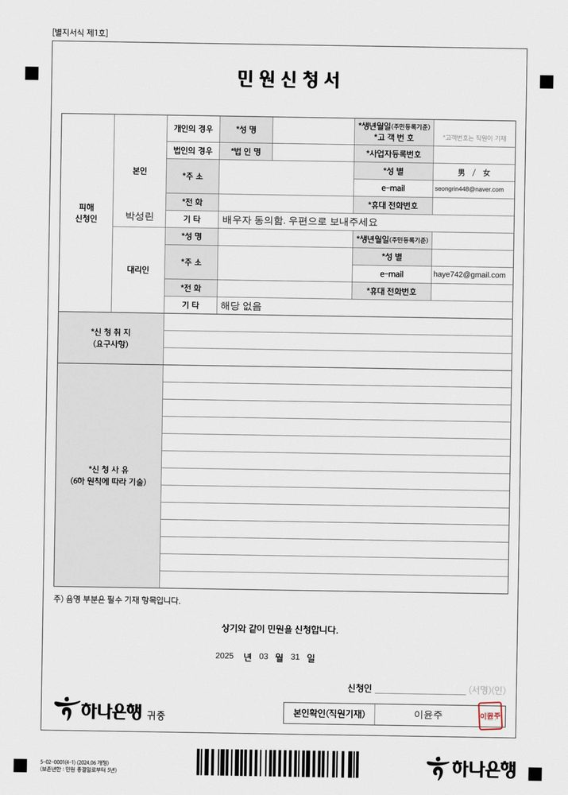</a> <a href="../examples/img/hf430_1000000_p2_b6e91dd2.jpg">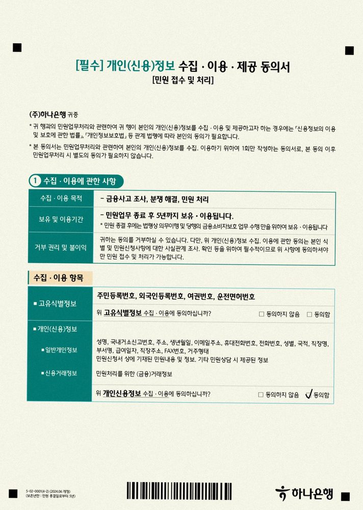</a> <a href="../examples/img/hf430_1000000_p3_2bc47b0f.jpg">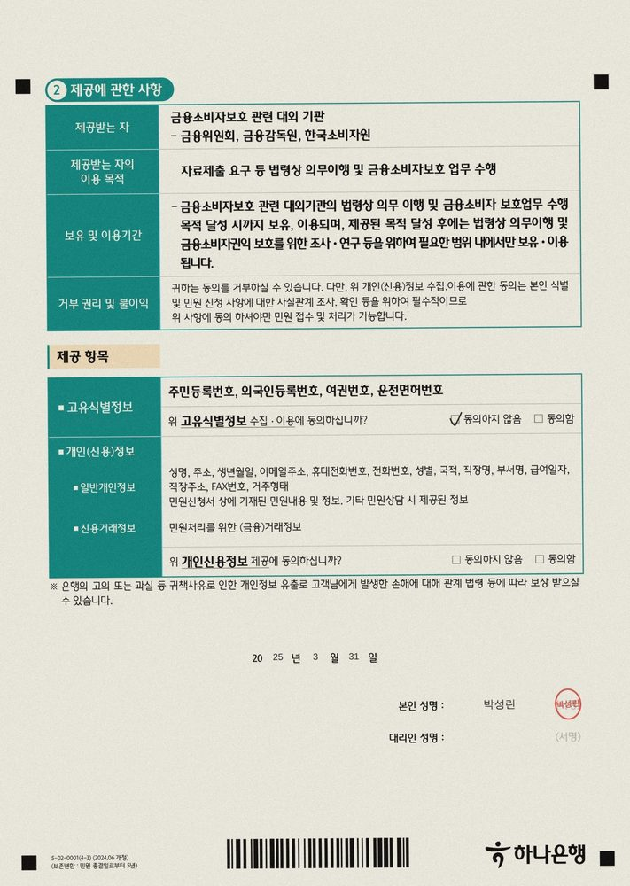</a> <a href="../examples/img/hf430_1000000_p4_9a49ff2a.jpg">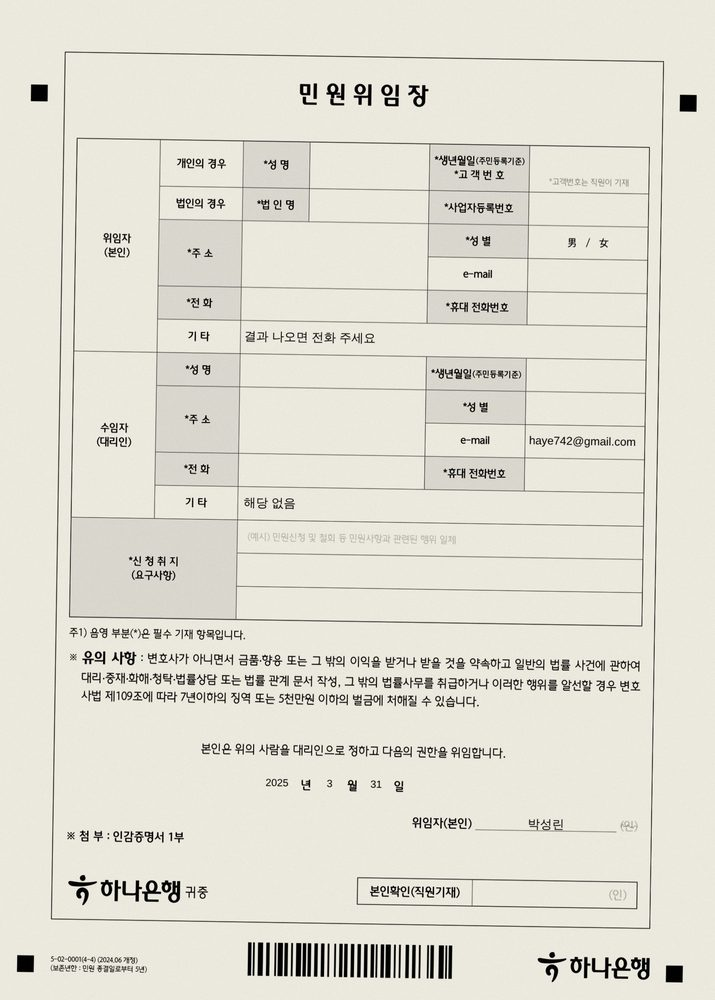</a></p>

1. `hf430_1000000_p1.jpg` · 2. `hf430_1000000_p2.jpg` · 3. `hf430_1000000_p3.jpg` · 4. `hf430_1000000_p4.jpg`

**질문** (`prompt`)

```
이 문서의 '기타' 칸에 적힌 내용을 DB에 넣을 수 있게 정리해 JSON 한 줄로 답하세요. 기준일(서류 작성일)은 2025-03-31 입니다.
쓸 수 있는 키
- purpose: 용도. 보기 중 하나: 생활자금, 주택구입, 전세자금, 사업자금, 학자금, 자녀 교육비, 의료비, 결혼자금, 차량구입
- reason: 사유. 보기 중 하나: 만기 해지, 해외 이주, 타행 이체, 급여 수령, 본인 요청, 계좌 정리, 주소 변경, 분실
- amount: 금액. 원 단위 정수 (3천만원 → 30000000)
- date: 날짜. YYYY-MM-DD. 상대 날짜는 기준일로 계산 (초 = 1일, 중순 = 15일, 말 = 말일, 다음주 = 7일 뒤)
- period_months: 기간. 개월 수 정수 (1년 → 12)
- request: 요청. 보기 중 하나: 서류 추가 제출, 전화 연락, 우편 발송, 문자 안내, 방문 예정
- memo: 위 키에 맞지 않는 내용. 적힌 그대로
- approx: 대략적인 값(정도, 쯤, 약, 초·중순, 다음주 등)을 쓴 키의 목록
적힌 내용만 쓰고 null 은 쓰지 않습니다. 대략적인 값도 가장 그럴듯한 값 하나로 쓰세요.
```

**정답** (`answer`)

```json
{"memo": "배우자 동의함", "request": "우편 발송"}
```

**나눠 보기 정보** (`meta`)

```json
{
 "doc_type": "hf430",
 "doc_name": "민원신청서",
 "group": "hana",
 "condition": "scan",
 "writing": "print",
 "n_pages": 4,
 "view": "all",
 "key": "기타",
 "label": "기타",
 "level": "short",
 "task_group": "doc",
 "label_format": "record"
}
```

**문항 한 줄 전체** (`tasks/freetext.jsonl`)

<details><summary>펼치기</summary>

```json
{
 "id": "freetext/hf430_1000000/기타",
 "task": "freetext",
 "prompt": "이 문서의 '기타' 칸에 적힌 내용을 DB에 넣을 수 있게 정리해 JSON 한 줄로 답하세요. 기준일(서류 작성일)은 2025-03-31 입니다.\n쓸 수 있는 키\n- purpose: 용도. 보기 중 하나: 생활자금, 주택구입, 전세자금, 사업자금, 학자금, 자녀 교육비, 의료비, 결혼자금, 차량구입\n- reason: 사유. 보기 중 하나: 만기 해지, 해외 이주, 타행 이체, 급여 수령, 본인 요청, 계좌 정리, 주소 변경, 분실\n- amount: 금액. 원 단위 정수 (3천만원 → 30000000)\n- date: 날짜. YYYY-MM-DD. 상대 날짜는 기준일로 계산 (초 = 1일, 중순 = 15일, 말 = 말일, 다음주 = 7일 뒤)\n- period_months: 기간. 개월 수 정수 (1년 → 12)\n- request: 요청. 보기 중 하나: 서류 추가 제출, 전화 연락, 우편 발송, 문자 안내, 방문 예정\n- memo: 위 키에 맞지 않는 내용. 적힌 그대로\n- approx: 대략적인 값(정도, 쯤, 약, 초·중순, 다음주 등)을 쓴 키의 목록\n적힌 내용만 쓰고 null 은 쓰지 않습니다. 대략적인 값도 가장 그럴듯한 값 하나로 쓰세요.",
 "answer": {"memo": "배우자 동의함", "request": "우편 발송"},
 "images": [
  "images/hf430_1000000_p1.jpg",
  "images/hf430_1000000_p2.jpg",
  "images/hf430_1000000_p3.jpg",
  "images/hf430_1000000_p4.jpg"
 ],
 "meta": {
  "doc_type": "hf430",
  "doc_name": "민원신청서",
  "group": "hana",
  "condition": "scan",
  "writing": "print",
  "n_pages": 4,
  "view": "all",
  "key": "기타",
  "label": "기타",
  "level": "short",
  "task_group": "doc",
  "label_format": "record"
 }
}
```
</details>

**학습 레코드** (`swift/all.jsonl` 한 줄: 같은 문항을 질문 + 정답 답변 대화로 바꾼 것)

```json
{
 "id": "freetext/hf430_1000000/기타",
 "task": "freetext",
 "images": [
  "images/hf430_1000000_p1.jpg",
  "images/hf430_1000000_p2.jpg",
  "images/hf430_1000000_p3.jpg",
  "images/hf430_1000000_p4.jpg"
 ],
 "messages": [
  {
   "role": "user",
   "content": "<image><image><image><image>이 문서의 '기타' 칸에 적힌 내용을 DB에 넣을 수 있게 정리해 JSON 한 줄로 답하세요. 기준일(서류 작성일)은 2025-03-31 입니다.\n쓸 수 있는 키\n- purpose: 용도. 보기 중 하나: 생활자금, 주택구입, 전세자금, 사업자금, 학자금, 자녀 교육비, 의료비, 결혼자금, 차량구입\n- reason: 사유. 보기 중 하나: 만기 해지, 해외 이주, 타행 이체, 급여 수령, 본인 요청, 계좌 정리, 주소 변경, 분실\n- amount: 금액. 원 단위 정수 (3천만원 → 30000000)\n- date: 날짜. YYYY-MM-DD. 상대 날짜는 기준일로 계산 (초 = 1일, 중순 = 15일, 말 = 말일, 다음주 = 7일 뒤)\n- period_months: 기간. 개월 수 정수 (1년 → 12)\n- request: 요청. 보기 중 하나: 서류 추가 제출, 전화 연락, 우편 발송, 문자 안내, 방문 예정\n- memo: 위 키에 맞지 않는 내용. 적힌 그대로\n- approx: 대략적인 값(정도, 쯤, 약, 초·중순, 다음주 등)을 쓴 키의 목록\n적힌 내용만 쓰고 null 은 쓰지 않습니다. 대략적인 값도 가장 그럴듯한 값 하나로 쓰세요."
  },
  {"role": "assistant", "content": "{\"memo\": \"배우자 동의함\", \"request\": \"우편 발송\"}"}
 ]
}
```

### 2-5. form_qa — 서식 전용 질문

**정답 형식:** 서식 폴더 `qa.py` 의 함수가 돌려준 정답 그대로 (숫자·예/아니오·글·JSON)

**채점:** eval.answer_type 으로: 숫자는 단위를 떼고 tol 안, 예/아니오는 네·아니요도 인정, 글은 띄어쓰기·문장부호를 맞춰 같은지, JSON 은 칸마다

이 저장소의 서식에는 아직 `qa.py` 가 없어 예시가 없습니다. 서식 폴더에 `qa.py` 를 두면 그 서식 문서마다 함수 하나 = 질문 하나가 나옵니다 (`docgen/forms/README.md`).

### 2-6. ocr_page — 전체 받아쓰기

**정답 형식:** 서류에 채워 넣은 값들 (한 줄에 하나). 채점은 이 값들이 받아쓴 글에 들어 있는 비율

**채점:** 값 재현율 (공백 무시). recall_fuzzy 는 값 길이 20% 까지 틀려도 인정

**입력 이미지** (1장, 질문 앞에 이 순서로)

<p><a href="../examples/img/loan_application_1000000_c024fabb.jpg"></a></p>

1. `loan_application_1000000.jpg`

**질문** (`prompt`)

```
이 문서 이미지에 보이는 모든 글자를 빠짐없이 읽어 텍스트로 옮기세요. 위에서 아래, 왼쪽에서 오른쪽 순서로 쓰고, 표는 한 행을 한 줄로 쓰세요. 설명 없이 읽은 글자만 출력하세요.
```

**정답** (`answer`)

```json
[
 "SC제일은행",
 "을지로지점",
 "조호빈",
 "901216-1******",
 "18365",
 "경기도 화성시 효행로 301, 113동 2004호 (반송동, e편한세상리버뷰아파트)",
 "010-4285-8633",
 "(주)코리아커뮤니케이션",
 "영업1팀",
 "대리",
 "2020-02-15",
 "5,260만원",
 "경기도 고양시 일산동구 정발산로 139, 18층",
 "전세자금대출",
 "일금 삼억사천사백만원정",
 "344,000,000",
 "2년",
 "2026-07-17",
 "매월 15일",
 "주택 임차보증금",
 "한국주택금융공사 보증서",
 "910-70-860556",
 "2026년 07월 14일"
]
```

**나눠 보기 정보** (`meta`)

```json
{
 "doc_type": "loan_application",
 "doc_name": "대출거래신청서",
 "group": "bank_form",
 "condition": "scan",
 "writing": "print",
 "n_pages": 1,
 "view": "all",
 "task_group": "ocr",
 "label_format": "text_list"
}
```

**문항 한 줄 전체** (`tasks/ocr_page.jsonl`)

<details><summary>펼치기</summary>

```json
{
 "id": "ocr_page/loan_application_1000000",
 "task": "ocr_page",
 "prompt": "이 문서 이미지에 보이는 모든 글자를 빠짐없이 읽어 텍스트로 옮기세요. 위에서 아래, 왼쪽에서 오른쪽 순서로 쓰고, 표는 한 행을 한 줄로 쓰세요. 설명 없이 읽은 글자만 출력하세요.",
 "answer": [
  "SC제일은행",
  "을지로지점",
  "조호빈",
  "901216-1******",
  "18365",
  "경기도 화성시 효행로 301, 113동 2004호 (반송동, e편한세상리버뷰아파트)",
  "010-4285-8633",
  "(주)코리아커뮤니케이션",
  "영업1팀",
  "대리",
  "2020-02-15",
  "5,260만원",
  "경기도 고양시 일산동구 정발산로 139, 18층",
  "전세자금대출",
  "일금 삼억사천사백만원정",
  "344,000,000",
  "2년",
  "2026-07-17",
  "매월 15일",
  "주택 임차보증금",
  "한국주택금융공사 보증서",
  "910-70-860556",
  "2026년 07월 14일"
 ],
 "images": ["images/loan_application_1000000.jpg"],
 "meta": {
  "doc_type": "loan_application",
  "doc_name": "대출거래신청서",
  "group": "bank_form",
  "condition": "scan",
  "writing": "print",
  "n_pages": 1,
  "view": "all",
  "task_group": "ocr",
  "label_format": "text_list"
 }
}
```
</details>

**학습 레코드** (`swift/all.jsonl` 한 줄: 같은 문항을 질문 + 정답 답변 대화로 바꾼 것)

```json
{
 "id": "ocr_page/loan_application_1000000",
 "task": "ocr_page",
 "images": ["images/loan_application_1000000.jpg"],
 "messages": [
  {
   "role": "user",
   "content": "<image>이 문서 이미지에 보이는 모든 글자를 빠짐없이 읽어 텍스트로 옮기세요. 위에서 아래, 왼쪽에서 오른쪽 순서로 쓰고, 표는 한 행을 한 줄로 쓰세요. 설명 없이 읽은 글자만 출력하세요."
  },
  {
   "role": "assistant",
   "content": "SC제일은행\n을지로지점\n조호빈\n901216-1******\n18365\n경기도 화성시 효행로 301, 113동 2004호 (반송동, e편한세상리버뷰아파트)\n010-4285-8633\n(주)코리아커뮤니케이션\n영업1팀\n대리\n2020-02-15\n5,260만원\n경기도 고양시 일산동구 정발산로 139, 18층\n전세자금대출\n일금 삼억사천사백만원정\n344,000,000\n2년\n2026-07-17\n매월 15일\n주택 임차보증금\n한국주택금융공사 보증서\n910-70-860556\n2026년 07월 14일"
  }
 ]
}
```

### 2-7. ocr_field — 값 칸 읽기

**정답 형식:** 잘라낸 값 칸에 적힌 글자

**채점:** 완전 일치 (공백 정규화), CER 함께

**입력 이미지** (1장, 질문 앞에 이 순서로)

<p><a href="../examples/img/loan_application_1000000_0_3aa4c7e5.jpg">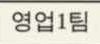</a></p>

1. `loan_application_1000000_0.png`

**질문** (`prompt`)

```
이미지에 적힌 글자를 그대로 읽어 옮기세요. 설명 없이 읽은 글자만 출력하세요.
```

**정답** (`answer`)

```
영업1팀
```

**나눠 보기 정보** (`meta`)

```json
{
 "doc_type": "loan_application",
 "doc_name": "대출거래신청서",
 "group": "bank_form",
 "condition": "scan",
 "writing": "print",
 "n_pages": 1,
 "view": "all",
 "key": "workplace.department",
 "label": "근무부서",
 "kind": "text",
 "corrected": false,
 "length": 4,
 "task_group": "ocr",
 "label_format": "text"
}
```

**문항 한 줄 전체** (`tasks/ocr_field.jsonl`)

<details><summary>펼치기</summary>

```json
{
 "id": "ocr_field/loan_application_1000000/workplace.department",
 "task": "ocr_field",
 "images": ["crops/loan_application_1000000_0.png"],
 "prompt": "이미지에 적힌 글자를 그대로 읽어 옮기세요. 설명 없이 읽은 글자만 출력하세요.",
 "answer": "영업1팀",
 "meta": {
  "doc_type": "loan_application",
  "doc_name": "대출거래신청서",
  "group": "bank_form",
  "condition": "scan",
  "writing": "print",
  "n_pages": 1,
  "view": "all",
  "key": "workplace.department",
  "label": "근무부서",
  "kind": "text",
  "corrected": false,
  "length": 4,
  "task_group": "ocr",
  "label_format": "text"
 }
}
```
</details>

**학습 레코드** (`swift/all.jsonl` 한 줄: 같은 문항을 질문 + 정답 답변 대화로 바꾼 것)

```json
{
 "id": "ocr_field/loan_application_1000000/workplace.department",
 "task": "ocr_field",
 "images": ["crops/loan_application_1000000_0.png"],
 "messages": [
  {"role": "user", "content": "<image>이미지에 적힌 글자를 그대로 읽어 옮기세요. 설명 없이 읽은 글자만 출력하세요."},
  {"role": "assistant", "content": "영업1팀"}
 ]
}
```

### 2-8. table — 표 추출

**정답 형식:** `{"columns": 질문의 열 키, "rows": [[값 …]], "row_boxes": [{"bbox_2d", "page"}]}`. 행은 보이는 순서, 빈 칸·없는 열은 null

**채점:** 주 지표: 칸 F1 (정답 행과 답한 행을 순서대로 짝지은 뒤). 함께: 행 완전 일치, 행 수 일치, 행 위치 F1, 없는 열 null 비율

**입력 이미지** (1장, 질문 앞에 이 순서로)

<p><a href="../examples/img/hf206_1000000_p7_abb4abbd.jpg">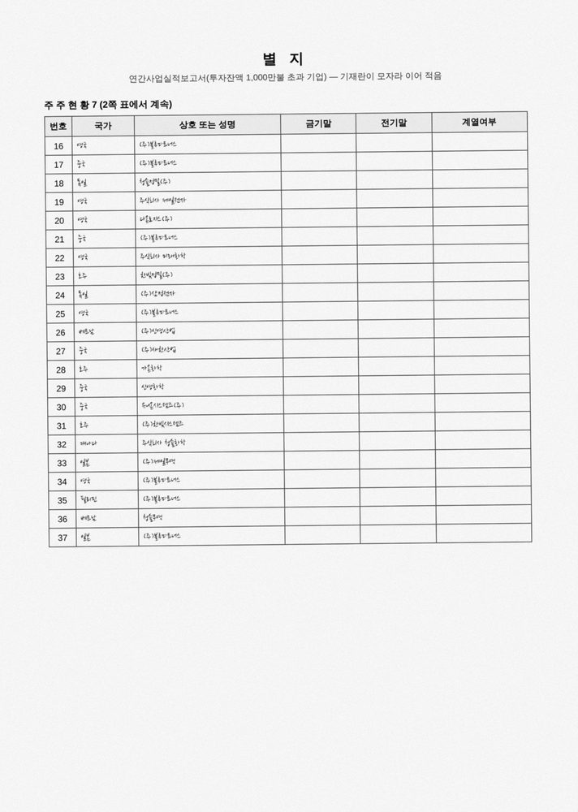</a></p>

1. `hf206_1000000_p7.jpg`

**질문** (`prompt`)

```
이 문서에서 '국가'·'상호또는성명' 열이 있는 표의 모든 행을 문서에 보이는 순서대로(위에서 아래, 앞쪽부터) 읽어 JSON 으로 답하세요.
꼴: {"columns": [열 키, …], "rows": [[값, …], …], "row_boxes": [{"bbox_2d": [x1, y1, x2, y2], "page": 쪽 번호}, …]}
- columns 는 아래 열 키를 그 순서 그대로 쓰고, rows 는 행마다 같은 순서로 값을 씁니다.
- 값은 문서에 적힌 그대로 씁니다. 빈 칸과 표에 없는 열은 null, 칸 안의 여러 줄은 공백 하나로 잇고, 여러 행에 걸친 칸은 행마다 같은 값을 씁니다.
- 합계·소계 행, 다음 쪽에서 다시 나온 머리글 행, 모두 빈 행은 뺍니다.
- row_boxes 는 rows 와 같은 순서로 행마다 그 행을 감싸는 상자입니다. 좌표는 그 쪽 이미지 기준 0~1000 정수, 쪽 번호는 1부터입니다.
- 그런 표가 없으면 rows 와 row_boxes 를 [] 로 답하세요.
열 (키: 설명)
- 국가: 국가
- 상호또는성명: 상호또는성명
- 금기말: 금기말
- 전기말: 전기말
- 계열여부: 계열여부
- 사업자번호: 사업자번호
```

**정답** (`answer`)

```json
{
 "columns": ["국가", "상호또는성명", "금기말", "전기말", "계열여부", "사업자번호"],
 "rows": [
  ["영국", "(주)블루파트너스", null, null, null, null],
  ["중국", "(주)블루파트너스", null, null, null, null],
  ["독일", "청솔정밀(주)", null, null, null, null],
  ["영국", "주식회사 제일전자", null, null, null, null],
  ["영국", "다온로지스(주)", null, null, null, null],
  ["중국", "(주)블루파트너스", null, null, null, null],
  ["영국", "주식회사 미래화학", null, null, null, null],
  ["호주", "한빛정밀(주)", null, null, null, null],
  ["독일", "(주)삼정전자", null, null, null, null],
  ["영국", "(주)블루파트너스", null, null, null, null],
  ["베트남", "(주)신영산업", null, null, null, null],
  ["중국", "(주)새한산업", null, null, null, null],
  ["호주", "가온화학", null, null, null, null],
  ["중국", "신영화학", null, null, null, null],
  ["중국", "유니온시스템즈(주)", null, null, null, null],
  ["호주", "(주)한빛시스템즈", null, null, null, null],
  ["캐나다", "주식회사 청솔화학", null, null, null, null],
  ["일본", "(주)제일무역", null, null, null, null],
  ["영국", "(주)블루파트너스", null, null, null, null],
  ["필리핀", "(주)블루파트너스", null, null, null, null],
  ["베트남", "청솔무역", null, null, null, null],
  ["일본", "(주)블루파트너스", null, null, null, null]
 ],
 "row_boxes": [
  {"bbox_2d": [133, 172, 306, 184], "page": 1},
  {"bbox_2d": [133, 195, 307, 207], "page": 1},
  {"bbox_2d": [133, 218, 295, 230], "page": 1},
  {"bbox_2d": [134, 241, 323, 253], "page": 1},
  {"bbox_2d": [134, 264, 299, 276], "page": 1},
  {"bbox_2d": [135, 287, 308, 299], "page": 1},
  {"bbox_2d": [135, 310, 322, 322], "page": 1},
  {"bbox_2d": [135, 333, 299, 345], "page": 1},
  {"bbox_2d": [136, 356, 304, 368], "page": 1},
  {"bbox_2d": [136, 379, 309, 391], "page": 1},
  {"bbox_2d": [136, 402, 303, 414], "page": 1},
  {"bbox_2d": [137, 425, 304, 437], "page": 1},
  {"bbox_2d": [137, 448, 281, 460], "page": 1},
  {"bbox_2d": [137, 471, 284, 483], "page": 1},
  {"bbox_2d": [138, 494, 319, 506], "page": 1},
  {"bbox_2d": [138, 517, 318, 529], "page": 1},
  {"bbox_2d": [138, 540, 322, 552], "page": 1},
  {"bbox_2d": [139, 563, 303, 575], "page": 1},
  {"bbox_2d": [139, 586, 313, 598], "page": 1},
  {"bbox_2d": [139, 609, 313, 621], "page": 1},
  {"bbox_2d": [140, 632, 281, 644], "page": 1},
  {"bbox_2d": [140, 655, 314, 667], "page": 1}
 ]
}
```

**채점 정보** (`eval`)

```json
{
 "fields": {
  "국가": {"type": "text", "norm": null, "kind": "text", "label": "국가"},
  "상호또는성명": {"type": "text", "norm": null, "kind": "name", "label": "상호또는성명"},
  "금기말": {"type": "text", "norm": null, "kind": "text", "label": "금기말"},
  "전기말": {"type": "text", "norm": null, "kind": "text", "label": "전기말"},
  "계열여부": {"type": "text", "norm": null, "kind": "text", "label": "계열여부"},
  "사업자번호": {"type": "biz_no", "norm": null, "kind": "absent", "label": "사업자번호"}
 },
 "group": "주주현황7_목록",
 "absent": ["사업자번호"]
}
```

**나눠 보기 정보** (`meta`)

```json
{
 "doc_type": "hf206",
 "doc_name": "연간사업실적보고서(투자잔액 1,000만불 초과 기업)",
 "group": "hana",
 "condition": "scan",
 "writing": "hand",
 "n_pages": 1,
 "view": "page",
 "page": 7,
 "n_pages_doc": 7,
 "table": "주주현황7_목록",
 "ref": "header",
 "scope": "all",
 "n_rows": 22,
 "n_cols": 6,
 "absent": true,
 "task_group": "doc",
 "label_format": "table_rows"
}
```

**문항 한 줄 전체** (`tasks/table.jsonl`)

<details><summary>펼치기</summary>

```json
{
 "id": "table/hf206_1000000_p7/주주현황7_목록",
 "task": "table",
 "prompt": "이 문서에서 '국가'·'상호또는성명' 열이 있는 표의 모든 행을 문서에 보이는 순서대로(위에서 아래, 앞쪽부터) 읽어 JSON 으로 답하세요.\n꼴: {\"columns\": [열 키, …], \"rows\": [[값, …], …], \"row_boxes\": [{\"bbox_2d\": [x1, y1, x2, y2], \"page\": 쪽 번호}, …]}\n- columns 는 아래 열 키를 그 순서 그대로 쓰고, rows 는 행마다 같은 순서로 값을 씁니다.\n- 값은 문서에 적힌 그대로 씁니다. 빈 칸과 표에 없는 열은 null, 칸 안의 여러 줄은 공백 하나로 잇고, 여러 행에 걸친 칸은 행마다 같은 값을 씁니다.\n- 합계·소계 행, 다음 쪽에서 다시 나온 머리글 행, 모두 빈 행은 뺍니다.\n- row_boxes 는 rows 와 같은 순서로 행마다 그 행을 감싸는 상자입니다. 좌표는 그 쪽 이미지 기준 0~1000 정수, 쪽 번호는 1부터입니다.\n- 그런 표가 없으면 rows 와 row_boxes 를 [] 로 답하세요.\n열 (키: 설명)\n- 국가: 국가\n- 상호또는성명: 상호또는성명\n- 금기말: 금기말\n- 전기말: 전기말\n- 계열여부: 계열여부\n- 사업자번호: 사업자번호",
 "answer": {
  "columns": ["국가", "상호또는성명", "금기말", "전기말", "계열여부", "사업자번호"],
  "rows": [
   ["영국", "(주)블루파트너스", null, null, null, null],
   ["중국", "(주)블루파트너스", null, null, null, null],
   ["독일", "청솔정밀(주)", null, null, null, null],
   ["영국", "주식회사 제일전자", null, null, null, null],
   ["영국", "다온로지스(주)", null, null, null, null],
   ["중국", "(주)블루파트너스", null, null, null, null],
   ["영국", "주식회사 미래화학", null, null, null, null],
   ["호주", "한빛정밀(주)", null, null, null, null],
   ["독일", "(주)삼정전자", null, null, null, null],
   ["영국", "(주)블루파트너스", null, null, null, null],
   ["베트남", "(주)신영산업", null, null, null, null],
   ["중국", "(주)새한산업", null, null, null, null],
   ["호주", "가온화학", null, null, null, null],
   ["중국", "신영화학", null, null, null, null],
   ["중국", "유니온시스템즈(주)", null, null, null, null],
   ["호주", "(주)한빛시스템즈", null, null, null, null],
   ["캐나다", "주식회사 청솔화학", null, null, null, null],
   ["일본", "(주)제일무역", null, null, null, null],
   ["영국", "(주)블루파트너스", null, null, null, null],
   ["필리핀", "(주)블루파트너스", null, null, null, null],
   ["베트남", "청솔무역", null, null, null, null],
   ["일본", "(주)블루파트너스", null, null, null, null]
  ],
  "row_boxes": [
   {"bbox_2d": [133, 172, 306, 184], "page": 1},
   {"bbox_2d": [133, 195, 307, 207], "page": 1},
   {"bbox_2d": [133, 218, 295, 230], "page": 1},
   {"bbox_2d": [134, 241, 323, 253], "page": 1},
   {"bbox_2d": [134, 264, 299, 276], "page": 1},
   {"bbox_2d": [135, 287, 308, 299], "page": 1},
   {"bbox_2d": [135, 310, 322, 322], "page": 1},
   {"bbox_2d": [135, 333, 299, 345], "page": 1},
   {"bbox_2d": [136, 356, 304, 368], "page": 1},
   {"bbox_2d": [136, 379, 309, 391], "page": 1},
   {"bbox_2d": [136, 402, 303, 414], "page": 1},
   {"bbox_2d": [137, 425, 304, 437], "page": 1},
   {"bbox_2d": [137, 448, 281, 460], "page": 1},
   {"bbox_2d": [137, 471, 284, 483], "page": 1},
   {"bbox_2d": [138, 494, 319, 506], "page": 1},
   {"bbox_2d": [138, 517, 318, 529], "page": 1},
   {"bbox_2d": [138, 540, 322, 552], "page": 1},
   {"bbox_2d": [139, 563, 303, 575], "page": 1},
   {"bbox_2d": [139, 586, 313, 598], "page": 1},
   {"bbox_2d": [139, 609, 313, 621], "page": 1},
   {"bbox_2d": [140, 632, 281, 644], "page": 1},
   {"bbox_2d": [140, 655, 314, 667], "page": 1}
  ]
 },
 "eval": {
  "fields": {
   "국가": {"type": "text", "norm": null, "kind": "text", "label": "국가"},
   "상호또는성명": {"type": "text", "norm": null, "kind": "name", "label": "상호또는성명"},
   "금기말": {"type": "text", "norm": null, "kind": "text", "label": "금기말"},
   "전기말": {"type": "text", "norm": null, "kind": "text", "label": "전기말"},
   "계열여부": {"type": "text", "norm": null, "kind": "text", "label": "계열여부"},
   "사업자번호": {"type": "biz_no", "norm": null, "kind": "absent", "label": "사업자번호"}
  },
  "group": "주주현황7_목록",
  "absent": ["사업자번호"]
 },
 "images": ["images/hf206_1000000_p7.jpg"],
 "meta": {
  "doc_type": "hf206",
  "doc_name": "연간사업실적보고서(투자잔액 1,000만불 초과 기업)",
  "group": "hana",
  "condition": "scan",
  "writing": "hand",
  "n_pages": 1,
  "view": "page",
  "page": 7,
  "n_pages_doc": 7,
  "table": "주주현황7_목록",
  "ref": "header",
  "scope": "all",
  "n_rows": 22,
  "n_cols": 6,
  "absent": true,
  "task_group": "doc",
  "label_format": "table_rows"
 }
}
```
</details>

**학습 레코드** (`swift/all.jsonl` 한 줄: 같은 문항을 질문 + 정답 답변 대화로 바꾼 것)

```json
{
 "id": "table/hf206_1000000_p7/주주현황7_목록",
 "task": "table",
 "images": ["images/hf206_1000000_p7.jpg"],
 "messages": [
  {
   "role": "user",
   "content": "<image>이 문서에서 '국가'·'상호또는성명' 열이 있는 표의 모든 행을 문서에 보이는 순서대로(위에서 아래, 앞쪽부터) 읽어 JSON 으로 답하세요.\n꼴: {\"columns\": [열 키, …], \"rows\": [[값, …], …], \"row_boxes\": [{\"bbox_2d\": [x1, y1, x2, y2], \"page\": 쪽 번호}, …]}\n- columns 는 아래 열 키를 그 순서 그대로 쓰고, rows 는 행마다 같은 순서로 값을 씁니다.\n- 값은 문서에 적힌 그대로 씁니다. 빈 칸과 표에 없는 열은 null, 칸 안의 여러 줄은 공백 하나로 잇고, 여러 행에 걸친 칸은 행마다 같은 값을 씁니다.\n- 합계·소계 행, 다음 쪽에서 다시 나온 머리글 행, 모두 빈 행은 뺍니다.\n- row_boxes 는 rows 와 같은 순서로 행마다 그 행을 감싸는 상자입니다. 좌표는 그 쪽 이미지 기준 0~1000 정수, 쪽 번호는 1부터입니다.\n- 그런 표가 없으면 rows 와 row_boxes 를 [] 로 답하세요.\n열 (키: 설명)\n- 국가: 국가\n- 상호또는성명: 상호또는성명\n- 금기말: 금기말\n- 전기말: 전기말\n- 계열여부: 계열여부\n- 사업자번호: 사업자번호"
  },
  {
   "role": "assistant",
   "content": "{\"columns\": [\"국가\", \"상호또는성명\", \"금기말\", \"전기말\", \"계열여부\", \"사업자번호\"], \"rows\": [[\"영국\", \"(주)블루파트너스\", null, null, null, null], [\"중국\", \"(주)블루파트너스\", null, null, null, null], [\"독일\", \"청솔정밀(주)\", null, null, null, null], [\"영국\", \"주식회사 제일전자\", null, null, null, null], [\"영국\", \"다온로지스(주)\", null, null, null, null], [\"중국\", \"(주)블루파트너스\", null, null, null, null], [\"영국\", \"주식회사 미래화학\", null, null, null, null], [\"호주\", \"한빛정밀(주)\", null, null, null, null], [\"독일\", \"(주)삼정전자\", null, null, null, null], [\"영국\", \"(주)블루파트너스\", null, null, null, null], [\"베트남\", \"(주)신영산업\", null, null, null, null], [\"중국\", \"(주)새한산업\", null, null, null, null], [\"호주\", \"가온화학\", null, null, null, null], [\"중국\", \"신영화학\", null, null, null, null], [\"중국\", \"유니온시스템즈(주)\", null, null, null, null], [\"호주\", \"(주)한빛시스템즈\", null, null, null, null], [\"캐나다\", \"주식회사 청솔화학\", null, null, null, null], [\"일본\", \"(주)제일무역\", null, null, null, null], [\"영국\", \"(주)블루파트너스\", null, null, null, null], [\"필리핀\", \"(주)블루파트너스\", null, null, null, null], [\"베트남\", \"청솔무역\", null, null, null, null], [\"일본\", \"(주)블루파트너스\", null, null, null, null]], \"row_boxes\": [{\"bbox_2d\": [133, 172, 306, 184], \"page\": 1}, {\"bbox_2d\": [133, 195, 307, 207], \"page\": 1}, {\"bbox_2d\": [133, 218, 295, 230], \"page\": 1}, {\"bbox_2d\": [134, 241, 323, 253], \"page\": 1}, {\"bbox_2d\": [134, 264, 299, 276], \"page\": 1}, {\"bbox_2d\": [135, 287, 308, 299], \"page\": 1}, {\"bbox_2d\": [135, 310, 322, 322], \"page\": 1}, {\"bbox_2d\": [135, 333, 299, 345], \"page\": 1}, {\"bbox_2d\": [136, 356, 304, 368], \"page\": 1}, {\"bbox_2d\": [136, 379, 309, 391], \"page\": 1}, {\"bbox_2d\": [136, 402, 303, 414], \"page\": 1}, {\"bbox_2d\": [137, 425, 304, 437], \"page\": 1}, {\"bbox_2d\": [137, 448, 281, 460], \"page\": 1}, {\"bbox_2d\": [137, 471, 284, 483], \"page\": 1}, {\"bbox_2d\": [138, 494, 319, 506], \"page\": 1}, {\"bbox_2d\": [138, 517, 318, 529], \"page\": 1}, {\"bbox_2d\": [138, 540, 322, 552], \"page\": 1}, {\"bbox_2d\": [139, 563, 303, 575], \"page\": 1}, {\"bbox_2d\": [139, 586, 313, 598], \"page\": 1}, {\"bbox_2d\": [139, 609, 313, 621], \"page\": 1}, {\"bbox_2d\": [140, 632, 281, 644], \"page\": 1}, {\"bbox_2d\": [140, 655, 314, 667], \"page\": 1}]}"
  }
 ]
}
```

### 2-9. table_read — 표 그대로 옮기기

**정답 형식:** 같은 꼴, `columns` 는 머리글 글자 그대로 (여러 줄 머리글은 `위 > 아래`), 합계 행은 그대로

**채점:** 주 지표: 칸 F1 (머리글을 글자로 짝지은 뒤). 함께: 머리글 F1

**입력 이미지** (1장, 질문 앞에 이 순서로)

<p><a href="../examples/img/hf206_1000000_p7_abb4abbd.jpg"></a></p>

1. `hf206_1000000_p7.jpg`

**질문** (`prompt`)

```
이 문서에서 표를 머리글까지 그대로 옮겨 JSON 으로 답하세요.
꼴: {"columns": [머리글 글자, …], "rows": [[칸 글자, …], …], "row_boxes": [{"bbox_2d": [x1, y1, x2, y2], "page": 쪽 번호}, …]}
- columns 는 표의 머리글을 왼쪽부터 쓰고, 머리글이 여러 줄이면 위 칸과 아래 칸 글자를 " > " 로 잇습니다.
- rows 는 행마다 columns 와 같은 순서로 칸 글자를 씁니다. 빈 칸은 null, 칸 안의 여러 줄은 공백 하나로 잇고, 여러 행에 걸친 칸은 행마다 같은 글자를 씁니다.
- 다음 쪽에서 다시 나온 머리글 행과 모두 빈 행은 빼고, 합계·소계 행은 그대로 둡니다.
- row_boxes 는 rows 와 같은 순서로 행마다 그 행을 감싸는 상자입니다. 좌표는 그 쪽 이미지 기준 0~1000 정수, 쪽 번호는 1부터입니다.
```

**정답** (`answer`)

```json
{
 "columns": ["번호", "국가", "상호 또는 성명", "금기말", "전기말", "계열여부"],
 "rows": [
  ["16", "영국", "(주)블루파트너스", null, null, null],
  ["17", "중국", "(주)블루파트너스", null, null, null],
  ["18", "독일", "청솔정밀(주)", null, null, null],
  ["19", "영국", "주식회사 제일전자", null, null, null],
  ["20", "영국", "다온로지스(주)", null, null, null],
  ["21", "중국", "(주)블루파트너스", null, null, null],
  ["22", "영국", "주식회사 미래화학", null, null, null],
  ["23", "호주", "한빛정밀(주)", null, null, null],
  ["24", "독일", "(주)삼정전자", null, null, null],
  ["25", "영국", "(주)블루파트너스", null, null, null],
  ["26", "베트남", "(주)신영산업", null, null, null],
  ["27", "중국", "(주)새한산업", null, null, null],
  ["28", "호주", "가온화학", null, null, null],
  ["29", "중국", "신영화학", null, null, null],
  ["30", "중국", "유니온시스템즈(주)", null, null, null],
  ["31", "호주", "(주)한빛시스템즈", null, null, null],
  ["32", "캐나다", "주식회사 청솔화학", null, null, null],
  ["33", "일본", "(주)제일무역", null, null, null],
  ["34", "영국", "(주)블루파트너스", null, null, null],
  ["35", "필리핀", "(주)블루파트너스", null, null, null],
  ["36", "베트남", "청솔무역", null, null, null],
  ["37", "일본", "(주)블루파트너스", null, null, null]
 ],
 "row_boxes": [
  {"bbox_2d": [78, 162, 912, 191], "page": 1},
  {"bbox_2d": [78, 185, 913, 214], "page": 1},
  {"bbox_2d": [78, 208, 913, 237], "page": 1},
  {"bbox_2d": [79, 231, 913, 260], "page": 1},
  {"bbox_2d": [79, 254, 914, 283], "page": 1},
  {"bbox_2d": [79, 277, 914, 306], "page": 1},
  {"bbox_2d": [80, 300, 915, 329], "page": 1},
  {"bbox_2d": [80, 323, 915, 352], "page": 1},
  {"bbox_2d": [80, 346, 915, 375], "page": 1},
  {"bbox_2d": [81, 369, 916, 398], "page": 1},
  {"bbox_2d": [81, 392, 916, 421], "page": 1},
  {"bbox_2d": [81, 415, 916, 444], "page": 1},
  {"bbox_2d": [82, 438, 917, 467], "page": 1},
  {"bbox_2d": [82, 461, 917, 490], "page": 1},
  {"bbox_2d": [82, 484, 917, 513], "page": 1},
  {"bbox_2d": [83, 507, 918, 536], "page": 1},
  {"bbox_2d": [83, 530, 918, 559], "page": 1},
  {"bbox_2d": [83, 553, 918, 582], "page": 1},
  {"bbox_2d": [84, 575, 919, 605], "page": 1},
  {"bbox_2d": [84, 598, 919, 628], "page": 1},
  {"bbox_2d": [84, 621, 919, 651], "page": 1},
  {"bbox_2d": [85, 644, 920, 674], "page": 1}
 ]
}
```

**나눠 보기 정보** (`meta`)

```json
{
 "doc_type": "hf206",
 "doc_name": "연간사업실적보고서(투자잔액 1,000만불 초과 기업)",
 "group": "hana",
 "condition": "scan",
 "writing": "hand",
 "n_pages": 1,
 "view": "page",
 "page": 7,
 "n_pages_doc": 7,
 "table": "주주현황7_목록",
 "ref": "only",
 "scope": "all",
 "n_rows": 22,
 "n_cols": 6,
 "segments": 1,
 "task_group": "doc",
 "label_format": "table_rows"
}
```

**문항 한 줄 전체** (`tasks/table_read.jsonl`)

<details><summary>펼치기</summary>

```json
{
 "id": "table_read/hf206_1000000_p7/주주현황7_목록/0",
 "task": "table_read",
 "prompt": "이 문서에서 표를 머리글까지 그대로 옮겨 JSON 으로 답하세요.\n꼴: {\"columns\": [머리글 글자, …], \"rows\": [[칸 글자, …], …], \"row_boxes\": [{\"bbox_2d\": [x1, y1, x2, y2], \"page\": 쪽 번호}, …]}\n- columns 는 표의 머리글을 왼쪽부터 쓰고, 머리글이 여러 줄이면 위 칸과 아래 칸 글자를 \" > \" 로 잇습니다.\n- rows 는 행마다 columns 와 같은 순서로 칸 글자를 씁니다. 빈 칸은 null, 칸 안의 여러 줄은 공백 하나로 잇고, 여러 행에 걸친 칸은 행마다 같은 글자를 씁니다.\n- 다음 쪽에서 다시 나온 머리글 행과 모두 빈 행은 빼고, 합계·소계 행은 그대로 둡니다.\n- row_boxes 는 rows 와 같은 순서로 행마다 그 행을 감싸는 상자입니다. 좌표는 그 쪽 이미지 기준 0~1000 정수, 쪽 번호는 1부터입니다.",
 "answer": {
  "columns": ["번호", "국가", "상호 또는 성명", "금기말", "전기말", "계열여부"],
  "rows": [
   ["16", "영국", "(주)블루파트너스", null, null, null],
   ["17", "중국", "(주)블루파트너스", null, null, null],
   ["18", "독일", "청솔정밀(주)", null, null, null],
   ["19", "영국", "주식회사 제일전자", null, null, null],
   ["20", "영국", "다온로지스(주)", null, null, null],
   ["21", "중국", "(주)블루파트너스", null, null, null],
   ["22", "영국", "주식회사 미래화학", null, null, null],
   ["23", "호주", "한빛정밀(주)", null, null, null],
   ["24", "독일", "(주)삼정전자", null, null, null],
   ["25", "영국", "(주)블루파트너스", null, null, null],
   ["26", "베트남", "(주)신영산업", null, null, null],
   ["27", "중국", "(주)새한산업", null, null, null],
   ["28", "호주", "가온화학", null, null, null],
   ["29", "중국", "신영화학", null, null, null],
   ["30", "중국", "유니온시스템즈(주)", null, null, null],
   ["31", "호주", "(주)한빛시스템즈", null, null, null],
   ["32", "캐나다", "주식회사 청솔화학", null, null, null],
   ["33", "일본", "(주)제일무역", null, null, null],
   ["34", "영국", "(주)블루파트너스", null, null, null],
   ["35", "필리핀", "(주)블루파트너스", null, null, null],
   ["36", "베트남", "청솔무역", null, null, null],
   ["37", "일본", "(주)블루파트너스", null, null, null]
  ],
  "row_boxes": [
   {"bbox_2d": [78, 162, 912, 191], "page": 1},
   {"bbox_2d": [78, 185, 913, 214], "page": 1},
   {"bbox_2d": [78, 208, 913, 237], "page": 1},
   {"bbox_2d": [79, 231, 913, 260], "page": 1},
   {"bbox_2d": [79, 254, 914, 283], "page": 1},
   {"bbox_2d": [79, 277, 914, 306], "page": 1},
   {"bbox_2d": [80, 300, 915, 329], "page": 1},
   {"bbox_2d": [80, 323, 915, 352], "page": 1},
   {"bbox_2d": [80, 346, 915, 375], "page": 1},
   {"bbox_2d": [81, 369, 916, 398], "page": 1},
   {"bbox_2d": [81, 392, 916, 421], "page": 1},
   {"bbox_2d": [81, 415, 916, 444], "page": 1},
   {"bbox_2d": [82, 438, 917, 467], "page": 1},
   {"bbox_2d": [82, 461, 917, 490], "page": 1},
   {"bbox_2d": [82, 484, 917, 513], "page": 1},
   {"bbox_2d": [83, 507, 918, 536], "page": 1},
   {"bbox_2d": [83, 530, 918, 559], "page": 1},
   {"bbox_2d": [83, 553, 918, 582], "page": 1},
   {"bbox_2d": [84, 575, 919, 605], "page": 1},
   {"bbox_2d": [84, 598, 919, 628], "page": 1},
   {"bbox_2d": [84, 621, 919, 651], "page": 1},
   {"bbox_2d": [85, 644, 920, 674], "page": 1}
  ]
 },
 "images": ["images/hf206_1000000_p7.jpg"],
 "meta": {
  "doc_type": "hf206",
  "doc_name": "연간사업실적보고서(투자잔액 1,000만불 초과 기업)",
  "group": "hana",
  "condition": "scan",
  "writing": "hand",
  "n_pages": 1,
  "view": "page",
  "page": 7,
  "n_pages_doc": 7,
  "table": "주주현황7_목록",
  "ref": "only",
  "scope": "all",
  "n_rows": 22,
  "n_cols": 6,
  "segments": 1,
  "task_group": "doc",
  "label_format": "table_rows"
 }
}
```
</details>

**학습 레코드** (`swift/all.jsonl` 한 줄: 같은 문항을 질문 + 정답 답변 대화로 바꾼 것)

```json
{
 "id": "table_read/hf206_1000000_p7/주주현황7_목록/0",
 "task": "table_read",
 "images": ["images/hf206_1000000_p7.jpg"],
 "messages": [
  {
   "role": "user",
   "content": "<image>이 문서에서 표를 머리글까지 그대로 옮겨 JSON 으로 답하세요.\n꼴: {\"columns\": [머리글 글자, …], \"rows\": [[칸 글자, …], …], \"row_boxes\": [{\"bbox_2d\": [x1, y1, x2, y2], \"page\": 쪽 번호}, …]}\n- columns 는 표의 머리글을 왼쪽부터 쓰고, 머리글이 여러 줄이면 위 칸과 아래 칸 글자를 \" > \" 로 잇습니다.\n- rows 는 행마다 columns 와 같은 순서로 칸 글자를 씁니다. 빈 칸은 null, 칸 안의 여러 줄은 공백 하나로 잇고, 여러 행에 걸친 칸은 행마다 같은 글자를 씁니다.\n- 다음 쪽에서 다시 나온 머리글 행과 모두 빈 행은 빼고, 합계·소계 행은 그대로 둡니다.\n- row_boxes 는 rows 와 같은 순서로 행마다 그 행을 감싸는 상자입니다. 좌표는 그 쪽 이미지 기준 0~1000 정수, 쪽 번호는 1부터입니다."
  },
  {
   "role": "assistant",
   "content": "{\"columns\": [\"번호\", \"국가\", \"상호 또는 성명\", \"금기말\", \"전기말\", \"계열여부\"], \"rows\": [[\"16\", \"영국\", \"(주)블루파트너스\", null, null, null], [\"17\", \"중국\", \"(주)블루파트너스\", null, null, null], [\"18\", \"독일\", \"청솔정밀(주)\", null, null, null], [\"19\", \"영국\", \"주식회사 제일전자\", null, null, null], [\"20\", \"영국\", \"다온로지스(주)\", null, null, null], [\"21\", \"중국\", \"(주)블루파트너스\", null, null, null], [\"22\", \"영국\", \"주식회사 미래화학\", null, null, null], [\"23\", \"호주\", \"한빛정밀(주)\", null, null, null], [\"24\", \"독일\", \"(주)삼정전자\", null, null, null], [\"25\", \"영국\", \"(주)블루파트너스\", null, null, null], [\"26\", \"베트남\", \"(주)신영산업\", null, null, null], [\"27\", \"중국\", \"(주)새한산업\", null, null, null], [\"28\", \"호주\", \"가온화학\", null, null, null], [\"29\", \"중국\", \"신영화학\", null, null, null], [\"30\", \"중국\", \"유니온시스템즈(주)\", null, null, null], [\"31\", \"호주\", \"(주)한빛시스템즈\", null, null, null], [\"32\", \"캐나다\", \"주식회사 청솔화학\", null, null, null], [\"33\", \"일본\", \"(주)제일무역\", null, null, null], [\"34\", \"영국\", \"(주)블루파트너스\", null, null, null], [\"35\", \"필리핀\", \"(주)블루파트너스\", null, null, null], [\"36\", \"베트남\", \"청솔무역\", null, null, null], [\"37\", \"일본\", \"(주)블루파트너스\", null, null, null]], \"row_boxes\": [{\"bbox_2d\": [78, 162, 912, 191], \"page\": 1}, {\"bbox_2d\": [78, 185, 913, 214], \"page\": 1}, {\"bbox_2d\": [78, 208, 913, 237], \"page\": 1}, {\"bbox_2d\": [79, 231, 913, 260], \"page\": 1}, {\"bbox_2d\": [79, 254, 914, 283], \"page\": 1}, {\"bbox_2d\": [79, 277, 914, 306], \"page\": 1}, {\"bbox_2d\": [80, 300, 915, 329], \"page\": 1}, {\"bbox_2d\": [80, 323, 915, 352], \"page\": 1}, {\"bbox_2d\": [80, 346, 915, 375], \"page\": 1}, {\"bbox_2d\": [81, 369, 916, 398], \"page\": 1}, {\"bbox_2d\": [81, 392, 916, 421], \"page\": 1}, {\"bbox_2d\": [81, 415, 916, 444], \"page\": 1}, {\"bbox_2d\": [82, 438, 917, 467], \"page\": 1}, {\"bbox_2d\": [82, 461, 917, 490], \"page\": 1}, {\"bbox_2d\": [82, 484, 917, 513], \"page\": 1}, {\"bbox_2d\": [83, 507, 918, 536], \"page\": 1}, {\"bbox_2d\": [83, 530, 918, 559], \"page\": 1}, {\"bbox_2d\": [83, 553, 918, 582], \"page\": 1}, {\"bbox_2d\": [84, 575, 919, 605], \"page\": 1}, {\"bbox_2d\": [84, 598, 919, 628], \"page\": 1}, {\"bbox_2d\": [84, 621, 919, 651], \"page\": 1}, {\"bbox_2d\": [85, 644, 920, 674], \"page\": 1}]}"
  }
 ]
}
```

### 2-10. table_find — 표 찾기

**정답 형식:** `[{"columns": 머리글, "bbox_2d", "page", "n_rows"}]` 표마다 (여러 쪽이면 쪽마다), 없으면 []

**채점:** 주 지표: 같은 쪽·IoU 0.5 짝 F1. 함께: 표 수 일치, 행 수 일치, 머리글 F1

**입력 이미지** (1장, 질문 앞에 이 순서로)

<p><a href="../examples/img/hf206_1000000_p7_abb4abbd.jpg"></a></p>

1. `hf206_1000000_p7.jpg`

**질문** (`prompt`)

```
이 문서에서 표를 모두 찾아 JSON 목록으로 답하세요. 여기서 표는 같은 항목 묶음(열)이 행마다 되풀이되고 행 수가 서류마다 달라지는 목록입니다. 항목명과 값이 번갈아 있는 신청서 칸, 칸 수가 정해진 결재란은 표가 아닙니다.
표마다 {{"columns": [머리글 글자, …], "bbox_2d": [x1, y1, x2, y2], "page": 쪽 번호, "n_rows": 행 수}} 를 쓰고, 여러 쪽에 걸친 표는 쪽마다 따로 씁니다. 좌표는 그 쪽 이미지 기준 0~1000 정수, 쪽 번호는 1부터입니다. 행 수에는 머리글·합계 행과 모두 빈 행을 넣지 않습니다. 표가 없으면 [] 로 답하세요.
```

**정답** (`answer`)

```json
[
 {"columns": ["국가", "상호또는성명", "금기말", "전기말", "계열여부"], "bbox_2d": [124, 137, 912, 667], "page": 1, "n_rows": 22}
]
```

**나눠 보기 정보** (`meta`)

```json
{
 "doc_type": "hf206",
 "doc_name": "연간사업실적보고서(투자잔액 1,000만불 초과 기업)",
 "group": "hana",
 "condition": "scan",
 "writing": "hand",
 "n_pages": 1,
 "view": "page",
 "page": 7,
 "n_pages_doc": 7,
 "n_tables": 1,
 "n_segments": 1,
 "task_group": "doc",
 "label_format": "table_list"
}
```

**문항 한 줄 전체** (`tasks/table_find.jsonl`)

<details><summary>펼치기</summary>

```json
{
 "id": "table_find/hf206_1000000_p7",
 "task": "table_find",
 "prompt": "이 문서에서 표를 모두 찾아 JSON 목록으로 답하세요. 여기서 표는 같은 항목 묶음(열)이 행마다 되풀이되고 행 수가 서류마다 달라지는 목록입니다. 항목명과 값이 번갈아 있는 신청서 칸, 칸 수가 정해진 결재란은 표가 아닙니다.\n표마다 {{\"columns\": [머리글 글자, …], \"bbox_2d\": [x1, y1, x2, y2], \"page\": 쪽 번호, \"n_rows\": 행 수}} 를 쓰고, 여러 쪽에 걸친 표는 쪽마다 따로 씁니다. 좌표는 그 쪽 이미지 기준 0~1000 정수, 쪽 번호는 1부터입니다. 행 수에는 머리글·합계 행과 모두 빈 행을 넣지 않습니다. 표가 없으면 [] 로 답하세요.",
 "answer": [
  {
   "columns": ["국가", "상호또는성명", "금기말", "전기말", "계열여부"],
   "bbox_2d": [124, 137, 912, 667],
   "page": 1,
   "n_rows": 22
  }
 ],
 "images": ["images/hf206_1000000_p7.jpg"],
 "meta": {
  "doc_type": "hf206",
  "doc_name": "연간사업실적보고서(투자잔액 1,000만불 초과 기업)",
  "group": "hana",
  "condition": "scan",
  "writing": "hand",
  "n_pages": 1,
  "view": "page",
  "page": 7,
  "n_pages_doc": 7,
  "n_tables": 1,
  "n_segments": 1,
  "task_group": "doc",
  "label_format": "table_list"
 }
}
```
</details>

**학습 레코드** (`swift/all.jsonl` 한 줄: 같은 문항을 질문 + 정답 답변 대화로 바꾼 것)

```json
{
 "id": "table_find/hf206_1000000_p7",
 "task": "table_find",
 "images": ["images/hf206_1000000_p7.jpg"],
 "messages": [
  {
   "role": "user",
   "content": "<image>이 문서에서 표를 모두 찾아 JSON 목록으로 답하세요. 여기서 표는 같은 항목 묶음(열)이 행마다 되풀이되고 행 수가 서류마다 달라지는 목록입니다. 항목명과 값이 번갈아 있는 신청서 칸, 칸 수가 정해진 결재란은 표가 아닙니다.\n표마다 {{\"columns\": [머리글 글자, …], \"bbox_2d\": [x1, y1, x2, y2], \"page\": 쪽 번호, \"n_rows\": 행 수}} 를 쓰고, 여러 쪽에 걸친 표는 쪽마다 따로 씁니다. 좌표는 그 쪽 이미지 기준 0~1000 정수, 쪽 번호는 1부터입니다. 행 수에는 머리글·합계 행과 모두 빈 행을 넣지 않습니다. 표가 없으면 [] 로 답하세요."
  },
  {
   "role": "assistant",
   "content": "[{\"columns\": [\"국가\", \"상호또는성명\", \"금기말\", \"전기말\", \"계열여부\"], \"bbox_2d\": [124, 137, 912, 667], \"page\": 1, \"n_rows\": 22}]"
  }
 ]
}
```

### 2-11. table_qa — 표 질의

**정답 형식:** 숫자 하나 또는 칸 값 (비었으면 null)

**채점:** 숫자는 같은 수, 칸 값은 kie 와 같은 비교 (빈 칸이면 답도 비어야)

**입력 이미지** (1장, 질문 앞에 이 순서로)

<p><a href="../examples/img/hf206_1000000_p7_abb4abbd.jpg"></a></p>

1. `hf206_1000000_p7.jpg`

**질문** (`prompt`)

```
이 문서의 '전기말'·'계열여부' 열이 있는 표를 보고 답하세요. 표의 행은 모두 몇 개입니까? 머리글·합계 행과 모두 빈 행은 세지 않습니다. (숫자만 답하세요)
```

**정답** (`answer`)

```json
22
```

**채점 정보** (`eval`)

```json
{"answer_type": "number", "type": null, "key": null}
```

**나눠 보기 정보** (`meta`)

```json
{
 "doc_type": "hf206",
 "doc_name": "연간사업실적보고서(투자잔액 1,000만불 초과 기업)",
 "group": "hana",
 "condition": "scan",
 "writing": "hand",
 "n_pages": 1,
 "view": "page",
 "page": 7,
 "n_pages_doc": 7,
 "table": "주주현황7_목록",
 "kind": "count",
 "ref": "header",
 "n_rows": 22,
 "task_group": "doc",
 "label_format": "scalar"
}
```

**문항 한 줄 전체** (`tasks/table_qa.jsonl`)

<details><summary>펼치기</summary>

```json
{
 "id": "table_qa/hf206_1000000_p7/주주현황7_목록/0",
 "task": "table_qa",
 "prompt": "이 문서의 '전기말'·'계열여부' 열이 있는 표를 보고 답하세요. 표의 행은 모두 몇 개입니까? 머리글·합계 행과 모두 빈 행은 세지 않습니다. (숫자만 답하세요)",
 "answer": 22,
 "eval": {"answer_type": "number", "type": null, "key": null},
 "images": ["images/hf206_1000000_p7.jpg"],
 "meta": {
  "doc_type": "hf206",
  "doc_name": "연간사업실적보고서(투자잔액 1,000만불 초과 기업)",
  "group": "hana",
  "condition": "scan",
  "writing": "hand",
  "n_pages": 1,
  "view": "page",
  "page": 7,
  "n_pages_doc": 7,
  "table": "주주현황7_목록",
  "kind": "count",
  "ref": "header",
  "n_rows": 22,
  "task_group": "doc",
  "label_format": "scalar"
 }
}
```
</details>

**학습 레코드** (`swift/all.jsonl` 한 줄: 같은 문항을 질문 + 정답 답변 대화로 바꾼 것)

```json
{
 "id": "table_qa/hf206_1000000_p7/주주현황7_목록/0",
 "task": "table_qa",
 "images": ["images/hf206_1000000_p7.jpg"],
 "messages": [
  {
   "role": "user",
   "content": "<image>이 문서의 '전기말'·'계열여부' 열이 있는 표를 보고 답하세요. 표의 행은 모두 몇 개입니까? 머리글·합계 행과 모두 빈 행은 세지 않습니다. (숫자만 답하세요)"
  },
  {"role": "assistant", "content": "22"}
 ]
}
```

## 3부. 비슷한 문제를 새로 정의하려면

| 바꾸고 싶은 것 | 고칠 곳 |
|---|---|
| 질문 문장 | 공통 `docgen/forms/_common/questions.json`, 서식마다 다르게는 그 서식 폴더의 `questions.json` (`guide/reference/questions.md`) |
| 서식마다 묻는 칸·키 설명 | 칸의 `q` (`fields.json`) |
| 서식 하나에만 묻는 질문 | 서식 폴더의 `qa.py` → 과제 `form_qa` (`docgen/forms/README.md`) |
| 과제의 정답 만드는 방식·답 형식 | `docgen/bench/tasks/<과제>.py` (과제 하나 = 파일 하나: `make(doc)`, `ANSWER`·`EXAMPLE`·`NOTES`) |
| 기타 칸 글의 문장 틀 | `docgen/forms/_common/freetext_templates.json` |
| 채점 | `docgen/bench/evaluate.py` (OCR 과제 포함) |
| OCR 과제 질문·만드는 방식 | `docgen/bench/ocr_tasks.py` (`PROMPTS`, 과제별 함수), 개수는 OCR 준비 설정의 `tasks_per_view` (`docgen/bench/ocr_config.example.json`) |

실서류로 같은 형식의 문항을 만들면 코드 수정 없이 학습·평가에 쓸 수 있습니다. 위 `2-0` 의 폴더 구조와 필드를 그대로 따르면 됩니다.
