# 과제 정의: 실제 데이터 예시 전부

학습·평가에 쓴 **모든 과제**를 실제 데이터 한 건씩으로 보여 줍니다. 질문 전문, 정답 전문, 채점 정보, 나눠 보기 정보, 학습 레코드를 줄이지 않고 그대로 실었습니다. 이 문서만 보고 같은 형식의 문제를 다시 만들 수 있게 하는 것이 목적입니다.

- 이 문서는 `bash guide/examples/make_examples.sh <작업 폴더> --docs` 로 자동 생성합니다(예시 데이터 생성부터 이 문서·발표 부록까지, 명령과 바꾼 설정값이 스크립트 안에 그대로 있음). 직접 고치지 말고 다시 생성하세요.
- 이미지는 문서 크기 때문에 긴 변 1000px 로 줄인 사본입니다(`guide/examples/img/`). 모델이 보는 크기는 학습 설정(긴 변 2300·짧은 변 1600, 문항당 이미지 합 12,000토큰)을 따릅니다.

**목차**
- [1부. OCR 과제](#1부-ocr-과제) — 입력 데이터, 문항 필드, 과제 8종, SFT·GRPO 행
- [2부. 은행 업무 과제](#2부-은행-업무-과제) — 세트 구조, 필드 사전, 과제 8종
- [3부. 서류 대조 사례 14종](#3부-서류-대조-사례-14종-cross_check-문항-하나씩)
- [4부. 심사 질의 규칙](#4부-심사-질의-규칙-review-문항-하나씩)
- [5부. 비슷한 문제를 새로 정의하려면](#5부-비슷한-문제를-새로-정의하려면)

## 1부. OCR 과제

실제 학습은 내부망 서류 이미지를 사내 OCR에 돌린 결과로 했습니다. 이 문서의 예시는 실제 이미지를 문서에 넣을 수 없어서, 합성 서류 이미지에 **사내 OCR과 같은 형식의 결과 JSON**을 붙이고 **실제 학습 코드(`bank_ocr scan` → `bank_ocr prepare`)로 만든** 것입니다. 파일 구조·필드·질문·정답 형식은 실제 학습 데이터와 같습니다. 예시용 OCR 결과는 생성기 정답(값 칸·항목명 위치)에서 만들어서 단어가 아니라 줄 단위입니다.

### 1-0. 입력 데이터

**① 페이지 이미지** (원본, 1장)

<p><a href="examples/img/loan_application_000000_p1_b632a7d4.jpg"></a></p>

**② 사내 OCR 결과 JSON** (`loan_application_000000_p1.json`, 이 페이지 전체. 실제 사내 OCR 응답과 같은 키)

<details><summary>펼치기</summary>

```json
{
 "filename": "loan_application_000000_p1.png",
 "success": "Y",
 "data": {
  "basicData": [
   [
    {"text": "기업은행", "confidence": 0.99, "bounding": {"shape": "rectangle", "vertices": [{"x": 172, "y": 88}, {"x": 327, "y": 88}, {"x": 327, "y": 138}, {"x": 172, "y": 138}]}, "line_num": 0},
    {"text": "범어지점", "confidence": 0.99, "bounding": {"shape": "rectangle", "vertices": [{"x": 1242, "y": 297}, {"x": 1335, "y": 297}, {"x": 1335, "y": 323}, {"x": 1242, "y": 323}]}, "line_num": 0},
    {"text": "박찬연", "confidence": 0.9999, "bounding": {"shape": "rectangle", "vertices": [{"x": 326, "y": 394}, {"x": 399, "y": 394}, {"x": 399, "y": 422}, {"x": 326, "y": 422}]}, "line_num": 0},
    {"text": "성명", "confidence": 0.995, "bounding": {"shape": "rectangle", "vertices": [{"x": 129, "y": 385}, {"x": 313, "y": 385}, {"x": 313, "y": 432}, {"x": 129, "y": 432}]}, "line_num": 0},
    {"text": "900210-1659382", "confidence": 0.97, "bounding": {"shape": "rectangle", "vertices": [{"x": 1034, "y": 394}, {"x": 1199, "y": 394}, {"x": 1199, "y": 422}, {"x": 1034, "y": 422}]}, "line_num": 0},
    {"text": "실명번호", "confidence": 0.99, "bounding": {"shape": "rectangle", "vertices": [{"x": 837, "y": 385}, {"x": 1021, "y": 385}, {"x": 1021, "y": 432}, {"x": 837, "y": 432}]}, "line_num": 0},
    {"text": "06931", "confidence": 0.99, "bounding": {"shape": "rectangle", "vertices": [{"x": 364, "y": 441}, {"x": 425, "y": 441}, {"x": 425, "y": 469}, {"x": 364, "y": 469}]}, "line_num": 0},
    {"text": "우편번호", "confidence": 0.995, "bounding": {"shape": "rectangle", "vertices": [{"x": 129, "y": 432}, {"x": 313, "y": 432}, {"x": 313, "y": 478}, {"x": 129, "y": 478}]}, "line_num": 0},
    {
     "text": "서울특별시 서초구 방배로 524, 110동 501호 (방배동, 롯데캐슬센트럴)",
     "confidence": 0.99,
     "bounding": {"shape": "rectangle", "vertices": [{"x": 439, "y": 441}, {"x": 1174, "y": 441}, {"x": 1174, "y": 469}, {"x": 439, "y": 469}]},
     "line_num": 0
    },
    {"text": "자택주소", "confidence": 0.995, "bounding": {"shape": "rectangle", "vertices": [{"x": 129, "y": 432}, {"x": 313, "y": 432}, {"x": 313, "y": 478}, {"x": 129, "y": 478}]}, "line_num": 0},
    {"text": "010-5907-7253", "confidence": 0.97, "bounding": {"shape": "rectangle", "vertices": [{"x": 326, "y": 487}, {"x": 475, "y": 487}, {"x": 475, "y": 515}, {"x": 326, "y": 515}]}, "line_num": 0},
    {"text": "휴대전화", "confidence": 0.998, "bounding": {"shape": "rectangle", "vertices": [{"x": 129, "y": 478}, {"x": 313, "y": 478}, {"x": 313, "y": 525}, {"x": 129, "y": 525}]}, "line_num": 0},
    {"text": "02-5105-8357", "confidence": 0.97, "bounding": {"shape": "rectangle", "vertices": [{"x": 1034, "y": 487}, {"x": 1171, "y": 487}, {"x": 1171, "y": 515}, {"x": 1034, "y": 515}]}, "line_num": 0},
    {"text": "자택전화", "confidence": 0.998, "bounding": {"shape": "rectangle", "vertices": [{"x": 837, "y": 478}, {"x": 1021, "y": 478}, {"x": 1021, "y": 525}, {"x": 837, "y": 525}]}, "line_num": 0},
    {"text": "chanyeon363@naver.com", "confidence": 0.995, "bounding": {"shape": "rectangle", "vertices": [{"x": 326, "y": 534}, {"x": 577, "y": 534}, {"x": 577, "y": 562}, {"x": 326, "y": 562}]}, "line_num": 0},
    {"text": "E-mail", "confidence": 0.998, "bounding": {"shape": "rectangle", "vertices": [{"x": 129, "y": 525}, {"x": 313, "y": 525}, {"x": 313, "y": 572}, {"x": 129, "y": 572}]}, "line_num": 0},
    {"text": "043-783-2775", "confidence": 0.9999, "bounding": {"shape": "rectangle", "vertices": [{"x": 1034, "y": 534}, {"x": 1171, "y": 534}, {"x": 1171, "y": 562}, {"x": 1034, "y": 562}]}, "line_num": 0},
    {"text": "직장전화", "confidence": 0.97, "bounding": {"shape": "rectangle", "vertices": [{"x": 837, "y": 525}, {"x": 1021, "y": 525}, {"x": 1021, "y": 572}, {"x": 837, "y": 572}]}, "line_num": 0},
    {"text": "주택소유구분", "confidence": 0.995, "bounding": {"shape": "rectangle", "vertices": [{"x": 129, "y": 572}, {"x": 313, "y": 572}, {"x": 313, "y": 651}, {"x": 129, "y": 651}]}, "line_num": 0},
    {"text": "주거형태", "confidence": 0.97, "bounding": {"shape": "rectangle", "vertices": [{"x": 837, "y": 572}, {"x": 1021, "y": 572}, {"x": 1021, "y": 651}, {"x": 837, "y": 651}]}, "line_num": 0},
    {"text": "직업구분", "confidence": 0.91, "bounding": {"shape": "rectangle", "vertices": [{"x": 129, "y": 711}, {"x": 313, "y": 711}, {"x": 313, "y": 758}, {"x": 129, "y": 758}]}, "line_num": 0},
    {"text": "주식회사 태평양무역", "confidence": 0.97, "bounding": {"shape": "rectangle", "vertices": [{"x": 326, "y": 766}, {"x": 550, "y": 766}, {"x": 550, "y": 794}, {"x": 326, "y": 794}]}, "line_num": 0},
    {"text": "직장명", "confidence": 0.998, "bounding": {"shape": "rectangle", "vertices": [{"x": 129, "y": 758}, {"x": 313, "y": 758}, {"x": 313, "y": 804}, {"x": 129, "y": 804}]}, "line_num": 0},
    {"text": "구매팀", "confidence": 0.995, "bounding": {"shape": "rectangle", "vertices": [{"x": 1034, "y": 766}, {"x": 1107, "y": 766}, {"x": 1107, "y": 794}, {"x": 1034, "y": 794}]}, "line_num": 0},
    {"text": "근무부서", "confidence": 0.9999, "bounding": {"shape": "rectangle", "vertices": [{"x": 837, "y": 758}, {"x": 1021, "y": 758}, {"x": 1021, "y": 804}, {"x": 837, "y": 804}]}, "line_num": 0},
    {"text": "대리", "confidence": 0.91, "bounding": {"shape": "rectangle", "vertices": [{"x": 326, "y": 813}, {"x": 374, "y": 813}, {"x": 374, "y": 841}, {"x": 326, "y": 841}]}, "line_num": 0},
    {"text": "직위", "confidence": 0.9999, "bounding": {"shape": "rectangle", "vertices": [{"x": 129, "y": 804}, {"x": 313, "y": 804}, {"x": 313, "y": 851}, {"x": 129, "y": 851}]}, "line_num": 0},
    {"text": "2020-05-08", "confidence": 0.91, "bounding": {"shape": "rectangle", "vertices": [{"x": 1034, "y": 813}, {"x": 1147, "y": 813}, {"x": 1147, "y": 841}, {"x": 1034, "y": 841}]}, "line_num": 0},
    {"text": "입사년월일", "confidence": 0.995, "bounding": {"shape": "rectangle", "vertices": [{"x": 837, "y": 804}, {"x": 1021, "y": 804}, {"x": 1021, "y": 851}, {"x": 837, "y": 851}]}, "line_num": 0},
    {"text": "5,460만원", "confidence": 0.99, "bounding": {"shape": "rectangle", "vertices": [{"x": 326, "y": 876}, {"x": 429, "y": 876}, {"x": 429, "y": 904}, {"x": 326, "y": 904}]}, "line_num": 0},
    {"text": "연소득(본인)", "confidence": 0.97, "bounding": {"shape": "rectangle", "vertices": [{"x": 129, "y": 851}, {"x": 313, "y": 851}, {"x": 313, "y": 930}, {"x": 129, "y": 930}]}, "line_num": 0},
    {"text": "충청북도 청주시 흥덕구 오송생명로 491-4, 10층 03호", "confidence": 0.9999, "bounding": {"shape": "rectangle", "vertices": [{"x": 1034, "y": 860}, {"x": 1415, "y": 860}, {"x": 1415, "y": 920}, {"x": 1034, "y": 920}]}, "line_num": 0},
    {"text": "직장주소", "confidence": 0.995, "bounding": {"shape": "rectangle", "vertices": [{"x": 837, "y": 851}, {"x": 1021, "y": 851}, {"x": 1021, "y": 930}, {"x": 837, "y": 930}]}, "line_num": 0},
    {"text": "국민은행", "confidence": 0.99, "bounding": {"shape": "rectangle", "vertices": [{"x": 234, "y": 1038}, {"x": 330, "y": 1038}, {"x": 330, "y": 1066}, {"x": 234, "y": 1066}]}, "line_num": 0},
    {"text": "금융기관", "confidence": 0.995, "bounding": {"shape": "rectangle", "vertices": [{"x": 129, "y": 990}, {"x": 435, "y": 990}, {"x": 435, "y": 1033}, {"x": 129, "y": 1033}]}, "line_num": 0},
    {"text": "현금서비스", "confidence": 0.97, "bounding": {"shape": "rectangle", "vertices": [{"x": 521, "y": 1038}, {"x": 642, "y": 1038}, {"x": 642, "y": 1066}, {"x": 521, "y": 1066}]}, "line_num": 0},
    {"text": "대출종류", "confidence": 0.91, "bounding": {"shape": "rectangle", "vertices": [{"x": 435, "y": 990}, {"x": 728, "y": 990}, {"x": 728, "y": 1033}, {"x": 435, "y": 1033}]}, "line_num": 0},
    {"text": "5,800,000", "confidence": 0.998, "bounding": {"shape": "rectangle", "vertices": [{"x": 874, "y": 1038}, {"x": 971, "y": 1038}, {"x": 971, "y": 1066}, {"x": 874, "y": 1066}]}, "line_num": 0},
    {"text": "잔액", "confidence": 0.97, "bounding": {"shape": "rectangle", "vertices": [{"x": 728, "y": 990}, {"x": 980, "y": 990}, {"x": 980, "y": 1033}, {"x": 728, "y": 1033}]}, "line_num": 0},
    {"text": "2027.03.23", "confidence": 0.99, "bounding": {"shape": "rectangle", "vertices": [{"x": 1072, "y": 1038}, {"x": 1181, "y": 1038}, {"x": 1181, "y": 1066}, {"x": 1072, "y": 1066}]}, "line_num": 0},
    {"text": "만기일", "confidence": 0.99, "bounding": {"shape": "rectangle", "vertices": [{"x": 980, "y": 990}, {"x": 1273, "y": 990}, {"x": 1273, "y": 1033}, {"x": 980, "y": 1033}]}, "line_num": 0},
    {"text": "유지", "confidence": 0.97, "bounding": {"shape": "rectangle", "vertices": [{"x": 1342, "y": 1038}, {"x": 1390, "y": 1038}, {"x": 1390, "y": 1066}, {"x": 1342, "y": 1066}]}, "line_num": 0},
    {"text": "상환여부", "confidence": 0.995, "bounding": {"shape": "rectangle", "vertices": [{"x": 1273, "y": 990}, {"x": 1459, "y": 990}, {"x": 1459, "y": 1033}, {"x": 1273, "y": 1033}]}, "line_num": 0},
    {"text": "삼성카드", "confidence": 0.9999, "bounding": {"shape": "rectangle", "vertices": [{"x": 234, "y": 1078}, {"x": 330, "y": 1078}, {"x": 330, "y": 1106}, {"x": 234, "y": 1106}]}, "line_num": 0},
    {"text": "카드론", "confidence": 0.97, "bounding": {"shape": "rectangle", "vertices": [{"x": 545, "y": 1078}, {"x": 617, "y": 1078}, {"x": 617, "y": 1106}, {"x": 545, "y": 1106}]}, "line_num": 0},
    {"text": "3,800,000", "confidence": 0.9999, "bounding": {"shape": "rectangle", "vertices": [{"x": 874, "y": 1078}, {"x": 971, "y": 1078}, {"x": 971, "y": 1106}, {"x": 874, "y": 1106}]}, "line_num": 0},
    {"text": "2028.11.14", "confidence": 0.9999, "bounding": {"shape": "rectangle", "vertices": [{"x": 1072, "y": 1078}, {"x": 1180, "y": 1078}, {"x": 1180, "y": 1106}, {"x": 1072, "y": 1106}]}, "line_num": 0},
    {"text": "유지", "confidence": 0.91, "bounding": {"shape": "rectangle", "vertices": [{"x": 1342, "y": 1078}, {"x": 1390, "y": 1078}, {"x": 1390, "y": 1106}, {"x": 1342, "y": 1106}]}, "line_num": 0},
    {"text": "OK저축은행", "confidence": 0.99, "bounding": {"shape": "rectangle", "vertices": [{"x": 216, "y": 1118}, {"x": 348, "y": 1118}, {"x": 348, "y": 1146}, {"x": 216, "y": 1146}]}, "line_num": 0},
    {"text": "학자금대출", "confidence": 0.91, "bounding": {"shape": "rectangle", "vertices": [{"x": 521, "y": 1118}, {"x": 642, "y": 1118}, {"x": 642, "y": 1146}, {"x": 521, "y": 1146}]}, "line_num": 0},
    {"text": "4,100,000", "confidence": 0.91, "bounding": {"shape": "rectangle", "vertices": [{"x": 874, "y": 1118}, {"x": 971, "y": 1118}, {"x": 971, "y": 1146}, {"x": 874, "y": 1146}]}, "line_num": 0},
    {"text": "2029.11.01", "confidence": 0.91, "bounding": {"shape": "rectangle", "vertices": [{"x": 1072, "y": 1118}, {"x": 1180, "y": 1118}, {"x": 1180, "y": 1146}, {"x": 1072, "y": 1146}]}, "line_num": 0},
    {"text": "유지", "confidence": 0.9999, "bounding": {"shape": "rectangle", "vertices": [{"x": 1342, "y": 1118}, {"x": 1390, "y": 1118}, {"x": 1390, "y": 1146}, {"x": 1342, "y": 1146}]}, "line_num": 0},
    {"text": "토스뱅크", "confidence": 0.97, "bounding": {"shape": "rectangle", "vertices": [{"x": 234, "y": 1158}, {"x": 330, "y": 1158}, {"x": 330, "y": 1186}, {"x": 234, "y": 1186}]}, "line_num": 0},
    {"text": "보험약관대출", "confidence": 0.99, "bounding": {"shape": "rectangle", "vertices": [{"x": 509, "y": 1158}, {"x": 654, "y": 1158}, {"x": 654, "y": 1186}, {"x": 509, "y": 1186}]}, "line_num": 0},
    {"text": "7,000,000", "confidence": 0.995, "bounding": {"shape": "rectangle", "vertices": [{"x": 874, "y": 1158}, {"x": 971, "y": 1158}, {"x": 971, "y": 1186}, {"x": 874, "y": 1186}]}, "line_num": 0},
    {"text": "2027.03.13", "confidence": 0.998, "bounding": {"shape": "rectangle", "vertices": [{"x": 1072, "y": 1158}, {"x": 1181, "y": 1158}, {"x": 1181, "y": 1186}, {"x": 1072, "y": 1186}]}, "line_num": 0},
    {"text": "유지", "confidence": 0.91, "bounding": {"shape": "rectangle", "vertices": [{"x": 1342, "y": 1158}, {"x": 1390, "y": 1158}, {"x": 1390, "y": 1186}, {"x": 1342, "y": 1186}]}, "line_num": 0},
    {"text": "국민은행", "confidence": 0.995, "bounding": {"shape": "rectangle", "vertices": [{"x": 234, "y": 1198}, {"x": 330, "y": 1198}, {"x": 330, "y": 1226}, {"x": 234, "y": 1226}]}, "line_num": 0},
    {"text": "현금서비스", "confidence": 0.91, "bounding": {"shape": "rectangle", "vertices": [{"x": 521, "y": 1198}, {"x": 642, "y": 1198}, {"x": 642, "y": 1226}, {"x": 521, "y": 1226}]}, "line_num": 0},
    {"text": "5,100,000", "confidence": 0.9999, "bounding": {"shape": "rectangle", "vertices": [{"x": 874, "y": 1198}, {"x": 971, "y": 1198}, {"x": 971, "y": 1226}, {"x": 874, "y": 1226}]}, "line_num": 0},
    {"text": "2027.08.29", "confidence": 0.998, "bounding": {"shape": "rectangle", "vertices": [{"x": 1072, "y": 1198}, {"x": 1181, "y": 1198}, {"x": 1181, "y": 1226}, {"x": 1072, "y": 1226}]}, "line_num": 0},
    {"text": "유지", "confidence": 0.97, "bounding": {"shape": "rectangle", "vertices": [{"x": 1342, "y": 1198}, {"x": 1390, "y": 1198}, {"x": 1390, "y": 1226}, {"x": 1342, "y": 1226}]}, "line_num": 0},
    {"text": "농협은행", "confidence": 0.998, "bounding": {"shape": "rectangle", "vertices": [{"x": 234, "y": 1238}, {"x": 330, "y": 1238}, {"x": 330, "y": 1266}, {"x": 234, "y": 1266}]}, "line_num": 0},
    {"text": "신용대출", "confidence": 0.998, "bounding": {"shape": "rectangle", "vertices": [{"x": 533, "y": 1238}, {"x": 630, "y": 1238}, {"x": 630, "y": 1266}, {"x": 533, "y": 1266}]}, "line_num": 0},
    {"text": "6,300,000", "confidence": 0.998, "bounding": {"shape": "rectangle", "vertices": [{"x": 874, "y": 1238}, {"x": 971, "y": 1238}, {"x": 971, "y": 1266}, {"x": 874, "y": 1266}]}, "line_num": 0},
    {"text": "2031.04.22", "confidence": 0.97, "bounding": {"shape": "rectangle", "vertices": [{"x": 1072, "y": 1238}, {"x": 1181, "y": 1238}, {"x": 1181, "y": 1266}, {"x": 1072, "y": 1266}]}, "line_num": 0},
    {"text": "유지", "confidence": 0.99, "bounding": {"shape": "rectangle", "vertices": [{"x": 1342, "y": 1238}, {"x": 1390, "y": 1238}, {"x": 1390, "y": 1266}, {"x": 1342, "y": 1266}]}, "line_num": 0},
    {"text": "자동차", "confidence": 0.9999, "bounding": {"shape": "rectangle", "vertices": [{"x": 206, "y": 1381}, {"x": 278, "y": 1381}, {"x": 278, "y": 1409}, {"x": 206, "y": 1409}]}, "line_num": 0},
    {"text": "종류", "confidence": 0.9999, "bounding": {"shape": "rectangle", "vertices": [{"x": 129, "y": 1333}, {"x": 355, "y": 1333}, {"x": 355, "y": 1375}, {"x": 129, "y": 1375}]}, "line_num": 0},
    {"text": "쏘렌토 (2020년식)", "confidence": 0.995, "bounding": {"shape": "rectangle", "vertices": [{"x": 364, "y": 1381}, {"x": 556, "y": 1381}, {"x": 556, "y": 1409}, {"x": 364, "y": 1409}]}, "line_num": 0},
    {"text": "소재지", "confidence": 0.97, "bounding": {"shape": "rectangle", "vertices": [{"x": 355, "y": 1333}, {"x": 1100, "y": 1333}, {"x": 1100, "y": 1375}, {"x": 355, "y": 1375}]}, "line_num": 0},
    {"text": "21,800,000", "confidence": 0.99, "bounding": {"shape": "rectangle", "vertices": [{"x": 1341, "y": 1381}, {"x": 1450, "y": 1381}, {"x": 1450, "y": 1409}, {"x": 1341, "y": 1409}]}, "line_num": 0},
    {"text": "평가금액", "confidence": 0.9999, "bounding": {"shape": "rectangle", "vertices": [{"x": 1100, "y": 1333}, {"x": 1459, "y": 1333}, {"x": 1459, "y": 1375}, {"x": 1100, "y": 1375}]}, "line_num": 0},
    {"text": "자동차", "confidence": 0.995, "bounding": {"shape": "rectangle", "vertices": [{"x": 206, "y": 1421}, {"x": 278, "y": 1421}, {"x": 278, "y": 1449}, {"x": 206, "y": 1449}]}, "line_num": 0},
    {"text": "그랜저 (2021년식)", "confidence": 0.97, "bounding": {"shape": "rectangle", "vertices": [{"x": 364, "y": 1421}, {"x": 556, "y": 1421}, {"x": 556, "y": 1449}, {"x": 364, "y": 1449}]}, "line_num": 0},
    {"text": "7,800,000", "confidence": 0.995, "bounding": {"shape": "rectangle", "vertices": [{"x": 1353, "y": 1421}, {"x": 1450, "y": 1421}, {"x": 1450, "y": 1449}, {"x": 1353, "y": 1449}]}, "line_num": 0},
    {"text": "주택담보대출", "confidence": 0.91, "bounding": {"shape": "rectangle", "vertices": [{"x": 326, "y": 1524}, {"x": 471, "y": 1524}, {"x": 471, "y": 1552}, {"x": 326, "y": 1552}]}, "line_num": 0},
    {"text": "대출과목", "confidence": 0.9999, "bounding": {"shape": "rectangle", "vertices": [{"x": 129, "y": 1515}, {"x": 313, "y": 1515}, {"x": 313, "y": 1562}, {"x": 129, "y": 1562}]}, "line_num": 0},
    {"text": "아파트 담보대출", "confidence": 0.97, "bounding": {"shape": "rectangle", "vertices": [{"x": 1034, "y": 1524}, {"x": 1209, "y": 1524}, {"x": 1209, "y": 1552}, {"x": 1034, "y": 1552}]}, "line_num": 0},
    {"text": "상품명", "confidence": 0.995, "bounding": {"shape": "rectangle", "vertices": [{"x": 837, "y": 1515}, {"x": 1021, "y": 1515}, {"x": 1021, "y": 1562}, {"x": 837, "y": 1562}]}, "line_num": 0},
    {"text": "일금 이억구천이백만원정", "confidence": 0.97, "bounding": {"shape": "rectangle", "vertices": [{"x": 326, "y": 1571}, {"x": 598, "y": 1571}, {"x": 598, "y": 1599}, {"x": 326, "y": 1599}]}, "line_num": 0},
    {"text": "대출신청금액(한글)", "confidence": 0.998, "bounding": {"shape": "rectangle", "vertices": [{"x": 129, "y": 1562}, {"x": 313, "y": 1562}, {"x": 313, "y": 1609}, {"x": 129, "y": 1609}]}, "line_num": 0},
    {"text": "292,000,000", "confidence": 0.97, "bounding": {"shape": "rectangle", "vertices": [{"x": 647, "y": 1571}, {"x": 768, "y": 1571}, {"x": 768, "y": 1599}, {"x": 647, "y": 1599}]}, "line_num": 0},
    {"text": "대출신청금액", "confidence": 0.97, "bounding": {"shape": "rectangle", "vertices": [{"x": 129, "y": 1562}, {"x": 313, "y": 1562}, {"x": 313, "y": 1609}, {"x": 129, "y": 1609}]}, "line_num": 0},
    {"text": "40년", "confidence": 0.97, "bounding": {"shape": "rectangle", "vertices": [{"x": 326, "y": 1618}, {"x": 374, "y": 1618}, {"x": 374, "y": 1646}, {"x": 326, "y": 1646}]}, "line_num": 0},
    {"text": "대출기간", "confidence": 0.995, "bounding": {"shape": "rectangle", "vertices": [{"x": 129, "y": 1609}, {"x": 313, "y": 1609}, {"x": 313, "y": 1655}, {"x": 129, "y": 1655}]}, "line_num": 0},
    {"text": "2026-02-16", "confidence": 0.99, "bounding": {"shape": "rectangle", "vertices": [{"x": 1034, "y": 1618}, {"x": 1147, "y": 1618}, {"x": 1147, "y": 1646}, {"x": 1034, "y": 1646}]}, "line_num": 0},
    {"text": "대출희망일", "confidence": 0.9999, "bounding": {"shape": "rectangle", "vertices": [{"x": 837, "y": 1609}, {"x": 1021, "y": 1609}, {"x": 1021, "y": 1655}, {"x": 837, "y": 1655}]}, "line_num": 0},
    {"text": "상환방법", "confidence": 0.97, "bounding": {"shape": "rectangle", "vertices": [{"x": 129, "y": 1655}, {"x": 313, "y": 1655}, {"x": 313, "y": 1702}, {"x": 129, "y": 1702}]}, "line_num": 0},
    {"text": "금리방식", "confidence": 0.99, "bounding": {"shape": "rectangle", "vertices": [{"x": 129, "y": 1702}, {"x": 313, "y": 1702}, {"x": 313, "y": 1748}, {"x": 129, "y": 1748}]}, "line_num": 0},
    {"text": "매월 15일", "confidence": 0.995, "bounding": {"shape": "rectangle", "vertices": [{"x": 1034, "y": 1711}, {"x": 1137, "y": 1711}, {"x": 1137, "y": 1739}, {"x": 1034, "y": 1739}]}, "line_num": 0},
    {"text": "이자납입일", "confidence": 0.97, "bounding": {"shape": "rectangle", "vertices": [{"x": 837, "y": 1702}, {"x": 1021, "y": 1702}, {"x": 1021, "y": 1748}, {"x": 837, "y": 1748}]}, "line_num": 0},
    {"text": "자금용도구분", "confidence": 0.998, "bounding": {"shape": "rectangle", "vertices": [{"x": 129, "y": 1748}, {"x": 313, "y": 1748}, {"x": 313, "y": 1828}, {"x": 129, "y": 1828}]}, "line_num": 0},
    {"text": "주택구입자금", "confidence": 0.995, "bounding": {"shape": "rectangle", "vertices": [{"x": 431, "y": 1790}, {"x": 576, "y": 1790}, {"x": 576, "y": 1818}, {"x": 431, "y": 1818}]}, "line_num": 0},
    {"text": "세부용도", "confidence": 0.998, "bounding": {"shape": "rectangle", "vertices": [{"x": 129, "y": 1748}, {"x": 313, "y": 1748}, {"x": 313, "y": 1828}, {"x": 129, "y": 1828}]}, "line_num": 0},
    {"text": "담보구분", "confidence": 0.998, "bounding": {"shape": "rectangle", "vertices": [{"x": 129, "y": 1828}, {"x": 313, "y": 1828}, {"x": 313, "y": 1908}, {"x": 129, "y": 1908}]}, "line_num": 0},
    {
     "text": "경기도 수원시 영통구 매탄로 376, 115동 2104호 (아파트, 전용 101.84㎡)",
     "confidence": 0.998,
     "bounding": {"shape": "rectangle", "vertices": [{"x": 1034, "y": 1837}, {"x": 1432, "y": 1837}, {"x": 1432, "y": 1898}, {"x": 1034, "y": 1898}]},
     "line_num": 0
    },
    {"text": "담보내용", "confidence": 0.9999, "bounding": {"shape": "rectangle", "vertices": [{"x": 837, "y": 1828}, {"x": 1021, "y": 1828}, {"x": 1021, "y": 1908}, {"x": 837, "y": 1908}]}, "line_num": 0},
    {"text": "기업은행", "confidence": 0.97, "bounding": {"shape": "rectangle", "vertices": [{"x": 380, "y": 1933}, {"x": 477, "y": 1933}, {"x": 477, "y": 1961}, {"x": 380, "y": 1961}]}, "line_num": 0},
    {"text": "이체은행", "confidence": 0.91, "bounding": {"shape": "rectangle", "vertices": [{"x": 129, "y": 1908}, {"x": 313, "y": 1908}, {"x": 313, "y": 1987}, {"x": 129, "y": 1987}]}, "line_num": 0},
    {"text": "171-760452-29-611", "confidence": 0.995, "bounding": {"shape": "rectangle", "vertices": [{"x": 598, "y": 1933}, {"x": 791, "y": 1933}, {"x": 791, "y": 1961}, {"x": 598, "y": 1961}]}, "line_num": 0},
    {"text": "이체계좌번호", "confidence": 0.99, "bounding": {"shape": "rectangle", "vertices": [{"x": 129, "y": 1908}, {"x": 313, "y": 1908}, {"x": 313, "y": 1987}, {"x": 129, "y": 1987}]}, "line_num": 0},
    {"text": "박찬연", "confidence": 0.9999, "bounding": {"shape": "rectangle", "vertices": [{"x": 888, "y": 1933}, {"x": 960, "y": 1933}, {"x": 960, "y": 1961}, {"x": 888, "y": 1961}]}, "line_num": 0},
    {"text": "예금주", "confidence": 0.9999, "bounding": {"shape": "rectangle", "vertices": [{"x": 129, "y": 1908}, {"x": 313, "y": 1908}, {"x": 313, "y": 1987}, {"x": 129, "y": 1987}]}, "line_num": 0},
    {"text": "우나민", "confidence": 0.91, "bounding": {"shape": "rectangle", "vertices": [{"x": 326, "y": 2056}, {"x": 399, "y": 2056}, {"x": 399, "y": 2084}, {"x": 326, "y": 2084}]}, "line_num": 0},
    {"text": "대리인성명", "confidence": 0.998, "bounding": {"shape": "rectangle", "vertices": [{"x": 129, "y": 2047}, {"x": 313, "y": 2047}, {"x": 313, "y": 2094}, {"x": 129, "y": 2094}]}, "line_num": 0},
    {"text": "671023-2******", "confidence": 0.998, "bounding": {"shape": "rectangle", "vertices": [{"x": 1034, "y": 2056}, {"x": 1199, "y": 2056}, {"x": 1199, "y": 2084}, {"x": 1034, "y": 2084}]}, "line_num": 0},
    {"text": "대리인실명번호", "confidence": 0.9999, "bounding": {"shape": "rectangle", "vertices": [{"x": 837, "y": 2047}, {"x": 1021, "y": 2047}, {"x": 1021, "y": 2094}, {"x": 837, "y": 2094}]}, "line_num": 0}
   ]
  ]
 }
}
```
</details>

**③ manifest.jsonl 한 줄** (`bank_ocr scan` 결과)

```json
{
 "document_id": "loan_application_000000",
 "image": "<images>/loan_application_000000_p1.png",
 "ocr_json": "<ocr_json>/loan_application_000000_p1.json",
 "page_id": "loan_application_000000_p1.png",
 "split": "train"
}
```

| 키 | 뜻 |
|---|---|
| `document_id` | 문서 ID. 같은 문서의 쪽은 같은 ID (파일 이름 정규식으로 뽑음) |
| `page_id` | 페이지 ID (이미지 상대 경로) |
| `image` | 이미지 경로 |
| `ocr_json` | 미리 만든 OCR JSON 경로 (없으면 prepare 가 사내 OCR 서버를 호출) |
| `split` | scan 때 준 분리. prepare 가 benchmark_fraction·val_fraction 비율로 문서 단위 재배정 |

**④ pages.jsonl 한 줄** (`prepare` 가 OCR JSON 을 읽어 정리한 것: 글자, 픽셀 박스 `bbox`, 0~1000 박스 `bbox_norm`, 신뢰도, 읽는 순서)

<details><summary>펼치기</summary>

```json
{
 "document_id": "loan_application_000000",
 "height": 2246,
 "id": "d6cecc2b9d432b628bc11304",
 "image": "<ocr_cache>/images/57c91de8cc7a6633c3ed2817863435ac72e388dc04e169bd8dfa5d5780ec8427.png",
 "ocr": [
  {"bbox": [172, 88, 327, 138], "bbox_norm": [108, 39, 206, 61], "confidence": 0.99, "line_num": 0, "order": 0, "text": "기업은행"},
  {"bbox": [1242, 297, 1335, 323], "bbox_norm": [782, 132, 841, 144], "confidence": 0.99, "line_num": 0, "order": 1, "text": "범어지점"},
  {"bbox": [326, 394, 399, 422], "bbox_norm": [205, 175, 251, 188], "confidence": 0.9999, "line_num": 0, "order": 2, "text": "박찬연"},
  {"bbox": [129, 385, 313, 432], "bbox_norm": [81, 171, 197, 192], "confidence": 0.995, "line_num": 0, "order": 3, "text": "성명"},
  {"bbox": [1034, 394, 1199, 422], "bbox_norm": [651, 175, 755, 188], "confidence": 0.97, "line_num": 0, "order": 4, "text": "900210-1659382"},
  {"bbox": [837, 385, 1021, 432], "bbox_norm": [527, 171, 643, 192], "confidence": 0.99, "line_num": 0, "order": 5, "text": "실명번호"},
  {"bbox": [364, 441, 425, 469], "bbox_norm": [229, 196, 268, 209], "confidence": 0.99, "line_num": 0, "order": 6, "text": "06931"},
  {"bbox": [129, 432, 313, 478], "bbox_norm": [81, 192, 197, 213], "confidence": 0.995, "line_num": 0, "order": 7, "text": "우편번호"},
  {"bbox": [439, 441, 1174, 469], "bbox_norm": [276, 196, 739, 209], "confidence": 0.99, "line_num": 0, "order": 8, "text": "서울특별시 서초구 방배로 524, 110동 501호 (방배동, 롯데캐슬센트럴)"},
  {"bbox": [129, 432, 313, 478], "bbox_norm": [81, 192, 197, 213], "confidence": 0.995, "line_num": 0, "order": 9, "text": "자택주소"},
  {"bbox": [326, 487, 475, 515], "bbox_norm": [205, 217, 299, 229], "confidence": 0.97, "line_num": 0, "order": 10, "text": "010-5907-7253"},
  {"bbox": [129, 478, 313, 525], "bbox_norm": [81, 213, 197, 234], "confidence": 0.998, "line_num": 0, "order": 11, "text": "휴대전화"},
  {"bbox": [1034, 487, 1171, 515], "bbox_norm": [651, 217, 737, 229], "confidence": 0.97, "line_num": 0, "order": 12, "text": "02-5105-8357"},
  {"bbox": [837, 478, 1021, 525], "bbox_norm": [527, 213, 643, 234], "confidence": 0.998, "line_num": 0, "order": 13, "text": "자택전화"},
  {"bbox": [326, 534, 577, 562], "bbox_norm": [205, 238, 363, 250], "confidence": 0.995, "line_num": 0, "order": 14, "text": "chanyeon363@naver.com"},
  {"bbox": [129, 525, 313, 572], "bbox_norm": [81, 234, 197, 255], "confidence": 0.998, "line_num": 0, "order": 15, "text": "E-mail"},
  {"bbox": [1034, 534, 1171, 562], "bbox_norm": [651, 238, 737, 250], "confidence": 0.9999, "line_num": 0, "order": 16, "text": "043-783-2775"},
  {"bbox": [837, 525, 1021, 572], "bbox_norm": [527, 234, 643, 255], "confidence": 0.97, "line_num": 0, "order": 17, "text": "직장전화"},
  {"bbox": [129, 572, 313, 651], "bbox_norm": [81, 255, 197, 290], "confidence": 0.995, "line_num": 0, "order": 18, "text": "주택소유구분"},
  {"bbox": [837, 572, 1021, 651], "bbox_norm": [527, 255, 643, 290], "confidence": 0.97, "line_num": 0, "order": 19, "text": "주거형태"},
  {"bbox": [129, 711, 313, 758], "bbox_norm": [81, 317, 197, 337], "confidence": 0.91, "line_num": 0, "order": 20, "text": "직업구분"},
  {"bbox": [326, 766, 550, 794], "bbox_norm": [205, 341, 346, 354], "confidence": 0.97, "line_num": 0, "order": 21, "text": "주식회사 태평양무역"},
  {"bbox": [129, 758, 313, 804], "bbox_norm": [81, 337, 197, 358], "confidence": 0.998, "line_num": 0, "order": 22, "text": "직장명"},
  {"bbox": [1034, 766, 1107, 794], "bbox_norm": [651, 341, 697, 354], "confidence": 0.995, "line_num": 0, "order": 23, "text": "구매팀"},
  {"bbox": [837, 758, 1021, 804], "bbox_norm": [527, 337, 643, 358], "confidence": 0.9999, "line_num": 0, "order": 24, "text": "근무부서"},
  {"bbox": [326, 813, 374, 841], "bbox_norm": [205, 362, 236, 374], "confidence": 0.91, "line_num": 0, "order": 25, "text": "대리"},
  {"bbox": [129, 804, 313, 851], "bbox_norm": [81, 358, 197, 379], "confidence": 0.9999, "line_num": 0, "order": 26, "text": "직위"},
  {"bbox": [1034, 813, 1147, 841], "bbox_norm": [651, 362, 722, 374], "confidence": 0.91, "line_num": 0, "order": 27, "text": "2020-05-08"},
  {"bbox": [837, 804, 1021, 851], "bbox_norm": [527, 358, 643, 379], "confidence": 0.995, "line_num": 0, "order": 28, "text": "입사년월일"},
  {"bbox": [326, 876, 429, 904], "bbox_norm": [205, 390, 270, 402], "confidence": 0.99, "line_num": 0, "order": 29, "text": "5,460만원"},
  {"bbox": [129, 851, 313, 930], "bbox_norm": [81, 379, 197, 414], "confidence": 0.97, "line_num": 0, "order": 30, "text": "연소득(본인)"},
  {"bbox": [1034, 860, 1415, 920], "bbox_norm": [651, 383, 891, 410], "confidence": 0.9999, "line_num": 0, "order": 31, "text": "충청북도 청주시 흥덕구 오송생명로 491-4, 10층 03호"},
  {"bbox": [837, 851, 1021, 930], "bbox_norm": [527, 379, 643, 414], "confidence": 0.995, "line_num": 0, "order": 32, "text": "직장주소"},
  {"bbox": [234, 1038, 330, 1066], "bbox_norm": [147, 462, 208, 475], "confidence": 0.99, "line_num": 0, "order": 33, "text": "국민은행"},
  {"bbox": [129, 990, 435, 1033], "bbox_norm": [81, 441, 274, 460], "confidence": 0.995, "line_num": 0, "order": 34, "text": "금융기관"},
  {"bbox": [521, 1038, 642, 1066], "bbox_norm": [328, 462, 404, 475], "confidence": 0.97, "line_num": 0, "order": 35, "text": "현금서비스"},
  {"bbox": [435, 990, 728, 1033], "bbox_norm": [274, 441, 458, 460], "confidence": 0.91, "line_num": 0, "order": 36, "text": "대출종류"},
  {"bbox": [874, 1038, 971, 1066], "bbox_norm": [550, 462, 611, 475], "confidence": 0.998, "line_num": 0, "order": 37, "text": "5,800,000"},
  {"bbox": [728, 990, 980, 1033], "bbox_norm": [458, 441, 617, 460], "confidence": 0.97, "line_num": 0, "order": 38, "text": "잔액"},
  {"bbox": [1072, 1038, 1181, 1066], "bbox_norm": [675, 462, 744, 475], "confidence": 0.99, "line_num": 0, "order": 39, "text": "2027.03.23"},
  {"bbox": [980, 990, 1273, 1033], "bbox_norm": [617, 441, 802, 460], "confidence": 0.99, "line_num": 0, "order": 40, "text": "만기일"},
  {"bbox": [1342, 1038, 1390, 1066], "bbox_norm": [845, 462, 875, 475], "confidence": 0.97, "line_num": 0, "order": 41, "text": "유지"},
  {"bbox": [1273, 990, 1459, 1033], "bbox_norm": [802, 441, 919, 460], "confidence": 0.995, "line_num": 0, "order": 42, "text": "상환여부"},
  {"bbox": [234, 1078, 330, 1106], "bbox_norm": [147, 480, 208, 492], "confidence": 0.9999, "line_num": 0, "order": 43, "text": "삼성카드"},
  {"bbox": [545, 1078, 617, 1106], "bbox_norm": [343, 480, 389, 492], "confidence": 0.97, "line_num": 0, "order": 44, "text": "카드론"},
  {"bbox": [874, 1078, 971, 1106], "bbox_norm": [550, 480, 611, 492], "confidence": 0.9999, "line_num": 0, "order": 45, "text": "3,800,000"},
  {"bbox": [1072, 1078, 1180, 1106], "bbox_norm": [675, 480, 743, 492], "confidence": 0.9999, "line_num": 0, "order": 46, "text": "2028.11.14"},
  {"bbox": [1342, 1078, 1390, 1106], "bbox_norm": [845, 480, 875, 492], "confidence": 0.91, "line_num": 0, "order": 47, "text": "유지"},
  {"bbox": [216, 1118, 348, 1146], "bbox_norm": [136, 498, 219, 510], "confidence": 0.99, "line_num": 0, "order": 48, "text": "OK저축은행"},
  {"bbox": [521, 1118, 642, 1146], "bbox_norm": [328, 498, 404, 510], "confidence": 0.91, "line_num": 0, "order": 49, "text": "학자금대출"},
  {"bbox": [874, 1118, 971, 1146], "bbox_norm": [550, 498, 611, 510], "confidence": 0.91, "line_num": 0, "order": 50, "text": "4,100,000"},
  {"bbox": [1072, 1118, 1180, 1146], "bbox_norm": [675, 498, 743, 510], "confidence": 0.91, "line_num": 0, "order": 51, "text": "2029.11.01"},
  {"bbox": [1342, 1118, 1390, 1146], "bbox_norm": [845, 498, 875, 510], "confidence": 0.9999, "line_num": 0, "order": 52, "text": "유지"},
  {"bbox": [234, 1158, 330, 1186], "bbox_norm": [147, 516, 208, 528], "confidence": 0.97, "line_num": 0, "order": 53, "text": "토스뱅크"},
  {"bbox": [509, 1158, 654, 1186], "bbox_norm": [321, 516, 412, 528], "confidence": 0.99, "line_num": 0, "order": 54, "text": "보험약관대출"},
  {"bbox": [874, 1158, 971, 1186], "bbox_norm": [550, 516, 611, 528], "confidence": 0.995, "line_num": 0, "order": 55, "text": "7,000,000"},
  {"bbox": [1072, 1158, 1181, 1186], "bbox_norm": [675, 516, 744, 528], "confidence": 0.998, "line_num": 0, "order": 56, "text": "2027.03.13"},
  {"bbox": [1342, 1158, 1390, 1186], "bbox_norm": [845, 516, 875, 528], "confidence": 0.91, "line_num": 0, "order": 57, "text": "유지"},
  {"bbox": [234, 1198, 330, 1226], "bbox_norm": [147, 533, 208, 546], "confidence": 0.995, "line_num": 0, "order": 58, "text": "국민은행"},
  {"bbox": [521, 1198, 642, 1226], "bbox_norm": [328, 533, 404, 546], "confidence": 0.91, "line_num": 0, "order": 59, "text": "현금서비스"},
  {"bbox": [874, 1198, 971, 1226], "bbox_norm": [550, 533, 611, 546], "confidence": 0.9999, "line_num": 0, "order": 60, "text": "5,100,000"},
  {"bbox": [1072, 1198, 1181, 1226], "bbox_norm": [675, 533, 744, 546], "confidence": 0.998, "line_num": 0, "order": 61, "text": "2027.08.29"},
  {"bbox": [1342, 1198, 1390, 1226], "bbox_norm": [845, 533, 875, 546], "confidence": 0.97, "line_num": 0, "order": 62, "text": "유지"},
  {"bbox": [234, 1238, 330, 1266], "bbox_norm": [147, 551, 208, 564], "confidence": 0.998, "line_num": 0, "order": 63, "text": "농협은행"},
  {"bbox": [533, 1238, 630, 1266], "bbox_norm": [336, 551, 397, 564], "confidence": 0.998, "line_num": 0, "order": 64, "text": "신용대출"},
  {"bbox": [874, 1238, 971, 1266], "bbox_norm": [550, 551, 611, 564], "confidence": 0.998, "line_num": 0, "order": 65, "text": "6,300,000"},
  {"bbox": [1072, 1238, 1181, 1266], "bbox_norm": [675, 551, 744, 564], "confidence": 0.97, "line_num": 0, "order": 66, "text": "2031.04.22"},
  {"bbox": [1342, 1238, 1390, 1266], "bbox_norm": [845, 551, 875, 564], "confidence": 0.99, "line_num": 0, "order": 67, "text": "유지"},
  {"bbox": [206, 1381, 278, 1409], "bbox_norm": [130, 615, 175, 627], "confidence": 0.9999, "line_num": 0, "order": 68, "text": "자동차"},
  {"bbox": [129, 1333, 355, 1375], "bbox_norm": [81, 593, 224, 612], "confidence": 0.9999, "line_num": 0, "order": 69, "text": "종류"},
  {"bbox": [364, 1381, 556, 1409], "bbox_norm": [229, 615, 350, 627], "confidence": 0.995, "line_num": 0, "order": 70, "text": "쏘렌토 (2020년식)"},
  {"bbox": [355, 1333, 1100, 1375], "bbox_norm": [224, 593, 693, 612], "confidence": 0.97, "line_num": 0, "order": 71, "text": "소재지"},
  {"bbox": [1341, 1381, 1450, 1409], "bbox_norm": [844, 615, 913, 627], "confidence": 0.99, "line_num": 0, "order": 72, "text": "21,800,000"},
  {"bbox": [1100, 1333, 1459, 1375], "bbox_norm": [693, 593, 919, 612], "confidence": 0.9999, "line_num": 0, "order": 73, "text": "평가금액"},
  {"bbox": [206, 1421, 278, 1449], "bbox_norm": [130, 633, 175, 645], "confidence": 0.995, "line_num": 0, "order": 74, "text": "자동차"},
  {"bbox": [364, 1421, 556, 1449], "bbox_norm": [229, 633, 350, 645], "confidence": 0.97, "line_num": 0, "order": 75, "text": "그랜저 (2021년식)"},
  {"bbox": [1353, 1421, 1450, 1449], "bbox_norm": [852, 633, 913, 645], "confidence": 0.995, "line_num": 0, "order": 76, "text": "7,800,000"},
  {"bbox": [326, 1524, 471, 1552], "bbox_norm": [205, 679, 297, 691], "confidence": 0.91, "line_num": 0, "order": 77, "text": "주택담보대출"},
  {"bbox": [129, 1515, 313, 1562], "bbox_norm": [81, 675, 197, 695], "confidence": 0.9999, "line_num": 0, "order": 78, "text": "대출과목"},
  {"bbox": [1034, 1524, 1209, 1552], "bbox_norm": [651, 679, 761, 691], "confidence": 0.97, "line_num": 0, "order": 79, "text": "아파트 담보대출"},
  {"bbox": [837, 1515, 1021, 1562], "bbox_norm": [527, 675, 643, 695], "confidence": 0.995, "line_num": 0, "order": 80, "text": "상품명"},
  {"bbox": [326, 1571, 598, 1599], "bbox_norm": [205, 699, 377, 712], "confidence": 0.97, "line_num": 0, "order": 81, "text": "일금 이억구천이백만원정"},
  {"bbox": [129, 1562, 313, 1609], "bbox_norm": [81, 695, 197, 716], "confidence": 0.998, "line_num": 0, "order": 82, "text": "대출신청금액(한글)"},
  {"bbox": [647, 1571, 768, 1599], "bbox_norm": [407, 699, 484, 712], "confidence": 0.97, "line_num": 0, "order": 83, "text": "292,000,000"},
  {"bbox": [129, 1562, 313, 1609], "bbox_norm": [81, 695, 197, 716], "confidence": 0.97, "line_num": 0, "order": 84, "text": "대출신청금액"},
  {"bbox": [326, 1618, 374, 1646], "bbox_norm": [205, 720, 236, 733], "confidence": 0.97, "line_num": 0, "order": 85, "text": "40년"},
  {"bbox": [129, 1609, 313, 1655], "bbox_norm": [81, 716, 197, 737], "confidence": 0.995, "line_num": 0, "order": 86, "text": "대출기간"},
  {"bbox": [1034, 1618, 1147, 1646], "bbox_norm": [651, 720, 722, 733], "confidence": 0.99, "line_num": 0, "order": 87, "text": "2026-02-16"},
  {"bbox": [837, 1609, 1021, 1655], "bbox_norm": [527, 716, 643, 737], "confidence": 0.9999, "line_num": 0, "order": 88, "text": "대출희망일"},
  {"bbox": [129, 1655, 313, 1702], "bbox_norm": [81, 737, 197, 758], "confidence": 0.97, "line_num": 0, "order": 89, "text": "상환방법"},
  {"bbox": [129, 1702, 313, 1748], "bbox_norm": [81, 758, 197, 778], "confidence": 0.99, "line_num": 0, "order": 90, "text": "금리방식"},
  {"bbox": [1034, 1711, 1137, 1739], "bbox_norm": [651, 762, 716, 774], "confidence": 0.995, "line_num": 0, "order": 91, "text": "매월 15일"},
  {"bbox": [837, 1702, 1021, 1748], "bbox_norm": [527, 758, 643, 778], "confidence": 0.97, "line_num": 0, "order": 92, "text": "이자납입일"},
  {"bbox": [129, 1748, 313, 1828], "bbox_norm": [81, 778, 197, 814], "confidence": 0.998, "line_num": 0, "order": 93, "text": "자금용도구분"},
  {"bbox": [431, 1790, 576, 1818], "bbox_norm": [271, 797, 363, 809], "confidence": 0.995, "line_num": 0, "order": 94, "text": "주택구입자금"},
  {"bbox": [129, 1748, 313, 1828], "bbox_norm": [81, 778, 197, 814], "confidence": 0.998, "line_num": 0, "order": 95, "text": "세부용도"},
  {"bbox": [129, 1828, 313, 1908], "bbox_norm": [81, 814, 197, 850], "confidence": 0.998, "line_num": 0, "order": 96, "text": "담보구분"},
  {"bbox": [1034, 1837, 1432, 1898], "bbox_norm": [651, 818, 902, 845], "confidence": 0.998, "line_num": 0, "order": 97, "text": "경기도 수원시 영통구 매탄로 376, 115동 2104호 (아파트, 전용 101.84㎡)"},
  {"bbox": [837, 1828, 1021, 1908], "bbox_norm": [527, 814, 643, 850], "confidence": 0.9999, "line_num": 0, "order": 98, "text": "담보내용"},
  {"bbox": [380, 1933, 477, 1961], "bbox_norm": [239, 861, 300, 873], "confidence": 0.97, "line_num": 0, "order": 99, "text": "기업은행"},
  {"bbox": [129, 1908, 313, 1987], "bbox_norm": [81, 850, 197, 885], "confidence": 0.91, "line_num": 0, "order": 100, "text": "이체은행"},
  {"bbox": [598, 1933, 791, 1961], "bbox_norm": [377, 861, 498, 873], "confidence": 0.995, "line_num": 0, "order": 101, "text": "171-760452-29-611"},
  {"bbox": [129, 1908, 313, 1987], "bbox_norm": [81, 850, 197, 885], "confidence": 0.99, "line_num": 0, "order": 102, "text": "이체계좌번호"},
  {"bbox": [888, 1933, 960, 1961], "bbox_norm": [559, 861, 605, 873], "confidence": 0.9999, "line_num": 0, "order": 103, "text": "박찬연"},
  {"bbox": [129, 1908, 313, 1987], "bbox_norm": [81, 850, 197, 885], "confidence": 0.9999, "line_num": 0, "order": 104, "text": "예금주"},
  {"bbox": [326, 2056, 399, 2084], "bbox_norm": [205, 915, 251, 928], "confidence": 0.91, "line_num": 0, "order": 105, "text": "우나민"},
  {"bbox": [129, 2047, 313, 2094], "bbox_norm": [81, 911, 197, 932], "confidence": 0.998, "line_num": 0, "order": 106, "text": "대리인성명"},
  {"bbox": [1034, 2056, 1199, 2084], "bbox_norm": [651, 915, 755, 928], "confidence": 0.998, "line_num": 0, "order": 107, "text": "671023-2******"},
  {"bbox": [837, 2047, 1021, 2094], "bbox_norm": [527, 911, 643, 932], "confidence": 0.9999, "line_num": 0, "order": 108, "text": "대리인실명번호"}
 ],
 "ocr_cache": "<ocr_json>/loan_application_000000_p1.json",
 "ocr_json": "<ocr_json>/loan_application_000000_p1.json",
 "page_id": "loan_application_000000_p1.png",
 "pixel_sha256": "57c91de8cc7a6633c3ed2817863435ac72e388dc04e169bd8dfa5d5780ec8427",
 "reference_type": "ocr_pseudo_unreviewed",
 "source_image": "<images>/loan_application_000000_p1.png",
 "split": "benchmark",
 "width": 1588
}
```
</details>

### 1-1. 문항 한 줄의 필드 (`*_tasks.jsonl`, 모든 OCR 과제 공통)

| 키 | 뜻 |
|---|---|
| `id` | 문항 ID: `<페이지 ID>_v<사본 번호>_<과제>_<순번>` |
| `task` | 과제 이름 |
| `document_id` | 원본 문서 ID (manifest). 학습·검증·벤치마크는 이 단위로 나뉜다 |
| `page_id` | 원본 페이지 ID (manifest) |
| `split` | train / val / benchmark |
| `view` | 입력 이미지 종류: `clean` 깨끗한 사본, `aug` 노이즈 사본 |
| `view_id` | 이 문항이 쓴 사본 이미지의 ID |
| `view_ops` | 노이즈 사본에 적용한 변환 목록 (예: `scale0.760` 축소, `blur` 흐림, `rotate…`, `jpeg…`). 깨끗한 사본은 [] |
| `reference_type` | 정답의 출처. `ocr_pseudo_unreviewed` = 사내 OCR 결과, 사람 검수 없음 |
| `messages` | 모델에게 보내는 질문 (user 한 턴). `<image>` 자리에 images[0]가 들어간다 |
| `images` | 모델 입력 이미지 경로 1개 (사본, 잘라낸 단어, 타일, 색 박스 그림 중 하나) |
| `context_image` | 이 문항을 만든 사본 페이지 이미지 (잘라낸 이미지·타일의 원래 페이지) |
| `target` | 정답 JSON 문자열. 글자 과제는 `{"text"}`, 박스 과제는 `{"boxes": [{"bbox_2d", "label"}]}` |
| `confidence` | 정답 단어들의 사내 OCR 신뢰도 중 최솟값 (평가에서 0.95 이상/미만으로 나눠 봄) |
| `masked_words` | (spotting만) 신뢰도가 낮아 타일에서 배경색으로 지우고 정답에서 뺀 단어 수 |
| `size` | 정답 박스 높이 구간 `small`(<12) / `medium`(<25) / `large` (0~1000 좌표 기준, 평가에서 나눠 봄) |

### 1-2. crop_ocr — 잘라낸 글자 읽기

**어떻게 만드나:** OCR 단어 하나의 박스를 위아래 여백과 함께 잘라낸 이미지(`crops/`)를 준다. 신뢰도 0.95 이상·잘리지 않은 단어만

**채점:** 글자: CER·완전 일치. GRPO 보상 0.7×문자 유사도+0.3×숫자 유사도

**입력 이미지** (왼쪽) 

<p><a href="examples/img/d6cecc2b9d432b628bc11304_v1_90_1d985a36.jpg">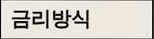</a></p>

**질문** (`messages[0].content`)

```
<image>
이미지의 글자를 보이는 그대로 읽으세요. 고치거나 추측하지 말고 글자만 답하세요.
```

**정답** (`target`)

```json
{"text": "금리방식"}
```

**학습할 때 모델이 내야 하는 답** (SFT 의 assistant 내용)

```
금리방식
```

**문항 한 줄 전체** (`benchmark_tasks.jsonl`)

```json
{
 "confidence": 0.99,
 "context_image": "<prepared>/views/d6cecc2b9d432b628bc11304_v1.png",
 "document_id": "loan_application_000000",
 "id": "d6cecc2b9d432b628bc11304_v1_crop_ocr_0",
 "images": [
  "<prepared>/crops/d6cecc2b9d432b628bc11304_v1_90.png"
 ],
 "messages": [{"content": "<image>\n이미지의 글자를 보이는 그대로 읽으세요. 고치거나 추측하지 말고 글자만 답하세요.", "role": "user"}],
 "page_id": "loan_application_000000_p1.png",
 "reference_type": "ocr_pseudo_unreviewed",
 "size": "medium",
 "split": "benchmark",
 "target": "{\"text\": \"금리방식\"}",
 "task": "crop_ocr",
 "view": "aug",
 "view_id": "d6cecc2b9d432b628bc11304_v1",
 "view_ops": ["crop1559x2114", "rotate-0.08", "scale0.830", "jpeg", "contrast"]
}
```

### 1-3. bbox_ocr — 박스 안 글자 읽기

**어떻게 만드나:** 사본 페이지 전체 + 단어 하나의 박스 좌표(0~1000)를 질문에 넣는다

**채점:** 글자: CER·완전 일치·숫자 일치

**입력 이미지** (왼쪽) · 정답 박스 초록, 질문에 준 박스 파랑 (오른쪽)

<p><a href="examples/img/d6cecc2b9d432b628bc11304_v1_17b871c9.jpg"></a> <a href="examples/img/d6cecc2b9d432b628bc11304_v1_bbox_ocr_2255bea6.jpg">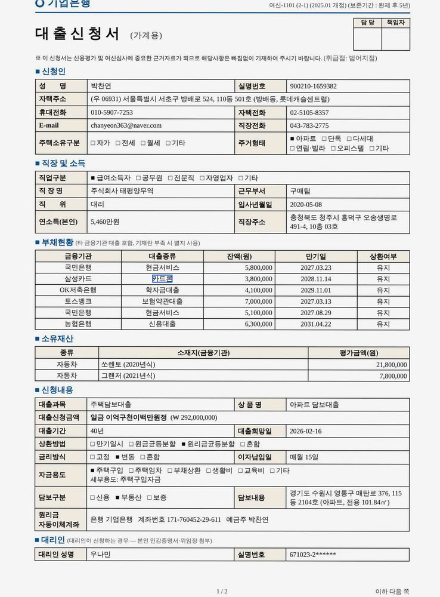</a></p>

**질문** (`messages[0].content`)

```
<image>
bbox_2d=[346, 460, 392, 473] 영역 안의 글자를 그대로 읽으세요. 좌표는 이미지 기준 0~1000입니다. 글자만 답하세요.
```

**정답** (`target`)

```json
{"text": "카드론"}
```

**학습할 때 모델이 내야 하는 답** (SFT 의 assistant 내용)

```
카드론
```

**문항 한 줄 전체** (`benchmark_tasks.jsonl`)

```json
{
 "confidence": 0.97,
 "context_image": "<prepared>/views/d6cecc2b9d432b628bc11304_v1.png",
 "document_id": "loan_application_000000",
 "id": "d6cecc2b9d432b628bc11304_v1_bbox_ocr_0",
 "images": [
  "<prepared>/views/d6cecc2b9d432b628bc11304_v1.png"
 ],
 "messages": [
  {
   "content": "<image>\nbbox_2d=[346, 460, 392, 473] 영역 안의 글자를 그대로 읽으세요. 좌표는 이미지 기준 0~1000입니다. 글자만 답하세요.",
   "role": "user"
  }
 ],
 "page_id": "loan_application_000000_p1.png",
 "reference_type": "ocr_pseudo_unreviewed",
 "size": "medium",
 "split": "benchmark",
 "target": "{\"text\": \"카드론\"}",
 "task": "bbox_ocr",
 "view": "aug",
 "view_id": "d6cecc2b9d432b628bc11304_v1",
 "view_ops": ["crop1559x2114", "rotate-0.08", "scale0.830", "jpeg", "contrast"]
}
```

### 1-4. grounding — 글자 위치 찾기

**어떻게 만드나:** 사본 페이지 + 글자. 페이지에 같은 글자가 여러 번 있으면 전부가 정답. 약 10%는 같은 분리의 다른 페이지에서 가져온, 이 페이지에 없는 글자(정답 [])

**채점:** 박스: IoU 0.5 F1 등. 정답이 [] 이면 [] 일 때만 맞음. 보상 min(1, IoU/0.8) 짝별 soft F1

**입력 이미지** (왼쪽) · 정답 박스 초록, 질문에 준 박스 파랑 (오른쪽)

<p><a href="examples/img/d6cecc2b9d432b628bc11304_v0_aae6b8a8.jpg"></a> <a href="examples/img/d6cecc2b9d432b628bc11304_v0_grounding_0302c30c.jpg">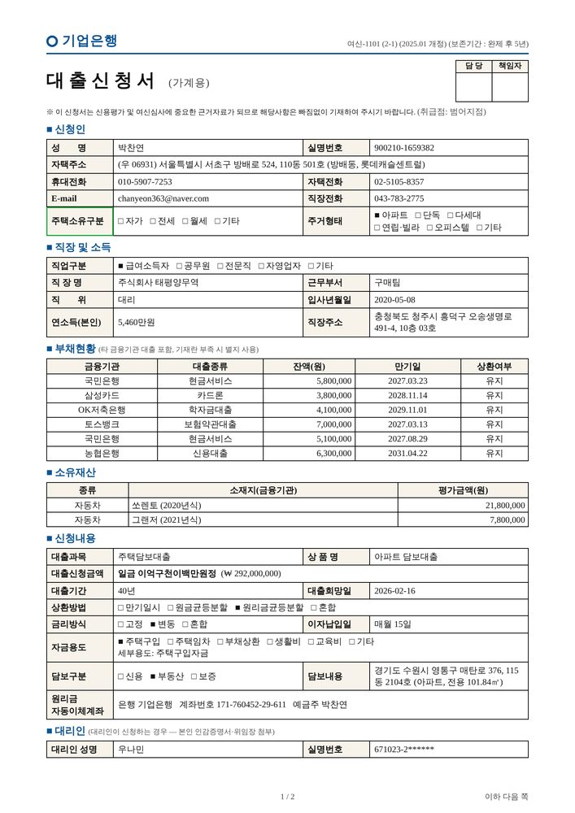</a></p>

**질문** (`messages[0].content`)

```
<image>
"주택소유구분" 와 정확히 같은 글자가 있는 곳을 모두 찾으세요. 좌표는 이미지 기준 0~1000입니다. [{"bbox_2d": [x1, y1, x2, y2], "label": "..."}] 형식의 JSON 리스트만 답하고, 없으면 []로 답하세요.
```

**정답** (`target`)

```json
{"boxes": [{"bbox_2d": [81, 255, 197, 290], "label": "주택소유구분"}]}
```

**학습할 때 모델이 내야 하는 답** (SFT 의 assistant 내용)

```
[{"bbox_2d": [81, 255, 197, 290], "label": "주택소유구분"}]
```

**문항 한 줄 전체** (`benchmark_tasks.jsonl`)

```json
{
 "confidence": 0.995,
 "context_image": "<prepared>/views/d6cecc2b9d432b628bc11304_v0.png",
 "document_id": "loan_application_000000",
 "id": "d6cecc2b9d432b628bc11304_v0_grounding_0",
 "images": [
  "<prepared>/views/d6cecc2b9d432b628bc11304_v0.png"
 ],
 "messages": [
  {
   "content": "<image>\n\"주택소유구분\" 와 정확히 같은 글자가 있는 곳을 모두 찾으세요. 좌표는 이미지 기준 0~1000입니다. [{\"bbox_2d\": [x1, y1, x2, y2], \"label\": \"...\"}] 형식의 JSON 리스트만 답하고, 없으면 []로 답하세요.",
   "role": "user"
  }
 ],
 "page_id": "loan_application_000000_p1.png",
 "reference_type": "ocr_pseudo_unreviewed",
 "size": "large",
 "split": "benchmark",
 "target": "{\"boxes\": [{\"bbox_2d\": [81, 255, 197, 290], \"label\": \"주택소유구분\"}]}",
 "task": "grounding",
 "view": "clean",
 "view_id": "d6cecc2b9d432b628bc11304_v0",
 "view_ops": []
}
```

### 1-5. region_ocr — 영역 안 글자 전부 읽기

**어떻게 만드나:** 여러 단어를 덮는 영역(단어를 자르지 않게 넓힘). 영역 안에 신뢰도 낮은 단어가 하나라도 있으면 버림. 줄은 세로로 겹치는 단어끼리 묶고 위→아래, 왼→오른쪽

**채점:** 글자: CER·완전 일치 + 순서 무관 단어 F1

**입력 이미지** (왼쪽) · 정답 박스 초록, 질문에 준 박스 파랑 (오른쪽)

<p><a href="examples/img/d6cecc2b9d432b628bc11304_v0_aae6b8a8.jpg"></a> <a href="examples/img/d6cecc2b9d432b628bc11304_v0_region_ocr_2a8116fb.jpg">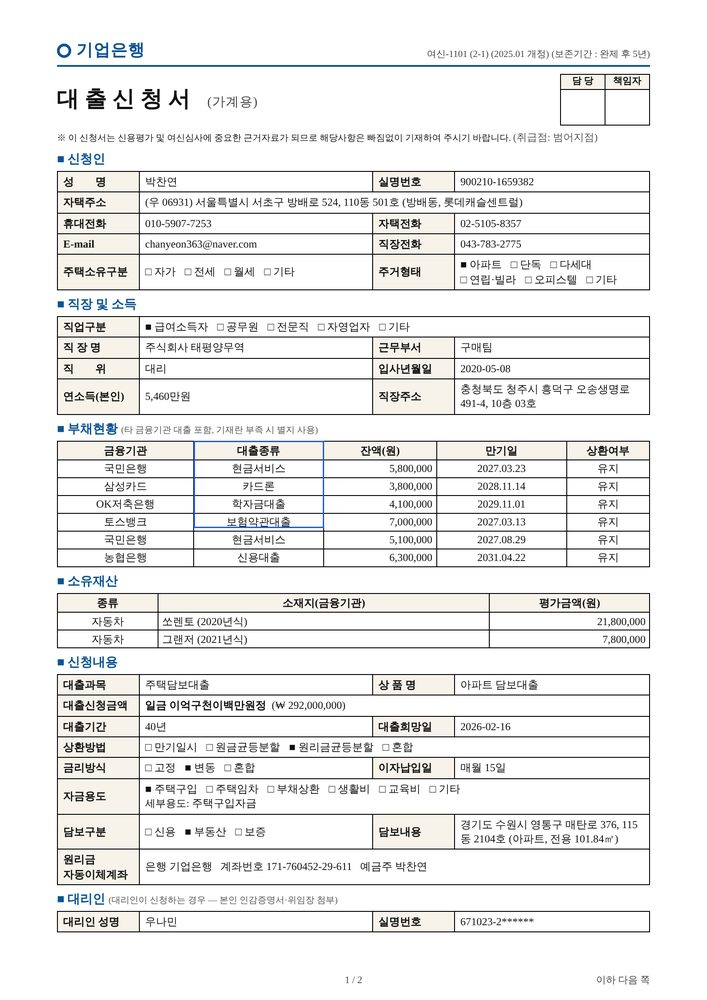</a></p>

**질문** (`messages[0].content`)

```
<image>
bbox_2d=[274, 441, 458, 528] 영역 안의 모든 글자를 읽는 순서대로 적으세요. 줄이 바뀌면 줄바꿈하세요. 좌표는 0~1000입니다. 글자만 답하세요.
```

**정답** (`target`)

```json
{"text": "대출종류\n현금서비스\n카드론\n학자금대출\n보험약관대출"}
```

**학습할 때 모델이 내야 하는 답** (SFT 의 assistant 내용)

```
대출종류
현금서비스
카드론
학자금대출
보험약관대출
```

**문항 한 줄 전체** (`benchmark_tasks.jsonl`)

```json
{
 "confidence": 0.91,
 "context_image": "<prepared>/views/d6cecc2b9d432b628bc11304_v0.png",
 "document_id": "loan_application_000000",
 "id": "d6cecc2b9d432b628bc11304_v0_region_ocr_0",
 "images": [
  "<prepared>/views/d6cecc2b9d432b628bc11304_v0.png"
 ],
 "messages": [
  {
   "content": "<image>\nbbox_2d=[274, 441, 458, 528] 영역 안의 모든 글자를 읽는 순서대로 적으세요. 줄이 바뀌면 줄바꿈하세요. 좌표는 0~1000입니다. 글자만 답하세요.",
   "role": "user"
  }
 ],
 "page_id": "loan_application_000000_p1.png",
 "reference_type": "ocr_pseudo_unreviewed",
 "size": null,
 "split": "benchmark",
 "target": "{\"text\": \"대출종류\\n현금서비스\\n카드론\\n학자금대출\\n보험약관대출\"}",
 "task": "region_ocr",
 "view": "clean",
 "view_id": "d6cecc2b9d432b628bc11304_v0",
 "view_ops": []
}
```

### 1-6. spotting — 전체 글자 + 위치

**어떻게 만드나:** 페이지를 잘라낸 타일(`tiles/`), 타일당 단어 40개 이하. 신뢰도 낮은 단어는 배경색으로 지우고 정답에서 뺌

**채점:** 박스+글자: 위치+글자 F1. 보상 0.5×min(1,IoU/0.8)+0.5×글자 유사도

**입력 이미지** (왼쪽) · 정답 박스 초록, 질문에 준 박스 파랑 (오른쪽)

<p><a href="examples/img/d6cecc2b9d432b628bc11304_v0_0_071d42c4.jpg">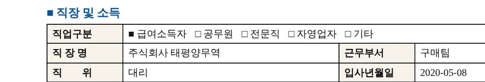</a> <a href="examples/img/d6cecc2b9d432b628bc11304_v0_0_spotting_147013dd.jpg">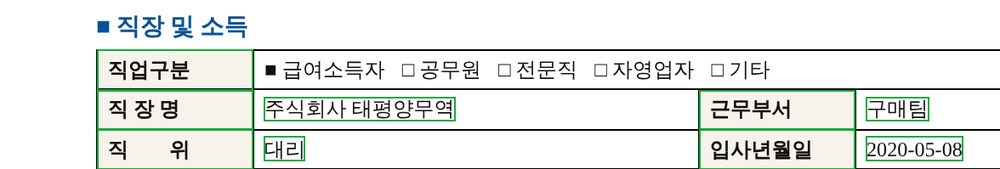</a></p>

**질문** (`messages[0].content`)

```
<image>
Detect every piece of text in the image in reading order. Coordinates are 0-1000 relative to the image. Return only a JSON list like [{"bbox_2d": [x1, y1, x2, y2], "label": "text"}].
```

**정답** (`target`)

```json
{
 "boxes": [
  {"bbox_2d": [97, 296, 253, 533], "label": "직업구분"},
  {"bbox_2d": [97, 533, 253, 764], "label": "직장명"},
  {"bbox_2d": [264, 573, 455, 714], "label": "주식회사 태평양무역"},
  {"bbox_2d": [699, 533, 855, 764], "label": "근무부서"},
  {"bbox_2d": [866, 573, 929, 714], "label": "구매팀"},
  {"bbox_2d": [97, 764, 253, 1000], "label": "직위"},
  {"bbox_2d": [264, 809, 305, 950], "label": "대리"},
  {"bbox_2d": [699, 764, 855, 1000], "label": "입사년월일"},
  {"bbox_2d": [866, 809, 963, 950], "label": "2020-05-08"}
 ]
}
```

**학습할 때 모델이 내야 하는 답** (SFT 의 assistant 내용)

```
[{"bbox_2d": [97, 296, 253, 533], "label": "직업구분"}, {"bbox_2d": [97, 533, 253, 764], "label": "직장명"}, {"bbox_2d": [264, 573, 455, 714], "label": "주식회사 태평양무역"}, {"bbox_2d": [699, 533, 855, 764], "label": "근무부서"}, {"bbox_2d": [866, 573, 929, 714], "label": "구매팀"}, {"bbox_2d": [97, 764, 253, 1000], "label": "직위"}, {"bbox_2d": [264, 809, 305, 950], "label": "대리"}, {"bbox_2d": [699, 764, 855, 1000], "label": "입사년월일"}, {"bbox_2d": [866, 809, 963, 950], "label": "2020-05-08"}]
```

**문항 한 줄 전체** (`benchmark_tasks.jsonl`)

```json
{
 "confidence": 0.91,
 "context_image": "<prepared>/views/d6cecc2b9d432b628bc11304_v0.png",
 "document_id": "loan_application_000000",
 "id": "d6cecc2b9d432b628bc11304_v0_spotting_0",
 "images": [
  "<prepared>/tiles/d6cecc2b9d432b628bc11304_v0_0.png"
 ],
 "masked_words": 0,
 "messages": [
  {
   "content": "<image>\nDetect every piece of text in the image in reading order. Coordinates are 0-1000 relative to the image. Return only a JSON list like [{\"bbox_2d\": [x1, y1, x2, y2], \"label\": \"text\"}].",
   "role": "user"
  }
 ],
 "page_id": "loan_application_000000_p1.png",
 "reference_type": "ocr_pseudo_unreviewed",
 "size": null,
 "split": "benchmark",
 "target": "{\"boxes\": [{\"bbox_2d\": [97, 296, 253, 533], \"label\": \"직업구분\"}, {\"bbox_2d\": [97, 533, 253, 764], \"label\": \"직장명\"}, {\"bbox_2d\": [264, 573, 455, 714], \"label\": \"주식회사 태평양무역\"}, {\"bbox_2d\": [699, 533, 855, 764], \"label\": \"근무부서\"}, {\"bbox_2d\": [866, 573, 929, 714], \"label\": \"구매팀\"}, {\"bbox_2d\": [97, 764, 253, 1000], \"label\": \"직위\"}, {\"bbox_2d\": [264, 809, 305, 950], \"label\": \"대리\"}, {\"bbox_2d\": [699, 764, 855, 1000], \"label\": \"입사년월일\"}, {\"bbox_2d\": [866, 809, 963, 950], \"label\": \"2020-05-08\"}]}",
 "task": "spotting",
 "view": "clean",
 "view_id": "d6cecc2b9d432b628bc11304_v0",
 "view_ops": []
}
```

### 1-7. relation — 옆 글자 찾기

**어떻게 만드나:** 기준 글자(페이지에 하나뿐이면 글자, 아니면 박스 좌표) + 방향(오른쪽·왼쪽·위·아래). 가장 가까운 이웃이 분명할 때만

**채점:** 박스+글자: 위치+글자 F1 (박스 하나)

**입력 이미지** (왼쪽) · 정답 박스 초록, 질문에 준 박스 파랑 (오른쪽)

<p><a href="examples/img/d6cecc2b9d432b628bc11304_v0_aae6b8a8.jpg"></a> <a href="examples/img/d6cecc2b9d432b628bc11304_v0_relation_683587c8.jpg">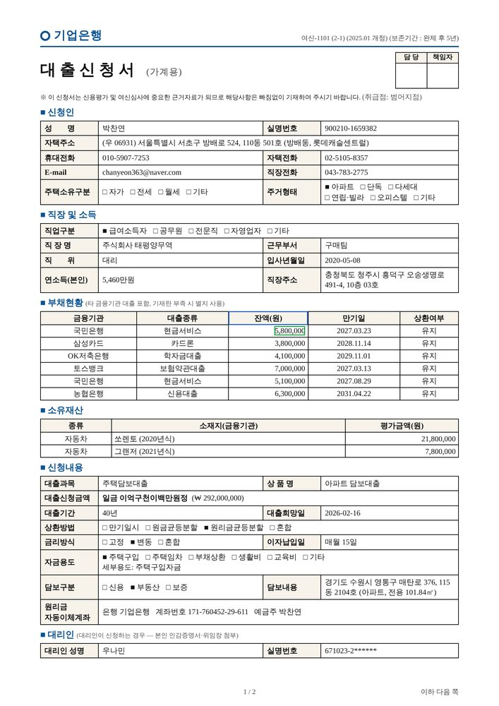</a></p>

**질문** (`messages[0].content`)

```
<image>
bbox_2d=[458, 441, 617, 460] 글자 바로 아래에 있는 글자를 찾으세요. 좌표는 0~1000입니다. [{"bbox_2d": [x1, y1, x2, y2], "label": "글자"}] 형식으로 하나만 답하세요.
```

**정답** (`target`)

```json
{"boxes": [{"bbox_2d": [550, 462, 611, 475], "label": "5,800,000"}]}
```

**학습할 때 모델이 내야 하는 답** (SFT 의 assistant 내용)

```
[{"bbox_2d": [550, 462, 611, 475], "label": "5,800,000"}]
```

**문항 한 줄 전체** (`benchmark_tasks.jsonl`)

```json
{
 "confidence": 0.97,
 "context_image": "<prepared>/views/d6cecc2b9d432b628bc11304_v0.png",
 "document_id": "loan_application_000000",
 "id": "d6cecc2b9d432b628bc11304_v0_relation_0",
 "images": [
  "<prepared>/views/d6cecc2b9d432b628bc11304_v0.png"
 ],
 "messages": [
  {
   "content": "<image>\nbbox_2d=[458, 441, 617, 460] 글자 바로 아래에 있는 글자를 찾으세요. 좌표는 0~1000입니다. [{\"bbox_2d\": [x1, y1, x2, y2], \"label\": \"글자\"}] 형식으로 하나만 답하세요.",
   "role": "user"
  }
 ],
 "page_id": "loan_application_000000_p1.png",
 "reference_type": "ocr_pseudo_unreviewed",
 "size": "medium",
 "split": "benchmark",
 "target": "{\"boxes\": [{\"bbox_2d\": [550, 462, 611, 475], \"label\": \"5,800,000\"}]}",
 "task": "relation",
 "view": "clean",
 "view_id": "d6cecc2b9d432b628bc11304_v0",
 "view_ops": []
}
```

### 1-8. marked_ocr — 그린 박스 안 글자 읽기

**어떻게 만드나:** 사본에 빨강·파랑·초록 사각형(최대 3개)을 그린 이미지(`marked/`). 30%는 좌표도 함께 알려 줌

**채점:** 글자: CER·완전 일치

**입력 이미지** (왼쪽) 

<p><a href="examples/img/d6cecc2b9d432b628bc11304_v0_1a3a3858.jpg">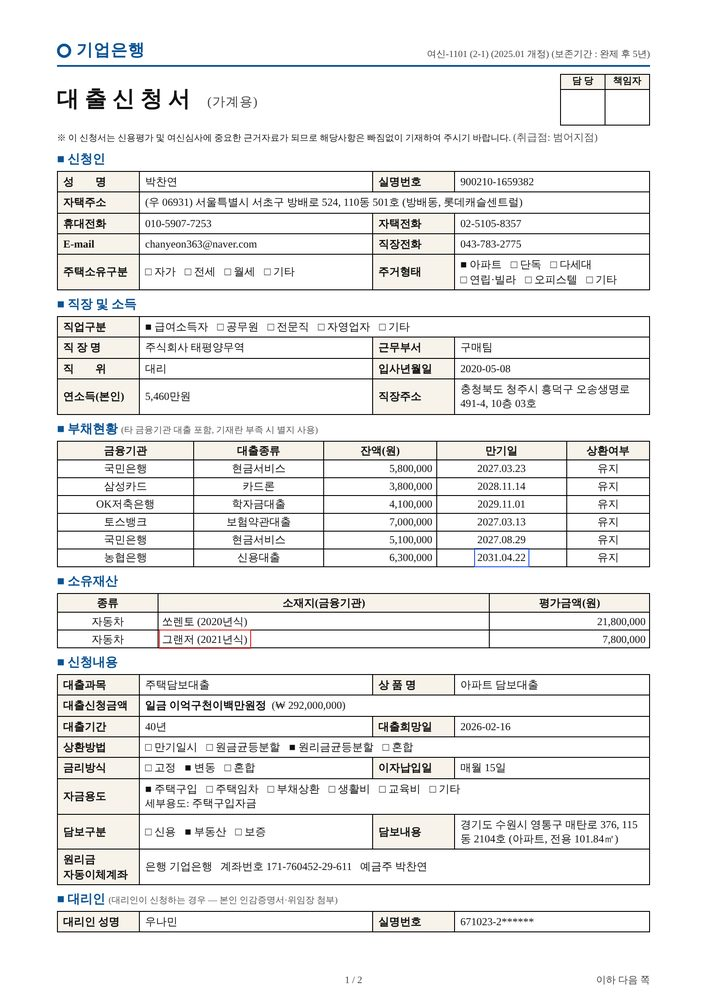</a></p>

**질문** (`messages[0].content`)

```
<image>
이미지에 그려진 빨간 박스 안의 글자를 그대로 읽으세요. 글자만 답하세요.
```

**정답** (`target`)

```json
{"text": "그랜저 (2021년식)"}
```

**학습할 때 모델이 내야 하는 답** (SFT 의 assistant 내용)

```
그랜저 (2021년식)
```

**문항 한 줄 전체** (`benchmark_tasks.jsonl`)

```json
{
 "confidence": 0.97,
 "context_image": "<prepared>/views/d6cecc2b9d432b628bc11304_v0.png",
 "document_id": "loan_application_000000",
 "id": "d6cecc2b9d432b628bc11304_v0_marked_ocr_0",
 "images": [
  "<prepared>/marked/d6cecc2b9d432b628bc11304_v0.png"
 ],
 "messages": [{"content": "<image>\n이미지에 그려진 빨간 박스 안의 글자를 그대로 읽으세요. 글자만 답하세요.", "role": "user"}],
 "page_id": "loan_application_000000_p1.png",
 "reference_type": "ocr_pseudo_unreviewed",
 "size": "medium",
 "split": "benchmark",
 "target": "{\"text\": \"그랜저 (2021년식)\"}",
 "task": "marked_ocr",
 "view": "clean",
 "view_id": "d6cecc2b9d432b628bc11304_v0",
 "view_ops": []
}
```

### 1-9. marked_box — 그린 박스의 좌표

**어떻게 만드나:** 같은 그림에서 색 하나를 묻고, 직접 그린 사각형의 바깥 테두리 좌표와 글자를 답한다

**채점:** 박스+글자: IoU 0.75 F1 (그린 사각형이라 정답 좌표가 정확함)

**입력 이미지** (왼쪽) · 정답 박스 초록, 질문에 준 박스 파랑 (오른쪽)

<p><a href="examples/img/d6cecc2b9d432b628bc11304_v0_1a3a3858.jpg"></a> <a href="examples/img/d6cecc2b9d432b628bc11304_v0_marked_box_db2a69d2.jpg">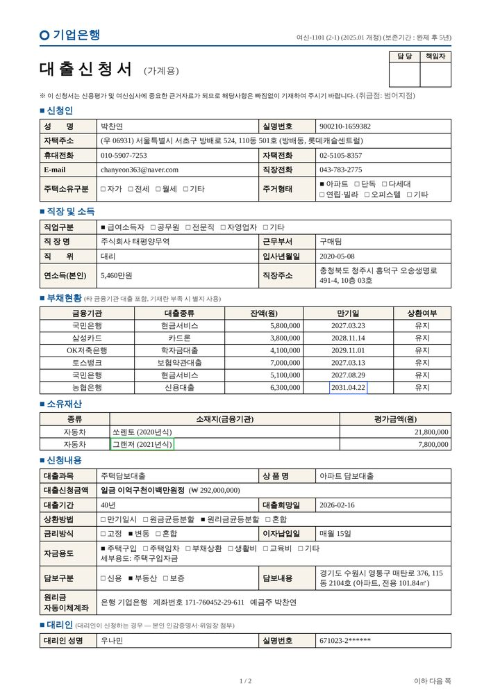</a></p>

**질문** (`messages[0].content`)

```
<image>
이미지에 그려진 빨간 박스의 위치와 그 안의 글자를 답하세요. 좌표는 이미지 기준 0~1000입니다. [{"bbox_2d": [x1, y1, x2, y2], "label": "글자"}] 형식으로 하나만 답하세요.
```

**정답** (`target`)

```json
{"boxes": [{"bbox_2d": [225, 630, 355, 648], "label": "그랜저 (2021년식)"}]}
```

**학습할 때 모델이 내야 하는 답** (SFT 의 assistant 내용)

```
[{"bbox_2d": [225, 630, 355, 648], "label": "그랜저 (2021년식)"}]
```

**문항 한 줄 전체** (`benchmark_tasks.jsonl`)

```json
{
 "confidence": 0.97,
 "context_image": "<prepared>/views/d6cecc2b9d432b628bc11304_v0.png",
 "document_id": "loan_application_000000",
 "id": "d6cecc2b9d432b628bc11304_v0_marked_box_0",
 "images": [
  "<prepared>/marked/d6cecc2b9d432b628bc11304_v0.png"
 ],
 "messages": [
  {
   "content": "<image>\n이미지에 그려진 빨간 박스의 위치와 그 안의 글자를 답하세요. 좌표는 이미지 기준 0~1000입니다. [{\"bbox_2d\": [x1, y1, x2, y2], \"label\": \"글자\"}] 형식으로 하나만 답하세요.",
   "role": "user"
  }
 ],
 "page_id": "loan_application_000000_p1.png",
 "reference_type": "ocr_pseudo_unreviewed",
 "size": "medium",
 "split": "benchmark",
 "target": "{\"boxes\": [{\"bbox_2d\": [225, 630, 355, 648], \"label\": \"그랜저 (2021년식)\"}]}",
 "task": "marked_box",
 "view": "clean",
 "view_id": "d6cecc2b9d432b628bc11304_v0",
 "view_ops": []
}
```

### 1-10. SFT 학습 샘플 한 줄 (`train_sft.jsonl`)

같은 이미지에 대한 질문을 최대 8개까지 한 대화로 묶습니다. 이미지는 첫 질문에만 붙고, 답은 모두 학습합니다.

```json
{
 "images": [
  "<prepared>/views/d4ceaa08ef4eb07ef6474f30_v0.png"
 ],
 "messages": [
  {
   "content": "<image>\n\"공정태\" 와 정확히 같은 글자가 있는 곳을 모두 찾으세요. 좌표는 이미지 기준 0~1000입니다. [{\"bbox_2d\": [x1, y1, x2, y2], \"label\": \"...\"}] 형식의 JSON 리스트만 답하고, 없으면 []로 답하세요.",
   "role": "user"
  },
  {"content": "[{\"bbox_2d\": [689, 215, 731, 226], \"label\": \"공정태\"}]", "role": "assistant"},
  {
   "content": "\"소재지(주소)\" 바로 오른쪽에 있는 글자를 찾으세요. 좌표는 0~1000입니다. [{\"bbox_2d\": [x1, y1, x2, y2], \"label\": \"글자\"}] 형식으로 하나만 답하세요.",
   "role": "user"
  },
  {
   "content": "[{\"bbox_2d\": [297, 264, 625, 275], \"label\": \"충청북도 청주시 흥덕구 오송생명로 491-4, 10층 03호\"}]",
   "role": "assistant"
  },
  {
   "content": "Read all text inside bbox_2d=[101, 641, 549, 805] in reading order, one line per text line. Coordinates are 0-1000 relative to the image. Return only the text.",
   "role": "user"
  },
  {"content": "비과세소득계 2,400,000\n주(현)근무지\n결정세액\n주(현)근무지\n차감징수세액\n실효세율(%)", "role": "assistant"},
  {
   "content": "Find every occurrence of the exact text \"법인명(상호)\". Coordinates are 0-1000 relative to the image. Return only a JSON list like [{\"bbox_2d\": [x1, y1, x2, y2], \"label\": \"...\"}]; return [] if it does not appear.",
   "role": "user"
  },
  {"content": "[{\"bbox_2d\": [105, 213, 292, 229], \"label\": \"법인명(상호)\"}]", "role": "assistant"},
  {
   "content": "bbox_2d=[661, 775, 712, 785] 영역 안의 글자를 그대로 읽으세요. 좌표는 이미지 기준 0~1000입니다. 글자만 답하세요.",
   "role": "user"
  },
  {"content": "-370,770", "role": "assistant"},
  {
   "content": "Find every occurrence of the exact text \"상여\". Coordinates are 0-1000 relative to the image. Return only a JSON list like [{\"bbox_2d\": [x1, y1, x2, y2], \"label\": \"...\"}]; return [] if it does not appear.",
   "role": "user"
  },
  {"content": "[{\"bbox_2d\": [105, 421, 338, 437], \"label\": \"상여\"}]", "role": "assistant"},
  {
   "content": "\"주민등록번호\" 바로 오른쪽에 있는 글자를 찾으세요. 좌표는 0~1000입니다. [{\"bbox_2d\": [x1, y1, x2, y2], \"label\": \"글자\"}] 형식으로 하나만 답하세요.",
   "role": "user"
  },
  {"content": "[{\"bbox_2d\": [689, 287, 786, 297], \"label\": \"900210-1659382\"}]", "role": "assistant"},
  {
   "content": "Read all text inside bbox_2d=[297, 169, 429, 226] in reading order, one line per text line. Coordinates are 0-1000 relative to the image. Return only the text.",
   "role": "user"
  },
  {"content": "2024\n주식회사 태평양무역", "role": "assistant"}
 ]
}
```

### 1-11. GRPO 문제 한 줄 (`train_grpo.jsonl`)

질문만 있고 답은 없습니다. 모델이 답을 여러 개 만들면 `target`으로 보상을 계산합니다.

```json
{
 "id": "f03c9cfbd81d9b58ba5cfb78_v0_grounding_0",
 "images": [
  "<prepared>/views/f03c9cfbd81d9b58ba5cfb78_v0.png"
 ],
 "messages": [
  {
   "content": "<image>\nFind every occurrence of the exact text \"강원특별자치도 춘천시 공지로 302, 14층 07호\". Coordinates are 0-1000 relative to the image. Return only a JSON list like [{\"bbox_2d\": [x1, y1, x2, y2], \"label\": \"...\"}]; return [] if it does not appear.",
   "role": "user"
  }
 ],
 "split": "train",
 "target": "{\"boxes\": [{\"bbox_2d\": [640, 385, 912, 412], \"label\": \"강원특별자치도 춘천시 공지로 302, 14층 07호\"}]}",
 "task": "grounding"
}
```

## 2부. 은행 업무 과제

예시는 `python -m docgen.bench build` 로 만든 실제 평가 세트 형식 그대로입니다 (세트 버전 1.1, 생성기 커밋 `4500618`). 학습 데이터(`--split train`)도 같은 형식이고, 고객만 다릅니다.

### 2-0. 세트 폴더와 문항 한 줄의 필드

```
<세트>/
  meta.json                 만든 설정, 생성기 커밋, 과제별 문항 수, split (test / train)
  images/<서류ID>_<seed>.jpg               서류 한 건 과제의 이미지 (여러 쪽이면 _p1, _p2 …)
  images/bundles/<묶음ID>/<서류ID>.png     업무 묶음의 서류 이미지
  images/bundles/<묶음ID>/<서류ID>_<사례>.png   값을 바꾼 사본 (other_person 은 다른 고객 서류)
  crops/                    값 칸을 잘라낸 이미지 (ocr_field)
  tasks/<과제>.jsonl        문항, 한 줄에 하나
  swift/all.jsonl           (학습 세트만) 같은 문항의 학습 레코드
```

| 키 | 뜻 |
|---|---|
| `id` | 문항 ID: `<과제>/<묶음 또는 서류 ID>/<구분>`. 두 번째 칸이 고객(묶음) 단위라서, 학습·평가의 고객 겹침 검사와 GRPO용 고객 분리에 쓰인다 |
| `task` | 과제 이름 |
| `images` | 질문 앞에 순서대로 넣는 이미지 (세트 폴더 기준 상대 경로). 여러 쪽 서류는 `_p1`, `_p2` … |
| `prompt` | 질문 문장 (docgen/bench/prompts.py 의 틀에 값을 채운 것) |
| `answer` | 정답 |
| `eval` | 채점에 쓰는 추가 정보 |
| `meta` | 결과를 나눠 보는 기준 (채점에는 안 쓰임) |

**meta 키** (과제에 따라 일부만 있음)

| 키 | 뜻 |
|---|---|
| `scenario` | 업무 ID (예: `jeonse_loan`) |
| `task_name` | 업무 이름 (질문에 들어가는 이름) |
| `bundle` | 고객 묶음 ID `<업무>_<seed>` |
| `customer` | 고객 성명 (질문에 들어감) |
| `n_missing` | 필수 서류 중 뺀 개수 (0~2, 다른 고객 서류로 바꾼 것은 세지 않음) |
| `not_customer` | 다른 고객 서류를 섞었는지 |
| `not_required` | 업무와 상관없는 서류를 끼워 넣었는지 |
| `n_docs` | 질문에 보여 준 서류 수 |
| `case` | 불일치 사례 ID |
| `category` | 사례 분류: typo 오기 / other_person 타인 / amount 금액 / logic 관계 / format 표기만 다름 |
| `perturbed` | 값을 바꾼 변조 문항인지 (false = 같은 서류 조합의 정상 문항) |
| `rule` | 심사 질의 규칙 ID (`case:<사례>` = 서류 대조 사례에서 만든 예/아니오 질문) |
| `skill` | 능력 분류: 계산(비율) / 계산(합계) / 날짜 계산 / 표 계산 / 서류 대조 |
| `doc_type` | 서류 ID (guide/documents.md) |
| `doc_name` | 서류 정식 명칭 |
| `group` | 서류 그룹 |
| `condition` | 촬영 조건: clean 원본 / scan 스캔 / photo 촬영 / fax 팩스 |
| `writing` | 글씨: print 인쇄체 / hand 손글씨 |
| `n_pages` | 쪽 수 |
| `key` | 값 칸의 정답 키 |
| `label` | 값 칸의 항목명 |
| `kind` | 값 종류 (이름·금액·날짜 …) |
| `corrected` | 손글씨 정정(두 줄 긋고 고쳐 씀)이 있는 칸인지 |
| `length` | 정답 글자 수 (공백 제외) |

**eval 키**

| 키 | 뜻 |
|---|---|
| `required` | 필수 서류 목록 (질문에 번호로 나열한 것) |
| `names` | 모델 답의 서류명을 대응시킬 후보: 필수 서류 + 끼워 넣은 서류 |
| `documents` | 질문에 보여 준 서류명 (모델 답의 document 를 이 중 하나로 대응시킴) |
| `answer_type` | `number` 숫자 / `yesno` 예·아니오 |
| `tol` | 숫자 답의 허용 오차 (질문에 적은 반올림 자릿수에 맞춤) |
| `days` | 유효기간 문항: 발급일부터 신청일까지 일수 (정답 계산 근거) |
| `fields` | 키마다 `type`(값 타입), `norm`(정규화 값: 날짜 YYYY-MM-DD, 금액 정수 …), `kind`(값 종류). 타입별로 표기 차이를 맞춰 비교 |
| `types` | 키마다 `checkbox` / `checkbox_multi` / `seal` / `signature` |

### 2-1. doc_check — 서류 구비 확인

**정답 형식:** `missing` 빠진 필수 서류 (타인 서류만 낸 것 포함), `not_required` 필수 목록에 없는 서류, `not_customer` 고객 본인 명의가 아닌 서류. 세 목록이 모두 맞아야 완전 일치

**채점:** 주 지표: 완전 일치. 함께: 세 목록 합친 F1, 목록별 일치. 서류명은 후보(eval.names) 중 비슷한 이름으로 대응

**입력 이미지** (7장, 질문 앞에 이 순서로)

<p><a href="examples/img/account_opening_application_p1_7c6cd821.jpg">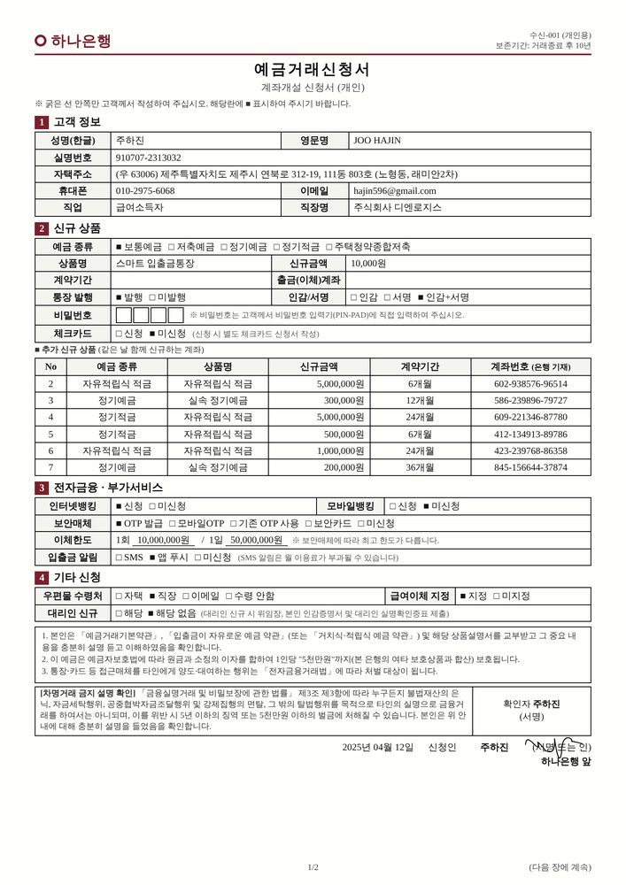</a> <a href="examples/img/fatca_crs_16e4ec86.jpg">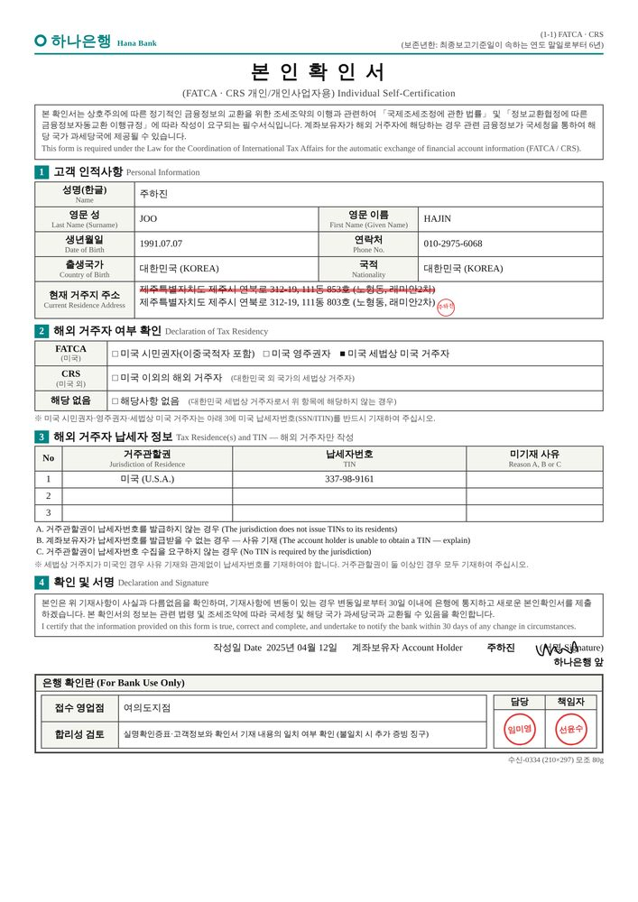</a> <a href="examples/img/privacy_consent_57e9b89a.jpg">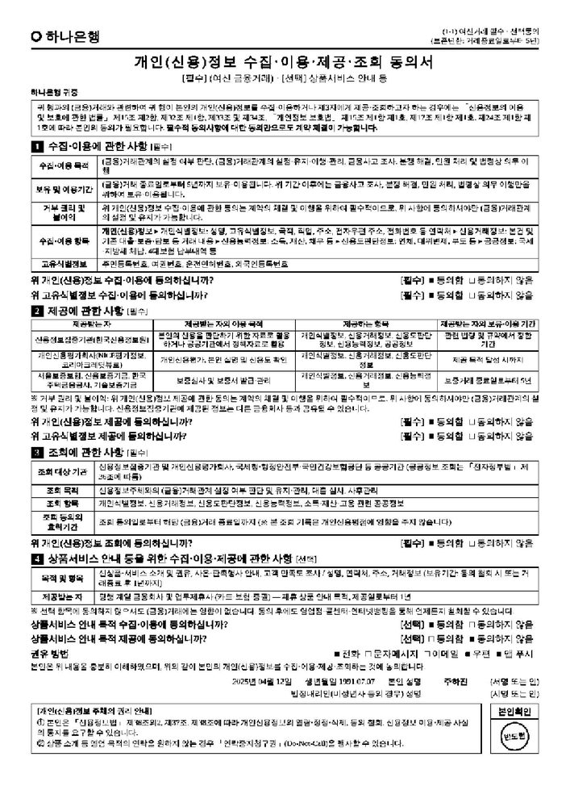</a> <a href="examples/img/customer_due_diligence_d5df3487.jpg">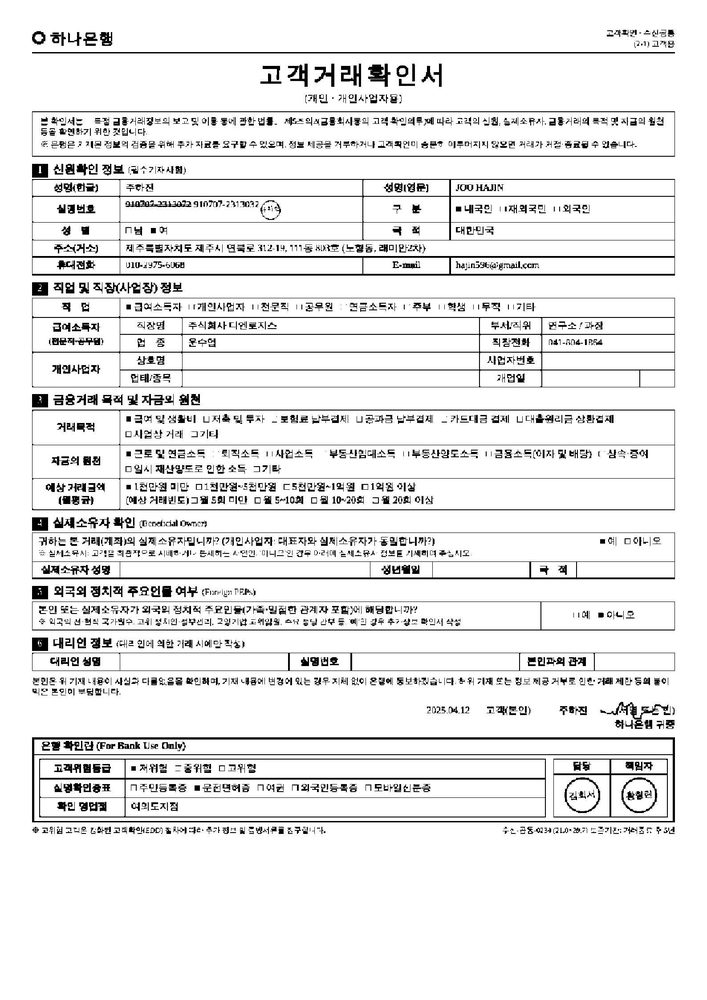</a> <a href="examples/img/resident_id_card_other_7e1ab600.jpg">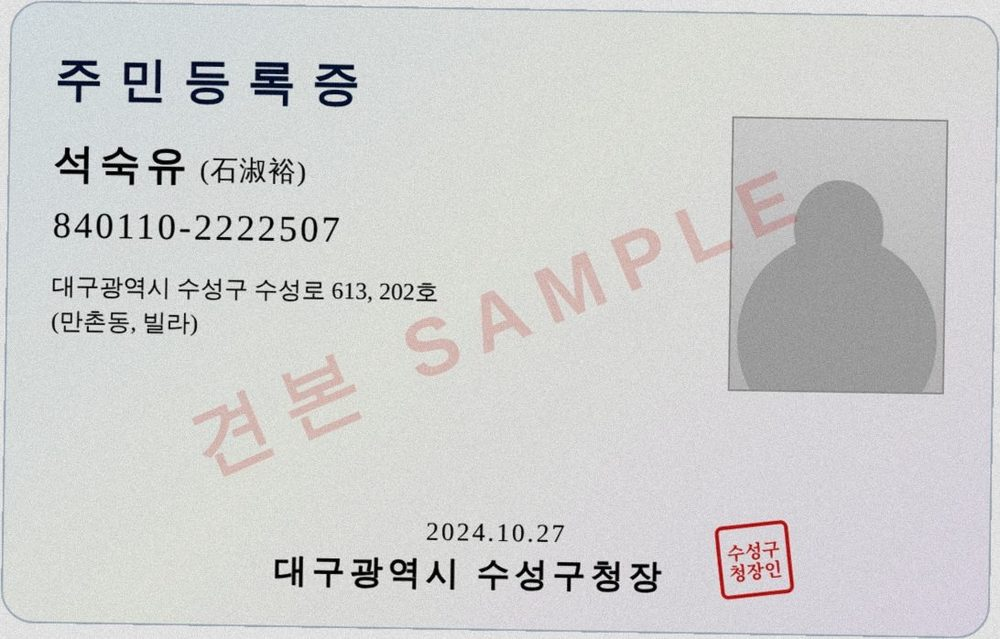</a> <a href="examples/img/financial_transaction_purpose_eecca3af.jpg">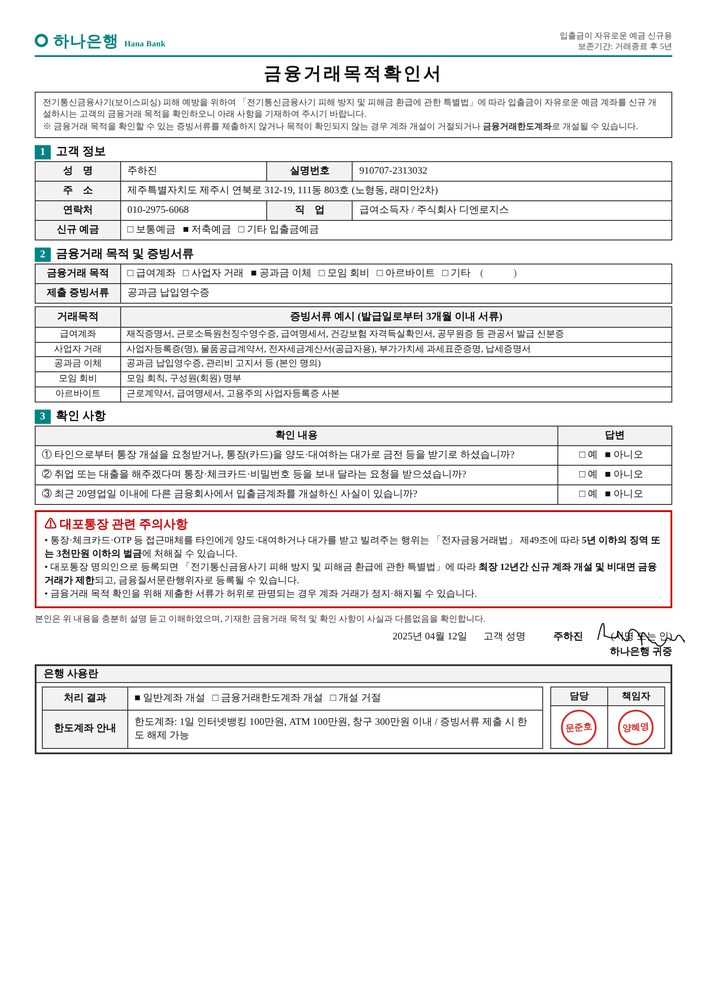</a> <a href="examples/img/tax_payment_certificate_corp_extra_09075c8c.jpg">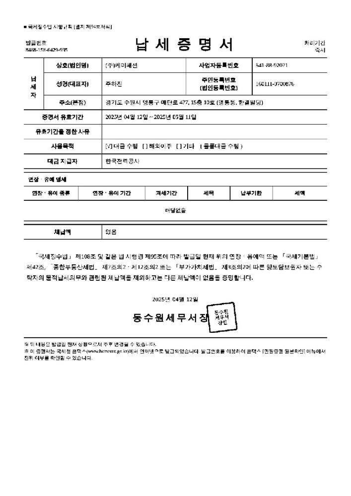</a></p>

1. `account_opening_application_p1.png` · 2. `fatca_crs.png` · 3. `privacy_consent.jpg` · 4. `customer_due_diligence.jpg` · 5. `resident_id_card_other.jpg` · 6. `financial_transaction_purpose.png` · 7. `tax_payment_certificate_corp_extra.jpg`

**질문** (`prompt`)

```
고객 '주하진' 님이 '개인 계좌개설' 업무를 위해 서류를 제출했습니다. 첨부 이미지는 제출된 서류의 첫 쪽입니다 (순서 무관).
필수 제출 서류:
1. 주민등록증
2. 재직증명서
3. 예금거래신청서
4. 금융거래목적확인서
5. 고객확인서(개인)
6. 개인(신용)정보 수집·이용·제공·조회 동의서
7. 해외금융계좌 납세자 확인서(개인)

제출 서류를 확인해 다음을 JSON 으로 답하세요.
- missing: 필수 서류 중 제출되지 않은 서류. 고객 본인 명의가 아닌 서류만 낸 경우도 제출되지 않은 것으로 봅니다.
- not_required: 제출됐지만 필수 서류 목록에 없는 서류
- not_customer: 고객 본인 명의가 아닌 서류
{"missing": ["서류명", ...], "not_required": [...], "not_customer": [...]} 형식으로 답하고, 해당 없으면 빈 목록 [] 으로 두세요. 서류명은 목록에 있으면 목록 그대로, 없으면 서류에 적힌 제목대로 쓰세요.
```

**정답** (`answer`)

```json
{"missing": ["주민등록증", "재직증명서"], "not_required": ["납세증명서(법인)"], "not_customer": ["주민등록증"]}
```

**채점 정보** (`eval`)

```json
{
 "required": ["주민등록증", "재직증명서", "예금거래신청서", "금융거래목적확인서", "고객확인서(개인)", "개인(신용)정보 수집·이용·제공·조회 동의서", "해외금융계좌 납세자 확인서(개인)"],
 "names": [
  "주민등록증",
  "재직증명서",
  "예금거래신청서",
  "금융거래목적확인서",
  "고객확인서(개인)",
  "개인(신용)정보 수집·이용·제공·조회 동의서",
  "해외금융계좌 납세자 확인서(개인)",
  "납세증명서(법인)"
 ]
}
```

**나눠 보기 정보** (`meta`)

```json
{
 "scenario": "account_opening",
 "task_name": "개인 계좌개설",
 "bundle": "account_opening_2000002",
 "customer": "주하진",
 "n_missing": 1,
 "not_customer": true,
 "not_required": true,
 "n_docs": 7
}
```

**문항 한 줄 전체** (`tasks/doc_check.jsonl`)

<details><summary>펼치기</summary>

```json
{
 "id": "doc_check/account_opening_2000002",
 "task": "doc_check",
 "images": [
  "images/bundles/account_opening_2000002/account_opening_application_p1.png",
  "images/bundles/account_opening_2000002/fatca_crs.png",
  "images/bundles/account_opening_2000002/privacy_consent.jpg",
  "images/bundles/account_opening_2000002/customer_due_diligence.jpg",
  "images/bundles/account_opening_2000002/resident_id_card_other.jpg",
  "images/bundles/account_opening_2000002/financial_transaction_purpose.png",
  "images/bundles/account_opening_2000002/tax_payment_certificate_corp_extra.jpg"
 ],
 "prompt": "고객 '주하진' 님이 '개인 계좌개설' 업무를 위해 서류를 제출했습니다. 첨부 이미지는 제출된 서류의 첫 쪽입니다 (순서 무관).\n필수 제출 서류:\n1. 주민등록증\n2. 재직증명서\n3. 예금거래신청서\n4. 금융거래목적확인서\n5. 고객확인서(개인)\n6. 개인(신용)정보 수집·이용·제공·조회 동의서\n7. 해외금융계좌 납세자 확인서(개인)\n\n제출 서류를 확인해 다음을 JSON 으로 답하세요.\n- missing: 필수 서류 중 제출되지 않은 서류. 고객 본인 명의가 아닌 서류만 낸 경우도 제출되지 않은 것으로 봅니다.\n- not_required: 제출됐지만 필수 서류 목록에 없는 서류\n- not_customer: 고객 본인 명의가 아닌 서류\n{\"missing\": [\"서류명\", ...], \"not_required\": [...], \"not_customer\": [...]} 형식으로 답하고, 해당 없으면 빈 목록 [] 으로 두세요. 서류명은 목록에 있으면 목록 그대로, 없으면 서류에 적힌 제목대로 쓰세요.",
 "answer": {"missing": ["주민등록증", "재직증명서"], "not_required": ["납세증명서(법인)"], "not_customer": ["주민등록증"]},
 "eval": {
  "required": ["주민등록증", "재직증명서", "예금거래신청서", "금융거래목적확인서", "고객확인서(개인)", "개인(신용)정보 수집·이용·제공·조회 동의서", "해외금융계좌 납세자 확인서(개인)"],
  "names": [
   "주민등록증",
   "재직증명서",
   "예금거래신청서",
   "금융거래목적확인서",
   "고객확인서(개인)",
   "개인(신용)정보 수집·이용·제공·조회 동의서",
   "해외금융계좌 납세자 확인서(개인)",
   "납세증명서(법인)"
  ]
 },
 "meta": {
  "scenario": "account_opening",
  "task_name": "개인 계좌개설",
  "bundle": "account_opening_2000002",
  "customer": "주하진",
  "n_missing": 1,
  "not_customer": true,
  "not_required": true,
  "n_docs": 7
 }
}
```
</details>

**학습 레코드** (`swift/all.jsonl` 한 줄: 같은 문항을 질문 + 정답 답변 대화로 바꾼 것)

```json
{
 "id": "doc_check/account_opening_2000002",
 "task": "doc_check",
 "images": [
  "images/bundles/account_opening_2000002/account_opening_application_p1.png",
  "images/bundles/account_opening_2000002/fatca_crs.png",
  "images/bundles/account_opening_2000002/privacy_consent.jpg",
  "images/bundles/account_opening_2000002/customer_due_diligence.jpg",
  "images/bundles/account_opening_2000002/resident_id_card_other.jpg",
  "images/bundles/account_opening_2000002/financial_transaction_purpose.png",
  "images/bundles/account_opening_2000002/tax_payment_certificate_corp_extra.jpg"
 ],
 "messages": [
  {
   "role": "user",
   "content": "<image><image><image><image><image><image><image>고객 '주하진' 님이 '개인 계좌개설' 업무를 위해 서류를 제출했습니다. 첨부 이미지는 제출된 서류의 첫 쪽입니다 (순서 무관).\n필수 제출 서류:\n1. 주민등록증\n2. 재직증명서\n3. 예금거래신청서\n4. 금융거래목적확인서\n5. 고객확인서(개인)\n6. 개인(신용)정보 수집·이용·제공·조회 동의서\n7. 해외금융계좌 납세자 확인서(개인)\n\n제출 서류를 확인해 다음을 JSON 으로 답하세요.\n- missing: 필수 서류 중 제출되지 않은 서류. 고객 본인 명의가 아닌 서류만 낸 경우도 제출되지 않은 것으로 봅니다.\n- not_required: 제출됐지만 필수 서류 목록에 없는 서류\n- not_customer: 고객 본인 명의가 아닌 서류\n{\"missing\": [\"서류명\", ...], \"not_required\": [...], \"not_customer\": [...]} 형식으로 답하고, 해당 없으면 빈 목록 [] 으로 두세요. 서류명은 목록에 있으면 목록 그대로, 없으면 서류에 적힌 제목대로 쓰세요."
  },
  {
   "role": "assistant",
   "content": "{\"missing\": [\"주민등록증\", \"재직증명서\"], \"not_required\": [\"납세증명서(법인)\"], \"not_customer\": [\"주민등록증\"]}"
  }
 ]
}
```

### 2-2. cross_check — 서류 대조

**정답 형식:** `consistent` 불일치가 없으면 true. `issues[]`: `document` 문제 서류, `field` 항목명, `value` 그 서류에 적힌 값, `expected` 다른 서류에 적힌(맞아야 할) 값, `alt_documents` 짝 서류(이 서류를 짚어도 정답 인정, 학습 레코드에서는 뺌)

**채점:** 정상 문항: consistent=true 면 1. 변조 문항: consistent=false 이고 issues 에 문제 서류(또는 짝 서류)와 값·원래 값·항목명 중 하나를 맞게 짚으면 1. 함께: 탐지, 위치, 오탐률

**입력 이미지** (2장, 질문 앞에 이 순서로)

<p><a href="examples/img/lease_contract_39a79a48.jpg">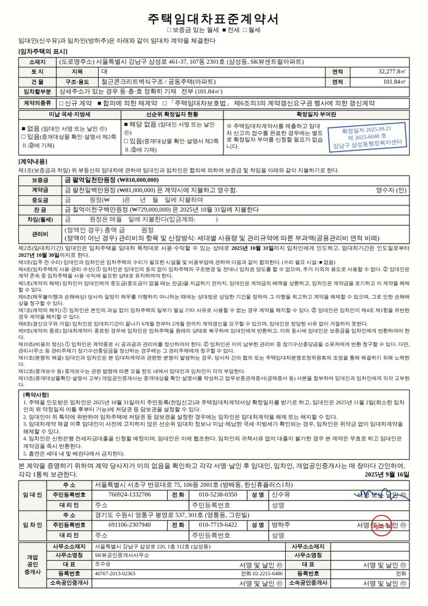</a> <a href="examples/img/real_estate_registry_lease_owner_868611ae.jpg">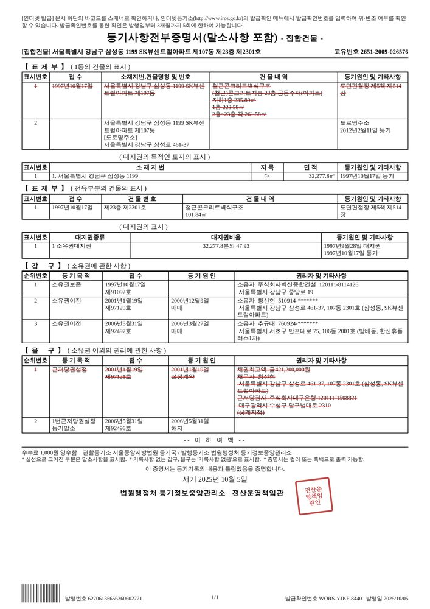</a></p>

1. `lease_contract.png` · 2. `real_estate_registry_lease_owner.png`

**질문** (`prompt`)

```
고객 '방하주' 님이 '전세자금대출' 업무를 위해 제출한 서류 2건입니다 (이미지 2장). 서류들을 서로 대조해 맞지 않는 정보(성명, 주민등록번호, 생년월일, 주소, 연락처, 계좌번호, 상호, 금액, 날짜 등), 업무상 맞지 않는 관계(계약 상대방이 등기부 소유자가 아님, 금액·날짜 관계 오류 등), 고객 본인 명의가 아닌 서류가 있는지 확인하세요. 표기 방식만 다른 것(날짜 형식, 주민번호 뒷자리 가림, 하이픈 유무 등)은 불일치가 아닙니다.
{"consistent": true 또는 false, "issues": [{"document": "문제가 있는 서류명", "field": "항목명", "value": "그 서류에 적힌 값", "expected": "다른 서류에 적힌 값"}]} 형식의 JSON 으로 답하세요. 문제가 없으면 {"consistent": true, "issues": []} 입니다.
```

**정답** (`answer`)

```json
{
 "consistent": false,
 "issues": [
  {
   "document": "등기사항전부증명서(집합건물)",
   "field": "소유자",
   "value": "추규태",
   "expected": "신수유",
   "alt_documents": ["주택임대차표준계약서"]
  }
 ]
}
```

**채점 정보** (`eval`)

```json
{"documents": ["주택임대차표준계약서", "등기사항전부증명서(집합건물)"]}
```

**나눠 보기 정보** (`meta`)

```json
{
 "scenario": "jeonse_loan",
 "task_name": "전세자금대출",
 "bundle": "jeonse_loan_2003000",
 "customer": "방하주",
 "case": "lease_owner",
 "category": "logic",
 "perturbed": true,
 "n_docs": 2
}
```

**문항 한 줄 전체** (`tasks/cross_check.jsonl`)

<details><summary>펼치기</summary>

```json
{
 "id": "cross_check/jeonse_loan_2003000/lease_owner",
 "task": "cross_check",
 "images": [
  "images/bundles/jeonse_loan_2003000/lease_contract.png",
  "images/bundles/jeonse_loan_2003000/real_estate_registry_lease_owner.png"
 ],
 "prompt": "고객 '방하주' 님이 '전세자금대출' 업무를 위해 제출한 서류 2건입니다 (이미지 2장). 서류들을 서로 대조해 맞지 않는 정보(성명, 주민등록번호, 생년월일, 주소, 연락처, 계좌번호, 상호, 금액, 날짜 등), 업무상 맞지 않는 관계(계약 상대방이 등기부 소유자가 아님, 금액·날짜 관계 오류 등), 고객 본인 명의가 아닌 서류가 있는지 확인하세요. 표기 방식만 다른 것(날짜 형식, 주민번호 뒷자리 가림, 하이픈 유무 등)은 불일치가 아닙니다.\n{\"consistent\": true 또는 false, \"issues\": [{\"document\": \"문제가 있는 서류명\", \"field\": \"항목명\", \"value\": \"그 서류에 적힌 값\", \"expected\": \"다른 서류에 적힌 값\"}]} 형식의 JSON 으로 답하세요. 문제가 없으면 {\"consistent\": true, \"issues\": []} 입니다.",
 "answer": {
  "consistent": false,
  "issues": [
   {
    "document": "등기사항전부증명서(집합건물)",
    "field": "소유자",
    "value": "추규태",
    "expected": "신수유",
    "alt_documents": ["주택임대차표준계약서"]
   }
  ]
 },
 "eval": {"documents": ["주택임대차표준계약서", "등기사항전부증명서(집합건물)"]},
 "meta": {
  "scenario": "jeonse_loan",
  "task_name": "전세자금대출",
  "bundle": "jeonse_loan_2003000",
  "customer": "방하주",
  "case": "lease_owner",
  "category": "logic",
  "perturbed": true,
  "n_docs": 2
 }
}
```
</details>

**학습 레코드** (`swift/all.jsonl` 한 줄: 같은 문항을 질문 + 정답 답변 대화로 바꾼 것)

```json
{
 "id": "cross_check/jeonse_loan_2003000/lease_owner",
 "task": "cross_check",
 "images": [
  "images/bundles/jeonse_loan_2003000/lease_contract.png",
  "images/bundles/jeonse_loan_2003000/real_estate_registry_lease_owner.png"
 ],
 "messages": [
  {
   "role": "user",
   "content": "<image><image>고객 '방하주' 님이 '전세자금대출' 업무를 위해 제출한 서류 2건입니다 (이미지 2장). 서류들을 서로 대조해 맞지 않는 정보(성명, 주민등록번호, 생년월일, 주소, 연락처, 계좌번호, 상호, 금액, 날짜 등), 업무상 맞지 않는 관계(계약 상대방이 등기부 소유자가 아님, 금액·날짜 관계 오류 등), 고객 본인 명의가 아닌 서류가 있는지 확인하세요. 표기 방식만 다른 것(날짜 형식, 주민번호 뒷자리 가림, 하이픈 유무 등)은 불일치가 아닙니다.\n{\"consistent\": true 또는 false, \"issues\": [{\"document\": \"문제가 있는 서류명\", \"field\": \"항목명\", \"value\": \"그 서류에 적힌 값\", \"expected\": \"다른 서류에 적힌 값\"}]} 형식의 JSON 으로 답하세요. 문제가 없으면 {\"consistent\": true, \"issues\": []} 입니다."
  },
  {
   "role": "assistant",
   "content": "{\"consistent\": false, \"issues\": [{\"document\": \"등기사항전부증명서(집합건물)\", \"field\": \"소유자\", \"value\": \"추규태\", \"expected\": \"신수유\"}]}"
  }
 ]
}
```

### 2-3. review — 심사 질의

**정답 형식:** 숫자(문자열) 또는 `예` / `아니오`

**채점:** 숫자: 단위(%, 배, 원 …)를 떼고 tol 안이면 정답. 예/아니오: 네·아니요도 인정

**입력 이미지** (2장, 질문 앞에 이 순서로)

<p><a href="examples/img/loan_application_e179d459.jpg">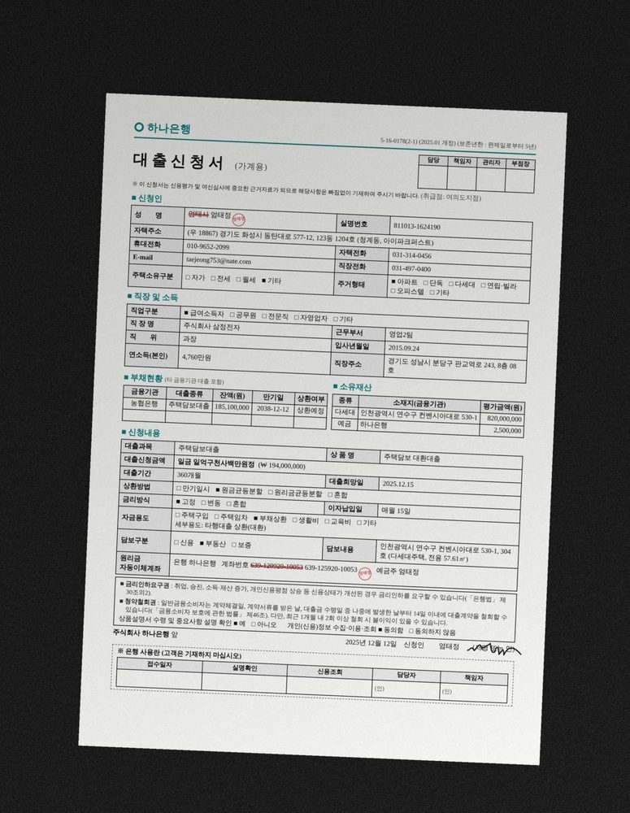</a> <a href="examples/img/sales_contract_bf738685.jpg">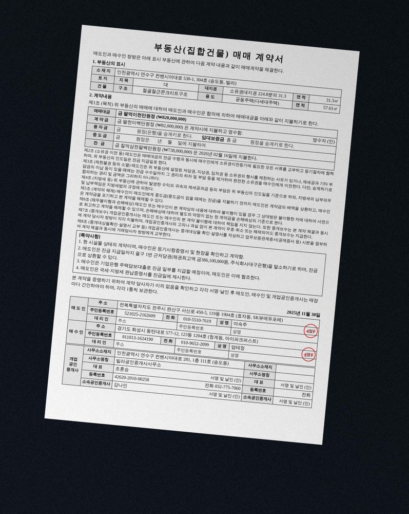</a></p>

1. `loan_application.jpg` · 2. `sales_contract.jpg`

**질문** (`prompt`)

```
고객이 '주택담보대출' 업무를 위해 제출한 서류입니다 (이미지 2장).
주택담보대출 심사입니다. '대출거래신청서'의 대출신청금액은 '부동산 매매계약서'의 매매대금의 몇 %입니까? (LTV, 소수 첫째 자리까지 반올림한 숫자만 답하세요)
```

**정답** (`answer`)

```json
23.7
```

**채점 정보** (`eval`)

```json
{"answer_type": "number", "tol": 0.1}
```

**나눠 보기 정보** (`meta`)

```json
{
 "scenario": "mortgage",
 "task_name": "주택담보대출",
 "bundle": "mortgage_2002000",
 "customer": "엄태정",
 "rule": "ltv",
 "skill": "계산(비율)"
}
```

**문항 한 줄 전체** (`tasks/review.jsonl`)

<details><summary>펼치기</summary>

```json
{
 "id": "review/mortgage_2002000/ltv",
 "task": "review",
 "images": [
  "images/bundles/mortgage_2002000/loan_application.jpg",
  "images/bundles/mortgage_2002000/sales_contract.jpg"
 ],
 "prompt": "고객이 '주택담보대출' 업무를 위해 제출한 서류입니다 (이미지 2장).\n주택담보대출 심사입니다. '대출거래신청서'의 대출신청금액은 '부동산 매매계약서'의 매매대금의 몇 %입니까? (LTV, 소수 첫째 자리까지 반올림한 숫자만 답하세요)",
 "answer": 23.7,
 "eval": {"answer_type": "number", "tol": 0.1},
 "meta": {
  "scenario": "mortgage",
  "task_name": "주택담보대출",
  "bundle": "mortgage_2002000",
  "customer": "엄태정",
  "rule": "ltv",
  "skill": "계산(비율)"
 }
}
```
</details>

**학습 레코드** (`swift/all.jsonl` 한 줄: 같은 문항을 질문 + 정답 답변 대화로 바꾼 것)

```json
{
 "id": "review/mortgage_2002000/ltv",
 "task": "review",
 "images": [
  "images/bundles/mortgage_2002000/loan_application.jpg",
  "images/bundles/mortgage_2002000/sales_contract.jpg"
 ],
 "messages": [
  {
   "role": "user",
   "content": "<image><image>고객이 '주택담보대출' 업무를 위해 제출한 서류입니다 (이미지 2장).\n주택담보대출 심사입니다. '대출거래신청서'의 대출신청금액은 '부동산 매매계약서'의 매매대금의 몇 %입니까? (LTV, 소수 첫째 자리까지 반올림한 숫자만 답하세요)"
  },
  {"role": "assistant", "content": "23.7"}
 ]
}
```

### 2-4. kie — 정보 추출

**정답 형식:** `{키: 문서에 적힌 값 또는 null}`. 빈 칸은 null

**채점:** 주 지표: F1 (값이 있는 칸 기준, 빈 칸에 값을 지어내면 감점). 날짜·금액·번호는 타입별로 표기를 맞춰 비교

**입력 이미지** (1장, 질문 앞에 이 순서로)

<p><a href="examples/img/loan_application_1000000_49fcf226.jpg">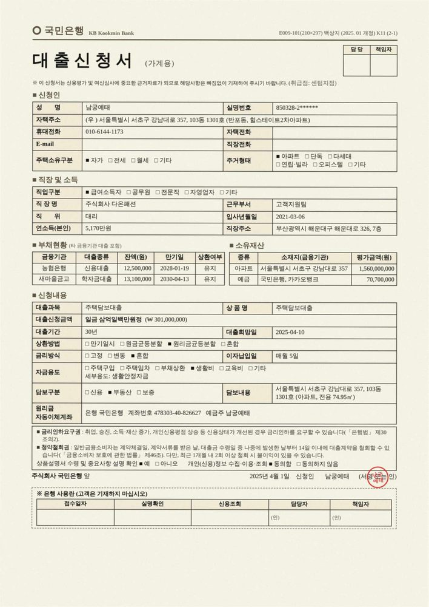</a></p>

1. `loan_application_1000000.jpg`

**질문** (`prompt`)

```
이 문서에서 아래 항목의 값을 찾아 JSON 객체로 답하세요. 키는 그대로 쓰고, 값은 문서에 적힌 그대로 옮기세요. 문서에 비어 있거나 없는 항목은 null 로 답하세요.
항목 (키: 항목명)
- bank: 은행명
- branch: 취급점
- applicant.name: 성명
- applicant.rrn: 실명번호
- applicant.zipcode: 우편번호
- applicant.address: 자택주소
- applicant.mobile: 휴대전화
- applicant.home_phone: 자택전화
- applicant.email: E-mail
- applicant.work_phone: 직장전화
- workplace.name: 직장명
- workplace.department: 근무부서
- workplace.address: 직장주소
- debts.0.lender: 금융기관
- debts.0.kind: 대출종류
- debts.0.balance: 잔액
- debts.0.maturity: 만기일
- debts.0.refinance: 상환여부
- debts.1.lender: 금융기관
- debts.1.kind: 대출종류
- debts.1.balance: 잔액
- debts.1.maturity: 만기일
- debts.1.refinance: 상환여부
- assets.0.location: 소재지
- assets.0.value: 평가금액
- assets.1.kind: 종류
- assets.1.location: 소재지
- assets.1.value: 평가금액
- loan.subject: 대출과목
- loan.product: 상품명
- loan.amount_korean: 대출신청금액(한글)
- loan.term: 대출기간
- loan.interest_day: 이자납입일
- loan.purpose: 세부용도
- collateral_detail: 담보내용
- loan.debit_bank: 이체은행
- loan.debit_account: 이체계좌번호
- loan.debit_holder: 예금주
- apply_date: 신청일
- signature: 신청인
```

**정답** (`answer`)

```json
{
 "bank": "국민은행",
 "branch": "센텀지점",
 "applicant.name": "남궁예태",
 "applicant.rrn": "850328-2******",
 "applicant.zipcode": null,
 "applicant.address": "서울특별시 서초구 강남대로 357, 103동 1301호 (반포동, 힐스테이트2차아파트)",
 "applicant.mobile": "010-6144-1173",
 "applicant.home_phone": null,
 "applicant.email": null,
 "applicant.work_phone": null,
 "workplace.name": "주식회사 다온패션",
 "workplace.department": "고객지원팀",
 "workplace.address": "부산광역시 해운대구 해운대로 326, 7층",
 "debts.0.lender": "농협은행",
 "debts.0.kind": "신용대출",
 "debts.0.balance": "12,500,000",
 "debts.0.maturity": "2028-01-19",
 "debts.0.refinance": "유지",
 "debts.1.lender": "새마을금고",
 "debts.1.kind": "학자금대출",
 "debts.1.balance": "13,100,000",
 "debts.1.maturity": "2030-04-13",
 "debts.1.refinance": "유지",
 "assets.0.location": "서울특별시 서초구 강남대로 357",
 "assets.0.value": "1,560,000,000",
 "assets.1.kind": "예금",
 "assets.1.location": "국민은행, 카카오뱅크",
 "assets.1.value": "70,700,000",
 "loan.subject": "주택담보대출",
 "loan.product": "주택담보대출",
 "loan.amount_korean": "일금 삼억일백만원정",
 "loan.term": "30년",
 "loan.interest_day": "매월 5일",
 "loan.purpose": "생활안정자금",
 "collateral_detail": "서울특별시 서초구 강남대로 357, 103동 1301호 (아파트, 전용 74.95㎡)",
 "loan.debit_bank": "국민은행",
 "loan.debit_account": "478303-40-826627",
 "loan.debit_holder": "남궁예태",
 "apply_date": "2025년 4월 1일",
 "signature": "남궁예태"
}
```

**채점 정보** (`eval`)

```json
{
 "fields": {
  "bank": {"type": "text", "norm": "국민은행", "kind": "text"},
  "branch": {"type": "text", "norm": "센텀지점", "kind": "text"},
  "applicant.name": {"type": "text", "norm": "남궁예태", "kind": "name"},
  "applicant.rrn": {"type": "rrn", "norm": "850328-2******", "kind": "rrn"},
  "applicant.zipcode": {"type": "text", "norm": null, "kind": "text"},
  "applicant.address": {"type": "text", "norm": "서울특별시 서초구 강남대로 357, 103동 1301호 (반포동, 힐스테이트2차아파트)", "kind": "address"},
  "applicant.mobile": {"type": "phone", "norm": "01061441173", "kind": "phone"},
  "applicant.home_phone": {"type": "phone", "norm": null, "kind": "phone"},
  "applicant.email": {"type": "text", "norm": null, "kind": "text"},
  "applicant.work_phone": {"type": "phone", "norm": null, "kind": "phone"},
  "workplace.name": {"type": "text", "norm": "주식회사 다온패션", "kind": "text"},
  "workplace.department": {"type": "text", "norm": "고객지원팀", "kind": "text"},
  "workplace.address": {"type": "text", "norm": "부산광역시 해운대구 해운대로 326, 7층", "kind": "address"},
  "debts.0.lender": {"type": "text", "norm": "농협은행", "kind": "text"},
  "debts.0.kind": {"type": "text", "norm": "신용대출", "kind": "text"},
  "debts.0.balance": {"type": "amount", "norm": 12500000, "kind": "amount"},
  "debts.0.maturity": {"type": "date", "norm": "2028-01-19", "kind": "date"},
  "debts.0.refinance": {"type": "text", "norm": "유지", "kind": "text"},
  "debts.1.lender": {"type": "text", "norm": "새마을금고", "kind": "text"},
  "debts.1.kind": {"type": "text", "norm": "학자금대출", "kind": "text"},
  "debts.1.balance": {"type": "amount", "norm": 13100000, "kind": "amount"},
  "debts.1.maturity": {"type": "date", "norm": "2030-04-13", "kind": "date"},
  "debts.1.refinance": {"type": "text", "norm": "유지", "kind": "text"},
  "assets.0.location": {"type": "text", "norm": "서울특별시 서초구 강남대로 357", "kind": "address"},
  "assets.0.value": {"type": "amount", "norm": 1560000000, "kind": "amount"},
  "assets.1.kind": {"type": "text", "norm": "예금", "kind": "text"},
  "assets.1.location": {"type": "text", "norm": "국민은행, 카카오뱅크", "kind": "address"},
  "assets.1.value": {"type": "amount", "norm": 70700000, "kind": "amount"},
  "loan.subject": {"type": "text", "norm": "주택담보대출", "kind": "text"},
  "loan.product": {"type": "text", "norm": "주택담보대출", "kind": "text"},
  "loan.amount_korean": {"type": "amount_korean", "norm": 301000000, "kind": "amount"},
  "loan.term": {"type": "text", "norm": "30년", "kind": "text"},
  "loan.interest_day": {"type": "text", "norm": "매월 5일", "kind": "text"},
  "loan.purpose": {"type": "text", "norm": "생활안정자금", "kind": "text"},
  "collateral_detail": {"type": "text", "norm": "서울특별시 서초구 강남대로 357, 103동 1301호 (아파트, 전용 74.95㎡)", "kind": "text"},
  "loan.debit_bank": {"type": "text", "norm": "국민은행", "kind": "text"},
  "loan.debit_account": {"type": "account_no", "norm": "478303-40-826627", "kind": "account_no"},
  "loan.debit_holder": {"type": "text", "norm": "남궁예태", "kind": "name"},
  "apply_date": {"type": "date", "norm": "2025-04-01", "kind": "date"},
  "signature": {"type": "text", "norm": "남궁예태", "kind": "text"}
 }
}
```

**나눠 보기 정보** (`meta`)

```json
{
 "doc_type": "loan_application",
 "doc_name": "대출거래신청서",
 "group": "bank_form",
 "condition": "scan",
 "writing": "print",
 "n_pages": 1
}
```

**문항 한 줄 전체** (`tasks/kie.jsonl`)

<details><summary>펼치기</summary>

```json
{
 "id": "kie/loan_application_1000000",
 "task": "kie",
 "prompt": "이 문서에서 아래 항목의 값을 찾아 JSON 객체로 답하세요. 키는 그대로 쓰고, 값은 문서에 적힌 그대로 옮기세요. 문서에 비어 있거나 없는 항목은 null 로 답하세요.\n항목 (키: 항목명)\n- bank: 은행명\n- branch: 취급점\n- applicant.name: 성명\n- applicant.rrn: 실명번호\n- applicant.zipcode: 우편번호\n- applicant.address: 자택주소\n- applicant.mobile: 휴대전화\n- applicant.home_phone: 자택전화\n- applicant.email: E-mail\n- applicant.work_phone: 직장전화\n- workplace.name: 직장명\n- workplace.department: 근무부서\n- workplace.address: 직장주소\n- debts.0.lender: 금융기관\n- debts.0.kind: 대출종류\n- debts.0.balance: 잔액\n- debts.0.maturity: 만기일\n- debts.0.refinance: 상환여부\n- debts.1.lender: 금융기관\n- debts.1.kind: 대출종류\n- debts.1.balance: 잔액\n- debts.1.maturity: 만기일\n- debts.1.refinance: 상환여부\n- assets.0.location: 소재지\n- assets.0.value: 평가금액\n- assets.1.kind: 종류\n- assets.1.location: 소재지\n- assets.1.value: 평가금액\n- loan.subject: 대출과목\n- loan.product: 상품명\n- loan.amount_korean: 대출신청금액(한글)\n- loan.term: 대출기간\n- loan.interest_day: 이자납입일\n- loan.purpose: 세부용도\n- collateral_detail: 담보내용\n- loan.debit_bank: 이체은행\n- loan.debit_account: 이체계좌번호\n- loan.debit_holder: 예금주\n- apply_date: 신청일\n- signature: 신청인",
 "answer": {
  "bank": "국민은행",
  "branch": "센텀지점",
  "applicant.name": "남궁예태",
  "applicant.rrn": "850328-2******",
  "applicant.zipcode": null,
  "applicant.address": "서울특별시 서초구 강남대로 357, 103동 1301호 (반포동, 힐스테이트2차아파트)",
  "applicant.mobile": "010-6144-1173",
  "applicant.home_phone": null,
  "applicant.email": null,
  "applicant.work_phone": null,
  "workplace.name": "주식회사 다온패션",
  "workplace.department": "고객지원팀",
  "workplace.address": "부산광역시 해운대구 해운대로 326, 7층",
  "debts.0.lender": "농협은행",
  "debts.0.kind": "신용대출",
  "debts.0.balance": "12,500,000",
  "debts.0.maturity": "2028-01-19",
  "debts.0.refinance": "유지",
  "debts.1.lender": "새마을금고",
  "debts.1.kind": "학자금대출",
  "debts.1.balance": "13,100,000",
  "debts.1.maturity": "2030-04-13",
  "debts.1.refinance": "유지",
  "assets.0.location": "서울특별시 서초구 강남대로 357",
  "assets.0.value": "1,560,000,000",
  "assets.1.kind": "예금",
  "assets.1.location": "국민은행, 카카오뱅크",
  "assets.1.value": "70,700,000",
  "loan.subject": "주택담보대출",
  "loan.product": "주택담보대출",
  "loan.amount_korean": "일금 삼억일백만원정",
  "loan.term": "30년",
  "loan.interest_day": "매월 5일",
  "loan.purpose": "생활안정자금",
  "collateral_detail": "서울특별시 서초구 강남대로 357, 103동 1301호 (아파트, 전용 74.95㎡)",
  "loan.debit_bank": "국민은행",
  "loan.debit_account": "478303-40-826627",
  "loan.debit_holder": "남궁예태",
  "apply_date": "2025년 4월 1일",
  "signature": "남궁예태"
 },
 "eval": {
  "fields": {
   "bank": {"type": "text", "norm": "국민은행", "kind": "text"},
   "branch": {"type": "text", "norm": "센텀지점", "kind": "text"},
   "applicant.name": {"type": "text", "norm": "남궁예태", "kind": "name"},
   "applicant.rrn": {"type": "rrn", "norm": "850328-2******", "kind": "rrn"},
   "applicant.zipcode": {"type": "text", "norm": null, "kind": "text"},
   "applicant.address": {"type": "text", "norm": "서울특별시 서초구 강남대로 357, 103동 1301호 (반포동, 힐스테이트2차아파트)", "kind": "address"},
   "applicant.mobile": {"type": "phone", "norm": "01061441173", "kind": "phone"},
   "applicant.home_phone": {"type": "phone", "norm": null, "kind": "phone"},
   "applicant.email": {"type": "text", "norm": null, "kind": "text"},
   "applicant.work_phone": {"type": "phone", "norm": null, "kind": "phone"},
   "workplace.name": {"type": "text", "norm": "주식회사 다온패션", "kind": "text"},
   "workplace.department": {"type": "text", "norm": "고객지원팀", "kind": "text"},
   "workplace.address": {"type": "text", "norm": "부산광역시 해운대구 해운대로 326, 7층", "kind": "address"},
   "debts.0.lender": {"type": "text", "norm": "농협은행", "kind": "text"},
   "debts.0.kind": {"type": "text", "norm": "신용대출", "kind": "text"},
   "debts.0.balance": {"type": "amount", "norm": 12500000, "kind": "amount"},
   "debts.0.maturity": {"type": "date", "norm": "2028-01-19", "kind": "date"},
   "debts.0.refinance": {"type": "text", "norm": "유지", "kind": "text"},
   "debts.1.lender": {"type": "text", "norm": "새마을금고", "kind": "text"},
   "debts.1.kind": {"type": "text", "norm": "학자금대출", "kind": "text"},
   "debts.1.balance": {"type": "amount", "norm": 13100000, "kind": "amount"},
   "debts.1.maturity": {"type": "date", "norm": "2030-04-13", "kind": "date"},
   "debts.1.refinance": {"type": "text", "norm": "유지", "kind": "text"},
   "assets.0.location": {"type": "text", "norm": "서울특별시 서초구 강남대로 357", "kind": "address"},
   "assets.0.value": {"type": "amount", "norm": 1560000000, "kind": "amount"},
   "assets.1.kind": {"type": "text", "norm": "예금", "kind": "text"},
   "assets.1.location": {"type": "text", "norm": "국민은행, 카카오뱅크", "kind": "address"},
   "assets.1.value": {"type": "amount", "norm": 70700000, "kind": "amount"},
   "loan.subject": {"type": "text", "norm": "주택담보대출", "kind": "text"},
   "loan.product": {"type": "text", "norm": "주택담보대출", "kind": "text"},
   "loan.amount_korean": {"type": "amount_korean", "norm": 301000000, "kind": "amount"},
   "loan.term": {"type": "text", "norm": "30년", "kind": "text"},
   "loan.interest_day": {"type": "text", "norm": "매월 5일", "kind": "text"},
   "loan.purpose": {"type": "text", "norm": "생활안정자금", "kind": "text"},
   "collateral_detail": {"type": "text", "norm": "서울특별시 서초구 강남대로 357, 103동 1301호 (아파트, 전용 74.95㎡)", "kind": "text"},
   "loan.debit_bank": {"type": "text", "norm": "국민은행", "kind": "text"},
   "loan.debit_account": {"type": "account_no", "norm": "478303-40-826627", "kind": "account_no"},
   "loan.debit_holder": {"type": "text", "norm": "남궁예태", "kind": "name"},
   "apply_date": {"type": "date", "norm": "2025-04-01", "kind": "date"},
   "signature": {"type": "text", "norm": "남궁예태", "kind": "text"}
  }
 },
 "images": ["images/loan_application_1000000.jpg"],
 "meta": {
  "doc_type": "loan_application",
  "doc_name": "대출거래신청서",
  "group": "bank_form",
  "condition": "scan",
  "writing": "print",
  "n_pages": 1
 }
}
```
</details>

**학습 레코드** (`swift/all.jsonl` 한 줄: 같은 문항을 질문 + 정답 답변 대화로 바꾼 것)

```json
{
 "id": "kie/loan_application_1000000",
 "task": "kie",
 "images": ["images/loan_application_1000000.jpg"],
 "messages": [
  {
   "role": "user",
   "content": "<image>이 문서에서 아래 항목의 값을 찾아 JSON 객체로 답하세요. 키는 그대로 쓰고, 값은 문서에 적힌 그대로 옮기세요. 문서에 비어 있거나 없는 항목은 null 로 답하세요.\n항목 (키: 항목명)\n- bank: 은행명\n- branch: 취급점\n- applicant.name: 성명\n- applicant.rrn: 실명번호\n- applicant.zipcode: 우편번호\n- applicant.address: 자택주소\n- applicant.mobile: 휴대전화\n- applicant.home_phone: 자택전화\n- applicant.email: E-mail\n- applicant.work_phone: 직장전화\n- workplace.name: 직장명\n- workplace.department: 근무부서\n- workplace.address: 직장주소\n- debts.0.lender: 금융기관\n- debts.0.kind: 대출종류\n- debts.0.balance: 잔액\n- debts.0.maturity: 만기일\n- debts.0.refinance: 상환여부\n- debts.1.lender: 금융기관\n- debts.1.kind: 대출종류\n- debts.1.balance: 잔액\n- debts.1.maturity: 만기일\n- debts.1.refinance: 상환여부\n- assets.0.location: 소재지\n- assets.0.value: 평가금액\n- assets.1.kind: 종류\n- assets.1.location: 소재지\n- assets.1.value: 평가금액\n- loan.subject: 대출과목\n- loan.product: 상품명\n- loan.amount_korean: 대출신청금액(한글)\n- loan.term: 대출기간\n- loan.interest_day: 이자납입일\n- loan.purpose: 세부용도\n- collateral_detail: 담보내용\n- loan.debit_bank: 이체은행\n- loan.debit_account: 이체계좌번호\n- loan.debit_holder: 예금주\n- apply_date: 신청일\n- signature: 신청인"
  },
  {
   "role": "assistant",
   "content": "{\"bank\": \"국민은행\", \"branch\": \"센텀지점\", \"applicant.name\": \"남궁예태\", \"applicant.rrn\": \"850328-2******\", \"applicant.zipcode\": null, \"applicant.address\": \"서울특별시 서초구 강남대로 357, 103동 1301호 (반포동, 힐스테이트2차아파트)\", \"applicant.mobile\": \"010-6144-1173\", \"applicant.home_phone\": null, \"applicant.email\": null, \"applicant.work_phone\": null, \"workplace.name\": \"주식회사 다온패션\", \"workplace.department\": \"고객지원팀\", \"workplace.address\": \"부산광역시 해운대구 해운대로 326, 7층\", \"debts.0.lender\": \"농협은행\", \"debts.0.kind\": \"신용대출\", \"debts.0.balance\": \"12,500,000\", \"debts.0.maturity\": \"2028-01-19\", \"debts.0.refinance\": \"유지\", \"debts.1.lender\": \"새마을금고\", \"debts.1.kind\": \"학자금대출\", \"debts.1.balance\": \"13,100,000\", \"debts.1.maturity\": \"2030-04-13\", \"debts.1.refinance\": \"유지\", \"assets.0.location\": \"서울특별시 서초구 강남대로 357\", \"assets.0.value\": \"1,560,000,000\", \"assets.1.kind\": \"예금\", \"assets.1.location\": \"국민은행, 카카오뱅크\", \"assets.1.value\": \"70,700,000\", \"loan.subject\": \"주택담보대출\", \"loan.product\": \"주택담보대출\", \"loan.amount_korean\": \"일금 삼억일백만원정\", \"loan.term\": \"30년\", \"loan.interest_day\": \"매월 5일\", \"loan.purpose\": \"생활안정자금\", \"collateral_detail\": \"서울특별시 서초구 강남대로 357, 103동 1301호 (아파트, 전용 74.95㎡)\", \"loan.debit_bank\": \"국민은행\", \"loan.debit_account\": \"478303-40-826627\", \"loan.debit_holder\": \"남궁예태\", \"apply_date\": \"2025년 4월 1일\", \"signature\": \"남궁예태\"}"
  }
 ]
}
```

### 2-5. marks — 체크박스·도장·서명

**정답 형식:** 체크박스: 체크된 보기 글자 (없으면 null) · 복수 선택: 목록 · 도장/서명: true / false

**채점:** 항목별 정확도

**입력 이미지** (1장, 질문 앞에 이 순서로)

<p><a href="examples/img/loan_application_1000000_49fcf226.jpg"></a></p>

1. `loan_application_1000000.jpg`

**질문** (`prompt`)

```
이 문서의 체크박스·도장·서명 상태를 확인해 JSON 객체로 답하세요.
- 체크박스: 체크된 보기의 글자 (체크된 것이 없으면 null)
- 복수 선택: 체크된 보기 글자의 목록 (없으면 [])
- 도장·서명: 찍혀 있거나 서명되어 있으면 true, 비어 있으면 false
항목
- housing: 주택소유구분 (체크박스, 보기: 자가 / 전세 / 월세 / 기타)
- dwelling: 주거형태 (체크박스, 보기: 아파트 / 단독 / 다세대 / 연립·빌라 / 오피스텔 / 기타)
- workplace.job_type: 직업구분 (체크박스, 보기: 급여소득자 / 공무원 / 전문직 / 자영업자 / 기타)
- loan.repayment: 상환방법 (체크박스, 보기: 만기일시 / 원금균등분할 / 원리금균등분할 / 혼합)
- loan.rate_type: 금리방식 (체크박스, 보기: 고정 / 변동 / 혼합)
- loan.purpose_category: 자금용도구분 (체크박스, 보기: 주택구입 / 주택임차 / 부채상환 / 생활비 / 교육비 / 기타)
- collateral: 담보구분 (체크박스, 보기: 신용 / 부동산 / 보증)
- manual_received: 설명서수령확인 (체크박스, 보기: 예 / 아니오)
- consent: 개인(신용)정보동의 (체크박스, 보기: 동의함 / 동의하지 않음)
- seal.applicant: 신청인 (도장)
- sign.applicant: 신청인 (서명)
```

**정답** (`answer`)

```json
{
 "housing": "자가",
 "dwelling": "아파트",
 "workplace.job_type": "급여소득자",
 "loan.repayment": "원리금균등분할",
 "loan.rate_type": "혼합",
 "loan.purpose_category": "생활비",
 "collateral": "부동산",
 "manual_received": "예",
 "consent": "동의함",
 "seal.applicant": true,
 "sign.applicant": false
}
```

**채점 정보** (`eval`)

```json
{
 "types": {
  "housing": "checkbox",
  "dwelling": "checkbox",
  "workplace.job_type": "checkbox",
  "loan.repayment": "checkbox",
  "loan.rate_type": "checkbox",
  "loan.purpose_category": "checkbox",
  "collateral": "checkbox",
  "manual_received": "checkbox",
  "consent": "checkbox",
  "seal.applicant": "seal",
  "sign.applicant": "signature"
 }
}
```

**나눠 보기 정보** (`meta`)

```json
{
 "doc_type": "loan_application",
 "doc_name": "대출거래신청서",
 "group": "bank_form",
 "condition": "scan",
 "writing": "print",
 "n_pages": 1
}
```

**문항 한 줄 전체** (`tasks/marks.jsonl`)

<details><summary>펼치기</summary>

```json
{
 "id": "marks/loan_application_1000000",
 "task": "marks",
 "prompt": "이 문서의 체크박스·도장·서명 상태를 확인해 JSON 객체로 답하세요.\n- 체크박스: 체크된 보기의 글자 (체크된 것이 없으면 null)\n- 복수 선택: 체크된 보기 글자의 목록 (없으면 [])\n- 도장·서명: 찍혀 있거나 서명되어 있으면 true, 비어 있으면 false\n항목\n- housing: 주택소유구분 (체크박스, 보기: 자가 / 전세 / 월세 / 기타)\n- dwelling: 주거형태 (체크박스, 보기: 아파트 / 단독 / 다세대 / 연립·빌라 / 오피스텔 / 기타)\n- workplace.job_type: 직업구분 (체크박스, 보기: 급여소득자 / 공무원 / 전문직 / 자영업자 / 기타)\n- loan.repayment: 상환방법 (체크박스, 보기: 만기일시 / 원금균등분할 / 원리금균등분할 / 혼합)\n- loan.rate_type: 금리방식 (체크박스, 보기: 고정 / 변동 / 혼합)\n- loan.purpose_category: 자금용도구분 (체크박스, 보기: 주택구입 / 주택임차 / 부채상환 / 생활비 / 교육비 / 기타)\n- collateral: 담보구분 (체크박스, 보기: 신용 / 부동산 / 보증)\n- manual_received: 설명서수령확인 (체크박스, 보기: 예 / 아니오)\n- consent: 개인(신용)정보동의 (체크박스, 보기: 동의함 / 동의하지 않음)\n- seal.applicant: 신청인 (도장)\n- sign.applicant: 신청인 (서명)",
 "answer": {
  "housing": "자가",
  "dwelling": "아파트",
  "workplace.job_type": "급여소득자",
  "loan.repayment": "원리금균등분할",
  "loan.rate_type": "혼합",
  "loan.purpose_category": "생활비",
  "collateral": "부동산",
  "manual_received": "예",
  "consent": "동의함",
  "seal.applicant": true,
  "sign.applicant": false
 },
 "eval": {
  "types": {
   "housing": "checkbox",
   "dwelling": "checkbox",
   "workplace.job_type": "checkbox",
   "loan.repayment": "checkbox",
   "loan.rate_type": "checkbox",
   "loan.purpose_category": "checkbox",
   "collateral": "checkbox",
   "manual_received": "checkbox",
   "consent": "checkbox",
   "seal.applicant": "seal",
   "sign.applicant": "signature"
  }
 },
 "images": ["images/loan_application_1000000.jpg"],
 "meta": {
  "doc_type": "loan_application",
  "doc_name": "대출거래신청서",
  "group": "bank_form",
  "condition": "scan",
  "writing": "print",
  "n_pages": 1
 }
}
```
</details>

**학습 레코드** (`swift/all.jsonl` 한 줄: 같은 문항을 질문 + 정답 답변 대화로 바꾼 것)

```json
{
 "id": "marks/loan_application_1000000",
 "task": "marks",
 "images": ["images/loan_application_1000000.jpg"],
 "messages": [
  {
   "role": "user",
   "content": "<image>이 문서의 체크박스·도장·서명 상태를 확인해 JSON 객체로 답하세요.\n- 체크박스: 체크된 보기의 글자 (체크된 것이 없으면 null)\n- 복수 선택: 체크된 보기 글자의 목록 (없으면 [])\n- 도장·서명: 찍혀 있거나 서명되어 있으면 true, 비어 있으면 false\n항목\n- housing: 주택소유구분 (체크박스, 보기: 자가 / 전세 / 월세 / 기타)\n- dwelling: 주거형태 (체크박스, 보기: 아파트 / 단독 / 다세대 / 연립·빌라 / 오피스텔 / 기타)\n- workplace.job_type: 직업구분 (체크박스, 보기: 급여소득자 / 공무원 / 전문직 / 자영업자 / 기타)\n- loan.repayment: 상환방법 (체크박스, 보기: 만기일시 / 원금균등분할 / 원리금균등분할 / 혼합)\n- loan.rate_type: 금리방식 (체크박스, 보기: 고정 / 변동 / 혼합)\n- loan.purpose_category: 자금용도구분 (체크박스, 보기: 주택구입 / 주택임차 / 부채상환 / 생활비 / 교육비 / 기타)\n- collateral: 담보구분 (체크박스, 보기: 신용 / 부동산 / 보증)\n- manual_received: 설명서수령확인 (체크박스, 보기: 예 / 아니오)\n- consent: 개인(신용)정보동의 (체크박스, 보기: 동의함 / 동의하지 않음)\n- seal.applicant: 신청인 (도장)\n- sign.applicant: 신청인 (서명)"
  },
  {
   "role": "assistant",
   "content": "{\"housing\": \"자가\", \"dwelling\": \"아파트\", \"workplace.job_type\": \"급여소득자\", \"loan.repayment\": \"원리금균등분할\", \"loan.rate_type\": \"혼합\", \"loan.purpose_category\": \"생활비\", \"collateral\": \"부동산\", \"manual_received\": \"예\", \"consent\": \"동의함\", \"seal.applicant\": true, \"sign.applicant\": false}"
  }
 ]
}
```

### 2-6. classify — 서류 분류

**정답 형식:** 서류 정식 명칭

**채점:** 공백·문장부호를 뺀 뒤 정식 명칭과 같으면 정답

**입력 이미지** (1장, 질문 앞에 이 순서로)

<p><a href="examples/img/loan_application_1000000_49fcf226.jpg"></a></p>

1. `loan_application_1000000.jpg`

**질문** (`prompt`)

```
이 문서는 고객이 은행에 제출한 서류입니다. 서류의 정식 명칭(서류명)을 답하세요. 설명 없이 서류명만 한 줄로 답하세요.
```

**정답** (`answer`)

```
대출거래신청서
```

**나눠 보기 정보** (`meta`)

```json
{
 "doc_type": "loan_application",
 "doc_name": "대출거래신청서",
 "group": "bank_form",
 "condition": "scan",
 "writing": "print",
 "n_pages": 1
}
```

**문항 한 줄 전체** (`tasks/classify.jsonl`)

<details><summary>펼치기</summary>

```json
{
 "id": "classify/loan_application_1000000",
 "task": "classify",
 "prompt": "이 문서는 고객이 은행에 제출한 서류입니다. 서류의 정식 명칭(서류명)을 답하세요. 설명 없이 서류명만 한 줄로 답하세요.",
 "answer": "대출거래신청서",
 "images": ["images/loan_application_1000000.jpg"],
 "meta": {
  "doc_type": "loan_application",
  "doc_name": "대출거래신청서",
  "group": "bank_form",
  "condition": "scan",
  "writing": "print",
  "n_pages": 1
 }
}
```
</details>

**학습 레코드** (`swift/all.jsonl` 한 줄: 같은 문항을 질문 + 정답 답변 대화로 바꾼 것)

```json
{
 "id": "classify/loan_application_1000000",
 "task": "classify",
 "images": ["images/loan_application_1000000.jpg"],
 "messages": [
  {"role": "user", "content": "<image>이 문서는 고객이 은행에 제출한 서류입니다. 서류의 정식 명칭(서류명)을 답하세요. 설명 없이 서류명만 한 줄로 답하세요."},
  {"role": "assistant", "content": "대출거래신청서"}
 ]
}
```

### 2-7. ocr_page — 전체 받아쓰기

**정답 형식:** 서류에 채워 넣은 값들 (한 줄에 하나). 채점은 이 값들이 받아쓴 글에 들어 있는 비율

**채점:** 값 재현율 (공백 무시). recall_fuzzy 는 값 길이 20% 까지 틀려도 인정

**입력 이미지** (1장, 질문 앞에 이 순서로)

<p><a href="examples/img/loan_application_1000000_49fcf226.jpg"></a></p>

1. `loan_application_1000000.jpg`

**질문** (`prompt`)

```
이 문서 이미지에 보이는 모든 글자를 빠짐없이 읽어 텍스트로 옮기세요. 위에서 아래, 왼쪽에서 오른쪽 순서로 쓰고, 표는 한 행을 한 줄로 쓰세요. 설명 없이 읽은 글자만 출력하세요.
```

**정답** (`answer`)

```json
[
 "국민은행",
 "센텀지점",
 "남궁예태",
 "850328-2******",
 "서울특별시 서초구 강남대로 357, 103동 1301호 (반포동, 힐스테이트2차아파트)",
 "010-6144-1173",
 "주식회사 다온패션",
 "고객지원팀",
 "대리",
 "2021-03-06",
 "5,170만원",
 "부산광역시 해운대구 해운대로 326, 7층",
 "농협은행",
 "신용대출",
 "12,500,000",
 "2028-01-19",
 "유지",
 "새마을금고",
 "학자금대출",
 "13,100,000",
 "2030-04-13",
 "아파트",
 "서울특별시 서초구 강남대로 357",
 "1,560,000,000",
 "예금",
 "국민은행, 카카오뱅크",
 "70,700,000",
 "주택담보대출",
 "일금 삼억일백만원정",
 "301,000,000",
 "30년",
 "2025-04-10",
 "매월 5일",
 "생활안정자금",
 "서울특별시 서초구 강남대로 357, 103동 1301호 (아파트, 전용 74.95㎡)",
 "478303-40-826627",
 "2025년 4월 1일"
]
```

**나눠 보기 정보** (`meta`)

```json
{
 "doc_type": "loan_application",
 "doc_name": "대출거래신청서",
 "group": "bank_form",
 "condition": "scan",
 "writing": "print",
 "n_pages": 1
}
```

**문항 한 줄 전체** (`tasks/ocr_page.jsonl`)

<details><summary>펼치기</summary>

```json
{
 "id": "ocr_page/loan_application_1000000",
 "task": "ocr_page",
 "prompt": "이 문서 이미지에 보이는 모든 글자를 빠짐없이 읽어 텍스트로 옮기세요. 위에서 아래, 왼쪽에서 오른쪽 순서로 쓰고, 표는 한 행을 한 줄로 쓰세요. 설명 없이 읽은 글자만 출력하세요.",
 "answer": [
  "국민은행",
  "센텀지점",
  "남궁예태",
  "850328-2******",
  "서울특별시 서초구 강남대로 357, 103동 1301호 (반포동, 힐스테이트2차아파트)",
  "010-6144-1173",
  "주식회사 다온패션",
  "고객지원팀",
  "대리",
  "2021-03-06",
  "5,170만원",
  "부산광역시 해운대구 해운대로 326, 7층",
  "농협은행",
  "신용대출",
  "12,500,000",
  "2028-01-19",
  "유지",
  "새마을금고",
  "학자금대출",
  "13,100,000",
  "2030-04-13",
  "아파트",
  "서울특별시 서초구 강남대로 357",
  "1,560,000,000",
  "예금",
  "국민은행, 카카오뱅크",
  "70,700,000",
  "주택담보대출",
  "일금 삼억일백만원정",
  "301,000,000",
  "30년",
  "2025-04-10",
  "매월 5일",
  "생활안정자금",
  "서울특별시 서초구 강남대로 357, 103동 1301호 (아파트, 전용 74.95㎡)",
  "478303-40-826627",
  "2025년 4월 1일"
 ],
 "images": ["images/loan_application_1000000.jpg"],
 "meta": {
  "doc_type": "loan_application",
  "doc_name": "대출거래신청서",
  "group": "bank_form",
  "condition": "scan",
  "writing": "print",
  "n_pages": 1
 }
}
```
</details>

**학습 레코드** (`swift/all.jsonl` 한 줄: 같은 문항을 질문 + 정답 답변 대화로 바꾼 것)

```json
{
 "id": "ocr_page/loan_application_1000000",
 "task": "ocr_page",
 "images": ["images/loan_application_1000000.jpg"],
 "messages": [
  {
   "role": "user",
   "content": "<image>이 문서 이미지에 보이는 모든 글자를 빠짐없이 읽어 텍스트로 옮기세요. 위에서 아래, 왼쪽에서 오른쪽 순서로 쓰고, 표는 한 행을 한 줄로 쓰세요. 설명 없이 읽은 글자만 출력하세요."
  },
  {
   "role": "assistant",
   "content": "국민은행\n센텀지점\n남궁예태\n850328-2******\n서울특별시 서초구 강남대로 357, 103동 1301호 (반포동, 힐스테이트2차아파트)\n010-6144-1173\n주식회사 다온패션\n고객지원팀\n대리\n2021-03-06\n5,170만원\n부산광역시 해운대구 해운대로 326, 7층\n농협은행\n신용대출\n12,500,000\n2028-01-19\n유지\n새마을금고\n학자금대출\n13,100,000\n2030-04-13\n아파트\n서울특별시 서초구 강남대로 357\n1,560,000,000\n예금\n국민은행, 카카오뱅크\n70,700,000\n주택담보대출\n일금 삼억일백만원정\n301,000,000\n30년\n2025-04-10\n매월 5일\n생활안정자금\n서울특별시 서초구 강남대로 357, 103동 1301호 (아파트, 전용 74.95㎡)\n478303-40-826627\n2025년 4월 1일"
  }
 ]
}
```

### 2-8. ocr_field — 값 칸 읽기

**정답 형식:** 잘라낸 값 칸에 적힌 글자

**채점:** 완전 일치 (공백 정규화), CER 함께

**입력 이미지** (1장, 질문 앞에 이 순서로)

<p><a href="examples/img/loan_application_1000000_0_d743f248.jpg">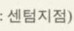</a></p>

1. `loan_application_1000000_0.png`

**질문** (`prompt`)

```
이미지에 적힌 글자를 그대로 읽어 옮기세요. 설명 없이 읽은 글자만 출력하세요.
```

**정답** (`answer`)

```
센텀지점
```

**나눠 보기 정보** (`meta`)

```json
{
 "doc_type": "loan_application",
 "doc_name": "대출거래신청서",
 "group": "bank_form",
 "condition": "scan",
 "writing": "print",
 "n_pages": 1,
 "key": "branch",
 "label": "취급점",
 "kind": "text",
 "corrected": false,
 "length": 4
}
```

**문항 한 줄 전체** (`tasks/ocr_field.jsonl`)

<details><summary>펼치기</summary>

```json
{
 "id": "ocr_field/loan_application_1000000/branch",
 "task": "ocr_field",
 "images": ["crops/loan_application_1000000_0.png"],
 "prompt": "이미지에 적힌 글자를 그대로 읽어 옮기세요. 설명 없이 읽은 글자만 출력하세요.",
 "answer": "센텀지점",
 "meta": {
  "doc_type": "loan_application",
  "doc_name": "대출거래신청서",
  "group": "bank_form",
  "condition": "scan",
  "writing": "print",
  "n_pages": 1,
  "key": "branch",
  "label": "취급점",
  "kind": "text",
  "corrected": false,
  "length": 4
 }
}
```
</details>

**학습 레코드** (`swift/all.jsonl` 한 줄: 같은 문항을 질문 + 정답 답변 대화로 바꾼 것)

```json
{
 "id": "ocr_field/loan_application_1000000/branch",
 "task": "ocr_field",
 "images": ["crops/loan_application_1000000_0.png"],
 "messages": [
  {"role": "user", "content": "<image>이미지에 적힌 글자를 그대로 읽어 옮기세요. 설명 없이 읽은 글자만 출력하세요."},
  {"role": "assistant", "content": "센텀지점"}
 ]
}
```

## 3부. 서류 대조 사례 14종 (cross_check 문항 하나씩)

사례마다 원본 서류에서 그 관계가 맞는지 먼저 확인하고, 50% 확률로 값 하나를 바꿔 다시 렌더링합니다(변조 문항). 나머지는 같은 서류 조합 그대로 냅니다(정상 문항). 아래는 사례마다 변조 문항 하나입니다(`format_only` 는 항상 정상 문항). 예/아니오로 물을 수 있는 사례는 같은 이미지로 심사 질의 문항(`review`, rule `case:<사례>`)도 만듭니다.

### 3-1. typo — 성명·번호·주소 오기

**분류:** `typo` · **실제 사례 근거:** 신청서·약정서 기재 오류 (성명·주민번호·연락처·주소 한 자리)

**입력 이미지** (3장, 질문 앞에 이 순서로)

<p><a href="examples/img/customer_due_diligence_d5df3487.jpg"></a> <a href="examples/img/fatca_crs_typo_c31cb323.jpg"></a> <a href="examples/img/financial_transaction_purpose_eecca3af.jpg"></a></p>

1. `customer_due_diligence.jpg` · 2. `fatca_crs_typo.png` · 3. `financial_transaction_purpose.png`

**질문** (`prompt`)

```
고객 '주하진' 님이 '개인 계좌개설' 업무를 위해 제출한 서류 3건입니다 (이미지 3장). 서류들을 서로 대조해 맞지 않는 정보(성명, 주민등록번호, 생년월일, 주소, 연락처, 계좌번호, 상호, 금액, 날짜 등), 업무상 맞지 않는 관계(계약 상대방이 등기부 소유자가 아님, 금액·날짜 관계 오류 등), 고객 본인 명의가 아닌 서류가 있는지 확인하세요. 표기 방식만 다른 것(날짜 형식, 주민번호 뒷자리 가림, 하이픈 유무 등)은 불일치가 아닙니다.
{"consistent": true 또는 false, "issues": [{"document": "문제가 있는 서류명", "field": "항목명", "value": "그 서류에 적힌 값", "expected": "다른 서류에 적힌 값"}]} 형식의 JSON 으로 답하세요. 문제가 없으면 {"consistent": true, "issues": []} 입니다.
```

**정답** (`answer`)

```json
{
 "consistent": false,
 "issues": [
  {
   "document": "해외금융계좌 납세자 확인서(개인)",
   "field": "연락처",
   "value": "010-2975-6008",
   "expected": "010-2975-6068",
   "alt_documents": []
  }
 ]
}
```

**채점 정보** (`eval`)

```json
{"documents": ["고객확인서(개인)", "해외금융계좌 납세자 확인서(개인)", "금융거래목적확인서"]}
```

**나눠 보기 정보** (`meta`)

```json
{
 "scenario": "account_opening",
 "task_name": "개인 계좌개설",
 "bundle": "account_opening_2000002",
 "customer": "주하진",
 "case": "typo",
 "category": "typo",
 "perturbed": true,
 "n_docs": 3
}
```

**문항 한 줄 전체** (`tasks/cross_check.jsonl`)

<details><summary>펼치기</summary>

```json
{
 "id": "cross_check/account_opening_2000002/typo",
 "task": "cross_check",
 "images": [
  "images/bundles/account_opening_2000002/customer_due_diligence.jpg",
  "images/bundles/account_opening_2000002/fatca_crs_typo.png",
  "images/bundles/account_opening_2000002/financial_transaction_purpose.png"
 ],
 "prompt": "고객 '주하진' 님이 '개인 계좌개설' 업무를 위해 제출한 서류 3건입니다 (이미지 3장). 서류들을 서로 대조해 맞지 않는 정보(성명, 주민등록번호, 생년월일, 주소, 연락처, 계좌번호, 상호, 금액, 날짜 등), 업무상 맞지 않는 관계(계약 상대방이 등기부 소유자가 아님, 금액·날짜 관계 오류 등), 고객 본인 명의가 아닌 서류가 있는지 확인하세요. 표기 방식만 다른 것(날짜 형식, 주민번호 뒷자리 가림, 하이픈 유무 등)은 불일치가 아닙니다.\n{\"consistent\": true 또는 false, \"issues\": [{\"document\": \"문제가 있는 서류명\", \"field\": \"항목명\", \"value\": \"그 서류에 적힌 값\", \"expected\": \"다른 서류에 적힌 값\"}]} 형식의 JSON 으로 답하세요. 문제가 없으면 {\"consistent\": true, \"issues\": []} 입니다.",
 "answer": {
  "consistent": false,
  "issues": [
   {
    "document": "해외금융계좌 납세자 확인서(개인)",
    "field": "연락처",
    "value": "010-2975-6008",
    "expected": "010-2975-6068",
    "alt_documents": []
   }
  ]
 },
 "eval": {"documents": ["고객확인서(개인)", "해외금융계좌 납세자 확인서(개인)", "금융거래목적확인서"]},
 "meta": {
  "scenario": "account_opening",
  "task_name": "개인 계좌개설",
  "bundle": "account_opening_2000002",
  "customer": "주하진",
  "case": "typo",
  "category": "typo",
  "perturbed": true,
  "n_docs": 3
 }
}
```
</details>

**학습 레코드** (`swift/all.jsonl` 한 줄: 같은 문항을 질문 + 정답 답변 대화로 바꾼 것)

```json
{
 "id": "cross_check/account_opening_2000002/typo",
 "task": "cross_check",
 "images": [
  "images/bundles/account_opening_2000002/customer_due_diligence.jpg",
  "images/bundles/account_opening_2000002/fatca_crs_typo.png",
  "images/bundles/account_opening_2000002/financial_transaction_purpose.png"
 ],
 "messages": [
  {
   "role": "user",
   "content": "<image><image><image>고객 '주하진' 님이 '개인 계좌개설' 업무를 위해 제출한 서류 3건입니다 (이미지 3장). 서류들을 서로 대조해 맞지 않는 정보(성명, 주민등록번호, 생년월일, 주소, 연락처, 계좌번호, 상호, 금액, 날짜 등), 업무상 맞지 않는 관계(계약 상대방이 등기부 소유자가 아님, 금액·날짜 관계 오류 등), 고객 본인 명의가 아닌 서류가 있는지 확인하세요. 표기 방식만 다른 것(날짜 형식, 주민번호 뒷자리 가림, 하이픈 유무 등)은 불일치가 아닙니다.\n{\"consistent\": true 또는 false, \"issues\": [{\"document\": \"문제가 있는 서류명\", \"field\": \"항목명\", \"value\": \"그 서류에 적힌 값\", \"expected\": \"다른 서류에 적힌 값\"}]} 형식의 JSON 으로 답하세요. 문제가 없으면 {\"consistent\": true, \"issues\": []} 입니다."
  },
  {
   "role": "assistant",
   "content": "{\"consistent\": false, \"issues\": [{\"document\": \"해외금융계좌 납세자 확인서(개인)\", \"field\": \"연락처\", \"value\": \"010-2975-6008\", \"expected\": \"010-2975-6068\"}]}"
  }
 ]
}
```

### 3-2. other_person — 타인 명의 서류

**분류:** `other_person` · **실제 사례 근거:** 명의도용·가족 서류 혼입, 대리 제출 시 타인 서류

**입력 이미지** (2장, 질문 앞에 이 순서로)

<p><a href="examples/img/account_opening_application_a3a2f2d9.jpg">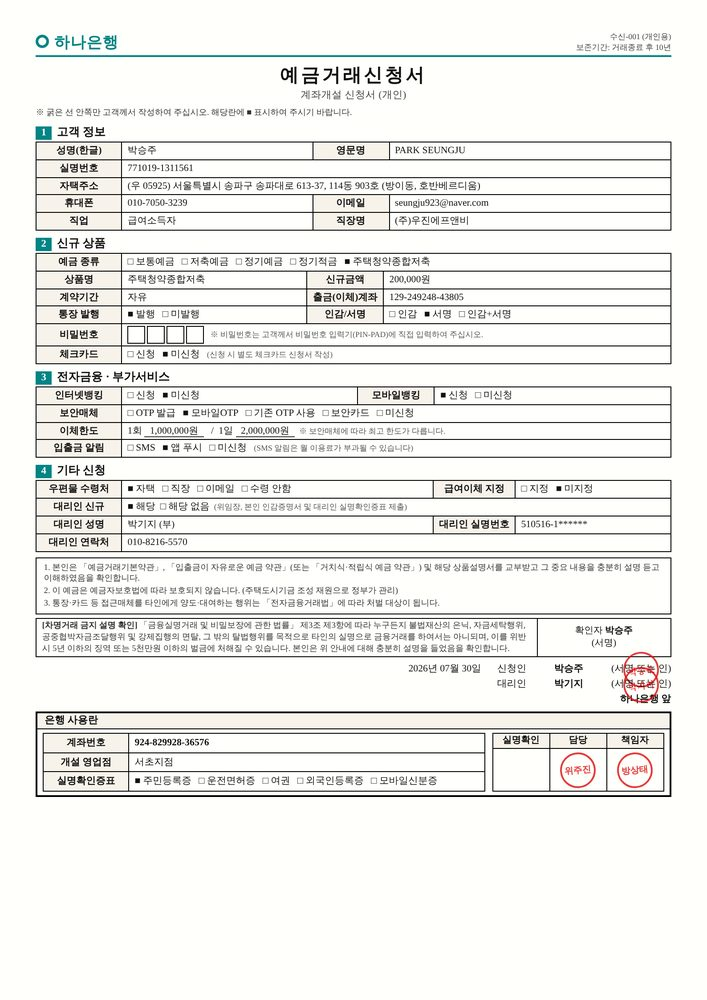</a> <a href="examples/img/resident_id_card_other_person_b99b03b3.jpg">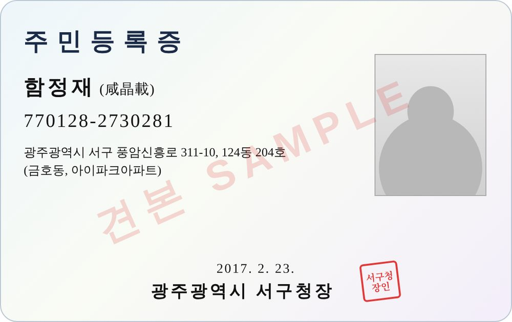</a></p>

1. `account_opening_application.png` · 2. `resident_id_card_other_person.png`

**질문** (`prompt`)

```
고객 '박승주' 님이 '개인 계좌개설' 업무를 위해 제출한 서류 2건입니다 (이미지 2장). 서류들을 서로 대조해 맞지 않는 정보(성명, 주민등록번호, 생년월일, 주소, 연락처, 계좌번호, 상호, 금액, 날짜 등), 업무상 맞지 않는 관계(계약 상대방이 등기부 소유자가 아님, 금액·날짜 관계 오류 등), 고객 본인 명의가 아닌 서류가 있는지 확인하세요. 표기 방식만 다른 것(날짜 형식, 주민번호 뒷자리 가림, 하이픈 유무 등)은 불일치가 아닙니다.
{"consistent": true 또는 false, "issues": [{"document": "문제가 있는 서류명", "field": "항목명", "value": "그 서류에 적힌 값", "expected": "다른 서류에 적힌 값"}]} 형식의 JSON 으로 답하세요. 문제가 없으면 {"consistent": true, "issues": []} 입니다.
```

**정답** (`answer`)

```json
{
 "consistent": false,
 "issues": [{"document": "주민등록증", "field": "성명", "value": "함정재", "expected": "박승주", "alt_documents": []}]
}
```

**채점 정보** (`eval`)

```json
{"documents": ["예금거래신청서", "주민등록증"]}
```

**나눠 보기 정보** (`meta`)

```json
{
 "scenario": "account_opening",
 "task_name": "개인 계좌개설",
 "bundle": "account_opening_2000003",
 "customer": "박승주",
 "case": "other_person",
 "category": "other_person",
 "perturbed": true,
 "n_docs": 2
}
```

**문항 한 줄 전체** (`tasks/cross_check.jsonl`)

<details><summary>펼치기</summary>

```json
{
 "id": "cross_check/account_opening_2000003/other_person",
 "task": "cross_check",
 "images": [
  "images/bundles/account_opening_2000003/account_opening_application.png",
  "images/bundles/account_opening_2000003/resident_id_card_other_person.png"
 ],
 "prompt": "고객 '박승주' 님이 '개인 계좌개설' 업무를 위해 제출한 서류 2건입니다 (이미지 2장). 서류들을 서로 대조해 맞지 않는 정보(성명, 주민등록번호, 생년월일, 주소, 연락처, 계좌번호, 상호, 금액, 날짜 등), 업무상 맞지 않는 관계(계약 상대방이 등기부 소유자가 아님, 금액·날짜 관계 오류 등), 고객 본인 명의가 아닌 서류가 있는지 확인하세요. 표기 방식만 다른 것(날짜 형식, 주민번호 뒷자리 가림, 하이픈 유무 등)은 불일치가 아닙니다.\n{\"consistent\": true 또는 false, \"issues\": [{\"document\": \"문제가 있는 서류명\", \"field\": \"항목명\", \"value\": \"그 서류에 적힌 값\", \"expected\": \"다른 서류에 적힌 값\"}]} 형식의 JSON 으로 답하세요. 문제가 없으면 {\"consistent\": true, \"issues\": []} 입니다.",
 "answer": {
  "consistent": false,
  "issues": [{"document": "주민등록증", "field": "성명", "value": "함정재", "expected": "박승주", "alt_documents": []}]
 },
 "eval": {"documents": ["예금거래신청서", "주민등록증"]},
 "meta": {
  "scenario": "account_opening",
  "task_name": "개인 계좌개설",
  "bundle": "account_opening_2000003",
  "customer": "박승주",
  "case": "other_person",
  "category": "other_person",
  "perturbed": true,
  "n_docs": 2
 }
}
```
</details>

**학습 레코드** (`swift/all.jsonl` 한 줄: 같은 문항을 질문 + 정답 답변 대화로 바꾼 것)

```json
{
 "id": "cross_check/account_opening_2000003/other_person",
 "task": "cross_check",
 "images": [
  "images/bundles/account_opening_2000003/account_opening_application.png",
  "images/bundles/account_opening_2000003/resident_id_card_other_person.png"
 ],
 "messages": [
  {
   "role": "user",
   "content": "<image><image>고객 '박승주' 님이 '개인 계좌개설' 업무를 위해 제출한 서류 2건입니다 (이미지 2장). 서류들을 서로 대조해 맞지 않는 정보(성명, 주민등록번호, 생년월일, 주소, 연락처, 계좌번호, 상호, 금액, 날짜 등), 업무상 맞지 않는 관계(계약 상대방이 등기부 소유자가 아님, 금액·날짜 관계 오류 등), 고객 본인 명의가 아닌 서류가 있는지 확인하세요. 표기 방식만 다른 것(날짜 형식, 주민번호 뒷자리 가림, 하이픈 유무 등)은 불일치가 아닙니다.\n{\"consistent\": true 또는 false, \"issues\": [{\"document\": \"문제가 있는 서류명\", \"field\": \"항목명\", \"value\": \"그 서류에 적힌 값\", \"expected\": \"다른 서류에 적힌 값\"}]} 형식의 JSON 으로 답하세요. 문제가 없으면 {\"consistent\": true, \"issues\": []} 입니다."
  },
  {
   "role": "assistant",
   "content": "{\"consistent\": false, \"issues\": [{\"document\": \"주민등록증\", \"field\": \"성명\", \"value\": \"함정재\", \"expected\": \"박승주\"}]}"
  }
 ]
}
```

### 3-3. loan_vs_agreement — 신청금액 ≠ 약정금액

**분류:** `amount` · **실제 사례 근거:** 신청서와 약정서 금액 상이 (약정서 작성 오류·변조)

**입력 이미지** (2장, 질문 앞에 이 순서로)

<p><a href="examples/img/loan_application_88fc6342.jpg">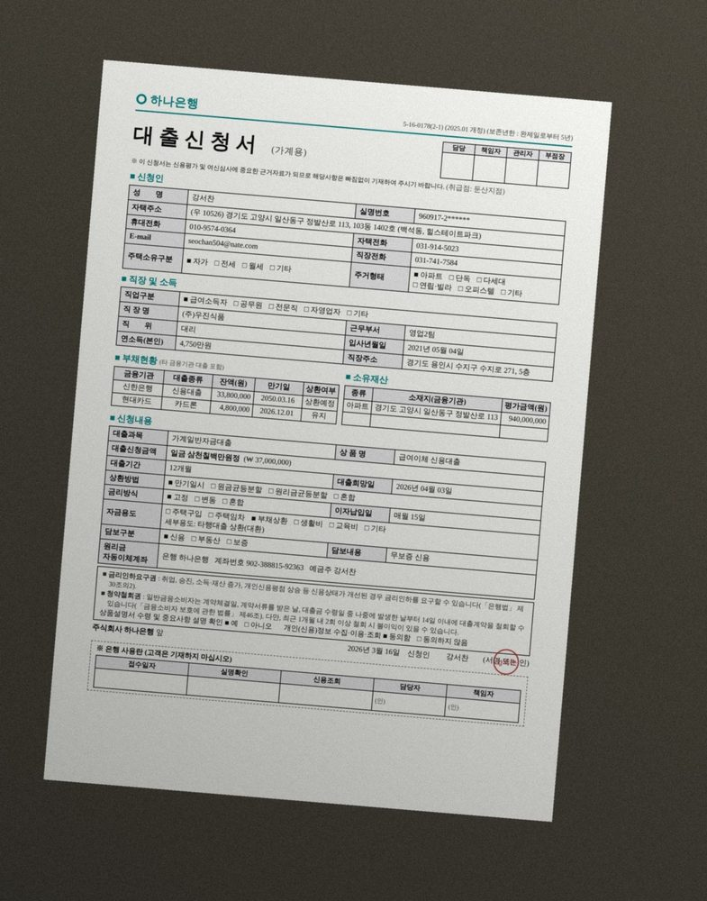</a> <a href="examples/img/credit_agreement_loan_vs_agreement_29d778ad.jpg"></a></p>

1. `loan_application.jpg` · 2. `credit_agreement_loan_vs_agreement.jpg`

**질문** (`prompt`)

```
고객 '강서찬' 님이 '개인 신용대출' 업무를 위해 제출한 서류 2건입니다 (이미지 2장). 서류들을 서로 대조해 맞지 않는 정보(성명, 주민등록번호, 생년월일, 주소, 연락처, 계좌번호, 상호, 금액, 날짜 등), 업무상 맞지 않는 관계(계약 상대방이 등기부 소유자가 아님, 금액·날짜 관계 오류 등), 고객 본인 명의가 아닌 서류가 있는지 확인하세요. 표기 방식만 다른 것(날짜 형식, 주민번호 뒷자리 가림, 하이픈 유무 등)은 불일치가 아닙니다.
{"consistent": true 또는 false, "issues": [{"document": "문제가 있는 서류명", "field": "항목명", "value": "그 서류에 적힌 값", "expected": "다른 서류에 적힌 값"}]} 형식의 JSON 으로 답하세요. 문제가 없으면 {"consistent": true, "issues": []} 입니다.
```

**정답** (`answer`)

```json
{
 "consistent": false,
 "issues": [
  {
   "document": "대출거래약정서(가계용)",
   "field": "대출(한도)금액",
   "value": "33,000,000원",
   "expected": "37,000,000원",
   "alt_documents": ["대출거래신청서"]
  }
 ]
}
```

**채점 정보** (`eval`)

```json
{"documents": ["대출거래신청서", "대출거래약정서(가계용)"]}
```

**나눠 보기 정보** (`meta`)

```json
{
 "scenario": "personal_credit_loan",
 "task_name": "개인 신용대출",
 "bundle": "personal_credit_loan_2001000",
 "customer": "강서찬",
 "case": "loan_vs_agreement",
 "category": "amount",
 "perturbed": true,
 "n_docs": 2
}
```

**문항 한 줄 전체** (`tasks/cross_check.jsonl`)

<details><summary>펼치기</summary>

```json
{
 "id": "cross_check/personal_credit_loan_2001000/loan_vs_agreement",
 "task": "cross_check",
 "images": [
  "images/bundles/personal_credit_loan_2001000/loan_application.jpg",
  "images/bundles/personal_credit_loan_2001000/credit_agreement_loan_vs_agreement.jpg"
 ],
 "prompt": "고객 '강서찬' 님이 '개인 신용대출' 업무를 위해 제출한 서류 2건입니다 (이미지 2장). 서류들을 서로 대조해 맞지 않는 정보(성명, 주민등록번호, 생년월일, 주소, 연락처, 계좌번호, 상호, 금액, 날짜 등), 업무상 맞지 않는 관계(계약 상대방이 등기부 소유자가 아님, 금액·날짜 관계 오류 등), 고객 본인 명의가 아닌 서류가 있는지 확인하세요. 표기 방식만 다른 것(날짜 형식, 주민번호 뒷자리 가림, 하이픈 유무 등)은 불일치가 아닙니다.\n{\"consistent\": true 또는 false, \"issues\": [{\"document\": \"문제가 있는 서류명\", \"field\": \"항목명\", \"value\": \"그 서류에 적힌 값\", \"expected\": \"다른 서류에 적힌 값\"}]} 형식의 JSON 으로 답하세요. 문제가 없으면 {\"consistent\": true, \"issues\": []} 입니다.",
 "answer": {
  "consistent": false,
  "issues": [
   {
    "document": "대출거래약정서(가계용)",
    "field": "대출(한도)금액",
    "value": "33,000,000원",
    "expected": "37,000,000원",
    "alt_documents": ["대출거래신청서"]
   }
  ]
 },
 "eval": {"documents": ["대출거래신청서", "대출거래약정서(가계용)"]},
 "meta": {
  "scenario": "personal_credit_loan",
  "task_name": "개인 신용대출",
  "bundle": "personal_credit_loan_2001000",
  "customer": "강서찬",
  "case": "loan_vs_agreement",
  "category": "amount",
  "perturbed": true,
  "n_docs": 2
 }
}
```
</details>

**학습 레코드** (`swift/all.jsonl` 한 줄: 같은 문항을 질문 + 정답 답변 대화로 바꾼 것)

```json
{
 "id": "cross_check/personal_credit_loan_2001000/loan_vs_agreement",
 "task": "cross_check",
 "images": [
  "images/bundles/personal_credit_loan_2001000/loan_application.jpg",
  "images/bundles/personal_credit_loan_2001000/credit_agreement_loan_vs_agreement.jpg"
 ],
 "messages": [
  {
   "role": "user",
   "content": "<image><image>고객 '강서찬' 님이 '개인 신용대출' 업무를 위해 제출한 서류 2건입니다 (이미지 2장). 서류들을 서로 대조해 맞지 않는 정보(성명, 주민등록번호, 생년월일, 주소, 연락처, 계좌번호, 상호, 금액, 날짜 등), 업무상 맞지 않는 관계(계약 상대방이 등기부 소유자가 아님, 금액·날짜 관계 오류 등), 고객 본인 명의가 아닌 서류가 있는지 확인하세요. 표기 방식만 다른 것(날짜 형식, 주민번호 뒷자리 가림, 하이픈 유무 등)은 불일치가 아닙니다.\n{\"consistent\": true 또는 false, \"issues\": [{\"document\": \"문제가 있는 서류명\", \"field\": \"항목명\", \"value\": \"그 서류에 적힌 값\", \"expected\": \"다른 서류에 적힌 값\"}]} 형식의 JSON 으로 답하세요. 문제가 없으면 {\"consistent\": true, \"issues\": []} 입니다."
  },
  {
   "role": "assistant",
   "content": "{\"consistent\": false, \"issues\": [{\"document\": \"대출거래약정서(가계용)\", \"field\": \"대출(한도)금액\", \"value\": \"33,000,000원\", \"expected\": \"37,000,000원\"}]}"
  }
 ]
}
```

### 3-4. income_inflated — 소득 부풀리기

**분류:** `amount` · **실제 사례 근거:** 작업대출: 원천징수영수증 위·변조로 소득 과다 기재

**입력 이미지** (2장, 질문 앞에 이 순서로)

<p><a href="examples/img/income_certificate_acfc99fc.jpg">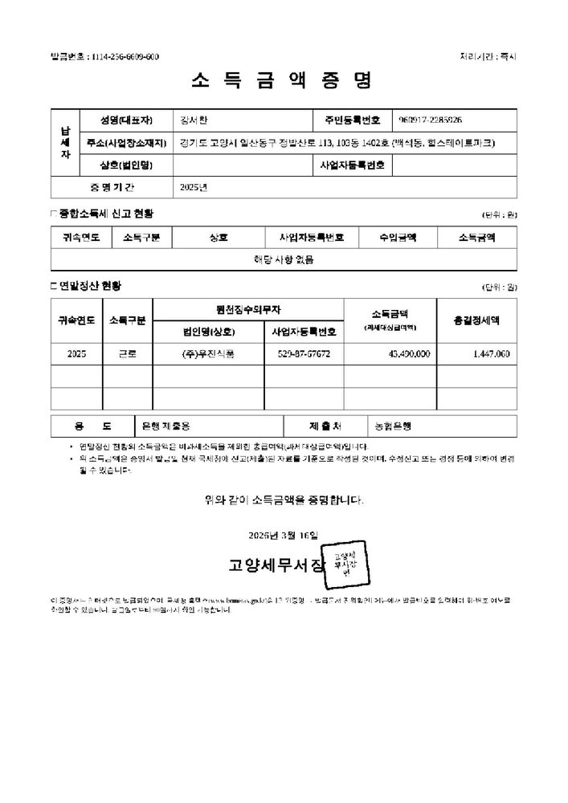</a> <a href="examples/img/withholding_receipt_income_inflated_d112844f.jpg">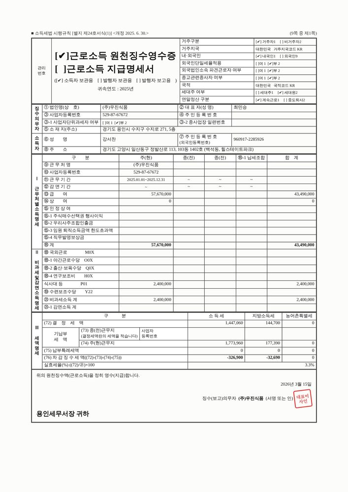</a></p>

1. `income_certificate.jpg` · 2. `withholding_receipt_income_inflated.png`

**질문** (`prompt`)

```
고객 '강서찬' 님이 '개인 신용대출' 업무를 위해 제출한 서류 2건입니다 (이미지 2장). 서류들을 서로 대조해 맞지 않는 정보(성명, 주민등록번호, 생년월일, 주소, 연락처, 계좌번호, 상호, 금액, 날짜 등), 업무상 맞지 않는 관계(계약 상대방이 등기부 소유자가 아님, 금액·날짜 관계 오류 등), 고객 본인 명의가 아닌 서류가 있는지 확인하세요. 표기 방식만 다른 것(날짜 형식, 주민번호 뒷자리 가림, 하이픈 유무 등)은 불일치가 아닙니다.
{"consistent": true 또는 false, "issues": [{"document": "문제가 있는 서류명", "field": "항목명", "value": "그 서류에 적힌 값", "expected": "다른 서류에 적힌 값"}]} 형식의 JSON 으로 답하세요. 문제가 없으면 {"consistent": true, "issues": []} 입니다.
```

**정답** (`answer`)

```json
{
 "consistent": false,
 "issues": [
  {
   "document": "근로소득 원천징수영수증",
   "field": "계",
   "value": "57,670,000",
   "expected": "43,490,000",
   "alt_documents": ["소득금액증명원"]
  }
 ]
}
```

**채점 정보** (`eval`)

```json
{"documents": ["소득금액증명원", "근로소득 원천징수영수증"]}
```

**나눠 보기 정보** (`meta`)

```json
{
 "scenario": "personal_credit_loan",
 "task_name": "개인 신용대출",
 "bundle": "personal_credit_loan_2001000",
 "customer": "강서찬",
 "case": "income_inflated",
 "category": "amount",
 "perturbed": true,
 "n_docs": 2
}
```

**문항 한 줄 전체** (`tasks/cross_check.jsonl`)

<details><summary>펼치기</summary>

```json
{
 "id": "cross_check/personal_credit_loan_2001000/income_inflated",
 "task": "cross_check",
 "images": [
  "images/bundles/personal_credit_loan_2001000/income_certificate.jpg",
  "images/bundles/personal_credit_loan_2001000/withholding_receipt_income_inflated.png"
 ],
 "prompt": "고객 '강서찬' 님이 '개인 신용대출' 업무를 위해 제출한 서류 2건입니다 (이미지 2장). 서류들을 서로 대조해 맞지 않는 정보(성명, 주민등록번호, 생년월일, 주소, 연락처, 계좌번호, 상호, 금액, 날짜 등), 업무상 맞지 않는 관계(계약 상대방이 등기부 소유자가 아님, 금액·날짜 관계 오류 등), 고객 본인 명의가 아닌 서류가 있는지 확인하세요. 표기 방식만 다른 것(날짜 형식, 주민번호 뒷자리 가림, 하이픈 유무 등)은 불일치가 아닙니다.\n{\"consistent\": true 또는 false, \"issues\": [{\"document\": \"문제가 있는 서류명\", \"field\": \"항목명\", \"value\": \"그 서류에 적힌 값\", \"expected\": \"다른 서류에 적힌 값\"}]} 형식의 JSON 으로 답하세요. 문제가 없으면 {\"consistent\": true, \"issues\": []} 입니다.",
 "answer": {
  "consistent": false,
  "issues": [
   {
    "document": "근로소득 원천징수영수증",
    "field": "계",
    "value": "57,670,000",
    "expected": "43,490,000",
    "alt_documents": ["소득금액증명원"]
   }
  ]
 },
 "eval": {"documents": ["소득금액증명원", "근로소득 원천징수영수증"]},
 "meta": {
  "scenario": "personal_credit_loan",
  "task_name": "개인 신용대출",
  "bundle": "personal_credit_loan_2001000",
  "customer": "강서찬",
  "case": "income_inflated",
  "category": "amount",
  "perturbed": true,
  "n_docs": 2
 }
}
```
</details>

**학습 레코드** (`swift/all.jsonl` 한 줄: 같은 문항을 질문 + 정답 답변 대화로 바꾼 것)

```json
{
 "id": "cross_check/personal_credit_loan_2001000/income_inflated",
 "task": "cross_check",
 "images": [
  "images/bundles/personal_credit_loan_2001000/income_certificate.jpg",
  "images/bundles/personal_credit_loan_2001000/withholding_receipt_income_inflated.png"
 ],
 "messages": [
  {
   "role": "user",
   "content": "<image><image>고객 '강서찬' 님이 '개인 신용대출' 업무를 위해 제출한 서류 2건입니다 (이미지 2장). 서류들을 서로 대조해 맞지 않는 정보(성명, 주민등록번호, 생년월일, 주소, 연락처, 계좌번호, 상호, 금액, 날짜 등), 업무상 맞지 않는 관계(계약 상대방이 등기부 소유자가 아님, 금액·날짜 관계 오류 등), 고객 본인 명의가 아닌 서류가 있는지 확인하세요. 표기 방식만 다른 것(날짜 형식, 주민번호 뒷자리 가림, 하이픈 유무 등)은 불일치가 아닙니다.\n{\"consistent\": true 또는 false, \"issues\": [{\"document\": \"문제가 있는 서류명\", \"field\": \"항목명\", \"value\": \"그 서류에 적힌 값\", \"expected\": \"다른 서류에 적힌 값\"}]} 형식의 JSON 으로 답하세요. 문제가 없으면 {\"consistent\": true, \"issues\": []} 입니다."
  },
  {
   "role": "assistant",
   "content": "{\"consistent\": false, \"issues\": [{\"document\": \"근로소득 원천징수영수증\", \"field\": \"계\", \"value\": \"57,670,000\", \"expected\": \"43,490,000\"}]}"
  }
 ]
}
```

### 3-5. lease_owner — 임대인 ≠ 등기부 소유자

**분류:** `logic` · **실제 사례 근거:** 전세사기: 계약서상 임대인이 등기부 소유자가 아님

**입력 이미지** (2장, 질문 앞에 이 순서로)

<p><a href="examples/img/lease_contract_39a79a48.jpg"></a> <a href="examples/img/real_estate_registry_lease_owner_868611ae.jpg"></a></p>

1. `lease_contract.png` · 2. `real_estate_registry_lease_owner.png`

**질문** (`prompt`)

```
고객 '방하주' 님이 '전세자금대출' 업무를 위해 제출한 서류 2건입니다 (이미지 2장). 서류들을 서로 대조해 맞지 않는 정보(성명, 주민등록번호, 생년월일, 주소, 연락처, 계좌번호, 상호, 금액, 날짜 등), 업무상 맞지 않는 관계(계약 상대방이 등기부 소유자가 아님, 금액·날짜 관계 오류 등), 고객 본인 명의가 아닌 서류가 있는지 확인하세요. 표기 방식만 다른 것(날짜 형식, 주민번호 뒷자리 가림, 하이픈 유무 등)은 불일치가 아닙니다.
{"consistent": true 또는 false, "issues": [{"document": "문제가 있는 서류명", "field": "항목명", "value": "그 서류에 적힌 값", "expected": "다른 서류에 적힌 값"}]} 형식의 JSON 으로 답하세요. 문제가 없으면 {"consistent": true, "issues": []} 입니다.
```

**정답** (`answer`)

```json
{
 "consistent": false,
 "issues": [
  {
   "document": "등기사항전부증명서(집합건물)",
   "field": "소유자",
   "value": "추규태",
   "expected": "신수유",
   "alt_documents": ["주택임대차표준계약서"]
  }
 ]
}
```

**채점 정보** (`eval`)

```json
{"documents": ["주택임대차표준계약서", "등기사항전부증명서(집합건물)"]}
```

**나눠 보기 정보** (`meta`)

```json
{
 "scenario": "jeonse_loan",
 "task_name": "전세자금대출",
 "bundle": "jeonse_loan_2003000",
 "customer": "방하주",
 "case": "lease_owner",
 "category": "logic",
 "perturbed": true,
 "n_docs": 2
}
```

**문항 한 줄 전체** (`tasks/cross_check.jsonl`)

<details><summary>펼치기</summary>

```json
{
 "id": "cross_check/jeonse_loan_2003000/lease_owner",
 "task": "cross_check",
 "images": [
  "images/bundles/jeonse_loan_2003000/lease_contract.png",
  "images/bundles/jeonse_loan_2003000/real_estate_registry_lease_owner.png"
 ],
 "prompt": "고객 '방하주' 님이 '전세자금대출' 업무를 위해 제출한 서류 2건입니다 (이미지 2장). 서류들을 서로 대조해 맞지 않는 정보(성명, 주민등록번호, 생년월일, 주소, 연락처, 계좌번호, 상호, 금액, 날짜 등), 업무상 맞지 않는 관계(계약 상대방이 등기부 소유자가 아님, 금액·날짜 관계 오류 등), 고객 본인 명의가 아닌 서류가 있는지 확인하세요. 표기 방식만 다른 것(날짜 형식, 주민번호 뒷자리 가림, 하이픈 유무 등)은 불일치가 아닙니다.\n{\"consistent\": true 또는 false, \"issues\": [{\"document\": \"문제가 있는 서류명\", \"field\": \"항목명\", \"value\": \"그 서류에 적힌 값\", \"expected\": \"다른 서류에 적힌 값\"}]} 형식의 JSON 으로 답하세요. 문제가 없으면 {\"consistent\": true, \"issues\": []} 입니다.",
 "answer": {
  "consistent": false,
  "issues": [
   {
    "document": "등기사항전부증명서(집합건물)",
    "field": "소유자",
    "value": "추규태",
    "expected": "신수유",
    "alt_documents": ["주택임대차표준계약서"]
   }
  ]
 },
 "eval": {"documents": ["주택임대차표준계약서", "등기사항전부증명서(집합건물)"]},
 "meta": {
  "scenario": "jeonse_loan",
  "task_name": "전세자금대출",
  "bundle": "jeonse_loan_2003000",
  "customer": "방하주",
  "case": "lease_owner",
  "category": "logic",
  "perturbed": true,
  "n_docs": 2
 }
}
```
</details>

**학습 레코드** (`swift/all.jsonl` 한 줄: 같은 문항을 질문 + 정답 답변 대화로 바꾼 것)

```json
{
 "id": "cross_check/jeonse_loan_2003000/lease_owner",
 "task": "cross_check",
 "images": [
  "images/bundles/jeonse_loan_2003000/lease_contract.png",
  "images/bundles/jeonse_loan_2003000/real_estate_registry_lease_owner.png"
 ],
 "messages": [
  {
   "role": "user",
   "content": "<image><image>고객 '방하주' 님이 '전세자금대출' 업무를 위해 제출한 서류 2건입니다 (이미지 2장). 서류들을 서로 대조해 맞지 않는 정보(성명, 주민등록번호, 생년월일, 주소, 연락처, 계좌번호, 상호, 금액, 날짜 등), 업무상 맞지 않는 관계(계약 상대방이 등기부 소유자가 아님, 금액·날짜 관계 오류 등), 고객 본인 명의가 아닌 서류가 있는지 확인하세요. 표기 방식만 다른 것(날짜 형식, 주민번호 뒷자리 가림, 하이픈 유무 등)은 불일치가 아닙니다.\n{\"consistent\": true 또는 false, \"issues\": [{\"document\": \"문제가 있는 서류명\", \"field\": \"항목명\", \"value\": \"그 서류에 적힌 값\", \"expected\": \"다른 서류에 적힌 값\"}]} 형식의 JSON 으로 답하세요. 문제가 없으면 {\"consistent\": true, \"issues\": []} 입니다."
  },
  {
   "role": "assistant",
   "content": "{\"consistent\": false, \"issues\": [{\"document\": \"등기사항전부증명서(집합건물)\", \"field\": \"소유자\", \"value\": \"추규태\", \"expected\": \"신수유\"}]}"
  }
 ]
}
```

### 3-6. seller_owner — 매도인 ≠ 등기부 소유자

**분류:** `logic` · **실제 사례 근거:** 무권리자 매도·허위 매매계약

**입력 이미지** (2장, 질문 앞에 이 순서로)

<p><a href="examples/img/real_estate_registry_seller_owner_e41f55c0.jpg">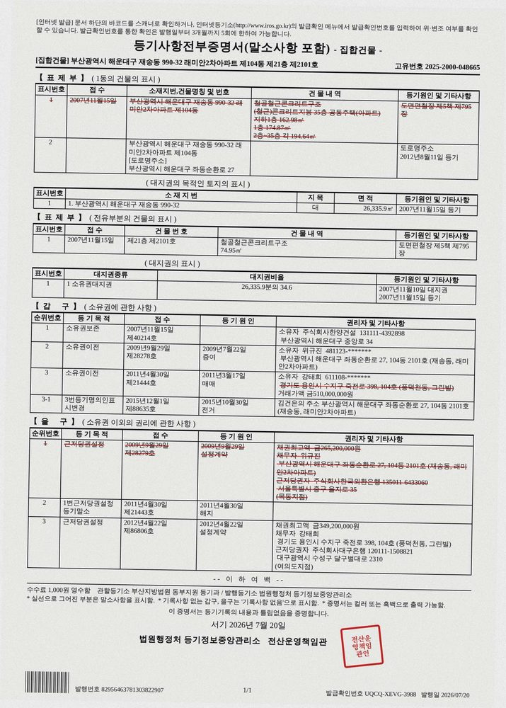</a> <a href="examples/img/sales_contract_9a10688a.jpg">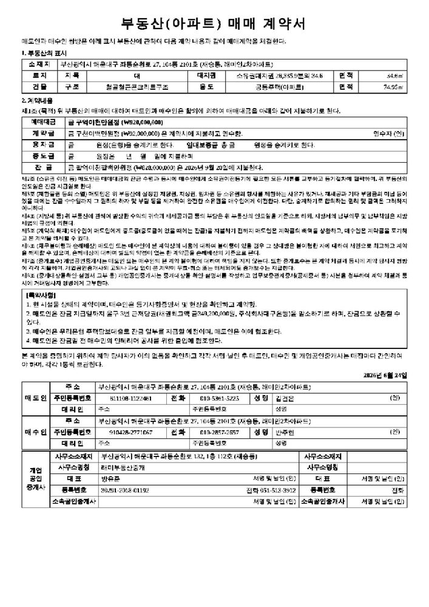</a></p>

1. `real_estate_registry_seller_owner.jpg` · 2. `sales_contract.jpg`

**질문** (`prompt`)

```
고객 '반주현' 님이 '주택담보대출' 업무를 위해 제출한 서류 2건입니다 (이미지 2장). 서류들을 서로 대조해 맞지 않는 정보(성명, 주민등록번호, 생년월일, 주소, 연락처, 계좌번호, 상호, 금액, 날짜 등), 업무상 맞지 않는 관계(계약 상대방이 등기부 소유자가 아님, 금액·날짜 관계 오류 등), 고객 본인 명의가 아닌 서류가 있는지 확인하세요. 표기 방식만 다른 것(날짜 형식, 주민번호 뒷자리 가림, 하이픈 유무 등)은 불일치가 아닙니다.
{"consistent": true 또는 false, "issues": [{"document": "문제가 있는 서류명", "field": "항목명", "value": "그 서류에 적힌 값", "expected": "다른 서류에 적힌 값"}]} 형식의 JSON 으로 답하세요. 문제가 없으면 {"consistent": true, "issues": []} 입니다.
```

**정답** (`answer`)

```json
{
 "consistent": false,
 "issues": [
  {
   "document": "등기사항전부증명서(집합건물)",
   "field": "소유자",
   "value": "강태희",
   "expected": "김건은",
   "alt_documents": ["부동산 매매계약서"]
  }
 ]
}
```

**채점 정보** (`eval`)

```json
{"documents": ["등기사항전부증명서(집합건물)", "부동산 매매계약서"]}
```

**나눠 보기 정보** (`meta`)

```json
{
 "scenario": "mortgage",
 "task_name": "주택담보대출",
 "bundle": "mortgage_2002002",
 "customer": "반주현",
 "case": "seller_owner",
 "category": "logic",
 "perturbed": true,
 "n_docs": 2
}
```

**문항 한 줄 전체** (`tasks/cross_check.jsonl`)

<details><summary>펼치기</summary>

```json
{
 "id": "cross_check/mortgage_2002002/seller_owner",
 "task": "cross_check",
 "images": [
  "images/bundles/mortgage_2002002/real_estate_registry_seller_owner.jpg",
  "images/bundles/mortgage_2002002/sales_contract.jpg"
 ],
 "prompt": "고객 '반주현' 님이 '주택담보대출' 업무를 위해 제출한 서류 2건입니다 (이미지 2장). 서류들을 서로 대조해 맞지 않는 정보(성명, 주민등록번호, 생년월일, 주소, 연락처, 계좌번호, 상호, 금액, 날짜 등), 업무상 맞지 않는 관계(계약 상대방이 등기부 소유자가 아님, 금액·날짜 관계 오류 등), 고객 본인 명의가 아닌 서류가 있는지 확인하세요. 표기 방식만 다른 것(날짜 형식, 주민번호 뒷자리 가림, 하이픈 유무 등)은 불일치가 아닙니다.\n{\"consistent\": true 또는 false, \"issues\": [{\"document\": \"문제가 있는 서류명\", \"field\": \"항목명\", \"value\": \"그 서류에 적힌 값\", \"expected\": \"다른 서류에 적힌 값\"}]} 형식의 JSON 으로 답하세요. 문제가 없으면 {\"consistent\": true, \"issues\": []} 입니다.",
 "answer": {
  "consistent": false,
  "issues": [
   {
    "document": "등기사항전부증명서(집합건물)",
    "field": "소유자",
    "value": "강태희",
    "expected": "김건은",
    "alt_documents": ["부동산 매매계약서"]
   }
  ]
 },
 "eval": {"documents": ["등기사항전부증명서(집합건물)", "부동산 매매계약서"]},
 "meta": {
  "scenario": "mortgage",
  "task_name": "주택담보대출",
  "bundle": "mortgage_2002002",
  "customer": "반주현",
  "case": "seller_owner",
  "category": "logic",
  "perturbed": true,
  "n_docs": 2
 }
}
```
</details>

**학습 레코드** (`swift/all.jsonl` 한 줄: 같은 문항을 질문 + 정답 답변 대화로 바꾼 것)

```json
{
 "id": "cross_check/mortgage_2002002/seller_owner",
 "task": "cross_check",
 "images": [
  "images/bundles/mortgage_2002002/real_estate_registry_seller_owner.jpg",
  "images/bundles/mortgage_2002002/sales_contract.jpg"
 ],
 "messages": [
  {
   "role": "user",
   "content": "<image><image>고객 '반주현' 님이 '주택담보대출' 업무를 위해 제출한 서류 2건입니다 (이미지 2장). 서류들을 서로 대조해 맞지 않는 정보(성명, 주민등록번호, 생년월일, 주소, 연락처, 계좌번호, 상호, 금액, 날짜 등), 업무상 맞지 않는 관계(계약 상대방이 등기부 소유자가 아님, 금액·날짜 관계 오류 등), 고객 본인 명의가 아닌 서류가 있는지 확인하세요. 표기 방식만 다른 것(날짜 형식, 주민번호 뒷자리 가림, 하이픈 유무 등)은 불일치가 아닙니다.\n{\"consistent\": true 또는 false, \"issues\": [{\"document\": \"문제가 있는 서류명\", \"field\": \"항목명\", \"value\": \"그 서류에 적힌 값\", \"expected\": \"다른 서류에 적힌 값\"}]} 형식의 JSON 으로 답하세요. 문제가 없으면 {\"consistent\": true, \"issues\": []} 입니다."
  },
  {
   "role": "assistant",
   "content": "{\"consistent\": false, \"issues\": [{\"document\": \"등기사항전부증명서(집합건물)\", \"field\": \"소유자\", \"value\": \"강태희\", \"expected\": \"김건은\"}]}"
  }
 ]
}
```

### 3-7. hire_date — 재직기간 부풀리기

**분류:** `logic` · **실제 사례 근거:** 작업대출: 재직증명서 입사일 ≠ 건강보험 자격취득일

**입력 이미지** (2장, 질문 앞에 이 순서로)

<p><a href="examples/img/health_insurance_qualification_13fc753f.jpg">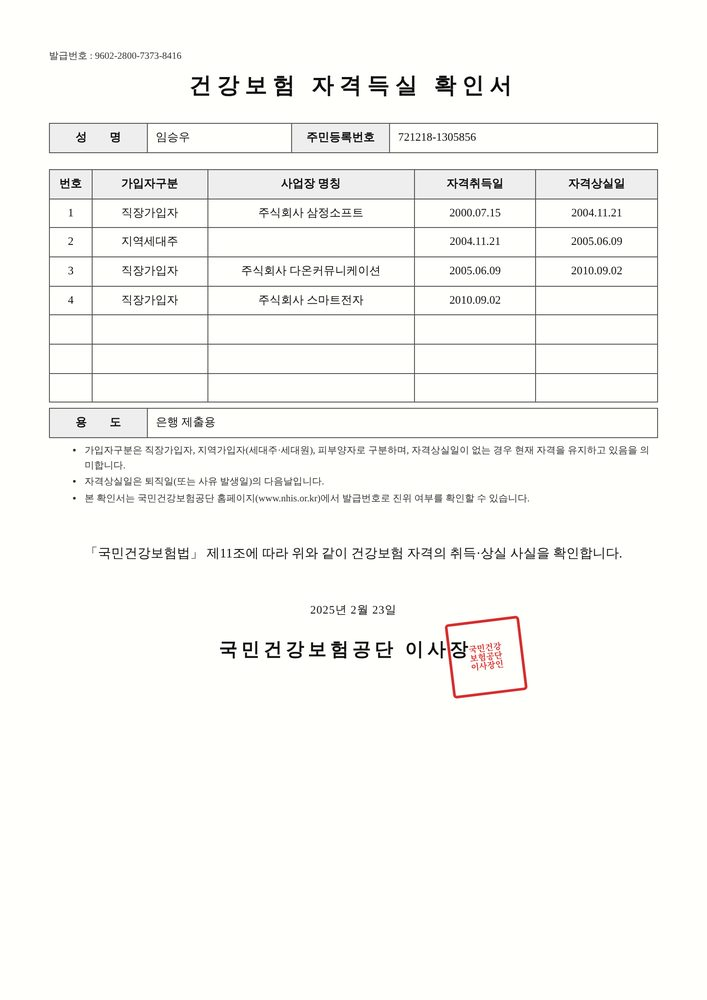</a> <a href="examples/img/employment_certificate_hire_date_74583f72.jpg">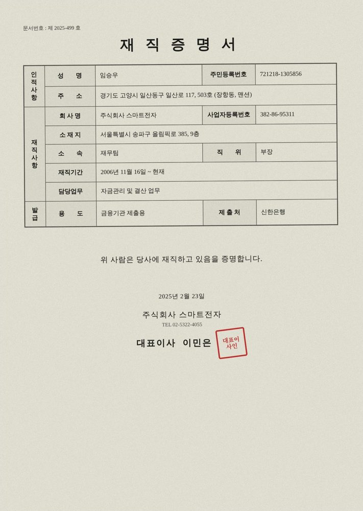</a></p>

1. `health_insurance_qualification.png` · 2. `employment_certificate_hire_date.jpg`

**질문** (`prompt`)

```
고객 '임승우' 님이 '개인 신용대출' 업무를 위해 제출한 서류 2건입니다 (이미지 2장). 서류들을 서로 대조해 맞지 않는 정보(성명, 주민등록번호, 생년월일, 주소, 연락처, 계좌번호, 상호, 금액, 날짜 등), 업무상 맞지 않는 관계(계약 상대방이 등기부 소유자가 아님, 금액·날짜 관계 오류 등), 고객 본인 명의가 아닌 서류가 있는지 확인하세요. 표기 방식만 다른 것(날짜 형식, 주민번호 뒷자리 가림, 하이픈 유무 등)은 불일치가 아닙니다.
{"consistent": true 또는 false, "issues": [{"document": "문제가 있는 서류명", "field": "항목명", "value": "그 서류에 적힌 값", "expected": "다른 서류에 적힌 값"}]} 형식의 JSON 으로 답하세요. 문제가 없으면 {"consistent": true, "issues": []} 입니다.
```

**정답** (`answer`)

```json
{
 "consistent": false,
 "issues": [
  {
   "document": "재직증명서",
   "field": "재직기간",
   "value": "2006년 11월 16일 ~ 현재",
   "expected": "2010년 09월 02일 ~ 현재",
   "alt_documents": ["건강보험 자격득실확인서"]
  }
 ]
}
```

**채점 정보** (`eval`)

```json
{"documents": ["건강보험 자격득실확인서", "재직증명서"]}
```

**나눠 보기 정보** (`meta`)

```json
{
 "scenario": "personal_credit_loan",
 "task_name": "개인 신용대출",
 "bundle": "personal_credit_loan_2001001",
 "customer": "임승우",
 "case": "hire_date",
 "category": "logic",
 "perturbed": true,
 "n_docs": 2
}
```

**문항 한 줄 전체** (`tasks/cross_check.jsonl`)

<details><summary>펼치기</summary>

```json
{
 "id": "cross_check/personal_credit_loan_2001001/hire_date",
 "task": "cross_check",
 "images": [
  "images/bundles/personal_credit_loan_2001001/health_insurance_qualification.png",
  "images/bundles/personal_credit_loan_2001001/employment_certificate_hire_date.jpg"
 ],
 "prompt": "고객 '임승우' 님이 '개인 신용대출' 업무를 위해 제출한 서류 2건입니다 (이미지 2장). 서류들을 서로 대조해 맞지 않는 정보(성명, 주민등록번호, 생년월일, 주소, 연락처, 계좌번호, 상호, 금액, 날짜 등), 업무상 맞지 않는 관계(계약 상대방이 등기부 소유자가 아님, 금액·날짜 관계 오류 등), 고객 본인 명의가 아닌 서류가 있는지 확인하세요. 표기 방식만 다른 것(날짜 형식, 주민번호 뒷자리 가림, 하이픈 유무 등)은 불일치가 아닙니다.\n{\"consistent\": true 또는 false, \"issues\": [{\"document\": \"문제가 있는 서류명\", \"field\": \"항목명\", \"value\": \"그 서류에 적힌 값\", \"expected\": \"다른 서류에 적힌 값\"}]} 형식의 JSON 으로 답하세요. 문제가 없으면 {\"consistent\": true, \"issues\": []} 입니다.",
 "answer": {
  "consistent": false,
  "issues": [
   {
    "document": "재직증명서",
    "field": "재직기간",
    "value": "2006년 11월 16일 ~ 현재",
    "expected": "2010년 09월 02일 ~ 현재",
    "alt_documents": ["건강보험 자격득실확인서"]
   }
  ]
 },
 "eval": {"documents": ["건강보험 자격득실확인서", "재직증명서"]},
 "meta": {
  "scenario": "personal_credit_loan",
  "task_name": "개인 신용대출",
  "bundle": "personal_credit_loan_2001001",
  "customer": "임승우",
  "case": "hire_date",
  "category": "logic",
  "perturbed": true,
  "n_docs": 2
 }
}
```
</details>

**학습 레코드** (`swift/all.jsonl` 한 줄: 같은 문항을 질문 + 정답 답변 대화로 바꾼 것)

```json
{
 "id": "cross_check/personal_credit_loan_2001001/hire_date",
 "task": "cross_check",
 "images": [
  "images/bundles/personal_credit_loan_2001001/health_insurance_qualification.png",
  "images/bundles/personal_credit_loan_2001001/employment_certificate_hire_date.jpg"
 ],
 "messages": [
  {
   "role": "user",
   "content": "<image><image>고객 '임승우' 님이 '개인 신용대출' 업무를 위해 제출한 서류 2건입니다 (이미지 2장). 서류들을 서로 대조해 맞지 않는 정보(성명, 주민등록번호, 생년월일, 주소, 연락처, 계좌번호, 상호, 금액, 날짜 등), 업무상 맞지 않는 관계(계약 상대방이 등기부 소유자가 아님, 금액·날짜 관계 오류 등), 고객 본인 명의가 아닌 서류가 있는지 확인하세요. 표기 방식만 다른 것(날짜 형식, 주민번호 뒷자리 가림, 하이픈 유무 등)은 불일치가 아닙니다.\n{\"consistent\": true 또는 false, \"issues\": [{\"document\": \"문제가 있는 서류명\", \"field\": \"항목명\", \"value\": \"그 서류에 적힌 값\", \"expected\": \"다른 서류에 적힌 값\"}]} 형식의 JSON 으로 답하세요. 문제가 없으면 {\"consistent\": true, \"issues\": []} 입니다."
  },
  {
   "role": "assistant",
   "content": "{\"consistent\": false, \"issues\": [{\"document\": \"재직증명서\", \"field\": \"재직기간\", \"value\": \"2006년 11월 16일 ~ 현재\", \"expected\": \"2010년 09월 02일 ~ 현재\"}]}"
  }
 ]
}
```

### 3-8. rep_director — 법인 대표자 불일치

**분류:** `logic` · **실제 사례 근거:** 대표이사 변경 미반영·권한 없는 자의 신청

**입력 이미지** (3장, 질문 앞에 이 순서로)

<p><a href="examples/img/loan_application_corp_p1_55e9dd3a.jpg">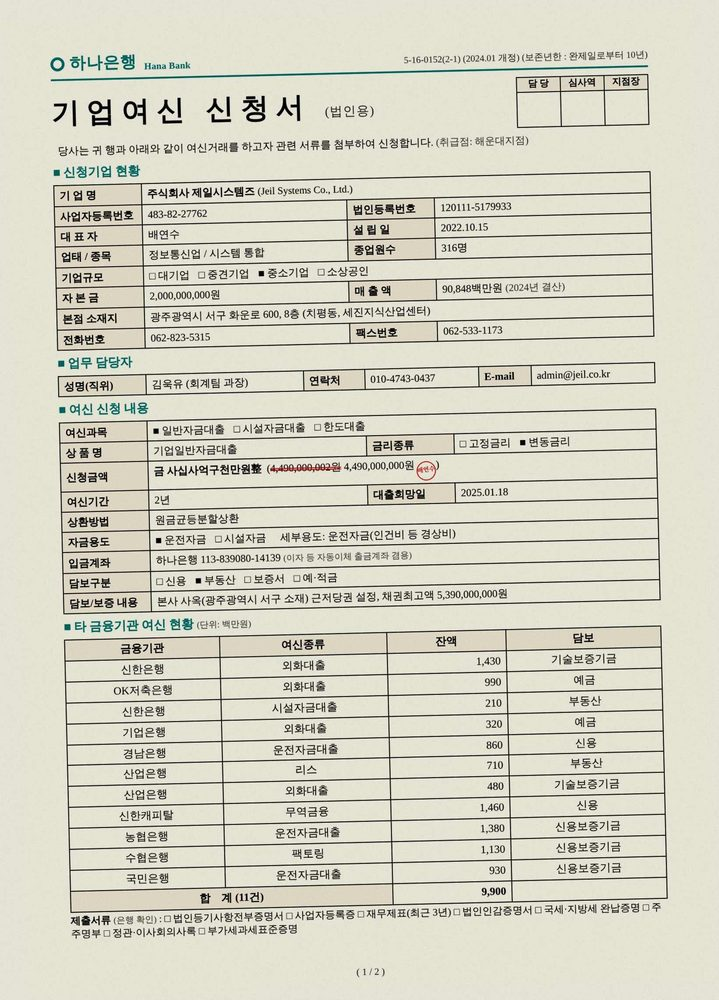</a> <a href="examples/img/loan_application_corp_p2_0013477e.jpg">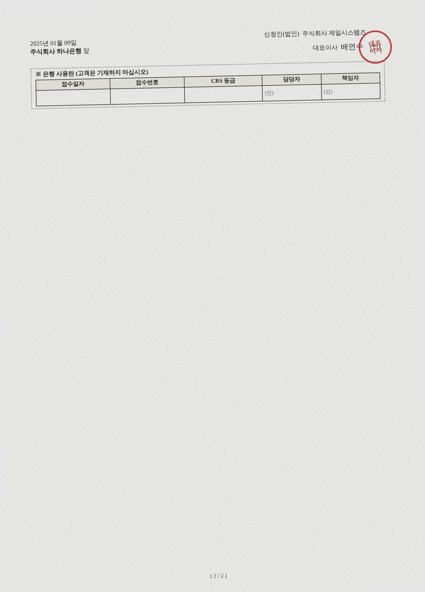</a> <a href="examples/img/corporate_seal_certificate_rep_director_fcbbfe89.jpg">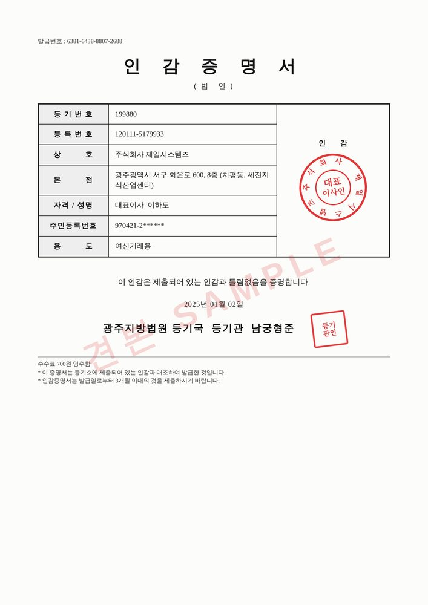</a></p>

1. `loan_application_corp_p1.jpg` · 2. `loan_application_corp_p2.jpg` · 3. `corporate_seal_certificate_rep_director.png`

**질문** (`prompt`)

```
고객 '배연수' 님이 '법인 여신' 업무를 위해 제출한 서류 2건입니다 (이미지 3장). 서류들을 서로 대조해 맞지 않는 정보(성명, 주민등록번호, 생년월일, 주소, 연락처, 계좌번호, 상호, 금액, 날짜 등), 업무상 맞지 않는 관계(계약 상대방이 등기부 소유자가 아님, 금액·날짜 관계 오류 등), 고객 본인 명의가 아닌 서류가 있는지 확인하세요. 표기 방식만 다른 것(날짜 형식, 주민번호 뒷자리 가림, 하이픈 유무 등)은 불일치가 아닙니다.
{"consistent": true 또는 false, "issues": [{"document": "문제가 있는 서류명", "field": "항목명", "value": "그 서류에 적힌 값", "expected": "다른 서류에 적힌 값"}]} 형식의 JSON 으로 답하세요. 문제가 없으면 {"consistent": true, "issues": []} 입니다.
```

**정답** (`answer`)

```json
{
 "consistent": false,
 "issues": [{"document": "법인인감증명서", "field": "성명", "value": "이하도", "expected": "배연수", "alt_documents": ["기업여신 신청서"]}]
}
```

**채점 정보** (`eval`)

```json
{"documents": ["기업여신 신청서", "법인인감증명서"]}
```

**나눠 보기 정보** (`meta`)

```json
{
 "scenario": "corporate_credit",
 "task_name": "법인 여신",
 "bundle": "corporate_credit_2005001",
 "customer": "배연수",
 "case": "rep_director",
 "category": "logic",
 "perturbed": true,
 "n_docs": 2
}
```

**문항 한 줄 전체** (`tasks/cross_check.jsonl`)

<details><summary>펼치기</summary>

```json
{
 "id": "cross_check/corporate_credit_2005001/rep_director",
 "task": "cross_check",
 "images": [
  "images/bundles/corporate_credit_2005001/loan_application_corp_p1.jpg",
  "images/bundles/corporate_credit_2005001/loan_application_corp_p2.jpg",
  "images/bundles/corporate_credit_2005001/corporate_seal_certificate_rep_director.png"
 ],
 "prompt": "고객 '배연수' 님이 '법인 여신' 업무를 위해 제출한 서류 2건입니다 (이미지 3장). 서류들을 서로 대조해 맞지 않는 정보(성명, 주민등록번호, 생년월일, 주소, 연락처, 계좌번호, 상호, 금액, 날짜 등), 업무상 맞지 않는 관계(계약 상대방이 등기부 소유자가 아님, 금액·날짜 관계 오류 등), 고객 본인 명의가 아닌 서류가 있는지 확인하세요. 표기 방식만 다른 것(날짜 형식, 주민번호 뒷자리 가림, 하이픈 유무 등)은 불일치가 아닙니다.\n{\"consistent\": true 또는 false, \"issues\": [{\"document\": \"문제가 있는 서류명\", \"field\": \"항목명\", \"value\": \"그 서류에 적힌 값\", \"expected\": \"다른 서류에 적힌 값\"}]} 형식의 JSON 으로 답하세요. 문제가 없으면 {\"consistent\": true, \"issues\": []} 입니다.",
 "answer": {
  "consistent": false,
  "issues": [{"document": "법인인감증명서", "field": "성명", "value": "이하도", "expected": "배연수", "alt_documents": ["기업여신 신청서"]}]
 },
 "eval": {"documents": ["기업여신 신청서", "법인인감증명서"]},
 "meta": {
  "scenario": "corporate_credit",
  "task_name": "법인 여신",
  "bundle": "corporate_credit_2005001",
  "customer": "배연수",
  "case": "rep_director",
  "category": "logic",
  "perturbed": true,
  "n_docs": 2
 }
}
```
</details>

**학습 레코드** (`swift/all.jsonl` 한 줄: 같은 문항을 질문 + 정답 답변 대화로 바꾼 것)

```json
{
 "id": "cross_check/corporate_credit_2005001/rep_director",
 "task": "cross_check",
 "images": [
  "images/bundles/corporate_credit_2005001/loan_application_corp_p1.jpg",
  "images/bundles/corporate_credit_2005001/loan_application_corp_p2.jpg",
  "images/bundles/corporate_credit_2005001/corporate_seal_certificate_rep_director.png"
 ],
 "messages": [
  {
   "role": "user",
   "content": "<image><image><image>고객 '배연수' 님이 '법인 여신' 업무를 위해 제출한 서류 2건입니다 (이미지 3장). 서류들을 서로 대조해 맞지 않는 정보(성명, 주민등록번호, 생년월일, 주소, 연락처, 계좌번호, 상호, 금액, 날짜 등), 업무상 맞지 않는 관계(계약 상대방이 등기부 소유자가 아님, 금액·날짜 관계 오류 등), 고객 본인 명의가 아닌 서류가 있는지 확인하세요. 표기 방식만 다른 것(날짜 형식, 주민번호 뒷자리 가림, 하이픈 유무 등)은 불일치가 아닙니다.\n{\"consistent\": true 또는 false, \"issues\": [{\"document\": \"문제가 있는 서류명\", \"field\": \"항목명\", \"value\": \"그 서류에 적힌 값\", \"expected\": \"다른 서류에 적힌 값\"}]} 형식의 JSON 으로 답하세요. 문제가 없으면 {\"consistent\": true, \"issues\": []} 입니다."
  },
  {
   "role": "assistant",
   "content": "{\"consistent\": false, \"issues\": [{\"document\": \"법인인감증명서\", \"field\": \"성명\", \"value\": \"이하도\", \"expected\": \"배연수\"}]}"
  }
 ]
}
```

### 3-9. contract_before_apply — 약정일 < 신청일

**분류:** `logic` · **실제 사례 근거:** 서류 작성일 순서 오류 (사후 작성·소급 작성)

**입력 이미지** (2장, 질문 앞에 이 순서로)

<p><a href="examples/img/credit_agreement_contract_before_apply_2d08b8da.jpg">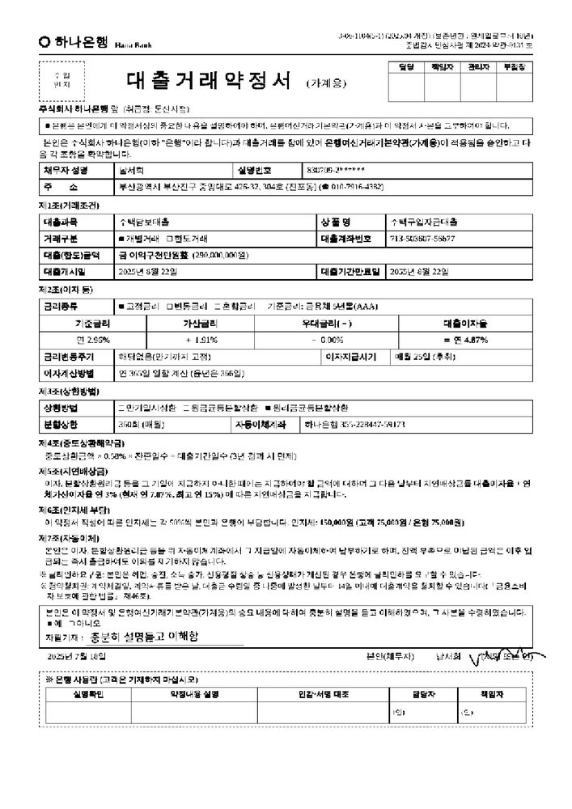</a> <a href="examples/img/loan_application_75801dc1.jpg">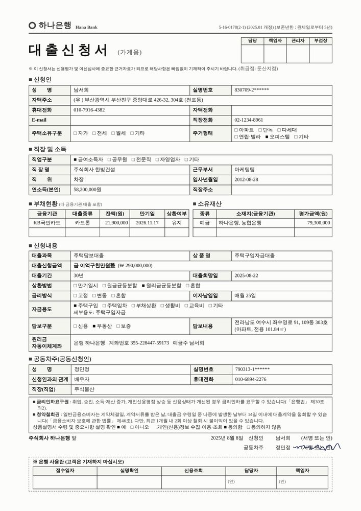</a></p>

1. `credit_agreement_contract_before_apply.jpg` · 2. `loan_application.png`

**질문** (`prompt`)

```
고객 '남서희' 님이 '주택담보대출' 업무를 위해 제출한 서류 2건입니다 (이미지 2장). 서류들을 서로 대조해 맞지 않는 정보(성명, 주민등록번호, 생년월일, 주소, 연락처, 계좌번호, 상호, 금액, 날짜 등), 업무상 맞지 않는 관계(계약 상대방이 등기부 소유자가 아님, 금액·날짜 관계 오류 등), 고객 본인 명의가 아닌 서류가 있는지 확인하세요. 표기 방식만 다른 것(날짜 형식, 주민번호 뒷자리 가림, 하이픈 유무 등)은 불일치가 아닙니다.
{"consistent": true 또는 false, "issues": [{"document": "문제가 있는 서류명", "field": "항목명", "value": "그 서류에 적힌 값", "expected": "다른 서류에 적힌 값"}]} 형식의 JSON 으로 답하세요. 문제가 없으면 {"consistent": true, "issues": []} 입니다.
```

**정답** (`answer`)

```json
{
 "consistent": false,
 "issues": [
  {
   "document": "대출거래약정서(가계용)",
   "field": "약정일",
   "value": "2025년 7월 18일",
   "expected": "2025년 8월 15일",
   "alt_documents": ["대출거래신청서"]
  }
 ]
}
```

**채점 정보** (`eval`)

```json
{"documents": ["대출거래약정서(가계용)", "대출거래신청서"]}
```

**나눠 보기 정보** (`meta`)

```json
{
 "scenario": "mortgage",
 "task_name": "주택담보대출",
 "bundle": "mortgage_2002001",
 "customer": "남서희",
 "case": "contract_before_apply",
 "category": "logic",
 "perturbed": true,
 "n_docs": 2
}
```

**문항 한 줄 전체** (`tasks/cross_check.jsonl`)

<details><summary>펼치기</summary>

```json
{
 "id": "cross_check/mortgage_2002001/contract_before_apply",
 "task": "cross_check",
 "images": [
  "images/bundles/mortgage_2002001/credit_agreement_contract_before_apply.jpg",
  "images/bundles/mortgage_2002001/loan_application.png"
 ],
 "prompt": "고객 '남서희' 님이 '주택담보대출' 업무를 위해 제출한 서류 2건입니다 (이미지 2장). 서류들을 서로 대조해 맞지 않는 정보(성명, 주민등록번호, 생년월일, 주소, 연락처, 계좌번호, 상호, 금액, 날짜 등), 업무상 맞지 않는 관계(계약 상대방이 등기부 소유자가 아님, 금액·날짜 관계 오류 등), 고객 본인 명의가 아닌 서류가 있는지 확인하세요. 표기 방식만 다른 것(날짜 형식, 주민번호 뒷자리 가림, 하이픈 유무 등)은 불일치가 아닙니다.\n{\"consistent\": true 또는 false, \"issues\": [{\"document\": \"문제가 있는 서류명\", \"field\": \"항목명\", \"value\": \"그 서류에 적힌 값\", \"expected\": \"다른 서류에 적힌 값\"}]} 형식의 JSON 으로 답하세요. 문제가 없으면 {\"consistent\": true, \"issues\": []} 입니다.",
 "answer": {
  "consistent": false,
  "issues": [
   {
    "document": "대출거래약정서(가계용)",
    "field": "약정일",
    "value": "2025년 7월 18일",
    "expected": "2025년 8월 15일",
    "alt_documents": ["대출거래신청서"]
   }
  ]
 },
 "eval": {"documents": ["대출거래약정서(가계용)", "대출거래신청서"]},
 "meta": {
  "scenario": "mortgage",
  "task_name": "주택담보대출",
  "bundle": "mortgage_2002001",
  "customer": "남서희",
  "case": "contract_before_apply",
  "category": "logic",
  "perturbed": true,
  "n_docs": 2
 }
}
```
</details>

**학습 레코드** (`swift/all.jsonl` 한 줄: 같은 문항을 질문 + 정답 답변 대화로 바꾼 것)

```json
{
 "id": "cross_check/mortgage_2002001/contract_before_apply",
 "task": "cross_check",
 "images": [
  "images/bundles/mortgage_2002001/credit_agreement_contract_before_apply.jpg",
  "images/bundles/mortgage_2002001/loan_application.png"
 ],
 "messages": [
  {
   "role": "user",
   "content": "<image><image>고객 '남서희' 님이 '주택담보대출' 업무를 위해 제출한 서류 2건입니다 (이미지 2장). 서류들을 서로 대조해 맞지 않는 정보(성명, 주민등록번호, 생년월일, 주소, 연락처, 계좌번호, 상호, 금액, 날짜 등), 업무상 맞지 않는 관계(계약 상대방이 등기부 소유자가 아님, 금액·날짜 관계 오류 등), 고객 본인 명의가 아닌 서류가 있는지 확인하세요. 표기 방식만 다른 것(날짜 형식, 주민번호 뒷자리 가림, 하이픈 유무 등)은 불일치가 아닙니다.\n{\"consistent\": true 또는 false, \"issues\": [{\"document\": \"문제가 있는 서류명\", \"field\": \"항목명\", \"value\": \"그 서류에 적힌 값\", \"expected\": \"다른 서류에 적힌 값\"}]} 형식의 JSON 으로 답하세요. 문제가 없으면 {\"consistent\": true, \"issues\": []} 입니다."
  },
  {
   "role": "assistant",
   "content": "{\"consistent\": false, \"issues\": [{\"document\": \"대출거래약정서(가계용)\", \"field\": \"약정일\", \"value\": \"2025년 7월 18일\", \"expected\": \"2025년 8월 15일\"}]}"
  }
 ]
}
```

### 3-10. collateral_short — 채권최고액 < 대출금

**분류:** `logic` · **실제 사례 근거:** 근저당 설정 금액 부족

**입력 이미지** (3장, 질문 앞에 이 순서로)

<p><a href="examples/img/credit_agreement_53d4771d.jpg">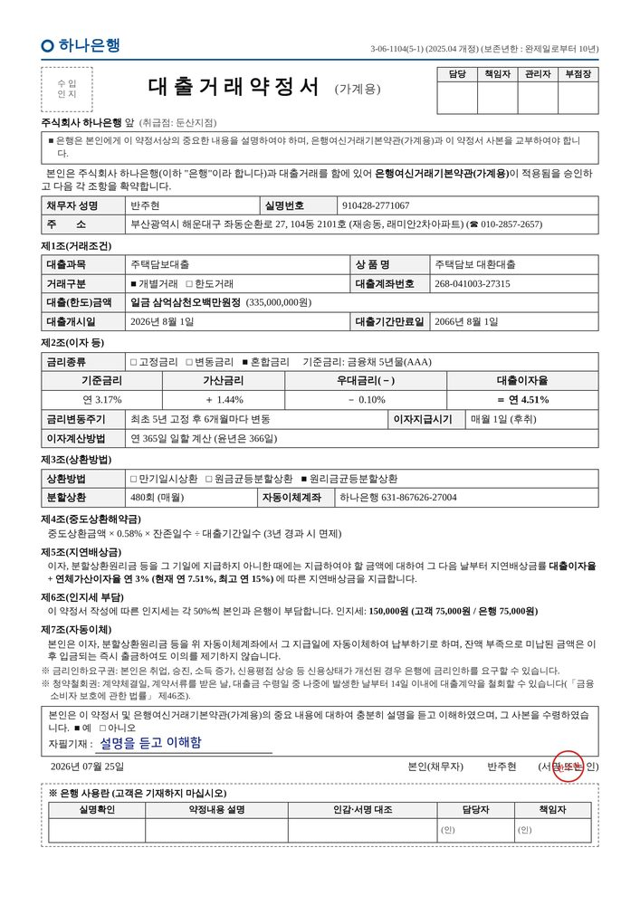</a> <a href="examples/img/collateral_agreement_collateral_short_p1_24ea1874.jpg">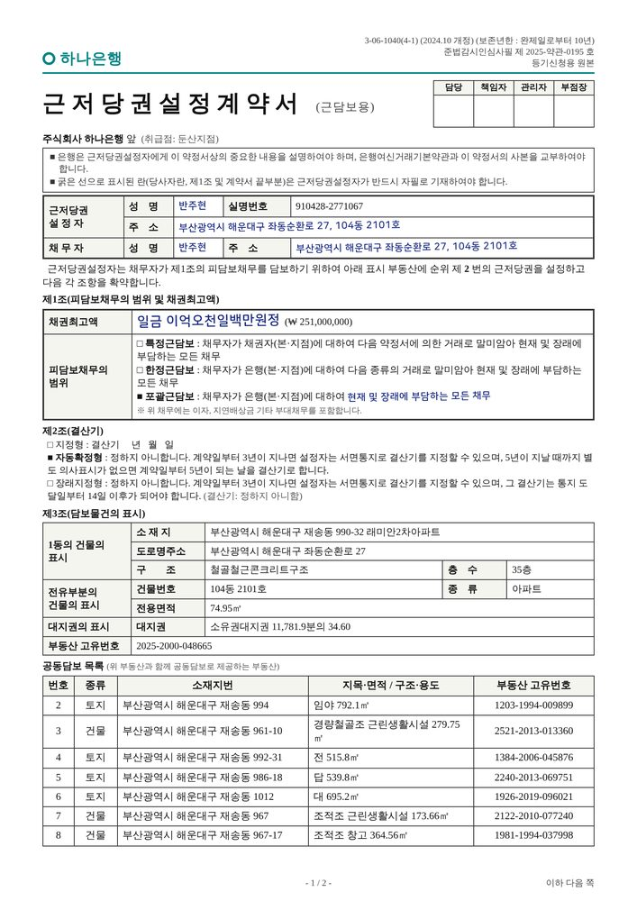</a> <a href="examples/img/collateral_agreement_collateral_short_p2_e2bf2b18.jpg">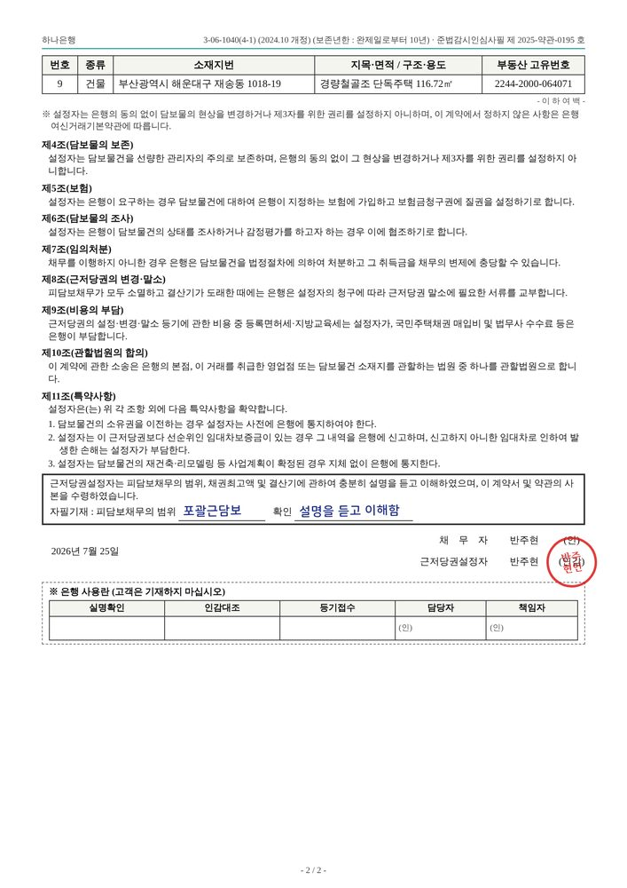</a></p>

1. `credit_agreement.png` · 2. `collateral_agreement_collateral_short_p1.png` · 3. `collateral_agreement_collateral_short_p2.png`

**질문** (`prompt`)

```
고객 '반주현' 님이 '주택담보대출' 업무를 위해 제출한 서류 2건입니다 (이미지 3장). 서류들을 서로 대조해 맞지 않는 정보(성명, 주민등록번호, 생년월일, 주소, 연락처, 계좌번호, 상호, 금액, 날짜 등), 업무상 맞지 않는 관계(계약 상대방이 등기부 소유자가 아님, 금액·날짜 관계 오류 등), 고객 본인 명의가 아닌 서류가 있는지 확인하세요. 표기 방식만 다른 것(날짜 형식, 주민번호 뒷자리 가림, 하이픈 유무 등)은 불일치가 아닙니다.
{"consistent": true 또는 false, "issues": [{"document": "문제가 있는 서류명", "field": "항목명", "value": "그 서류에 적힌 값", "expected": "다른 서류에 적힌 값"}]} 형식의 JSON 으로 답하세요. 문제가 없으면 {"consistent": true, "issues": []} 입니다.
```

**정답** (`answer`)

```json
{
 "consistent": false,
 "issues": [
  {
   "document": "근저당권설정계약서",
   "field": "채권최고액",
   "value": "251,000,000",
   "expected": "402,000,000",
   "alt_documents": ["대출거래약정서(가계용)"]
  }
 ]
}
```

**채점 정보** (`eval`)

```json
{"documents": ["대출거래약정서(가계용)", "근저당권설정계약서"]}
```

**나눠 보기 정보** (`meta`)

```json
{
 "scenario": "mortgage",
 "task_name": "주택담보대출",
 "bundle": "mortgage_2002002",
 "customer": "반주현",
 "case": "collateral_short",
 "category": "logic",
 "perturbed": true,
 "n_docs": 2
}
```

**문항 한 줄 전체** (`tasks/cross_check.jsonl`)

<details><summary>펼치기</summary>

```json
{
 "id": "cross_check/mortgage_2002002/collateral_short",
 "task": "cross_check",
 "images": [
  "images/bundles/mortgage_2002002/credit_agreement.png",
  "images/bundles/mortgage_2002002/collateral_agreement_collateral_short_p1.png",
  "images/bundles/mortgage_2002002/collateral_agreement_collateral_short_p2.png"
 ],
 "prompt": "고객 '반주현' 님이 '주택담보대출' 업무를 위해 제출한 서류 2건입니다 (이미지 3장). 서류들을 서로 대조해 맞지 않는 정보(성명, 주민등록번호, 생년월일, 주소, 연락처, 계좌번호, 상호, 금액, 날짜 등), 업무상 맞지 않는 관계(계약 상대방이 등기부 소유자가 아님, 금액·날짜 관계 오류 등), 고객 본인 명의가 아닌 서류가 있는지 확인하세요. 표기 방식만 다른 것(날짜 형식, 주민번호 뒷자리 가림, 하이픈 유무 등)은 불일치가 아닙니다.\n{\"consistent\": true 또는 false, \"issues\": [{\"document\": \"문제가 있는 서류명\", \"field\": \"항목명\", \"value\": \"그 서류에 적힌 값\", \"expected\": \"다른 서류에 적힌 값\"}]} 형식의 JSON 으로 답하세요. 문제가 없으면 {\"consistent\": true, \"issues\": []} 입니다.",
 "answer": {
  "consistent": false,
  "issues": [
   {
    "document": "근저당권설정계약서",
    "field": "채권최고액",
    "value": "251,000,000",
    "expected": "402,000,000",
    "alt_documents": ["대출거래약정서(가계용)"]
   }
  ]
 },
 "eval": {"documents": ["대출거래약정서(가계용)", "근저당권설정계약서"]},
 "meta": {
  "scenario": "mortgage",
  "task_name": "주택담보대출",
  "bundle": "mortgage_2002002",
  "customer": "반주현",
  "case": "collateral_short",
  "category": "logic",
  "perturbed": true,
  "n_docs": 2
 }
}
```
</details>

**학습 레코드** (`swift/all.jsonl` 한 줄: 같은 문항을 질문 + 정답 답변 대화로 바꾼 것)

```json
{
 "id": "cross_check/mortgage_2002002/collateral_short",
 "task": "cross_check",
 "images": [
  "images/bundles/mortgage_2002002/credit_agreement.png",
  "images/bundles/mortgage_2002002/collateral_agreement_collateral_short_p1.png",
  "images/bundles/mortgage_2002002/collateral_agreement_collateral_short_p2.png"
 ],
 "messages": [
  {
   "role": "user",
   "content": "<image><image><image>고객 '반주현' 님이 '주택담보대출' 업무를 위해 제출한 서류 2건입니다 (이미지 3장). 서류들을 서로 대조해 맞지 않는 정보(성명, 주민등록번호, 생년월일, 주소, 연락처, 계좌번호, 상호, 금액, 날짜 등), 업무상 맞지 않는 관계(계약 상대방이 등기부 소유자가 아님, 금액·날짜 관계 오류 등), 고객 본인 명의가 아닌 서류가 있는지 확인하세요. 표기 방식만 다른 것(날짜 형식, 주민번호 뒷자리 가림, 하이픈 유무 등)은 불일치가 아닙니다.\n{\"consistent\": true 또는 false, \"issues\": [{\"document\": \"문제가 있는 서류명\", \"field\": \"항목명\", \"value\": \"그 서류에 적힌 값\", \"expected\": \"다른 서류에 적힌 값\"}]} 형식의 JSON 으로 답하세요. 문제가 없으면 {\"consistent\": true, \"issues\": []} 입니다."
  },
  {
   "role": "assistant",
   "content": "{\"consistent\": false, \"issues\": [{\"document\": \"근저당권설정계약서\", \"field\": \"채권최고액\", \"value\": \"251,000,000\", \"expected\": \"402,000,000\"}]}"
  }
 ]
}
```

### 3-11. jeonse_over — 전세대출 > 보증금

**분류:** `logic` · **실제 사례 근거:** 허위 임대차계약·보증금 부풀리기

**입력 이미지** (2장, 질문 앞에 이 순서로)

<p><a href="examples/img/lease_contract_9496af91.jpg">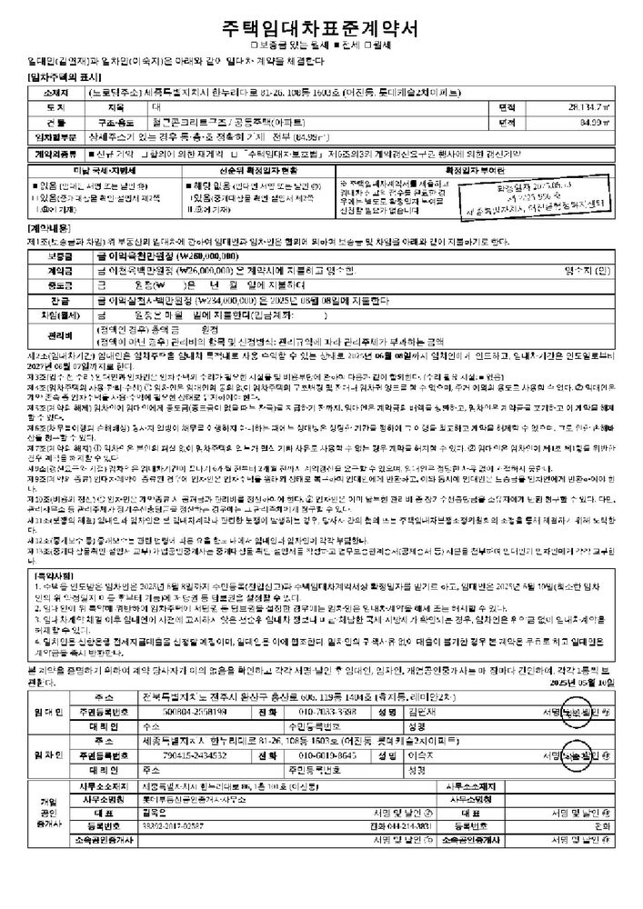</a> <a href="examples/img/loan_application_jeonse_over_778b95f8.jpg">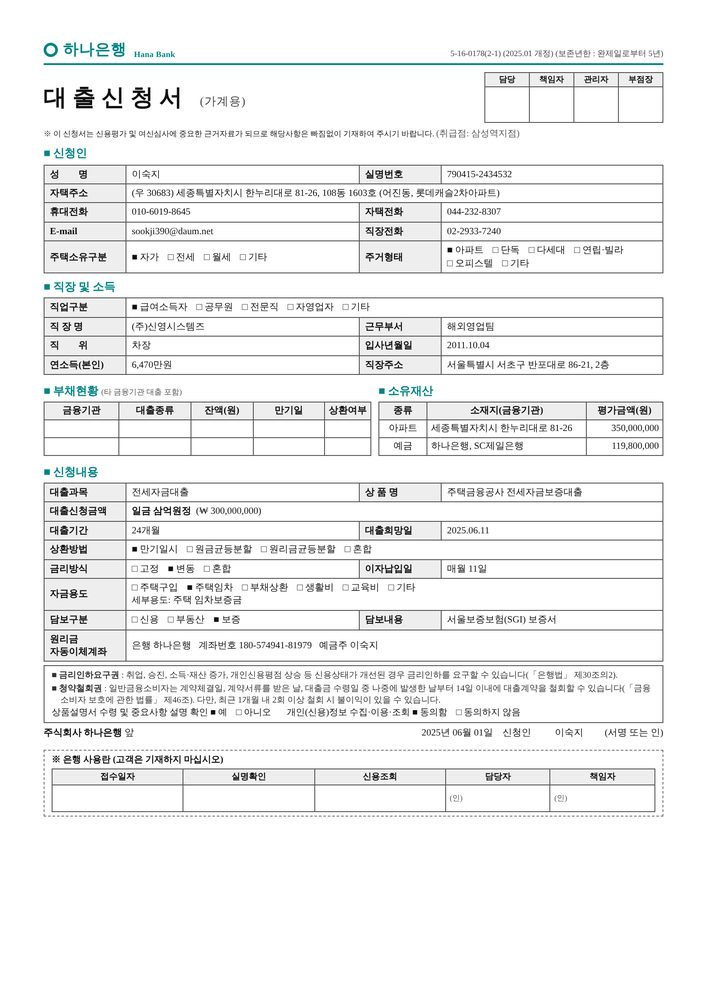</a></p>

1. `lease_contract.jpg` · 2. `loan_application_jeonse_over.png`

**질문** (`prompt`)

```
고객 '이숙지' 님이 '전세자금대출' 업무를 위해 제출한 서류 2건입니다 (이미지 2장). 서류들을 서로 대조해 맞지 않는 정보(성명, 주민등록번호, 생년월일, 주소, 연락처, 계좌번호, 상호, 금액, 날짜 등), 업무상 맞지 않는 관계(계약 상대방이 등기부 소유자가 아님, 금액·날짜 관계 오류 등), 고객 본인 명의가 아닌 서류가 있는지 확인하세요. 표기 방식만 다른 것(날짜 형식, 주민번호 뒷자리 가림, 하이픈 유무 등)은 불일치가 아닙니다.
{"consistent": true 또는 false, "issues": [{"document": "문제가 있는 서류명", "field": "항목명", "value": "그 서류에 적힌 값", "expected": "다른 서류에 적힌 값"}]} 형식의 JSON 으로 답하세요. 문제가 없으면 {"consistent": true, "issues": []} 입니다.
```

**정답** (`answer`)

```json
{
 "consistent": false,
 "issues": [
  {
   "document": "대출거래신청서",
   "field": "대출신청금액",
   "value": "300,000,000",
   "expected": "208,000,000",
   "alt_documents": ["주택임대차표준계약서"]
  }
 ]
}
```

**채점 정보** (`eval`)

```json
{"documents": ["주택임대차표준계약서", "대출거래신청서"]}
```

**나눠 보기 정보** (`meta`)

```json
{
 "scenario": "jeonse_loan",
 "task_name": "전세자금대출",
 "bundle": "jeonse_loan_2003003",
 "customer": "이숙지",
 "case": "jeonse_over",
 "category": "logic",
 "perturbed": true,
 "n_docs": 2
}
```

**문항 한 줄 전체** (`tasks/cross_check.jsonl`)

<details><summary>펼치기</summary>

```json
{
 "id": "cross_check/jeonse_loan_2003003/jeonse_over",
 "task": "cross_check",
 "images": [
  "images/bundles/jeonse_loan_2003003/lease_contract.jpg",
  "images/bundles/jeonse_loan_2003003/loan_application_jeonse_over.png"
 ],
 "prompt": "고객 '이숙지' 님이 '전세자금대출' 업무를 위해 제출한 서류 2건입니다 (이미지 2장). 서류들을 서로 대조해 맞지 않는 정보(성명, 주민등록번호, 생년월일, 주소, 연락처, 계좌번호, 상호, 금액, 날짜 등), 업무상 맞지 않는 관계(계약 상대방이 등기부 소유자가 아님, 금액·날짜 관계 오류 등), 고객 본인 명의가 아닌 서류가 있는지 확인하세요. 표기 방식만 다른 것(날짜 형식, 주민번호 뒷자리 가림, 하이픈 유무 등)은 불일치가 아닙니다.\n{\"consistent\": true 또는 false, \"issues\": [{\"document\": \"문제가 있는 서류명\", \"field\": \"항목명\", \"value\": \"그 서류에 적힌 값\", \"expected\": \"다른 서류에 적힌 값\"}]} 형식의 JSON 으로 답하세요. 문제가 없으면 {\"consistent\": true, \"issues\": []} 입니다.",
 "answer": {
  "consistent": false,
  "issues": [
   {
    "document": "대출거래신청서",
    "field": "대출신청금액",
    "value": "300,000,000",
    "expected": "208,000,000",
    "alt_documents": ["주택임대차표준계약서"]
   }
  ]
 },
 "eval": {"documents": ["주택임대차표준계약서", "대출거래신청서"]},
 "meta": {
  "scenario": "jeonse_loan",
  "task_name": "전세자금대출",
  "bundle": "jeonse_loan_2003003",
  "customer": "이숙지",
  "case": "jeonse_over",
  "category": "logic",
  "perturbed": true,
  "n_docs": 2
 }
}
```
</details>

**학습 레코드** (`swift/all.jsonl` 한 줄: 같은 문항을 질문 + 정답 답변 대화로 바꾼 것)

```json
{
 "id": "cross_check/jeonse_loan_2003003/jeonse_over",
 "task": "cross_check",
 "images": [
  "images/bundles/jeonse_loan_2003003/lease_contract.jpg",
  "images/bundles/jeonse_loan_2003003/loan_application_jeonse_over.png"
 ],
 "messages": [
  {
   "role": "user",
   "content": "<image><image>고객 '이숙지' 님이 '전세자금대출' 업무를 위해 제출한 서류 2건입니다 (이미지 2장). 서류들을 서로 대조해 맞지 않는 정보(성명, 주민등록번호, 생년월일, 주소, 연락처, 계좌번호, 상호, 금액, 날짜 등), 업무상 맞지 않는 관계(계약 상대방이 등기부 소유자가 아님, 금액·날짜 관계 오류 등), 고객 본인 명의가 아닌 서류가 있는지 확인하세요. 표기 방식만 다른 것(날짜 형식, 주민번호 뒷자리 가림, 하이픈 유무 등)은 불일치가 아닙니다.\n{\"consistent\": true 또는 false, \"issues\": [{\"document\": \"문제가 있는 서류명\", \"field\": \"항목명\", \"value\": \"그 서류에 적힌 값\", \"expected\": \"다른 서류에 적힌 값\"}]} 형식의 JSON 으로 답하세요. 문제가 없으면 {\"consistent\": true, \"issues\": []} 입니다."
  },
  {
   "role": "assistant",
   "content": "{\"consistent\": false, \"issues\": [{\"document\": \"대출거래신청서\", \"field\": \"대출신청금액\", \"value\": \"300,000,000\", \"expected\": \"208,000,000\"}]}"
  }
 ]
}
```

### 3-12. sales_sum — 업계약 (대금 합계 불일치)

**분류:** `logic` · **실제 사례 근거:** 업계약: 대출 한도를 늘리려 매매대금을 부풀림

**입력 이미지** (2장, 질문 앞에 이 순서로)

<p><a href="examples/img/sales_contract_sales_sum_be09ea05.jpg"></a> <a href="examples/img/loan_application_e179d459.jpg"></a></p>

1. `sales_contract_sales_sum.jpg` · 2. `loan_application.jpg`

**질문** (`prompt`)

```
고객 '엄태정' 님이 '주택담보대출' 업무를 위해 제출한 서류 2건입니다 (이미지 2장). 서류들을 서로 대조해 맞지 않는 정보(성명, 주민등록번호, 생년월일, 주소, 연락처, 계좌번호, 상호, 금액, 날짜 등), 업무상 맞지 않는 관계(계약 상대방이 등기부 소유자가 아님, 금액·날짜 관계 오류 등), 고객 본인 명의가 아닌 서류가 있는지 확인하세요. 표기 방식만 다른 것(날짜 형식, 주민번호 뒷자리 가림, 하이픈 유무 등)은 불일치가 아닙니다.
{"consistent": true 또는 false, "issues": [{"document": "문제가 있는 서류명", "field": "항목명", "value": "그 서류에 적힌 값", "expected": "다른 서류에 적힌 값"}]} 형식의 JSON 으로 답하세요. 문제가 없으면 {"consistent": true, "issues": []} 입니다.
```

**정답** (`answer`)

```json
{
 "consistent": false,
 "issues": [
  {
   "document": "부동산 매매계약서",
   "field": "매매대금",
   "value": "금 구억사천만원정 (₩940,000,000)",
   "expected": "금 팔억이천만원정 (₩820,000,000)",
   "alt_documents": []
  }
 ]
}
```

**채점 정보** (`eval`)

```json
{"documents": ["부동산 매매계약서", "대출거래신청서"]}
```

**나눠 보기 정보** (`meta`)

```json
{
 "scenario": "mortgage",
 "task_name": "주택담보대출",
 "bundle": "mortgage_2002000",
 "customer": "엄태정",
 "case": "sales_sum",
 "category": "logic",
 "perturbed": true,
 "n_docs": 2
}
```

**문항 한 줄 전체** (`tasks/cross_check.jsonl`)

<details><summary>펼치기</summary>

```json
{
 "id": "cross_check/mortgage_2002000/sales_sum",
 "task": "cross_check",
 "images": [
  "images/bundles/mortgage_2002000/sales_contract_sales_sum.jpg",
  "images/bundles/mortgage_2002000/loan_application.jpg"
 ],
 "prompt": "고객 '엄태정' 님이 '주택담보대출' 업무를 위해 제출한 서류 2건입니다 (이미지 2장). 서류들을 서로 대조해 맞지 않는 정보(성명, 주민등록번호, 생년월일, 주소, 연락처, 계좌번호, 상호, 금액, 날짜 등), 업무상 맞지 않는 관계(계약 상대방이 등기부 소유자가 아님, 금액·날짜 관계 오류 등), 고객 본인 명의가 아닌 서류가 있는지 확인하세요. 표기 방식만 다른 것(날짜 형식, 주민번호 뒷자리 가림, 하이픈 유무 등)은 불일치가 아닙니다.\n{\"consistent\": true 또는 false, \"issues\": [{\"document\": \"문제가 있는 서류명\", \"field\": \"항목명\", \"value\": \"그 서류에 적힌 값\", \"expected\": \"다른 서류에 적힌 값\"}]} 형식의 JSON 으로 답하세요. 문제가 없으면 {\"consistent\": true, \"issues\": []} 입니다.",
 "answer": {
  "consistent": false,
  "issues": [
   {
    "document": "부동산 매매계약서",
    "field": "매매대금",
    "value": "금 구억사천만원정 (₩940,000,000)",
    "expected": "금 팔억이천만원정 (₩820,000,000)",
    "alt_documents": []
   }
  ]
 },
 "eval": {"documents": ["부동산 매매계약서", "대출거래신청서"]},
 "meta": {
  "scenario": "mortgage",
  "task_name": "주택담보대출",
  "bundle": "mortgage_2002000",
  "customer": "엄태정",
  "case": "sales_sum",
  "category": "logic",
  "perturbed": true,
  "n_docs": 2
 }
}
```
</details>

**학습 레코드** (`swift/all.jsonl` 한 줄: 같은 문항을 질문 + 정답 답변 대화로 바꾼 것)

```json
{
 "id": "cross_check/mortgage_2002000/sales_sum",
 "task": "cross_check",
 "images": [
  "images/bundles/mortgage_2002000/sales_contract_sales_sum.jpg",
  "images/bundles/mortgage_2002000/loan_application.jpg"
 ],
 "messages": [
  {
   "role": "user",
   "content": "<image><image>고객 '엄태정' 님이 '주택담보대출' 업무를 위해 제출한 서류 2건입니다 (이미지 2장). 서류들을 서로 대조해 맞지 않는 정보(성명, 주민등록번호, 생년월일, 주소, 연락처, 계좌번호, 상호, 금액, 날짜 등), 업무상 맞지 않는 관계(계약 상대방이 등기부 소유자가 아님, 금액·날짜 관계 오류 등), 고객 본인 명의가 아닌 서류가 있는지 확인하세요. 표기 방식만 다른 것(날짜 형식, 주민번호 뒷자리 가림, 하이픈 유무 등)은 불일치가 아닙니다.\n{\"consistent\": true 또는 false, \"issues\": [{\"document\": \"문제가 있는 서류명\", \"field\": \"항목명\", \"value\": \"그 서류에 적힌 값\", \"expected\": \"다른 서류에 적힌 값\"}]} 형식의 JSON 으로 답하세요. 문제가 없으면 {\"consistent\": true, \"issues\": []} 입니다."
  },
  {
   "role": "assistant",
   "content": "{\"consistent\": false, \"issues\": [{\"document\": \"부동산 매매계약서\", \"field\": \"매매대금\", \"value\": \"금 구억사천만원정 (₩940,000,000)\", \"expected\": \"금 팔억이천만원정 (₩820,000,000)\"}]}"
  }
 ]
}
```

### 3-13. fx_beneficiary — 송금 수취인 ≠ 송장 수출자

**분류:** `logic` · **실제 사례 근거:** 증빙과 다른 상대방에게 송금 (외국환 증빙 불일치)

**입력 이미지** (2장, 질문 앞에 이 순서로)

<p><a href="examples/img/overseas_remittance_application_fx_beneficiary_7ff2e859.jpg">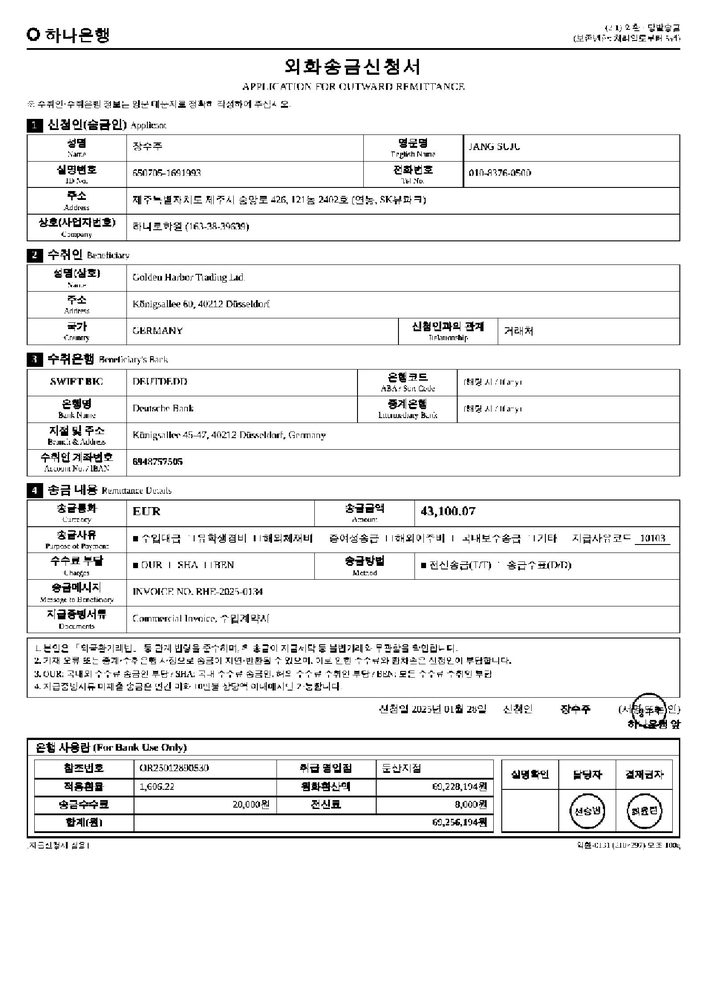</a> <a href="examples/img/commercial_invoice_564bb4a1.jpg">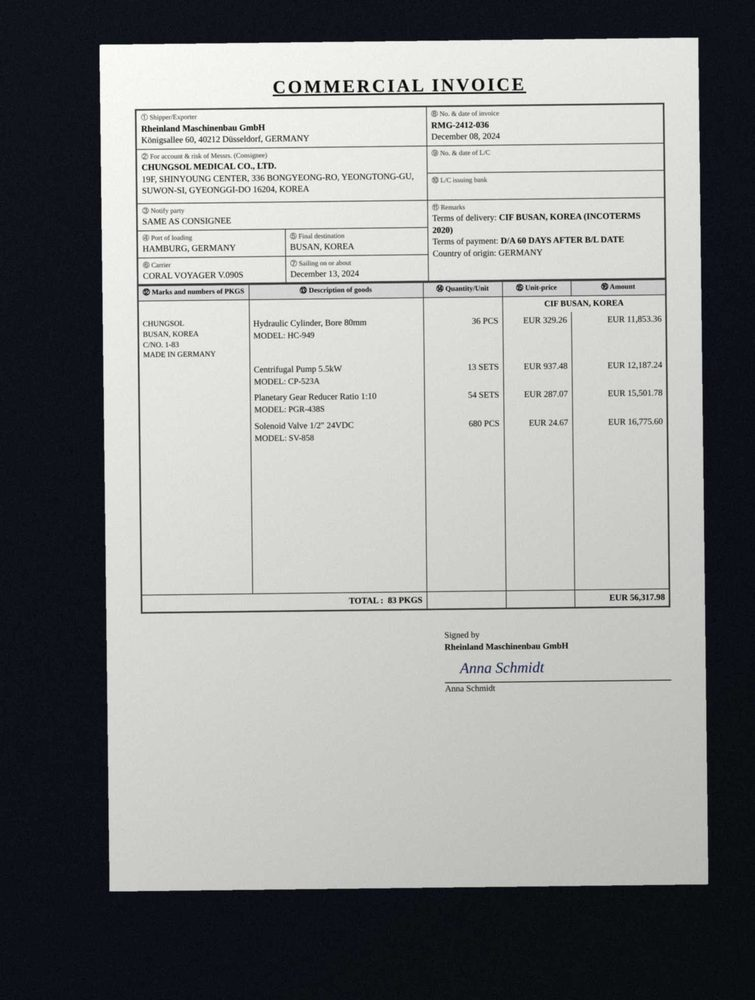</a></p>

1. `overseas_remittance_application_fx_beneficiary.jpg` · 2. `commercial_invoice.jpg`

**질문** (`prompt`)

```
고객 '장수주' 님이 '해외송금' 업무를 위해 제출한 서류 2건입니다 (이미지 2장). 서류들을 서로 대조해 맞지 않는 정보(성명, 주민등록번호, 생년월일, 주소, 연락처, 계좌번호, 상호, 금액, 날짜 등), 업무상 맞지 않는 관계(계약 상대방이 등기부 소유자가 아님, 금액·날짜 관계 오류 등), 고객 본인 명의가 아닌 서류가 있는지 확인하세요. 표기 방식만 다른 것(날짜 형식, 주민번호 뒷자리 가림, 하이픈 유무 등)은 불일치가 아닙니다.
{"consistent": true 또는 false, "issues": [{"document": "문제가 있는 서류명", "field": "항목명", "value": "그 서류에 적힌 값", "expected": "다른 서류에 적힌 값"}]} 형식의 JSON 으로 답하세요. 문제가 없으면 {"consistent": true, "issues": []} 입니다.
```

**정답** (`answer`)

```json
{
 "consistent": false,
 "issues": [
  {
   "document": "해외송금신청서",
   "field": "수취인성명",
   "value": "Golden Harbor Trading Ltd.",
   "expected": "Rheinland Maschinenbau GmbH",
   "alt_documents": ["상업송장(Commercial Invoice)"]
  }
 ]
}
```

**채점 정보** (`eval`)

```json
{"documents": ["해외송금신청서", "상업송장(Commercial Invoice)"]}
```

**나눠 보기 정보** (`meta`)

```json
{
 "scenario": "fx_remittance",
 "task_name": "해외송금",
 "bundle": "fx_remittance_2006000",
 "customer": "장수주",
 "case": "fx_beneficiary",
 "category": "logic",
 "perturbed": true,
 "n_docs": 2
}
```

**문항 한 줄 전체** (`tasks/cross_check.jsonl`)

<details><summary>펼치기</summary>

```json
{
 "id": "cross_check/fx_remittance_2006000/fx_beneficiary",
 "task": "cross_check",
 "images": [
  "images/bundles/fx_remittance_2006000/overseas_remittance_application_fx_beneficiary.jpg",
  "images/bundles/fx_remittance_2006000/commercial_invoice.jpg"
 ],
 "prompt": "고객 '장수주' 님이 '해외송금' 업무를 위해 제출한 서류 2건입니다 (이미지 2장). 서류들을 서로 대조해 맞지 않는 정보(성명, 주민등록번호, 생년월일, 주소, 연락처, 계좌번호, 상호, 금액, 날짜 등), 업무상 맞지 않는 관계(계약 상대방이 등기부 소유자가 아님, 금액·날짜 관계 오류 등), 고객 본인 명의가 아닌 서류가 있는지 확인하세요. 표기 방식만 다른 것(날짜 형식, 주민번호 뒷자리 가림, 하이픈 유무 등)은 불일치가 아닙니다.\n{\"consistent\": true 또는 false, \"issues\": [{\"document\": \"문제가 있는 서류명\", \"field\": \"항목명\", \"value\": \"그 서류에 적힌 값\", \"expected\": \"다른 서류에 적힌 값\"}]} 형식의 JSON 으로 답하세요. 문제가 없으면 {\"consistent\": true, \"issues\": []} 입니다.",
 "answer": {
  "consistent": false,
  "issues": [
   {
    "document": "해외송금신청서",
    "field": "수취인성명",
    "value": "Golden Harbor Trading Ltd.",
    "expected": "Rheinland Maschinenbau GmbH",
    "alt_documents": ["상업송장(Commercial Invoice)"]
   }
  ]
 },
 "eval": {"documents": ["해외송금신청서", "상업송장(Commercial Invoice)"]},
 "meta": {
  "scenario": "fx_remittance",
  "task_name": "해외송금",
  "bundle": "fx_remittance_2006000",
  "customer": "장수주",
  "case": "fx_beneficiary",
  "category": "logic",
  "perturbed": true,
  "n_docs": 2
 }
}
```
</details>

**학습 레코드** (`swift/all.jsonl` 한 줄: 같은 문항을 질문 + 정답 답변 대화로 바꾼 것)

```json
{
 "id": "cross_check/fx_remittance_2006000/fx_beneficiary",
 "task": "cross_check",
 "images": [
  "images/bundles/fx_remittance_2006000/overseas_remittance_application_fx_beneficiary.jpg",
  "images/bundles/fx_remittance_2006000/commercial_invoice.jpg"
 ],
 "messages": [
  {
   "role": "user",
   "content": "<image><image>고객 '장수주' 님이 '해외송금' 업무를 위해 제출한 서류 2건입니다 (이미지 2장). 서류들을 서로 대조해 맞지 않는 정보(성명, 주민등록번호, 생년월일, 주소, 연락처, 계좌번호, 상호, 금액, 날짜 등), 업무상 맞지 않는 관계(계약 상대방이 등기부 소유자가 아님, 금액·날짜 관계 오류 등), 고객 본인 명의가 아닌 서류가 있는지 확인하세요. 표기 방식만 다른 것(날짜 형식, 주민번호 뒷자리 가림, 하이픈 유무 등)은 불일치가 아닙니다.\n{\"consistent\": true 또는 false, \"issues\": [{\"document\": \"문제가 있는 서류명\", \"field\": \"항목명\", \"value\": \"그 서류에 적힌 값\", \"expected\": \"다른 서류에 적힌 값\"}]} 형식의 JSON 으로 답하세요. 문제가 없으면 {\"consistent\": true, \"issues\": []} 입니다."
  },
  {
   "role": "assistant",
   "content": "{\"consistent\": false, \"issues\": [{\"document\": \"해외송금신청서\", \"field\": \"수취인성명\", \"value\": \"Golden Harbor Trading Ltd.\", \"expected\": \"Rheinland Maschinenbau GmbH\"}]}"
  }
 ]
}
```

### 3-14. format_only — 표기만 다름 (정상)

**분류:** `format` · **실제 사례 근거:** 날짜·금액·주민번호·전화·주소 표기 차이는 불일치가 아님

**입력 이미지** (3장, 질문 앞에 이 순서로)

<p><a href="examples/img/financial_transaction_purpose_format_only_0e709fdb.jpg">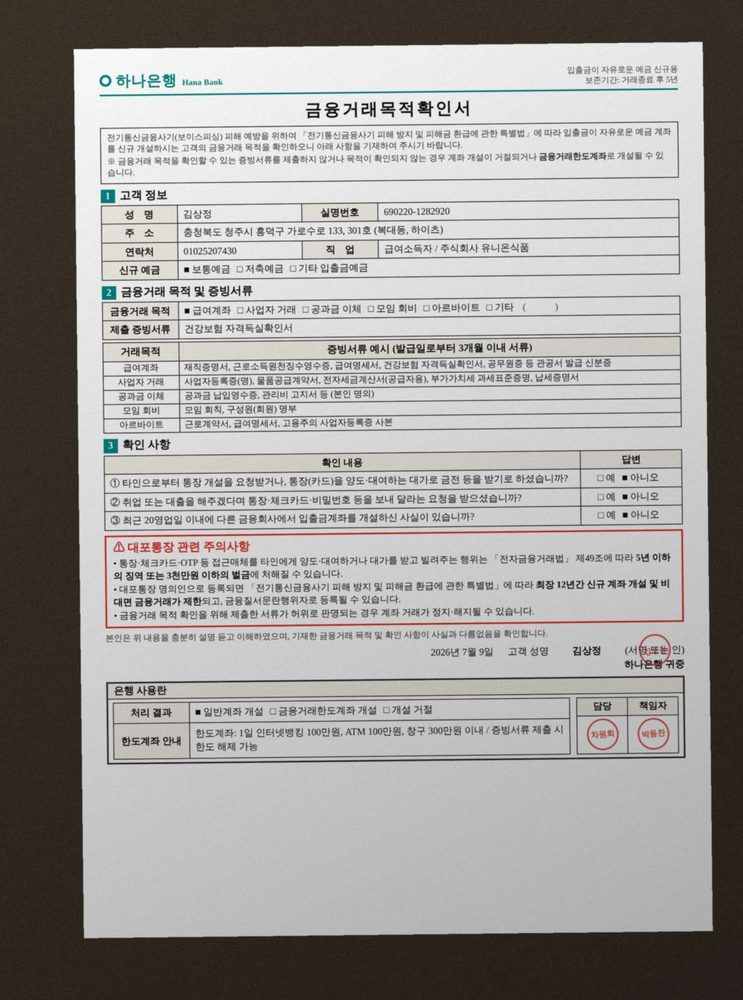</a> <a href="examples/img/customer_due_diligence_4bba97a3.jpg">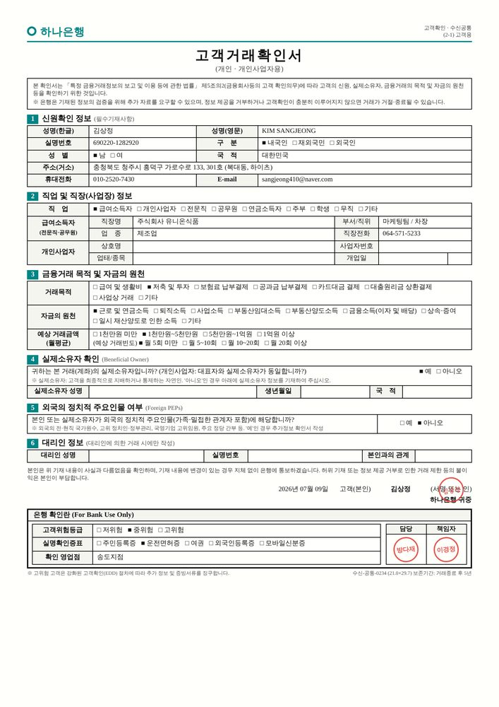</a> <a href="examples/img/account_opening_application_3ed40913.jpg">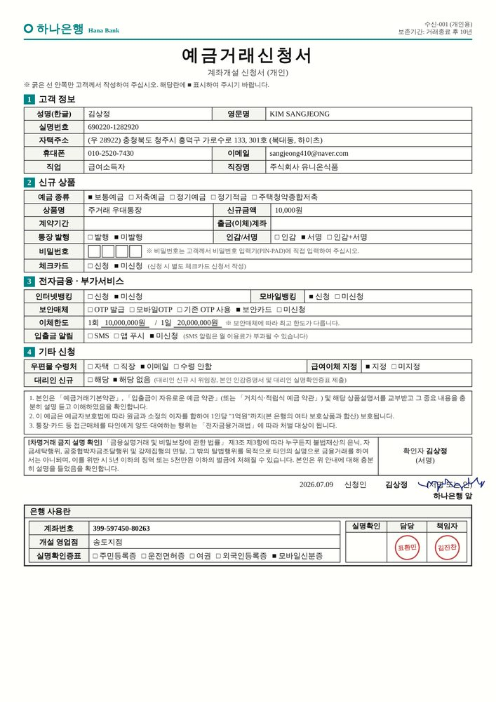</a></p>

1. `financial_transaction_purpose_format_only.jpg` · 2. `customer_due_diligence.png` · 3. `account_opening_application.png`

**질문** (`prompt`)

```
고객 '김상정' 님이 '개인 계좌개설' 업무를 위해 제출한 서류 3건입니다 (이미지 3장). 서류들을 서로 대조해 맞지 않는 정보(성명, 주민등록번호, 생년월일, 주소, 연락처, 계좌번호, 상호, 금액, 날짜 등), 업무상 맞지 않는 관계(계약 상대방이 등기부 소유자가 아님, 금액·날짜 관계 오류 등), 고객 본인 명의가 아닌 서류가 있는지 확인하세요. 표기 방식만 다른 것(날짜 형식, 주민번호 뒷자리 가림, 하이픈 유무 등)은 불일치가 아닙니다.
{"consistent": true 또는 false, "issues": [{"document": "문제가 있는 서류명", "field": "항목명", "value": "그 서류에 적힌 값", "expected": "다른 서류에 적힌 값"}]} 형식의 JSON 으로 답하세요. 문제가 없으면 {"consistent": true, "issues": []} 입니다.
```

**정답** (`answer`)

```json
{"consistent": true, "issues": []}
```

**채점 정보** (`eval`)

```json
{"documents": ["금융거래목적확인서", "고객확인서(개인)", "예금거래신청서"]}
```

**나눠 보기 정보** (`meta`)

```json
{
 "scenario": "account_opening",
 "task_name": "개인 계좌개설",
 "bundle": "account_opening_2000000",
 "customer": "김상정",
 "case": "format_only",
 "category": "format",
 "perturbed": false,
 "n_docs": 3
}
```

**문항 한 줄 전체** (`tasks/cross_check.jsonl`)

<details><summary>펼치기</summary>

```json
{
 "id": "cross_check/account_opening_2000000/format_only",
 "task": "cross_check",
 "images": [
  "images/bundles/account_opening_2000000/financial_transaction_purpose_format_only.jpg",
  "images/bundles/account_opening_2000000/customer_due_diligence.png",
  "images/bundles/account_opening_2000000/account_opening_application.png"
 ],
 "prompt": "고객 '김상정' 님이 '개인 계좌개설' 업무를 위해 제출한 서류 3건입니다 (이미지 3장). 서류들을 서로 대조해 맞지 않는 정보(성명, 주민등록번호, 생년월일, 주소, 연락처, 계좌번호, 상호, 금액, 날짜 등), 업무상 맞지 않는 관계(계약 상대방이 등기부 소유자가 아님, 금액·날짜 관계 오류 등), 고객 본인 명의가 아닌 서류가 있는지 확인하세요. 표기 방식만 다른 것(날짜 형식, 주민번호 뒷자리 가림, 하이픈 유무 등)은 불일치가 아닙니다.\n{\"consistent\": true 또는 false, \"issues\": [{\"document\": \"문제가 있는 서류명\", \"field\": \"항목명\", \"value\": \"그 서류에 적힌 값\", \"expected\": \"다른 서류에 적힌 값\"}]} 형식의 JSON 으로 답하세요. 문제가 없으면 {\"consistent\": true, \"issues\": []} 입니다.",
 "answer": {"consistent": true, "issues": []},
 "eval": {"documents": ["금융거래목적확인서", "고객확인서(개인)", "예금거래신청서"]},
 "meta": {
  "scenario": "account_opening",
  "task_name": "개인 계좌개설",
  "bundle": "account_opening_2000000",
  "customer": "김상정",
  "case": "format_only",
  "category": "format",
  "perturbed": false,
  "n_docs": 3
 }
}
```
</details>

**학습 레코드** (`swift/all.jsonl` 한 줄: 같은 문항을 질문 + 정답 답변 대화로 바꾼 것)

```json
{
 "id": "cross_check/account_opening_2000000/format_only",
 "task": "cross_check",
 "images": [
  "images/bundles/account_opening_2000000/financial_transaction_purpose_format_only.jpg",
  "images/bundles/account_opening_2000000/customer_due_diligence.png",
  "images/bundles/account_opening_2000000/account_opening_application.png"
 ],
 "messages": [
  {
   "role": "user",
   "content": "<image><image><image>고객 '김상정' 님이 '개인 계좌개설' 업무를 위해 제출한 서류 3건입니다 (이미지 3장). 서류들을 서로 대조해 맞지 않는 정보(성명, 주민등록번호, 생년월일, 주소, 연락처, 계좌번호, 상호, 금액, 날짜 등), 업무상 맞지 않는 관계(계약 상대방이 등기부 소유자가 아님, 금액·날짜 관계 오류 등), 고객 본인 명의가 아닌 서류가 있는지 확인하세요. 표기 방식만 다른 것(날짜 형식, 주민번호 뒷자리 가림, 하이픈 유무 등)은 불일치가 아닙니다.\n{\"consistent\": true 또는 false, \"issues\": [{\"document\": \"문제가 있는 서류명\", \"field\": \"항목명\", \"value\": \"그 서류에 적힌 값\", \"expected\": \"다른 서류에 적힌 값\"}]} 형식의 JSON 으로 답하세요. 문제가 없으면 {\"consistent\": true, \"issues\": []} 입니다."
  },
  {"role": "assistant", "content": "{\"consistent\": true, \"issues\": []}"}
 ]
}
```

## 4부. 심사 질의 규칙 (review 문항 하나씩)

정답은 서류의 정답 값으로 계산합니다. 질문에 반올림 자릿수·기준일·답 형식을 적어 정답이 하나로 정해집니다.

### 4-1. ltv (계산(비율))

**입력 이미지** (2장, 질문 앞에 이 순서로)

<p><a href="examples/img/loan_application_e179d459.jpg"></a> <a href="examples/img/sales_contract_bf738685.jpg"></a></p>

1. `loan_application.jpg` · 2. `sales_contract.jpg`

**질문** (`prompt`)

```
고객이 '주택담보대출' 업무를 위해 제출한 서류입니다 (이미지 2장).
주택담보대출 심사입니다. '대출거래신청서'의 대출신청금액은 '부동산 매매계약서'의 매매대금의 몇 %입니까? (LTV, 소수 첫째 자리까지 반올림한 숫자만 답하세요)
```

**정답** (`answer`)

```json
23.7
```

**채점 정보** (`eval`)

```json
{"answer_type": "number", "tol": 0.1}
```

**나눠 보기 정보** (`meta`)

```json
{
 "scenario": "mortgage",
 "task_name": "주택담보대출",
 "bundle": "mortgage_2002000",
 "customer": "엄태정",
 "rule": "ltv",
 "skill": "계산(비율)"
}
```

**문항 한 줄 전체** (`tasks/review.jsonl`)

<details><summary>펼치기</summary>

```json
{
 "id": "review/mortgage_2002000/ltv",
 "task": "review",
 "images": [
  "images/bundles/mortgage_2002000/loan_application.jpg",
  "images/bundles/mortgage_2002000/sales_contract.jpg"
 ],
 "prompt": "고객이 '주택담보대출' 업무를 위해 제출한 서류입니다 (이미지 2장).\n주택담보대출 심사입니다. '대출거래신청서'의 대출신청금액은 '부동산 매매계약서'의 매매대금의 몇 %입니까? (LTV, 소수 첫째 자리까지 반올림한 숫자만 답하세요)",
 "answer": 23.7,
 "eval": {"answer_type": "number", "tol": 0.1},
 "meta": {
  "scenario": "mortgage",
  "task_name": "주택담보대출",
  "bundle": "mortgage_2002000",
  "customer": "엄태정",
  "rule": "ltv",
  "skill": "계산(비율)"
 }
}
```
</details>

**학습 레코드** (`swift/all.jsonl` 한 줄: 같은 문항을 질문 + 정답 답변 대화로 바꾼 것)

```json
{
 "id": "review/mortgage_2002000/ltv",
 "task": "review",
 "images": [
  "images/bundles/mortgage_2002000/loan_application.jpg",
  "images/bundles/mortgage_2002000/sales_contract.jpg"
 ],
 "messages": [
  {
   "role": "user",
   "content": "<image><image>고객이 '주택담보대출' 업무를 위해 제출한 서류입니다 (이미지 2장).\n주택담보대출 심사입니다. '대출거래신청서'의 대출신청금액은 '부동산 매매계약서'의 매매대금의 몇 %입니까? (LTV, 소수 첫째 자리까지 반올림한 숫자만 답하세요)"
  },
  {"role": "assistant", "content": "23.7"}
 ]
}
```

### 4-2. collateral_ratio (계산(비율))

**입력 이미지** (2장, 질문 앞에 이 순서로)

<p><a href="examples/img/collateral_agreement_b396c277.jpg">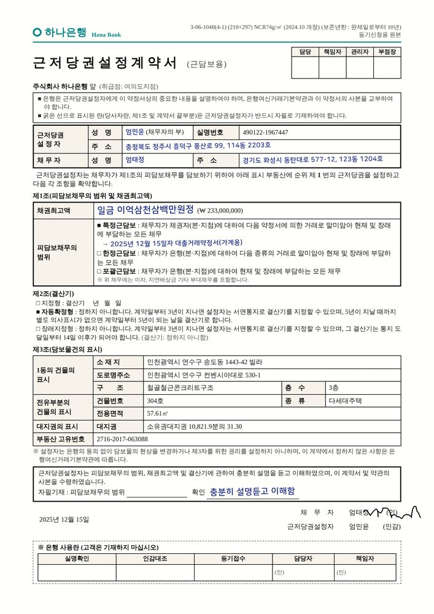</a> <a href="examples/img/credit_agreement_69260e31.jpg">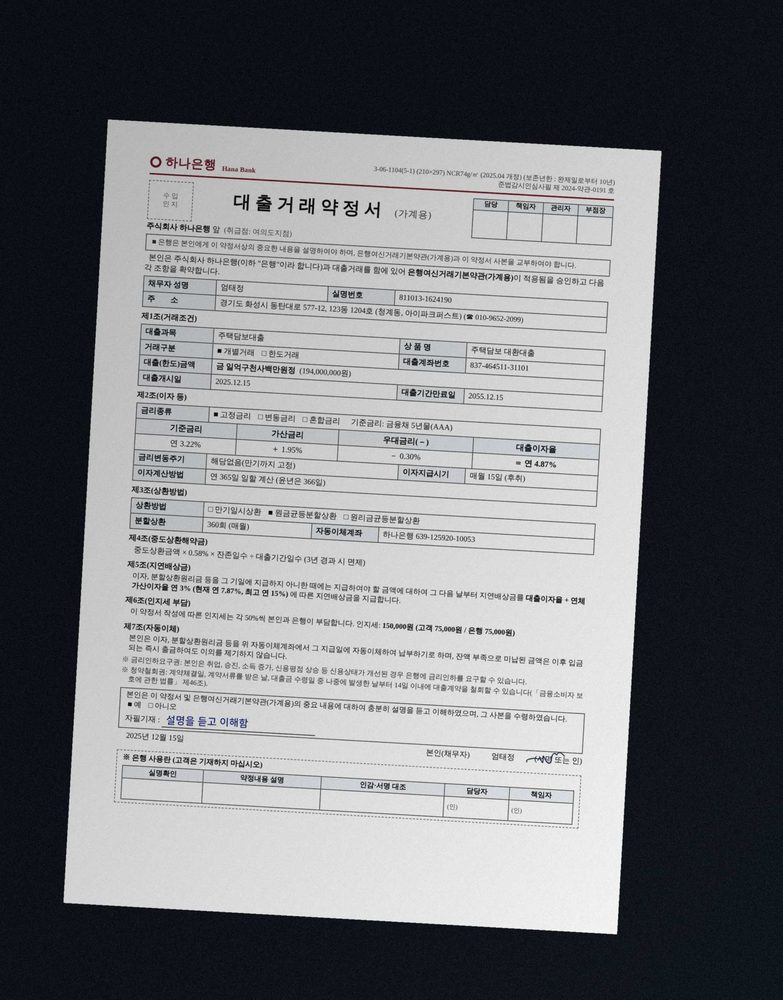</a></p>

1. `collateral_agreement.png` · 2. `credit_agreement.jpg`

**질문** (`prompt`)

```
고객이 '주택담보대출' 업무를 위해 제출한 서류입니다 (이미지 2장).
'근저당권설정계약서'의 채권최고액은 '대출거래약정서(가계용)'의 대출(한도)금액의 몇 %입니까? (소수 첫째 자리까지 반올림한 숫자만 답하세요)
```

**정답** (`answer`)

```json
120.1
```

**채점 정보** (`eval`)

```json
{"answer_type": "number", "tol": 0.1}
```

**나눠 보기 정보** (`meta`)

```json
{
 "scenario": "mortgage",
 "task_name": "주택담보대출",
 "bundle": "mortgage_2002000",
 "customer": "엄태정",
 "rule": "collateral_ratio",
 "skill": "계산(비율)"
}
```

**문항 한 줄 전체** (`tasks/review.jsonl`)

<details><summary>펼치기</summary>

```json
{
 "id": "review/mortgage_2002000/collateral_ratio",
 "task": "review",
 "images": [
  "images/bundles/mortgage_2002000/collateral_agreement.png",
  "images/bundles/mortgage_2002000/credit_agreement.jpg"
 ],
 "prompt": "고객이 '주택담보대출' 업무를 위해 제출한 서류입니다 (이미지 2장).\n'근저당권설정계약서'의 채권최고액은 '대출거래약정서(가계용)'의 대출(한도)금액의 몇 %입니까? (소수 첫째 자리까지 반올림한 숫자만 답하세요)",
 "answer": 120.1,
 "eval": {"answer_type": "number", "tol": 0.1},
 "meta": {
  "scenario": "mortgage",
  "task_name": "주택담보대출",
  "bundle": "mortgage_2002000",
  "customer": "엄태정",
  "rule": "collateral_ratio",
  "skill": "계산(비율)"
 }
}
```
</details>

**학습 레코드** (`swift/all.jsonl` 한 줄: 같은 문항을 질문 + 정답 답변 대화로 바꾼 것)

```json
{
 "id": "review/mortgage_2002000/collateral_ratio",
 "task": "review",
 "images": [
  "images/bundles/mortgage_2002000/collateral_agreement.png",
  "images/bundles/mortgage_2002000/credit_agreement.jpg"
 ],
 "messages": [
  {
   "role": "user",
   "content": "<image><image>고객이 '주택담보대출' 업무를 위해 제출한 서류입니다 (이미지 2장).\n'근저당권설정계약서'의 채권최고액은 '대출거래약정서(가계용)'의 대출(한도)금액의 몇 %입니까? (소수 첫째 자리까지 반올림한 숫자만 답하세요)"
  },
  {"role": "assistant", "content": "120.1"}
 ]
}
```

### 4-3. jeonse_ratio (계산(비율))

**입력 이미지** (2장, 질문 앞에 이 순서로)

<p><a href="examples/img/loan_application_9ad08642.jpg">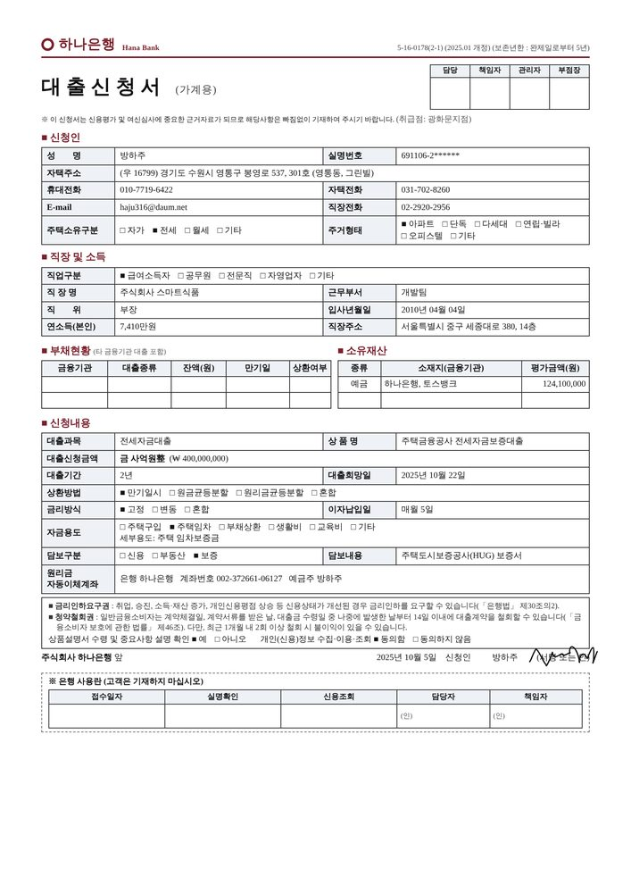</a> <a href="examples/img/lease_contract_39a79a48.jpg"></a></p>

1. `loan_application.png` · 2. `lease_contract.png`

**질문** (`prompt`)

```
고객이 '전세자금대출' 업무를 위해 제출한 서류입니다 (이미지 2장).
전세자금대출 심사입니다. '대출거래신청서'의 대출신청금액은 '주택임대차표준계약서'의 보증금의 몇 %입니까? (소수 첫째 자리까지 반올림한 숫자만 답하세요)
```

**정답** (`answer`)

```json
49.4
```

**채점 정보** (`eval`)

```json
{"answer_type": "number", "tol": 0.1}
```

**나눠 보기 정보** (`meta`)

```json
{
 "scenario": "jeonse_loan",
 "task_name": "전세자금대출",
 "bundle": "jeonse_loan_2003000",
 "customer": "방하주",
 "rule": "jeonse_ratio",
 "skill": "계산(비율)"
}
```

**문항 한 줄 전체** (`tasks/review.jsonl`)

<details><summary>펼치기</summary>

```json
{
 "id": "review/jeonse_loan_2003000/jeonse_ratio",
 "task": "review",
 "images": [
  "images/bundles/jeonse_loan_2003000/loan_application.png",
  "images/bundles/jeonse_loan_2003000/lease_contract.png"
 ],
 "prompt": "고객이 '전세자금대출' 업무를 위해 제출한 서류입니다 (이미지 2장).\n전세자금대출 심사입니다. '대출거래신청서'의 대출신청금액은 '주택임대차표준계약서'의 보증금의 몇 %입니까? (소수 첫째 자리까지 반올림한 숫자만 답하세요)",
 "answer": 49.4,
 "eval": {"answer_type": "number", "tol": 0.1},
 "meta": {
  "scenario": "jeonse_loan",
  "task_name": "전세자금대출",
  "bundle": "jeonse_loan_2003000",
  "customer": "방하주",
  "rule": "jeonse_ratio",
  "skill": "계산(비율)"
 }
}
```
</details>

**학습 레코드** (`swift/all.jsonl` 한 줄: 같은 문항을 질문 + 정답 답변 대화로 바꾼 것)

```json
{
 "id": "review/jeonse_loan_2003000/jeonse_ratio",
 "task": "review",
 "images": [
  "images/bundles/jeonse_loan_2003000/loan_application.png",
  "images/bundles/jeonse_loan_2003000/lease_contract.png"
 ],
 "messages": [
  {
   "role": "user",
   "content": "<image><image>고객이 '전세자금대출' 업무를 위해 제출한 서류입니다 (이미지 2장).\n전세자금대출 심사입니다. '대출거래신청서'의 대출신청금액은 '주택임대차표준계약서'의 보증금의 몇 %입니까? (소수 첫째 자리까지 반올림한 숫자만 답하세요)"
  },
  {"role": "assistant", "content": "49.4"}
 ]
}
```

### 4-4. income_multiple (계산(비율))

**입력 이미지** (2장, 질문 앞에 이 순서로)

<p><a href="examples/img/loan_application_88fc6342.jpg"></a> <a href="examples/img/withholding_receipt_aged_32f2a4c8.jpg"></a></p>

1. `loan_application.jpg` · 2. `withholding_receipt_aged.png`

**질문** (`prompt`)

```
고객이 '개인 신용대출' 업무를 위해 제출한 서류입니다 (이미지 2장).
'대출거래신청서'의 대출신청금액은 '근로소득 원천징수영수증'의 주(현)근무지 급여 합계(계)의 몇 배입니까? (소수 둘째 자리까지 반올림한 숫자만 답하세요)
```

**정답** (`answer`)

```json
0.85
```

**채점 정보** (`eval`)

```json
{"answer_type": "number", "tol": 0.01}
```

**나눠 보기 정보** (`meta`)

```json
{
 "scenario": "personal_credit_loan",
 "task_name": "개인 신용대출",
 "bundle": "personal_credit_loan_2001000",
 "customer": "강서찬",
 "rule": "income_multiple",
 "skill": "계산(비율)"
}
```

**문항 한 줄 전체** (`tasks/review.jsonl`)

<details><summary>펼치기</summary>

```json
{
 "id": "review/personal_credit_loan_2001000/income_multiple",
 "task": "review",
 "images": [
  "images/bundles/personal_credit_loan_2001000/loan_application.jpg",
  "images/bundles/personal_credit_loan_2001000/withholding_receipt_aged.png"
 ],
 "prompt": "고객이 '개인 신용대출' 업무를 위해 제출한 서류입니다 (이미지 2장).\n'대출거래신청서'의 대출신청금액은 '근로소득 원천징수영수증'의 주(현)근무지 급여 합계(계)의 몇 배입니까? (소수 둘째 자리까지 반올림한 숫자만 답하세요)",
 "answer": 0.85,
 "eval": {"answer_type": "number", "tol": 0.01},
 "meta": {
  "scenario": "personal_credit_loan",
  "task_name": "개인 신용대출",
  "bundle": "personal_credit_loan_2001000",
  "customer": "강서찬",
  "rule": "income_multiple",
  "skill": "계산(비율)"
 }
}
```
</details>

**학습 레코드** (`swift/all.jsonl` 한 줄: 같은 문항을 질문 + 정답 답변 대화로 바꾼 것)

```json
{
 "id": "review/personal_credit_loan_2001000/income_multiple",
 "task": "review",
 "images": [
  "images/bundles/personal_credit_loan_2001000/loan_application.jpg",
  "images/bundles/personal_credit_loan_2001000/withholding_receipt_aged.png"
 ],
 "messages": [
  {
   "role": "user",
   "content": "<image><image>고객이 '개인 신용대출' 업무를 위해 제출한 서류입니다 (이미지 2장).\n'대출거래신청서'의 대출신청금액은 '근로소득 원천징수영수증'의 주(현)근무지 급여 합계(계)의 몇 배입니까? (소수 둘째 자리까지 반올림한 숫자만 답하세요)"
  },
  {"role": "assistant", "content": "0.85"}
 ]
}
```

### 4-5. age (날짜 계산)

**입력 이미지** (2장, 질문 앞에 이 순서로)

<p><a href="examples/img/resident_id_card_49ca32ad.jpg">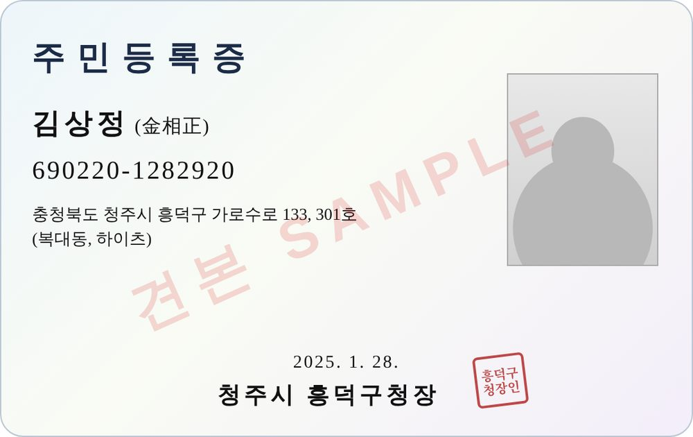</a> <a href="examples/img/account_opening_application_3ed40913.jpg"></a></p>

1. `resident_id_card.png` · 2. `account_opening_application.png`

**질문** (`prompt`)

```
고객이 '개인 계좌개설' 업무를 위해 제출한 서류입니다 (이미지 2장).
'주민등록증'의 주민등록번호로 보아, '예금거래신청서'의 신청일 당일 고객의 만 나이는 몇 세입니까? (숫자만 답하세요)
```

**정답** (`answer`)

```json
57
```

**채점 정보** (`eval`)

```json
{"answer_type": "number", "tol": 0}
```

**나눠 보기 정보** (`meta`)

```json
{
 "scenario": "account_opening",
 "task_name": "개인 계좌개설",
 "bundle": "account_opening_2000000",
 "customer": "김상정",
 "rule": "age",
 "skill": "날짜 계산"
}
```

**문항 한 줄 전체** (`tasks/review.jsonl`)

<details><summary>펼치기</summary>

```json
{
 "id": "review/account_opening_2000000/age",
 "task": "review",
 "images": [
  "images/bundles/account_opening_2000000/resident_id_card.png",
  "images/bundles/account_opening_2000000/account_opening_application.png"
 ],
 "prompt": "고객이 '개인 계좌개설' 업무를 위해 제출한 서류입니다 (이미지 2장).\n'주민등록증'의 주민등록번호로 보아, '예금거래신청서'의 신청일 당일 고객의 만 나이는 몇 세입니까? (숫자만 답하세요)",
 "answer": 57,
 "eval": {"answer_type": "number", "tol": 0},
 "meta": {
  "scenario": "account_opening",
  "task_name": "개인 계좌개설",
  "bundle": "account_opening_2000000",
  "customer": "김상정",
  "rule": "age",
  "skill": "날짜 계산"
 }
}
```
</details>

**학습 레코드** (`swift/all.jsonl` 한 줄: 같은 문항을 질문 + 정답 답변 대화로 바꾼 것)

```json
{
 "id": "review/account_opening_2000000/age",
 "task": "review",
 "images": [
  "images/bundles/account_opening_2000000/resident_id_card.png",
  "images/bundles/account_opening_2000000/account_opening_application.png"
 ],
 "messages": [
  {
   "role": "user",
   "content": "<image><image>고객이 '개인 계좌개설' 업무를 위해 제출한 서류입니다 (이미지 2장).\n'주민등록증'의 주민등록번호로 보아, '예금거래신청서'의 신청일 당일 고객의 만 나이는 몇 세입니까? (숫자만 답하세요)"
  },
  {"role": "assistant", "content": "57"}
 ]
}
```

### 4-6. tenure (날짜 계산)

**입력 이미지** (1장, 질문 앞에 이 순서로)

<p><a href="examples/img/loan_application_88fc6342.jpg"></a></p>

1. `loan_application.jpg`

**질문** (`prompt`)

```
고객이 '개인 신용대출' 업무를 위해 제출한 서류입니다 (이미지 1장).
'대출거래신청서'에 적힌 입사일과 신청일로 보아, 신청일 현재 재직기간은 만 몇 년입니까? (만 1년 미만은 버리고 숫자만 답하세요)
```

**정답** (`answer`)

```json
4
```

**채점 정보** (`eval`)

```json
{"answer_type": "number", "tol": 0}
```

**나눠 보기 정보** (`meta`)

```json
{
 "scenario": "personal_credit_loan",
 "task_name": "개인 신용대출",
 "bundle": "personal_credit_loan_2001000",
 "customer": "강서찬",
 "rule": "tenure",
 "skill": "날짜 계산"
}
```

**문항 한 줄 전체** (`tasks/review.jsonl`)

<details><summary>펼치기</summary>

```json
{
 "id": "review/personal_credit_loan_2001000/tenure",
 "task": "review",
 "images": ["images/bundles/personal_credit_loan_2001000/loan_application.jpg"],
 "prompt": "고객이 '개인 신용대출' 업무를 위해 제출한 서류입니다 (이미지 1장).\n'대출거래신청서'에 적힌 입사일과 신청일로 보아, 신청일 현재 재직기간은 만 몇 년입니까? (만 1년 미만은 버리고 숫자만 답하세요)",
 "answer": 4,
 "eval": {"answer_type": "number", "tol": 0},
 "meta": {
  "scenario": "personal_credit_loan",
  "task_name": "개인 신용대출",
  "bundle": "personal_credit_loan_2001000",
  "customer": "강서찬",
  "rule": "tenure",
  "skill": "날짜 계산"
 }
}
```
</details>

**학습 레코드** (`swift/all.jsonl` 한 줄: 같은 문항을 질문 + 정답 답변 대화로 바꾼 것)

```json
{
 "id": "review/personal_credit_loan_2001000/tenure",
 "task": "review",
 "images": ["images/bundles/personal_credit_loan_2001000/loan_application.jpg"],
 "messages": [
  {
   "role": "user",
   "content": "<image>고객이 '개인 신용대출' 업무를 위해 제출한 서류입니다 (이미지 1장).\n'대출거래신청서'에 적힌 입사일과 신청일로 보아, 신청일 현재 재직기간은 만 몇 년입니까? (만 1년 미만은 버리고 숫자만 답하세요)"
  },
  {"role": "assistant", "content": "4"}
 ]
}
```

### 4-7. net_pay (계산(합계))

**입력 이미지** (2장, 질문 앞에 이 순서로)

<p><a href="examples/img/pay_stub_p1_5398461e.jpg"></a> <a href="examples/img/pay_stub_p2_2d3c610a.jpg"></a></p>

1. `pay_stub_p1.png` · 2. `pay_stub_p2.png`

**질문** (`prompt`)

```
고객이 '개인 신용대출' 업무를 위해 제출한 서류입니다 (이미지 2장).
'급여명세서'의 지급액계에서 공제액계를 빼면 얼마입니까? (원 단위 숫자만 답하세요)
```

**정답** (`answer`)

```json
5879250
```

**채점 정보** (`eval`)

```json
{"answer_type": "number", "tol": 0}
```

**나눠 보기 정보** (`meta`)

```json
{
 "scenario": "personal_credit_loan",
 "task_name": "개인 신용대출",
 "bundle": "personal_credit_loan_2001000",
 "customer": "강서찬",
 "rule": "net_pay",
 "skill": "계산(합계)"
}
```

**문항 한 줄 전체** (`tasks/review.jsonl`)

<details><summary>펼치기</summary>

```json
{
 "id": "review/personal_credit_loan_2001000/net_pay",
 "task": "review",
 "images": [
  "images/bundles/personal_credit_loan_2001000/pay_stub_p1.png",
  "images/bundles/personal_credit_loan_2001000/pay_stub_p2.png"
 ],
 "prompt": "고객이 '개인 신용대출' 업무를 위해 제출한 서류입니다 (이미지 2장).\n'급여명세서'의 지급액계에서 공제액계를 빼면 얼마입니까? (원 단위 숫자만 답하세요)",
 "answer": 5879250,
 "eval": {"answer_type": "number", "tol": 0},
 "meta": {
  "scenario": "personal_credit_loan",
  "task_name": "개인 신용대출",
  "bundle": "personal_credit_loan_2001000",
  "customer": "강서찬",
  "rule": "net_pay",
  "skill": "계산(합계)"
 }
}
```
</details>

**학습 레코드** (`swift/all.jsonl` 한 줄: 같은 문항을 질문 + 정답 답변 대화로 바꾼 것)

```json
{
 "id": "review/personal_credit_loan_2001000/net_pay",
 "task": "review",
 "images": [
  "images/bundles/personal_credit_loan_2001000/pay_stub_p1.png",
  "images/bundles/personal_credit_loan_2001000/pay_stub_p2.png"
 ],
 "messages": [
  {
   "role": "user",
   "content": "<image><image>고객이 '개인 신용대출' 업무를 위해 제출한 서류입니다 (이미지 2장).\n'급여명세서'의 지급액계에서 공제액계를 빼면 얼마입니까? (원 단위 숫자만 답하세요)"
  },
  {"role": "assistant", "content": "5879250"}
 ]
}
```

### 4-8. sales_rest (계산(합계))

**입력 이미지** (1장, 질문 앞에 이 순서로)

<p><a href="examples/img/sales_contract_bf738685.jpg"></a></p>

1. `sales_contract.jpg`

**질문** (`prompt`)

```
고객이 '주택담보대출' 업무를 위해 제출한 서류입니다 (이미지 1장).
'부동산 매매계약서'의 매매대금에서 계약금과 중도금(없으면 0)을 빼면 얼마입니까? (원 단위 숫자만 답하세요)
```

**정답** (`answer`)

```json
738000000
```

**채점 정보** (`eval`)

```json
{"answer_type": "number", "tol": 0}
```

**나눠 보기 정보** (`meta`)

```json
{
 "scenario": "mortgage",
 "task_name": "주택담보대출",
 "bundle": "mortgage_2002000",
 "customer": "엄태정",
 "rule": "sales_rest",
 "skill": "계산(합계)"
}
```

**문항 한 줄 전체** (`tasks/review.jsonl`)

<details><summary>펼치기</summary>

```json
{
 "id": "review/mortgage_2002000/sales_rest",
 "task": "review",
 "images": ["images/bundles/mortgage_2002000/sales_contract.jpg"],
 "prompt": "고객이 '주택담보대출' 업무를 위해 제출한 서류입니다 (이미지 1장).\n'부동산 매매계약서'의 매매대금에서 계약금과 중도금(없으면 0)을 빼면 얼마입니까? (원 단위 숫자만 답하세요)",
 "answer": 738000000,
 "eval": {"answer_type": "number", "tol": 0},
 "meta": {
  "scenario": "mortgage",
  "task_name": "주택담보대출",
  "bundle": "mortgage_2002000",
  "customer": "엄태정",
  "rule": "sales_rest",
  "skill": "계산(합계)"
 }
}
```
</details>

**학습 레코드** (`swift/all.jsonl` 한 줄: 같은 문항을 질문 + 정답 답변 대화로 바꾼 것)

```json
{
 "id": "review/mortgage_2002000/sales_rest",
 "task": "review",
 "images": ["images/bundles/mortgage_2002000/sales_contract.jpg"],
 "messages": [
  {
   "role": "user",
   "content": "<image>고객이 '주택담보대출' 업무를 위해 제출한 서류입니다 (이미지 1장).\n'부동산 매매계약서'의 매매대금에서 계약금과 중도금(없으면 0)을 빼면 얼마입니까? (원 단위 숫자만 답하세요)"
  },
  {"role": "assistant", "content": "738000000"}
 ]
}
```

### 4-9. invoice_sum (표 계산)

**입력 이미지** (1장, 질문 앞에 이 순서로)

<p><a href="examples/img/commercial_invoice_564bb4a1.jpg"></a></p>

1. `commercial_invoice.jpg`

**질문** (`prompt`)

```
고객이 '해외송금' 업무를 위해 제출한 서류입니다 (이미지 1장).
'상업송장(Commercial Invoice)'의 품목별 금액(Amount)을 모두 더하면 얼마입니까? (통화 기호 없이 숫자만 답하세요)
```

**정답** (`answer`)

```json
56317.98
```

**채점 정보** (`eval`)

```json
{"answer_type": "number", "tol": 0.01}
```

**나눠 보기 정보** (`meta`)

```json
{
 "scenario": "fx_remittance",
 "task_name": "해외송금",
 "bundle": "fx_remittance_2006000",
 "customer": "장수주",
 "rule": "invoice_sum",
 "skill": "표 계산"
}
```

**문항 한 줄 전체** (`tasks/review.jsonl`)

<details><summary>펼치기</summary>

```json
{
 "id": "review/fx_remittance_2006000/invoice_sum",
 "task": "review",
 "images": ["images/bundles/fx_remittance_2006000/commercial_invoice.jpg"],
 "prompt": "고객이 '해외송금' 업무를 위해 제출한 서류입니다 (이미지 1장).\n'상업송장(Commercial Invoice)'의 품목별 금액(Amount)을 모두 더하면 얼마입니까? (통화 기호 없이 숫자만 답하세요)",
 "answer": 56317.98,
 "eval": {"answer_type": "number", "tol": 0.01},
 "meta": {
  "scenario": "fx_remittance",
  "task_name": "해외송금",
  "bundle": "fx_remittance_2006000",
  "customer": "장수주",
  "rule": "invoice_sum",
  "skill": "표 계산"
 }
}
```
</details>

**학습 레코드** (`swift/all.jsonl` 한 줄: 같은 문항을 질문 + 정답 답변 대화로 바꾼 것)

```json
{
 "id": "review/fx_remittance_2006000/invoice_sum",
 "task": "review",
 "images": ["images/bundles/fx_remittance_2006000/commercial_invoice.jpg"],
 "messages": [
  {
   "role": "user",
   "content": "<image>고객이 '해외송금' 업무를 위해 제출한 서류입니다 (이미지 1장).\n'상업송장(Commercial Invoice)'의 품목별 금액(Amount)을 모두 더하면 얼마입니까? (통화 기호 없이 숫자만 답하세요)"
  },
  {"role": "assistant", "content": "56317.98"}
 ]
}
```

### 4-10. tuition_due (계산(합계))

**입력 이미지** (1장, 질문 앞에 이 순서로)

<p><a href="examples/img/tuition_invoice_9c987358.jpg"></a></p>

1. `tuition_invoice.png`

**질문** (`prompt`)

```
고객이 '유학생 송금' 업무를 위해 제출한 서류입니다 (이미지 1장).
'학비 청구서(Tuition Invoice)'에서 Previous Balance + New Charges - Payments/Credits 는 얼마입니까? (통화 기호 없이 숫자만 답하세요)
```

**정답** (`answer`)

```json
35380.0
```

**채점 정보** (`eval`)

```json
{"answer_type": "number", "tol": 0.01}
```

**나눠 보기 정보** (`meta`)

```json
{
 "scenario": "study_abroad_remittance",
 "task_name": "유학생 송금",
 "bundle": "study_abroad_remittance_2007000",
 "customer": "박재성",
 "rule": "tuition_due",
 "skill": "계산(합계)"
}
```

**문항 한 줄 전체** (`tasks/review.jsonl`)

<details><summary>펼치기</summary>

```json
{
 "id": "review/study_abroad_remittance_2007000/tuition_due",
 "task": "review",
 "images": ["images/bundles/study_abroad_remittance_2007000/tuition_invoice.png"],
 "prompt": "고객이 '유학생 송금' 업무를 위해 제출한 서류입니다 (이미지 1장).\n'학비 청구서(Tuition Invoice)'에서 Previous Balance + New Charges - Payments/Credits 는 얼마입니까? (통화 기호 없이 숫자만 답하세요)",
 "answer": 35380.0,
 "eval": {"answer_type": "number", "tol": 0.01},
 "meta": {
  "scenario": "study_abroad_remittance",
  "task_name": "유학생 송금",
  "bundle": "study_abroad_remittance_2007000",
  "customer": "박재성",
  "rule": "tuition_due",
  "skill": "계산(합계)"
 }
}
```
</details>

**학습 레코드** (`swift/all.jsonl` 한 줄: 같은 문항을 질문 + 정답 답변 대화로 바꾼 것)

```json
{
 "id": "review/study_abroad_remittance_2007000/tuition_due",
 "task": "review",
 "images": ["images/bundles/study_abroad_remittance_2007000/tuition_invoice.png"],
 "messages": [
  {
   "role": "user",
   "content": "<image>고객이 '유학생 송금' 업무를 위해 제출한 서류입니다 (이미지 1장).\n'학비 청구서(Tuition Invoice)'에서 Previous Balance + New Charges - Payments/Credits 는 얼마입니까? (통화 기호 없이 숫자만 답하세요)"
  },
  {"role": "assistant", "content": "35380.0"}
 ]
}
```

### 4-11. debt_ratio (표 계산)

**입력 이미지** (1장, 질문 앞에 이 순서로)

<p><a href="examples/img/financial_statements_a3657a13.jpg"></a></p>

1. `financial_statements.jpg`

**질문** (`prompt`)

```
고객이 '법인 여신' 업무를 위해 제출한 서류입니다 (이미지 1장).
'재무제표(재무상태표·손익계산서)'의 당기 기준 부채비율(부채총계 ÷ 자본총계 × 100)은 몇 %입니까? (소수 첫째 자리까지 반올림한 숫자만 답하세요)
```

**정답** (`answer`)

```json
178.6
```

**채점 정보** (`eval`)

```json
{"answer_type": "number", "tol": 0.1}
```

**나눠 보기 정보** (`meta`)

```json
{
 "scenario": "corporate_credit",
 "task_name": "법인 여신",
 "bundle": "corporate_credit_2005000",
 "customer": "석석유",
 "rule": "debt_ratio",
 "skill": "표 계산"
}
```

**문항 한 줄 전체** (`tasks/review.jsonl`)

<details><summary>펼치기</summary>

```json
{
 "id": "review/corporate_credit_2005000/debt_ratio",
 "task": "review",
 "images": ["images/bundles/corporate_credit_2005000/financial_statements.jpg"],
 "prompt": "고객이 '법인 여신' 업무를 위해 제출한 서류입니다 (이미지 1장).\n'재무제표(재무상태표·손익계산서)'의 당기 기준 부채비율(부채총계 ÷ 자본총계 × 100)은 몇 %입니까? (소수 첫째 자리까지 반올림한 숫자만 답하세요)",
 "answer": 178.6,
 "eval": {"answer_type": "number", "tol": 0.1},
 "meta": {
  "scenario": "corporate_credit",
  "task_name": "법인 여신",
  "bundle": "corporate_credit_2005000",
  "customer": "석석유",
  "rule": "debt_ratio",
  "skill": "표 계산"
 }
}
```
</details>

**학습 레코드** (`swift/all.jsonl` 한 줄: 같은 문항을 질문 + 정답 답변 대화로 바꾼 것)

```json
{
 "id": "review/corporate_credit_2005000/debt_ratio",
 "task": "review",
 "images": ["images/bundles/corporate_credit_2005000/financial_statements.jpg"],
 "messages": [
  {
   "role": "user",
   "content": "<image>고객이 '법인 여신' 업무를 위해 제출한 서류입니다 (이미지 1장).\n'재무제표(재무상태표·손익계산서)'의 당기 기준 부채비율(부채총계 ÷ 자본총계 × 100)은 몇 %입니까? (소수 첫째 자리까지 반올림한 숫자만 답하세요)"
  },
  {"role": "assistant", "content": "178.6"}
 ]
}
```

### 4-12. doc_valid (날짜 계산)

**입력 이미지** (2장, 질문 앞에 이 순서로)

<p><a href="examples/img/employment_certificate_aged_87afd9da.jpg"></a> <a href="examples/img/account_opening_application_3ed40913.jpg"></a></p>

1. `employment_certificate_aged.jpg` · 2. `account_opening_application.png`

**질문** (`prompt`)

```
고객이 '개인 계좌개설' 업무를 위해 제출한 서류입니다 (이미지 2장).
은행은 제출 서류가 업무 신청일 기준 발급 후 90일 이내여야 받습니다. '재직증명서'의 발급일부터 '예금거래신청서'의 신청일까지 90일 이내입니까? ('예' 또는 '아니오'로만 답하세요)
```

**정답** (`answer`)

```
아니오
```

**채점 정보** (`eval`)

```json
{"answer_type": "yesno", "tol": 0, "days": 166}
```

**나눠 보기 정보** (`meta`)

```json
{
 "scenario": "account_opening",
 "task_name": "개인 계좌개설",
 "bundle": "account_opening_2000000",
 "customer": "김상정",
 "rule": "doc_valid",
 "skill": "날짜 계산"
}
```

**문항 한 줄 전체** (`tasks/review.jsonl`)

<details><summary>펼치기</summary>

```json
{
 "id": "review/account_opening_2000000/doc_valid",
 "task": "review",
 "images": [
  "images/bundles/account_opening_2000000/employment_certificate_aged.jpg",
  "images/bundles/account_opening_2000000/account_opening_application.png"
 ],
 "prompt": "고객이 '개인 계좌개설' 업무를 위해 제출한 서류입니다 (이미지 2장).\n은행은 제출 서류가 업무 신청일 기준 발급 후 90일 이내여야 받습니다. '재직증명서'의 발급일부터 '예금거래신청서'의 신청일까지 90일 이내입니까? ('예' 또는 '아니오'로만 답하세요)",
 "answer": "아니오",
 "eval": {"answer_type": "yesno", "tol": 0, "days": 166},
 "meta": {
  "scenario": "account_opening",
  "task_name": "개인 계좌개설",
  "bundle": "account_opening_2000000",
  "customer": "김상정",
  "rule": "doc_valid",
  "skill": "날짜 계산"
 }
}
```
</details>

**학습 레코드** (`swift/all.jsonl` 한 줄: 같은 문항을 질문 + 정답 답변 대화로 바꾼 것)

```json
{
 "id": "review/account_opening_2000000/doc_valid",
 "task": "review",
 "images": [
  "images/bundles/account_opening_2000000/employment_certificate_aged.jpg",
  "images/bundles/account_opening_2000000/account_opening_application.png"
 ],
 "messages": [
  {
   "role": "user",
   "content": "<image><image>고객이 '개인 계좌개설' 업무를 위해 제출한 서류입니다 (이미지 2장).\n은행은 제출 서류가 업무 신청일 기준 발급 후 90일 이내여야 받습니다. '재직증명서'의 발급일부터 '예금거래신청서'의 신청일까지 90일 이내입니까? ('예' 또는 '아니오'로만 답하세요)"
  },
  {"role": "assistant", "content": "아니오"}
 ]
}
```

### 4-13. case:other_person (서류 대조)

**입력 이미지** (2장, 질문 앞에 이 순서로)

<p><a href="examples/img/employment_certificate_8090058a.jpg"></a> <a href="examples/img/account_opening_application_3ed40913.jpg"></a></p>

1. `employment_certificate.jpg` · 2. `account_opening_application.png`

**질문** (`prompt`)

```
고객이 '개인 계좌개설' 업무를 위해 제출한 서류입니다 (이미지 2장).
'재직증명서'의 본인(명의자) 성명이 '예금거래신청서'의 고객 성명과 같습니까? ('예' 또는 '아니오'로만 답하세요)
```

**정답** (`answer`)

```
예
```

**채점 정보** (`eval`)

```json
{"answer_type": "yesno", "tol": 0}
```

**나눠 보기 정보** (`meta`)

```json
{
 "scenario": "account_opening",
 "task_name": "개인 계좌개설",
 "bundle": "account_opening_2000000",
 "customer": "김상정",
 "case": "other_person",
 "category": "other_person",
 "perturbed": false,
 "n_docs": 2,
 "rule": "case:other_person",
 "skill": "서류 대조"
}
```

**문항 한 줄 전체** (`tasks/review.jsonl`)

<details><summary>펼치기</summary>

```json
{
 "id": "review/account_opening_2000000/case_other_person",
 "task": "review",
 "images": [
  "images/bundles/account_opening_2000000/employment_certificate.jpg",
  "images/bundles/account_opening_2000000/account_opening_application.png"
 ],
 "prompt": "고객이 '개인 계좌개설' 업무를 위해 제출한 서류입니다 (이미지 2장).\n'재직증명서'의 본인(명의자) 성명이 '예금거래신청서'의 고객 성명과 같습니까? ('예' 또는 '아니오'로만 답하세요)",
 "answer": "예",
 "eval": {"answer_type": "yesno", "tol": 0},
 "meta": {
  "scenario": "account_opening",
  "task_name": "개인 계좌개설",
  "bundle": "account_opening_2000000",
  "customer": "김상정",
  "case": "other_person",
  "category": "other_person",
  "perturbed": false,
  "n_docs": 2,
  "rule": "case:other_person",
  "skill": "서류 대조"
 }
}
```
</details>

**학습 레코드** (`swift/all.jsonl` 한 줄: 같은 문항을 질문 + 정답 답변 대화로 바꾼 것)

```json
{
 "id": "review/account_opening_2000000/case_other_person",
 "task": "review",
 "images": [
  "images/bundles/account_opening_2000000/employment_certificate.jpg",
  "images/bundles/account_opening_2000000/account_opening_application.png"
 ],
 "messages": [
  {
   "role": "user",
   "content": "<image><image>고객이 '개인 계좌개설' 업무를 위해 제출한 서류입니다 (이미지 2장).\n'재직증명서'의 본인(명의자) 성명이 '예금거래신청서'의 고객 성명과 같습니까? ('예' 또는 '아니오'로만 답하세요)"
  },
  {"role": "assistant", "content": "예"}
 ]
}
```

### 4-14. case:loan_vs_agreement (서류 대조)

**입력 이미지** (2장, 질문 앞에 이 순서로)

<p><a href="examples/img/loan_application_88fc6342.jpg"></a> <a href="examples/img/credit_agreement_loan_vs_agreement_29d778ad.jpg"></a></p>

1. `loan_application.jpg` · 2. `credit_agreement_loan_vs_agreement.jpg`

**질문** (`prompt`)

```
고객이 '개인 신용대출' 업무를 위해 제출한 서류입니다 (이미지 2장).
'대출거래신청서'의 대출신청금액과 '대출거래약정서(가계용)'의 대출(한도)금액이 같습니까? ('예' 또는 '아니오'로만 답하세요)
```

**정답** (`answer`)

```
아니오
```

**채점 정보** (`eval`)

```json
{"answer_type": "yesno", "tol": 0}
```

**나눠 보기 정보** (`meta`)

```json
{
 "scenario": "personal_credit_loan",
 "task_name": "개인 신용대출",
 "bundle": "personal_credit_loan_2001000",
 "customer": "강서찬",
 "case": "loan_vs_agreement",
 "category": "amount",
 "perturbed": true,
 "n_docs": 2,
 "rule": "case:loan_vs_agreement",
 "skill": "서류 대조"
}
```

**문항 한 줄 전체** (`tasks/review.jsonl`)

<details><summary>펼치기</summary>

```json
{
 "id": "review/personal_credit_loan_2001000/case_loan_vs_agreement",
 "task": "review",
 "images": [
  "images/bundles/personal_credit_loan_2001000/loan_application.jpg",
  "images/bundles/personal_credit_loan_2001000/credit_agreement_loan_vs_agreement.jpg"
 ],
 "prompt": "고객이 '개인 신용대출' 업무를 위해 제출한 서류입니다 (이미지 2장).\n'대출거래신청서'의 대출신청금액과 '대출거래약정서(가계용)'의 대출(한도)금액이 같습니까? ('예' 또는 '아니오'로만 답하세요)",
 "answer": "아니오",
 "eval": {"answer_type": "yesno", "tol": 0},
 "meta": {
  "scenario": "personal_credit_loan",
  "task_name": "개인 신용대출",
  "bundle": "personal_credit_loan_2001000",
  "customer": "강서찬",
  "case": "loan_vs_agreement",
  "category": "amount",
  "perturbed": true,
  "n_docs": 2,
  "rule": "case:loan_vs_agreement",
  "skill": "서류 대조"
 }
}
```
</details>

**학습 레코드** (`swift/all.jsonl` 한 줄: 같은 문항을 질문 + 정답 답변 대화로 바꾼 것)

```json
{
 "id": "review/personal_credit_loan_2001000/case_loan_vs_agreement",
 "task": "review",
 "images": [
  "images/bundles/personal_credit_loan_2001000/loan_application.jpg",
  "images/bundles/personal_credit_loan_2001000/credit_agreement_loan_vs_agreement.jpg"
 ],
 "messages": [
  {
   "role": "user",
   "content": "<image><image>고객이 '개인 신용대출' 업무를 위해 제출한 서류입니다 (이미지 2장).\n'대출거래신청서'의 대출신청금액과 '대출거래약정서(가계용)'의 대출(한도)금액이 같습니까? ('예' 또는 '아니오'로만 답하세요)"
  },
  {"role": "assistant", "content": "아니오"}
 ]
}
```

### 4-15. case:income_inflated (서류 대조)

**입력 이미지** (2장, 질문 앞에 이 순서로)

<p><a href="examples/img/income_certificate_acfc99fc.jpg"></a> <a href="examples/img/withholding_receipt_income_inflated_d112844f.jpg"></a></p>

1. `income_certificate.jpg` · 2. `withholding_receipt_income_inflated.png`

**질문** (`prompt`)

```
고객이 '개인 신용대출' 업무를 위해 제출한 서류입니다 (이미지 2장).
'근로소득 원천징수영수증'의 주(현)근무지 급여 합계(계)와 '소득금액증명원'의 2025년 소득금액(과세대상급여액)이 같습니까? ('예' 또는 '아니오'로만 답하세요)
```

**정답** (`answer`)

```
아니오
```

**채점 정보** (`eval`)

```json
{"answer_type": "yesno", "tol": 0}
```

**나눠 보기 정보** (`meta`)

```json
{
 "scenario": "personal_credit_loan",
 "task_name": "개인 신용대출",
 "bundle": "personal_credit_loan_2001000",
 "customer": "강서찬",
 "case": "income_inflated",
 "category": "amount",
 "perturbed": true,
 "n_docs": 2,
 "rule": "case:income_inflated",
 "skill": "서류 대조"
}
```

**문항 한 줄 전체** (`tasks/review.jsonl`)

<details><summary>펼치기</summary>

```json
{
 "id": "review/personal_credit_loan_2001000/case_income_inflated",
 "task": "review",
 "images": [
  "images/bundles/personal_credit_loan_2001000/income_certificate.jpg",
  "images/bundles/personal_credit_loan_2001000/withholding_receipt_income_inflated.png"
 ],
 "prompt": "고객이 '개인 신용대출' 업무를 위해 제출한 서류입니다 (이미지 2장).\n'근로소득 원천징수영수증'의 주(현)근무지 급여 합계(계)와 '소득금액증명원'의 2025년 소득금액(과세대상급여액)이 같습니까? ('예' 또는 '아니오'로만 답하세요)",
 "answer": "아니오",
 "eval": {"answer_type": "yesno", "tol": 0},
 "meta": {
  "scenario": "personal_credit_loan",
  "task_name": "개인 신용대출",
  "bundle": "personal_credit_loan_2001000",
  "customer": "강서찬",
  "case": "income_inflated",
  "category": "amount",
  "perturbed": true,
  "n_docs": 2,
  "rule": "case:income_inflated",
  "skill": "서류 대조"
 }
}
```
</details>

**학습 레코드** (`swift/all.jsonl` 한 줄: 같은 문항을 질문 + 정답 답변 대화로 바꾼 것)

```json
{
 "id": "review/personal_credit_loan_2001000/case_income_inflated",
 "task": "review",
 "images": [
  "images/bundles/personal_credit_loan_2001000/income_certificate.jpg",
  "images/bundles/personal_credit_loan_2001000/withholding_receipt_income_inflated.png"
 ],
 "messages": [
  {
   "role": "user",
   "content": "<image><image>고객이 '개인 신용대출' 업무를 위해 제출한 서류입니다 (이미지 2장).\n'근로소득 원천징수영수증'의 주(현)근무지 급여 합계(계)와 '소득금액증명원'의 2025년 소득금액(과세대상급여액)이 같습니까? ('예' 또는 '아니오'로만 답하세요)"
  },
  {"role": "assistant", "content": "아니오"}
 ]
}
```

### 4-16. case:lease_owner (서류 대조)

**입력 이미지** (2장, 질문 앞에 이 순서로)

<p><a href="examples/img/lease_contract_39a79a48.jpg"></a> <a href="examples/img/real_estate_registry_lease_owner_868611ae.jpg"></a></p>

1. `lease_contract.png` · 2. `real_estate_registry_lease_owner.png`

**질문** (`prompt`)

```
고객이 '전세자금대출' 업무를 위해 제출한 서류입니다 (이미지 2장).
'주택임대차표준계약서'의 임대인이 '등기사항전부증명서(집합건물)'의 현재 소유자와 같은 사람입니까? ('예' 또는 '아니오'로만 답하세요)
```

**정답** (`answer`)

```
아니오
```

**채점 정보** (`eval`)

```json
{"answer_type": "yesno", "tol": 0}
```

**나눠 보기 정보** (`meta`)

```json
{
 "scenario": "jeonse_loan",
 "task_name": "전세자금대출",
 "bundle": "jeonse_loan_2003000",
 "customer": "방하주",
 "case": "lease_owner",
 "category": "logic",
 "perturbed": true,
 "n_docs": 2,
 "rule": "case:lease_owner",
 "skill": "서류 대조"
}
```

**문항 한 줄 전체** (`tasks/review.jsonl`)

<details><summary>펼치기</summary>

```json
{
 "id": "review/jeonse_loan_2003000/case_lease_owner",
 "task": "review",
 "images": [
  "images/bundles/jeonse_loan_2003000/lease_contract.png",
  "images/bundles/jeonse_loan_2003000/real_estate_registry_lease_owner.png"
 ],
 "prompt": "고객이 '전세자금대출' 업무를 위해 제출한 서류입니다 (이미지 2장).\n'주택임대차표준계약서'의 임대인이 '등기사항전부증명서(집합건물)'의 현재 소유자와 같은 사람입니까? ('예' 또는 '아니오'로만 답하세요)",
 "answer": "아니오",
 "eval": {"answer_type": "yesno", "tol": 0},
 "meta": {
  "scenario": "jeonse_loan",
  "task_name": "전세자금대출",
  "bundle": "jeonse_loan_2003000",
  "customer": "방하주",
  "case": "lease_owner",
  "category": "logic",
  "perturbed": true,
  "n_docs": 2,
  "rule": "case:lease_owner",
  "skill": "서류 대조"
 }
}
```
</details>

**학습 레코드** (`swift/all.jsonl` 한 줄: 같은 문항을 질문 + 정답 답변 대화로 바꾼 것)

```json
{
 "id": "review/jeonse_loan_2003000/case_lease_owner",
 "task": "review",
 "images": [
  "images/bundles/jeonse_loan_2003000/lease_contract.png",
  "images/bundles/jeonse_loan_2003000/real_estate_registry_lease_owner.png"
 ],
 "messages": [
  {
   "role": "user",
   "content": "<image><image>고객이 '전세자금대출' 업무를 위해 제출한 서류입니다 (이미지 2장).\n'주택임대차표준계약서'의 임대인이 '등기사항전부증명서(집합건물)'의 현재 소유자와 같은 사람입니까? ('예' 또는 '아니오'로만 답하세요)"
  },
  {"role": "assistant", "content": "아니오"}
 ]
}
```

### 4-17. case:seller_owner (서류 대조)

**입력 이미지** (2장, 질문 앞에 이 순서로)

<p><a href="examples/img/sales_contract_bf738685.jpg"></a> <a href="examples/img/real_estate_registry_adf93d9e.jpg"></a></p>

1. `sales_contract.jpg` · 2. `real_estate_registry.png`

**질문** (`prompt`)

```
고객이 '주택담보대출' 업무를 위해 제출한 서류입니다 (이미지 2장).
'부동산 매매계약서'의 매도인이 '등기사항전부증명서(집합건물)'의 현재 소유자와 같은 사람입니까? ('예' 또는 '아니오'로만 답하세요)
```

**정답** (`answer`)

```
예
```

**채점 정보** (`eval`)

```json
{"answer_type": "yesno", "tol": 0}
```

**나눠 보기 정보** (`meta`)

```json
{
 "scenario": "mortgage",
 "task_name": "주택담보대출",
 "bundle": "mortgage_2002000",
 "customer": "엄태정",
 "case": "seller_owner",
 "category": "logic",
 "perturbed": false,
 "n_docs": 2,
 "rule": "case:seller_owner",
 "skill": "서류 대조"
}
```

**문항 한 줄 전체** (`tasks/review.jsonl`)

<details><summary>펼치기</summary>

```json
{
 "id": "review/mortgage_2002000/case_seller_owner",
 "task": "review",
 "images": [
  "images/bundles/mortgage_2002000/sales_contract.jpg",
  "images/bundles/mortgage_2002000/real_estate_registry.png"
 ],
 "prompt": "고객이 '주택담보대출' 업무를 위해 제출한 서류입니다 (이미지 2장).\n'부동산 매매계약서'의 매도인이 '등기사항전부증명서(집합건물)'의 현재 소유자와 같은 사람입니까? ('예' 또는 '아니오'로만 답하세요)",
 "answer": "예",
 "eval": {"answer_type": "yesno", "tol": 0},
 "meta": {
  "scenario": "mortgage",
  "task_name": "주택담보대출",
  "bundle": "mortgage_2002000",
  "customer": "엄태정",
  "case": "seller_owner",
  "category": "logic",
  "perturbed": false,
  "n_docs": 2,
  "rule": "case:seller_owner",
  "skill": "서류 대조"
 }
}
```
</details>

**학습 레코드** (`swift/all.jsonl` 한 줄: 같은 문항을 질문 + 정답 답변 대화로 바꾼 것)

```json
{
 "id": "review/mortgage_2002000/case_seller_owner",
 "task": "review",
 "images": [
  "images/bundles/mortgage_2002000/sales_contract.jpg",
  "images/bundles/mortgage_2002000/real_estate_registry.png"
 ],
 "messages": [
  {
   "role": "user",
   "content": "<image><image>고객이 '주택담보대출' 업무를 위해 제출한 서류입니다 (이미지 2장).\n'부동산 매매계약서'의 매도인이 '등기사항전부증명서(집합건물)'의 현재 소유자와 같은 사람입니까? ('예' 또는 '아니오'로만 답하세요)"
  },
  {"role": "assistant", "content": "예"}
 ]
}
```

### 4-18. case:hire_date (서류 대조)

**입력 이미지** (2장, 질문 앞에 이 순서로)

<p><a href="examples/img/employment_certificate_0080ffec.jpg"></a> <a href="examples/img/health_insurance_qualification_6d87fa17.jpg"></a></p>

1. `employment_certificate.jpg` · 2. `health_insurance_qualification.png`

**질문** (`prompt`)

```
고객이 '개인 신용대출' 업무를 위해 제출한 서류입니다 (이미지 2장).
'재직증명서'의 입사일(재직기간 시작일)과 '건강보험 자격득실확인서'의 자격취득일이 같습니까? ('예' 또는 '아니오'로만 답하세요)
```

**정답** (`answer`)

```
예
```

**채점 정보** (`eval`)

```json
{"answer_type": "yesno", "tol": 0}
```

**나눠 보기 정보** (`meta`)

```json
{
 "scenario": "personal_credit_loan",
 "task_name": "개인 신용대출",
 "bundle": "personal_credit_loan_2001000",
 "customer": "강서찬",
 "case": "hire_date",
 "category": "logic",
 "perturbed": false,
 "n_docs": 2,
 "rule": "case:hire_date",
 "skill": "서류 대조"
}
```

**문항 한 줄 전체** (`tasks/review.jsonl`)

<details><summary>펼치기</summary>

```json
{
 "id": "review/personal_credit_loan_2001000/case_hire_date",
 "task": "review",
 "images": [
  "images/bundles/personal_credit_loan_2001000/employment_certificate.jpg",
  "images/bundles/personal_credit_loan_2001000/health_insurance_qualification.png"
 ],
 "prompt": "고객이 '개인 신용대출' 업무를 위해 제출한 서류입니다 (이미지 2장).\n'재직증명서'의 입사일(재직기간 시작일)과 '건강보험 자격득실확인서'의 자격취득일이 같습니까? ('예' 또는 '아니오'로만 답하세요)",
 "answer": "예",
 "eval": {"answer_type": "yesno", "tol": 0},
 "meta": {
  "scenario": "personal_credit_loan",
  "task_name": "개인 신용대출",
  "bundle": "personal_credit_loan_2001000",
  "customer": "강서찬",
  "case": "hire_date",
  "category": "logic",
  "perturbed": false,
  "n_docs": 2,
  "rule": "case:hire_date",
  "skill": "서류 대조"
 }
}
```
</details>

**학습 레코드** (`swift/all.jsonl` 한 줄: 같은 문항을 질문 + 정답 답변 대화로 바꾼 것)

```json
{
 "id": "review/personal_credit_loan_2001000/case_hire_date",
 "task": "review",
 "images": [
  "images/bundles/personal_credit_loan_2001000/employment_certificate.jpg",
  "images/bundles/personal_credit_loan_2001000/health_insurance_qualification.png"
 ],
 "messages": [
  {
   "role": "user",
   "content": "<image><image>고객이 '개인 신용대출' 업무를 위해 제출한 서류입니다 (이미지 2장).\n'재직증명서'의 입사일(재직기간 시작일)과 '건강보험 자격득실확인서'의 자격취득일이 같습니까? ('예' 또는 '아니오'로만 답하세요)"
  },
  {"role": "assistant", "content": "예"}
 ]
}
```

### 4-19. case:rep_director (서류 대조)

**입력 이미지** (2장, 질문 앞에 이 순서로)

<p><a href="examples/img/loan_application_corp_cba527a6.jpg"></a> <a href="examples/img/corporate_seal_certificate_5657c41b.jpg"></a></p>

1. `loan_application_corp.jpg` · 2. `corporate_seal_certificate.jpg`

**질문** (`prompt`)

```
고객이 '법인 여신' 업무를 위해 제출한 서류입니다 (이미지 2장).
'법인인감증명서'의 대표자와 '기업여신 신청서'의 대표자가 같은 사람입니까? ('예' 또는 '아니오'로만 답하세요)
```

**정답** (`answer`)

```
예
```

**채점 정보** (`eval`)

```json
{"answer_type": "yesno", "tol": 0}
```

**나눠 보기 정보** (`meta`)

```json
{
 "scenario": "corporate_credit",
 "task_name": "법인 여신",
 "bundle": "corporate_credit_2005000",
 "customer": "석석유",
 "case": "rep_director",
 "category": "logic",
 "perturbed": false,
 "n_docs": 2,
 "rule": "case:rep_director",
 "skill": "서류 대조"
}
```

**문항 한 줄 전체** (`tasks/review.jsonl`)

<details><summary>펼치기</summary>

```json
{
 "id": "review/corporate_credit_2005000/case_rep_director",
 "task": "review",
 "images": [
  "images/bundles/corporate_credit_2005000/loan_application_corp.jpg",
  "images/bundles/corporate_credit_2005000/corporate_seal_certificate.jpg"
 ],
 "prompt": "고객이 '법인 여신' 업무를 위해 제출한 서류입니다 (이미지 2장).\n'법인인감증명서'의 대표자와 '기업여신 신청서'의 대표자가 같은 사람입니까? ('예' 또는 '아니오'로만 답하세요)",
 "answer": "예",
 "eval": {"answer_type": "yesno", "tol": 0},
 "meta": {
  "scenario": "corporate_credit",
  "task_name": "법인 여신",
  "bundle": "corporate_credit_2005000",
  "customer": "석석유",
  "case": "rep_director",
  "category": "logic",
  "perturbed": false,
  "n_docs": 2,
  "rule": "case:rep_director",
  "skill": "서류 대조"
 }
}
```
</details>

**학습 레코드** (`swift/all.jsonl` 한 줄: 같은 문항을 질문 + 정답 답변 대화로 바꾼 것)

```json
{
 "id": "review/corporate_credit_2005000/case_rep_director",
 "task": "review",
 "images": [
  "images/bundles/corporate_credit_2005000/loan_application_corp.jpg",
  "images/bundles/corporate_credit_2005000/corporate_seal_certificate.jpg"
 ],
 "messages": [
  {
   "role": "user",
   "content": "<image><image>고객이 '법인 여신' 업무를 위해 제출한 서류입니다 (이미지 2장).\n'법인인감증명서'의 대표자와 '기업여신 신청서'의 대표자가 같은 사람입니까? ('예' 또는 '아니오'로만 답하세요)"
  },
  {"role": "assistant", "content": "예"}
 ]
}
```

### 4-20. case:contract_before_apply (서류 대조)

**입력 이미지** (2장, 질문 앞에 이 순서로)

<p><a href="examples/img/credit_agreement_86d44845.jpg"></a> <a href="examples/img/loan_application_88fc6342.jpg"></a></p>

1. `credit_agreement.jpg` · 2. `loan_application.jpg`

**질문** (`prompt`)

```
고객이 '개인 신용대출' 업무를 위해 제출한 서류입니다 (이미지 2장).
'대출거래약정서(가계용)'의 약정일이 '대출거래신청서'의 신청일과 같거나 그 이후입니까? ('예' 또는 '아니오'로만 답하세요)
```

**정답** (`answer`)

```
예
```

**채점 정보** (`eval`)

```json
{"answer_type": "yesno", "tol": 0}
```

**나눠 보기 정보** (`meta`)

```json
{
 "scenario": "personal_credit_loan",
 "task_name": "개인 신용대출",
 "bundle": "personal_credit_loan_2001000",
 "customer": "강서찬",
 "case": "contract_before_apply",
 "category": "logic",
 "perturbed": false,
 "n_docs": 2,
 "rule": "case:contract_before_apply",
 "skill": "서류 대조"
}
```

**문항 한 줄 전체** (`tasks/review.jsonl`)

<details><summary>펼치기</summary>

```json
{
 "id": "review/personal_credit_loan_2001000/case_contract_before_apply",
 "task": "review",
 "images": [
  "images/bundles/personal_credit_loan_2001000/credit_agreement.jpg",
  "images/bundles/personal_credit_loan_2001000/loan_application.jpg"
 ],
 "prompt": "고객이 '개인 신용대출' 업무를 위해 제출한 서류입니다 (이미지 2장).\n'대출거래약정서(가계용)'의 약정일이 '대출거래신청서'의 신청일과 같거나 그 이후입니까? ('예' 또는 '아니오'로만 답하세요)",
 "answer": "예",
 "eval": {"answer_type": "yesno", "tol": 0},
 "meta": {
  "scenario": "personal_credit_loan",
  "task_name": "개인 신용대출",
  "bundle": "personal_credit_loan_2001000",
  "customer": "강서찬",
  "case": "contract_before_apply",
  "category": "logic",
  "perturbed": false,
  "n_docs": 2,
  "rule": "case:contract_before_apply",
  "skill": "서류 대조"
 }
}
```
</details>

**학습 레코드** (`swift/all.jsonl` 한 줄: 같은 문항을 질문 + 정답 답변 대화로 바꾼 것)

```json
{
 "id": "review/personal_credit_loan_2001000/case_contract_before_apply",
 "task": "review",
 "images": [
  "images/bundles/personal_credit_loan_2001000/credit_agreement.jpg",
  "images/bundles/personal_credit_loan_2001000/loan_application.jpg"
 ],
 "messages": [
  {
   "role": "user",
   "content": "<image><image>고객이 '개인 신용대출' 업무를 위해 제출한 서류입니다 (이미지 2장).\n'대출거래약정서(가계용)'의 약정일이 '대출거래신청서'의 신청일과 같거나 그 이후입니까? ('예' 또는 '아니오'로만 답하세요)"
  },
  {"role": "assistant", "content": "예"}
 ]
}
```

### 4-21. case:collateral_short (서류 대조)

**입력 이미지** (2장, 질문 앞에 이 순서로)

<p><a href="examples/img/collateral_agreement_b396c277.jpg"></a> <a href="examples/img/credit_agreement_69260e31.jpg"></a></p>

1. `collateral_agreement.png` · 2. `credit_agreement.jpg`

**질문** (`prompt`)

```
고객이 '주택담보대출' 업무를 위해 제출한 서류입니다 (이미지 2장).
'근저당권설정계약서'의 채권최고액이 '대출거래약정서(가계용)'의 대출(한도)금액보다 큽니까? ('예' 또는 '아니오'로만 답하세요)
```

**정답** (`answer`)

```
예
```

**채점 정보** (`eval`)

```json
{"answer_type": "yesno", "tol": 0}
```

**나눠 보기 정보** (`meta`)

```json
{
 "scenario": "mortgage",
 "task_name": "주택담보대출",
 "bundle": "mortgage_2002000",
 "customer": "엄태정",
 "case": "collateral_short",
 "category": "logic",
 "perturbed": false,
 "n_docs": 2,
 "rule": "case:collateral_short",
 "skill": "서류 대조"
}
```

**문항 한 줄 전체** (`tasks/review.jsonl`)

<details><summary>펼치기</summary>

```json
{
 "id": "review/mortgage_2002000/case_collateral_short",
 "task": "review",
 "images": [
  "images/bundles/mortgage_2002000/collateral_agreement.png",
  "images/bundles/mortgage_2002000/credit_agreement.jpg"
 ],
 "prompt": "고객이 '주택담보대출' 업무를 위해 제출한 서류입니다 (이미지 2장).\n'근저당권설정계약서'의 채권최고액이 '대출거래약정서(가계용)'의 대출(한도)금액보다 큽니까? ('예' 또는 '아니오'로만 답하세요)",
 "answer": "예",
 "eval": {"answer_type": "yesno", "tol": 0},
 "meta": {
  "scenario": "mortgage",
  "task_name": "주택담보대출",
  "bundle": "mortgage_2002000",
  "customer": "엄태정",
  "case": "collateral_short",
  "category": "logic",
  "perturbed": false,
  "n_docs": 2,
  "rule": "case:collateral_short",
  "skill": "서류 대조"
 }
}
```
</details>

**학습 레코드** (`swift/all.jsonl` 한 줄: 같은 문항을 질문 + 정답 답변 대화로 바꾼 것)

```json
{
 "id": "review/mortgage_2002000/case_collateral_short",
 "task": "review",
 "images": [
  "images/bundles/mortgage_2002000/collateral_agreement.png",
  "images/bundles/mortgage_2002000/credit_agreement.jpg"
 ],
 "messages": [
  {
   "role": "user",
   "content": "<image><image>고객이 '주택담보대출' 업무를 위해 제출한 서류입니다 (이미지 2장).\n'근저당권설정계약서'의 채권최고액이 '대출거래약정서(가계용)'의 대출(한도)금액보다 큽니까? ('예' 또는 '아니오'로만 답하세요)"
  },
  {"role": "assistant", "content": "예"}
 ]
}
```

### 4-22. case:jeonse_over (서류 대조)

**입력 이미지** (2장, 질문 앞에 이 순서로)

<p><a href="examples/img/lease_contract_39a79a48.jpg"></a> <a href="examples/img/loan_application_9ad08642.jpg"></a></p>

1. `lease_contract.png` · 2. `loan_application.png`

**질문** (`prompt`)

```
고객이 '전세자금대출' 업무를 위해 제출한 서류입니다 (이미지 2장).
'대출거래신청서'의 대출신청금액이 '주택임대차표준계약서'의 보증금 이하입니까? ('예' 또는 '아니오'로만 답하세요)
```

**정답** (`answer`)

```
예
```

**채점 정보** (`eval`)

```json
{"answer_type": "yesno", "tol": 0}
```

**나눠 보기 정보** (`meta`)

```json
{
 "scenario": "jeonse_loan",
 "task_name": "전세자금대출",
 "bundle": "jeonse_loan_2003000",
 "customer": "방하주",
 "case": "jeonse_over",
 "category": "logic",
 "perturbed": false,
 "n_docs": 2,
 "rule": "case:jeonse_over",
 "skill": "서류 대조"
}
```

**문항 한 줄 전체** (`tasks/review.jsonl`)

<details><summary>펼치기</summary>

```json
{
 "id": "review/jeonse_loan_2003000/case_jeonse_over",
 "task": "review",
 "images": [
  "images/bundles/jeonse_loan_2003000/lease_contract.png",
  "images/bundles/jeonse_loan_2003000/loan_application.png"
 ],
 "prompt": "고객이 '전세자금대출' 업무를 위해 제출한 서류입니다 (이미지 2장).\n'대출거래신청서'의 대출신청금액이 '주택임대차표준계약서'의 보증금 이하입니까? ('예' 또는 '아니오'로만 답하세요)",
 "answer": "예",
 "eval": {"answer_type": "yesno", "tol": 0},
 "meta": {
  "scenario": "jeonse_loan",
  "task_name": "전세자금대출",
  "bundle": "jeonse_loan_2003000",
  "customer": "방하주",
  "case": "jeonse_over",
  "category": "logic",
  "perturbed": false,
  "n_docs": 2,
  "rule": "case:jeonse_over",
  "skill": "서류 대조"
 }
}
```
</details>

**학습 레코드** (`swift/all.jsonl` 한 줄: 같은 문항을 질문 + 정답 답변 대화로 바꾼 것)

```json
{
 "id": "review/jeonse_loan_2003000/case_jeonse_over",
 "task": "review",
 "images": [
  "images/bundles/jeonse_loan_2003000/lease_contract.png",
  "images/bundles/jeonse_loan_2003000/loan_application.png"
 ],
 "messages": [
  {
   "role": "user",
   "content": "<image><image>고객이 '전세자금대출' 업무를 위해 제출한 서류입니다 (이미지 2장).\n'대출거래신청서'의 대출신청금액이 '주택임대차표준계약서'의 보증금 이하입니까? ('예' 또는 '아니오'로만 답하세요)"
  },
  {"role": "assistant", "content": "예"}
 ]
}
```

### 4-23. case:sales_sum (서류 대조)

**입력 이미지** (2장, 질문 앞에 이 순서로)

<p><a href="examples/img/sales_contract_sales_sum_be09ea05.jpg"></a> <a href="examples/img/loan_application_e179d459.jpg"></a></p>

1. `sales_contract_sales_sum.jpg` · 2. `loan_application.jpg`

**질문** (`prompt`)

```
고객이 '주택담보대출' 업무를 위해 제출한 서류입니다 (이미지 2장).
'부동산 매매계약서'의 계약금·중도금·잔금을 모두 더한 금액이 매매대금과 같습니까? ('예' 또는 '아니오'로만 답하세요)
```

**정답** (`answer`)

```
아니오
```

**채점 정보** (`eval`)

```json
{"answer_type": "yesno", "tol": 0}
```

**나눠 보기 정보** (`meta`)

```json
{
 "scenario": "mortgage",
 "task_name": "주택담보대출",
 "bundle": "mortgage_2002000",
 "customer": "엄태정",
 "case": "sales_sum",
 "category": "logic",
 "perturbed": true,
 "n_docs": 2,
 "rule": "case:sales_sum",
 "skill": "서류 대조"
}
```

**문항 한 줄 전체** (`tasks/review.jsonl`)

<details><summary>펼치기</summary>

```json
{
 "id": "review/mortgage_2002000/case_sales_sum",
 "task": "review",
 "images": [
  "images/bundles/mortgage_2002000/sales_contract_sales_sum.jpg",
  "images/bundles/mortgage_2002000/loan_application.jpg"
 ],
 "prompt": "고객이 '주택담보대출' 업무를 위해 제출한 서류입니다 (이미지 2장).\n'부동산 매매계약서'의 계약금·중도금·잔금을 모두 더한 금액이 매매대금과 같습니까? ('예' 또는 '아니오'로만 답하세요)",
 "answer": "아니오",
 "eval": {"answer_type": "yesno", "tol": 0},
 "meta": {
  "scenario": "mortgage",
  "task_name": "주택담보대출",
  "bundle": "mortgage_2002000",
  "customer": "엄태정",
  "case": "sales_sum",
  "category": "logic",
  "perturbed": true,
  "n_docs": 2,
  "rule": "case:sales_sum",
  "skill": "서류 대조"
 }
}
```
</details>

**학습 레코드** (`swift/all.jsonl` 한 줄: 같은 문항을 질문 + 정답 답변 대화로 바꾼 것)

```json
{
 "id": "review/mortgage_2002000/case_sales_sum",
 "task": "review",
 "images": [
  "images/bundles/mortgage_2002000/sales_contract_sales_sum.jpg",
  "images/bundles/mortgage_2002000/loan_application.jpg"
 ],
 "messages": [
  {
   "role": "user",
   "content": "<image><image>고객이 '주택담보대출' 업무를 위해 제출한 서류입니다 (이미지 2장).\n'부동산 매매계약서'의 계약금·중도금·잔금을 모두 더한 금액이 매매대금과 같습니까? ('예' 또는 '아니오'로만 답하세요)"
  },
  {"role": "assistant", "content": "아니오"}
 ]
}
```

### 4-24. case:fx_beneficiary (서류 대조)

**입력 이미지** (2장, 질문 앞에 이 순서로)

<p><a href="examples/img/overseas_remittance_application_fx_beneficiary_7ff2e859.jpg"></a> <a href="examples/img/commercial_invoice_564bb4a1.jpg"></a></p>

1. `overseas_remittance_application_fx_beneficiary.jpg` · 2. `commercial_invoice.jpg`

**질문** (`prompt`)

```
고객이 '해외송금' 업무를 위해 제출한 서류입니다 (이미지 2장).
'해외송금신청서'의 수취인이 '상업송장(Commercial Invoice)'의 수출자(Shipper)와 같습니까? ('예' 또는 '아니오'로만 답하세요)
```

**정답** (`answer`)

```
아니오
```

**채점 정보** (`eval`)

```json
{"answer_type": "yesno", "tol": 0}
```

**나눠 보기 정보** (`meta`)

```json
{
 "scenario": "fx_remittance",
 "task_name": "해외송금",
 "bundle": "fx_remittance_2006000",
 "customer": "장수주",
 "case": "fx_beneficiary",
 "category": "logic",
 "perturbed": true,
 "n_docs": 2,
 "rule": "case:fx_beneficiary",
 "skill": "서류 대조"
}
```

**문항 한 줄 전체** (`tasks/review.jsonl`)

<details><summary>펼치기</summary>

```json
{
 "id": "review/fx_remittance_2006000/case_fx_beneficiary",
 "task": "review",
 "images": [
  "images/bundles/fx_remittance_2006000/overseas_remittance_application_fx_beneficiary.jpg",
  "images/bundles/fx_remittance_2006000/commercial_invoice.jpg"
 ],
 "prompt": "고객이 '해외송금' 업무를 위해 제출한 서류입니다 (이미지 2장).\n'해외송금신청서'의 수취인이 '상업송장(Commercial Invoice)'의 수출자(Shipper)와 같습니까? ('예' 또는 '아니오'로만 답하세요)",
 "answer": "아니오",
 "eval": {"answer_type": "yesno", "tol": 0},
 "meta": {
  "scenario": "fx_remittance",
  "task_name": "해외송금",
  "bundle": "fx_remittance_2006000",
  "customer": "장수주",
  "case": "fx_beneficiary",
  "category": "logic",
  "perturbed": true,
  "n_docs": 2,
  "rule": "case:fx_beneficiary",
  "skill": "서류 대조"
 }
}
```
</details>

**학습 레코드** (`swift/all.jsonl` 한 줄: 같은 문항을 질문 + 정답 답변 대화로 바꾼 것)

```json
{
 "id": "review/fx_remittance_2006000/case_fx_beneficiary",
 "task": "review",
 "images": [
  "images/bundles/fx_remittance_2006000/overseas_remittance_application_fx_beneficiary.jpg",
  "images/bundles/fx_remittance_2006000/commercial_invoice.jpg"
 ],
 "messages": [
  {
   "role": "user",
   "content": "<image><image>고객이 '해외송금' 업무를 위해 제출한 서류입니다 (이미지 2장).\n'해외송금신청서'의 수취인이 '상업송장(Commercial Invoice)'의 수출자(Shipper)와 같습니까? ('예' 또는 '아니오'로만 답하세요)"
  },
  {"role": "assistant", "content": "아니오"}
 ]
}
```

## 5부. 비슷한 문제를 새로 정의하려면

| 바꾸고 싶은 것 | 고칠 곳 |
|---|---|
| 질문 문장 | `docgen/bench/prompts.py` (평가·학습·viewer 가 같이 씀. `guide/questions.md` 와 테스트도 같이 고침) |
| 새 서류 대조 사례 | `docgen/bench/cases.py` 의 `CASES` 에 `Case(id, 제목, 분류, 근거, 함수)` 추가. 함수는 원본에서 관계가 맞는지 확인하고, 바꿀 서류·키·값과 짝 서류를 돌려줌 |
| 새 심사 질의 규칙 | `docgen/bench/rules.py` 의 `RULES` 에 함수 추가. `{"question", "answer", "answer_type", "tol", "docs", "skill"}` 를 돌려줌 |
| 업무와 필수 서류 | `docgen/registry.py` 의 `SCENARIOS` |
| 문항 만드는 방식 (빼는 서류 수, 타인 서류 비율 등) | `docgen/bench/build.py` 의 `doc_check`, `cross_checks`, `single` |
| 채점 | `docgen/bench/evaluate.py` (GRPO 보상도 이 코드를 그대로 씀: `bank/bank_task/score.py`) |
| OCR 과제 질문·만드는 방식 | `ocr/bank_ocr/tasks.py` (`PROMPTS`, 과제별 함수), 개수는 `ocr/config.json` 의 `tasks_per_view`, 비율은 `task_mix` |

실제 서류로 같은 형식의 문항을 만들면 코드 수정 없이 파이프라인에 연결됩니다. 위 `2-0` 의 폴더 구조와 필드를 그대로 따르면 됩니다.
